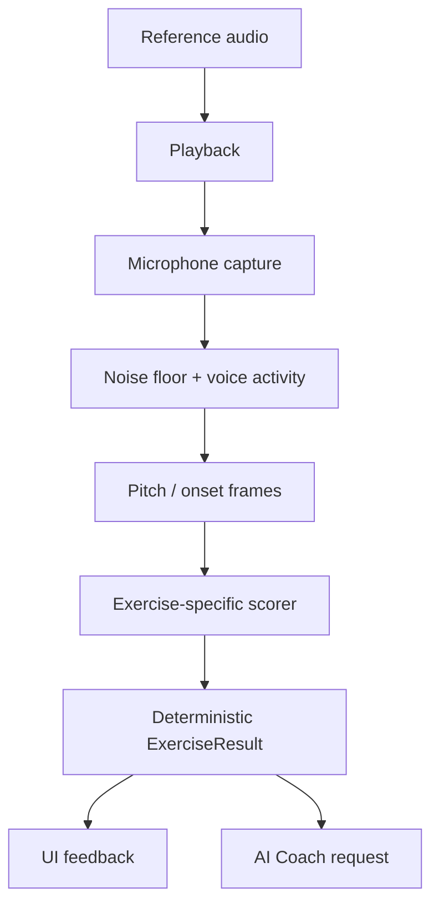

# Resonia — Architecture

## Mimari prensipler

21:40 TRT heartbeat: CAL-03a `LatencyEstimator` pure Dart bounded trial
istatistiği (8–64), explicit source/method/route/rate ve observed shared clock.
`LatencyEstimate` ayrı diagnostic tipidir; LatencyCalibration veya scorer'a
bridge yok. Scheduled playback zamanı, mikrofondaki loopback toplamı ve
dokunma/motor bias birbirinin yerine geçmez. Count-in hâlâ kapalı; CAL-03b
pipeline'a özel fiziksel ölçüm adapter'ı/cihaz raporu ister. [ADR-023](./DECISIONS.md).

2026-10-11 devam paketi: doğrulanan `ExerciseProtocol` yeni `ConfiguredExercise` binding'i üzerinden katalog için hazırdır; legacy demo henüz migrate edilmedi. Sonuç evidence deep snapshot, pitch provenance ve kaynak/analyzer cohort uygulanmıştır. İlk codec mono PCM16 WAV; sentetik tone ve fixture metadata ayrı katmanlardır. Bunlar kayıt adaptörü/frame analyzer değildir. Detay ve devam sınırları: [AUDIO_TESTING.md](./AUDIO_TESTING.md).

Sonraki “şimdi başlat” paketi: `AudioCapture`/`ReferencePlayback`/`AudioLabBackend` domain arayüzleri, application `AudioLabController`, infrastructure `PluginAudioLabBackend` ve ayrı laboratuvar ekranı eklendi. Domain codec'e bağımlı değildir; yalnız `CapturedAudio` metadata taşır. iOS/Android record/player kendi temp dosyalarında çalışır; skor ekranının mock analyzer'ını henüz değiştirmez. Cancel epoch ve serialized resource komutları session yarışlarını kapatır; kesintide yeniden başlamak kullanıcı eylemi gerektirir. Native build/fake test doğrulandı; fiziksel cihaz ve gerçek DSP ayrı kapılardır.

İlk heartbeat: domain `AudioFixture` JSON + `AudioFixtureEntry`/`AudioFixtureManifest` v1; infrastructure read-only `AudioFixtureLoader` (seçilmiş yerel root, hash/header/rate/count/path/bütçe) eklendi. `LoadedAudioFixture` codec PCM'ini taşır; label/consent/hak referansını doğrulanmış saymaz. Sequential fail-fast stream sonuna ulaşılmadan tüm dataset valid sayılmaz. Bu loader canlı kayıt adapter'ı veya pitch analyzer değildir. Domain'e IO/hash/codec bağımlılığı eklenmedi.

08:41 UTC heartbeat: domain `YinPitchFrameAnalyzer` sınırlı senkron PCM penceresinde target-independent Hz/RMS/periodicity ve abstention nedeni verir; `PitchDeviation` ham Hz'yi değiştirmeden signed absolute cents, pitch-class residual ve octave offset hesaplar. Flutter/plugin/IO/AI bağımlılığı yok. Bu çekirdek mevcut `PitchAnalyzer` implementasyonu değil: kayıt frame aggregation, stability/coverage, provenance, isolate ve session/capture bağlantısı bekliyor. Periodicity → insan sesi veya voicedRatio dönüşümü otomatik yapılmaz. UI isolate'ında canlı çağrılmamalı; scorer ve mock ekran bu pakette değişmedi. [ADR-019](./DECISIONS.md).

Kullanıcı devam paketi: domain `RecordingPitchAnalyzer` sabit-config/10 sn bütçeli diagnostic evidence üretir; source caller tarafından explicit (varsayılan unverified), version algoritma+config içerir. Regular half-hop ve end-anchor full windows, per-frame startSample, immutable counts/frame trace; PCM tutulmaz. Lower median observed Hz ve log-frequency population dispersion raw oktavı korur. `RecordingPitchWorker` async domain sınırı, infrastructure `IsolateRecordingPitchWorker` native VM implementasyonu, bounded snapshot ve tek active istek koruması. UI/plugin/IO closure'a taşınmaz. Hard cancel/owner epoch, laboratuvar PCM yükleme ve UI bağlantısı yok. Bu diagnostic model mevcut `PitchAnalyzer` sonucu değildir; periodic ratio otomatik voicedRatio yapılmaz. [ADR-020](./DECISIONS.md).

1. Ses ölçümü AI’ye bırakılmaz; deterministik ve test edilebilir bir motor tarafından yapılır.
2. UI, ses motoru ve backend birbirine doğrudan bağlanmaz.
3. Her egzersizin girdi, ölçüm ve sonuç sözleşmesi bulunur.
4. Offline temel çalışma mümkün olmalıdır.
5. AI sonucu değil, sonucu açıklamayı ve sonraki çalışmayı seçmeyi üstlenir.
6. Ham ses kişisel veri gibi ele alınır; varsayılan olarak gereksiz yere gönderilmez.

2026-10-11 modül envanteri paketi: domain `capture_quality.dart` (`AudioRouteSnapshot`/`RoutePolicy`, `CalibrationStamp`, `NoiseFloorCalibrator`, `CaptureQualityAssessor`, `LatencyCalibration`) saf Dart ve O(n)'dir; IO/plugin bağımlılığı yoktur. Opsiyonel `AudioRouteProbe` yetkinliği infrastructure `audio_route_mapping.dart` ile audio_session cihaz listesinden route çıkarır (API deneysel; yükseltmede yeniden test). `AudioLabController` kalibrasyon kaydını alıp siler, cevap kaydında kalite raporunu worker'dan önce hesaplar. Uygulama kabuğu: `ResoniaApp` → `AppShellController` (application) → `ProfileRepository` (application arayüzü) → `FileProfileRepository`/`JsonFileStore` (infrastructure). Tema token'ları `lib/app/theme/resonia_theme.dart`; sonuç renkleri `ResoniaResultColors` ThemeExtension. Ekranlar `features/onboarding|home|settings`. Karar: ADR-021/022.

## Katmanlar

13:44 UTC diagnostic integration: `AudioRecordingReader` optional domain
capability, immutable `CapturedAudioSamples` explicit origin taşır. Plugin
yalnız kendi tamamlanmış WAV'ını aynı file handle/bounded read/header kontrolüyle
okur (`readLabWav`); decode/snapshot henüz ana isolate'da, performans kapısı açık.
Controller file load'u resource queue'da tutar; native DSP işi queue dışında.
Cancel/background/route/close epoch eski sonucu reddeder; hard cancel yok,
aynı controller eski iş bitmeden yeni analiz başlatmaz. Analysis failure replay
dosyasını silmez. UI PCM-free evidence gösterir, scorer/AI/progress'e göndermez.
Yukarıdaki bağlantısız paket notları tarihsel durumdur; gerçek voice/device QA
kapısı hâlâ geçilmedi.

Son kullanıcı açıklamasıyla ana chord stimulus **prerecorded** oldu. Domain `ChordRecordingCatalog` üç reserved 2/3/4-note klasör/slot'u doğrular; infrastructure `AssetChordRecordingCatalog` yalnız bundled JSON okur; UI `ChordPlaceholderScreen` loading/error/retry ve disabled actions sunar. File/target/rights null; no player/capture/score veya fake assets. Home'dan ayrı route var. Sesler gelince reviewed asset manifest/adapter eklenecek; önceki renderer alternatif olarak korunur.

Piyano referans paketinde domain `PianoChordReference` MIDI/tuning'den tek bilinen hedef kaynağı ve simultaneous `ConfiguredExercise` üretir; infrastructure `PianoNoteSample`/`PianoChordRenderer` explicit mono decoded PCM'i aynı başlangıçta tek WAV'a hazırlar. Asset ID/rights/origin ve actual sample rate korunur; source beyanı lisans veya nota QA değildir. I/O/player/recording başlamaz. Prepared chord player/session ve gerçek bank adapter henüz yok; mevcut lab ve mock scorer değiştirilmedi. [Piyano teknik sınırları](./PIANO_REFERENCES.md).

```text
Flutter UI
  ├─ App shell / navigation
  ├─ Exercise screens
  ├─ Live visual feedback
  └─ Progress and subscription screens

Application layer
  ├─ Exercise session coordinator
  ├─ Adaptive plan service
  ├─ Result presenter
  └─ Entitlement checks

Domain layer
  ├─ Exercise definitions
  ├─ Pitch / rhythm / melody scoring
  ├─ Difficulty model
  ├─ Progress aggregation
  └─ Leaderboard rules

Audio layer
  ├─ Microphone capture
  ├─ Noise-floor calibration
  ├─ Voice activity detection
  ├─ Pitch detection
  ├─ Rhythm onset detection
  └─ Audio playback

Infrastructure
  ├─ Auth and profile API
  ├─ Results database
  ├─ Object storage for opted-in recordings
  ├─ AI gateway
  └─ Analytics / crash reporting
```

## Ses akışı



## `ExerciseResult` sözleşmesi

**Sonuç v2 temeli uygulandı (2026-10-11):** `ScoreMetric` measured/not_measured/not_applicable + nullable value; valid/invalid sonuç, mode/difficulty/content/scoring sürümü mevcut. Tek ses scorer ve ekran yeni modeli kullanır. JSON şekli v1'den farklıdır; henüz backend/persistence olmadığı için canlı veri migration yapılmadı. Gelecek okuyucular schemaVersion 2'yi açıkça desteklemeli; v1 sayısal alanlar sessizce measured kabul edilmemeli.

```json
{
  "schemaVersion": 2,
  "sessionId": "string",
  "exerciseId": "string",
  "skill": "pitch|interval|chord|rhythm|melody|range",
  "measurementStatus": "valid|invalid",
  "exerciseMode": "learning|recall_exam|sight_reading|choir_practice",
  "difficulty": 1,
  "contentVersion": "string",
  "scoringVersion": "2",
  "target": {},
  "measurements": {},
  "scores": {
    "overall": { "status": "measured", "value": 87.6 },
    "accuracy": { "status": "measured", "value": 90 },
    "timing": { "status": "not_applicable", "value": null },
    "stability": { "status": "measured", "value": 84 },
    "memory": { "status": "not_applicable", "value": null }
  },
  "errors": [
    {
      "type": "wrong_note|wrong_octave|late|early|unstable|missing_voice|noise|invalid_signal",
      "severity": "low|medium|high",
      "evidence": {}
    }
  ],
  "createdAt": "ISO-8601"
}
```

## Pitch motoru

İlk sürümde:

- Hedef frekansa göre pencere boyutu.
- Overlap’li frame analizi.
- Voice activity ve noise-floor filtresi.
- Median veya trimmed mean pitch.
- Cents farkı.
- Doğru oktav kontrolü.
- Stability ve voiced ratio.

Başarı kararı için oktav toleransı gizlice uygulanmamalıdır. Bir oktav hata, “yakınlık” olarak raporlanabilir ancak ses aralığı testinde doğru başarı sayılmamalıdır.

### Çok sesli sınav ve canlı görsel genişlemesi (2026-10-10)

2/3/4 sesli referans birlikte çalınır, kullanıcı ayrı ayrı söyler. Bilinen referans nota listesi + monofonik frame motoru + nota segmentleri + sıra/set eşleştirmesi kullanılır. Eşzamanlı mikrofon multipitch ayrı bir analyzer ve AR-GE kapısıdır; mevcut `PitchAnalyzer`'a tek frequency alanında saklanmaz.

`VisualFeedbackFrame` ölçümden UI'ya tek yönlü gider: phase, enerji, signed cents, confidence, aktif nota ve tamamlanan segmentler. Görsel smoothing skoru değiştirmez. Dinle-hatırla sınavında playback ve mic response fazları ayrılır. V2 skor geçişi model/scorer/ekranda yapıldı; gerçek frame/capture ve görsel pipeline henüz yok.

Sözleşmeler, benchmark ve iş sırası: [AUDIO_ENGINE_PLAN.md](./AUDIO_ENGINE_PLAN.md).

### Koro çalışması için ayrı audio policy

`choir_practice` modunda diğer parti track'leri kulaklıktan sürerken yalnız öğrencinin tek vokali mikrofondan alınabilir. Bu mod recall exam'den farklıdır; overlap yasağı bütün modlara yayılmaz. Rehber track gain/mute, playback timeline, kendi parti hedef event'leri ve latency kaydedilir. Hoparlör/bleed başarı sayılmamalı; cihaz fixture'ı ve kalite kontrolü gerekir. İlk sürüm ensemble multipitch ayrıştırma veya otomatik blend/tını/nefes tekniği skorlaması yapmaz.

Uygulama (ADR-036): `lib/choir/midi/part_renderer.dart` parti miksini tek saatte üretir, `lib/choir/audio/plugin_take_engine.dart` kaydı başlatıp eşliği aynı anda çalar, `take_controller.dart` + `wav_io.dart` sesi eşlikle birleştirir. `RouteAdvice.speaker` eşlikli kaydı kapatır.

## Müfredat ve öğrenme kanıtı — önerilen

`ExerciseDefinition` v2: referans nota/onset listesi, tuning bağlamı, tempo/ölçü, referans tekrar sayısı, gecikme, yanıt sıra/set kuralı, ipucu/mod, transpozisyon kuralı ve içerik sürümü. `SkillNode` önkoşul/öğrenme amacını; `MasteryEvidence` geçerli metrik örnekleri, algı/üretim, zorluk, destek, yeni soru ve gecikmeli kontrolü taşır.

Plan seçimi önce kurallı katalog/prerequisite hizmetinden gelir; AI yalnız uygun adayları açıklar veya sınırlandırılmış seçimi önerir. `SkillProgress` artık geçersiz/ölçülmemiş sonuçları dışlar; metrik başına denominator ve skill/difficulty/mode/content/scoring cohort'u kullanır. Tam mastery, hint/tuning/delay ayrıntıları, repository/dedup ve öğretmen gözlemi henüz yok. [Eğitim modeli](./LEARNING_MODEL.md).

## Ritim motoru

Uygulanan temel: `EventRhythmAnalyzer`, sınırlı kronolojik event listelerini monoton dinamik eşleştirmeyle karşılaştırır: maksimum birebir eşleşme, sonra minimum mutlak sapma. Skor F1 coverage × deadband dışındaki timing fidelity; eksik/fazla vuruşlar ve sapma ayrı. Bağımsız ölçülmüş latency çıkarılır; cevaptan otomatik hizalama yaparak gecikme gizlenmez. Boş referans hata; hiç kullanıcı onset'i yoksa invalid/unmeasured. Bu formül eğitimci kalibrasyonu bekler; mikrofon/clap veya tempo-independent mode henüz yok. Demo mock adapter aynı domain motoruna yönlenir.

- Referans ritim event listesine çevrilir.
- Kullanıcı tap/clap onset’leri çıkarılır.
- İlk vuruş için latency kalibrasyonu yapılır.
- Her onset’in beklenen vuruşa uzaklığı hesaplanır.
- Eksik, fazla, erken ve geç vuruşlar ayrılır.
- Tempo bağımsız ve tempo bağlı skorlar ayrı tutulur.

## AI gateway

Mobil uygulama doğrudan OpenAI API anahtarı taşımaz.

```text
Flutter -> Resonia API -> AI Gateway -> gpt-4o-mini
                                  └-> schema validation
                                  └-> usage limits
                                  └-> prompt versioning
                                  └-> audit log
```

AI gateway’in sorumlulukları:

- Kullanıcı kimliği ve abonelik kontrolü.
- PII azaltma.
- `ExerciseResult` özetleme.
- Prompt versiyonu seçme.
- Structured Output doğrulama.
- Hata durumunda deterministik fallback.
- Kullanım ve maliyet takibi.

V2 sonuç doğrudan eski sayısal AI payload'ına geçirilemez: gelecek özet adapter'ı yalnız `measured` metrikleri gönderir, invalid/unmeasured veriyi açık durum olarak korur. Mevcut AI örnek dokümanı canlı entegrasyon değildir; AI-01/02 uygulamasında payload/eval güncellenmelidir. Bu pakette gateway çağrılmadı.

## Veri varlıkları

```text
User
  ├─ Profile
  ├─ Consent
  ├─ Subscription
  ├─ ExerciseSession
  │    ├─ ExerciseAttempt
  │    └─ ExerciseResult
  ├─ SkillProgress
  ├─ DailyPlan
  └─ CoachMessage
```

Ham kayıtlar `ExerciseAttempt` içine gömülmemeli; ayrı storage kaydı olmalı. Silme talebinde kullanıcıya ait tüm ölçüm ve kayıt ilişkileri birlikte temizlenebilmeli.

## Plus gerçek eğitimci servisi — önerilen, henüz uygulanmadı

```text
Flutter: seçilmiş kayıt + seçilmiş gelişim özeti + paylaşım onayı
  -> Resonia Review API: auth / entitlement / kapasite / hak rezervasyonu
  -> Private RecordingAsset + HumanReviewRequest + queue
  -> Atanmış gerçek eğitimcinin paneli: dinleme + kendi yazdığı yorum
  -> WrittenFeedback + PracticeAssignment
  -> Öğrenci: imzalı yorum / takip / açıklama sorusu
```

Bu akış AI gateway üzerinden geçmez; kayıt AI'ye otomatik gönderilmez. İnsan yorumu otomatik AI metniyle doldurulmaz. Varlıklar: `RecordingAsset`, `HumanReviewRequest`, `ReviewAssignment`, `WrittenFeedback`, `HumanReviewCredit` ledger, `TeacherQualification`, `PracticeAssignment`, amaç bazlı `Consent`/audit. `ExerciseResult` geriye dönük değiştirilmez.

Kabul + hak rezervasyonu atomik/idempotent; teslimde consume, iptal/hizmet sorunu durumunda restore. Payment refund ayrı sağlayıcı olayıdır. Atama bazlı yetki, kısa süreli imzalı kayıt URL'si, erişim revocation, amaç/saklama süresi, kapasite/deadline ve minimal bildirim outbox'ı gerekir. Sınıf rolü bütün Plus kayıtlarına erişmez. Öğrencinin yalnız seçtiği progress snapshot paylaşılır; düşük güvenli veri etiketlenir.

Faz 3 küçük yönetilen pilot; Faz 4 hizmet kapılarından sonra ücretli Plus. Faz 5 tam Teacher paneli bu özelliğin önkoşulu değildir. [Hizmet/operasyon/gizlilik ayrıntıları](./HUMAN_REVIEW.md).

## Test sınırları

- Domain scoring: yüksek kapsamlı unit test.
- Pitch fixture kayıtları: regression test.
- Ritim event matching: property-based test.
- AI JSON schema: contract test.
- Flutter exercise flow: integration test.
- Gerçek mikrofon ve cihaz davranışı: seçilmiş cihaz matrisiyle manual QA.
- Ölçüm geçerliliği: null/status, yanlış oktav/sıra, ekstra ritim, latency ve invalid'in mastery dışında tutulması.
- Öğrenme: içerik/prerequisite contract; yeni soru ve gecikmeli kontrolün ipuçlu çalışmadan ayrımı.
- Koro: diğer partilerle kulaklıklı tek vokal ve bleed regression.
- İnsan hizmeti: rol/atama erişimi, hak rezervasyonu çift istek, upload/queue hatası, iptal/silme/reassignment, teslim/QA ve bildirim idempotency.

## Dağıtım sırası

1. Offline demo.
2. Internal test build.
3. 10 kişilik closed beta.
4. AI kapalı ölçüm beta’sı.
5. AI açık beta.
6. Abonelikli public release.

## CORE-03a — Exact-order symbolic pitch alignment (2026-10-12)

Domain `SequencePitchEvent` already-segmented immutable Hz/onset/duration;
`PitchSequenceAligner` bounded monotonic DP ve `PitchSequenceEvidence` source
ile adım kanıtı. Reference invalid throw; response invalid/no-response nullable
karar. Existing PitchDeviation raw cents/octave kullanılır, hedefe pitch fold
yok. No IO/plugin/AI, no MelodyAnalyzer/scorer bridge. Onset/duration sadece
chronology/budget için; timing/memory skoru üretmez. CORE-03b segmentation ve
gerçek VAD/benchmark sonrasında ürün adapter'ı ayrıca gerekir.

## CORE-03b — Diagnostic recording frame→segment (2026-10-12)

Domain `SegmentationPitchFrame` validasyon sınırı, `PitchSegmenter.fromRecording`
mevcut immutable DSP evidence adapter'ı. Target-independent run anchor, raw
observed lower median; window-center midpoint sınırları sadece diagnostic.
Örtüşen frame süreleri toplanmaz, unknown gap sustain varsayılmaz. Discarded
ve nonPitched indeksleri ayrı audit; source/analyzer version korunur. No IO,
VAD/MelodyAnalyzer/scorer bridge. PCM→DSP→segment→symbolic alignment yalnız
sentetik regresyonda explicit bağlandı; ürün UI başarı akışı değil.

## CORE-04a — Puansız ezgi application session (2026-10-12)

`MelodySessionController` bir private `SingleToneSessionController` sahiplenir:
noise-floor/route/quality gate, cevap penceresi, owned PCM silme ve epoch sonuç
reddi aynı kalır. Tek ses target deviation hesaplaması içeride kullanılmayan
diagnostic'tir; dış sonuç yalnız `PitchSegmenter` adayları, quality/retry ve
reference binding taşır. PitchSequenceAligner/ExerciseResult/history bağlantısı yok.

`MelodyReferenceBackend` explicit reference id/contentVersion/3–5 finite Hz
declaration sağlar; oynatıcı bu referansı çalmalıdır. Source/hak/etiket kabulü
değildir, gerçek adapter henüz yok. Private backend wrapper tüm native command/
read/route çağrılarını seri işler ve error sonrası queue'yu kurtarır. Playback
handle completion ve worker bitişi native kuyruğu tutmaz. Facade old operation
settle olana kadar restart'ı engeller; hard cancel/izin diyaloğu kapatma yok.
Close/deletion pending native işlem bitişini bekleyebilir. Callback sayımı
device-unverified; tek attempt tek reference, ipucu veya recalled memory iddiası yok.

## CORE-04b1 — Bağlı sentetik ezgi audio adapter (2026-10-12)

Infrastructure `SyntheticMelodyBackend` capture (AudioLabBackend + reader) ile
ReferenceClipPlayer'ı birlikte sahiplenir. DiagnosticMelodyReference frequencies
tek kaynak; `renderDiagnosticMelody` bounded 8–48 kHz/fixed 600 ms tones/gaps,
immutable encoded bytes. Reference source açık `synthetic`, capture origin
reader'dan aynen taşınır; iki kaynak birbirine dönüştürülmez. Mobile factory
PluginAudioLabBackend + JustAudioClipPlayer yaratır (lazy native init).

Reference çalma capture.playReference'e delege edilmez; varsayılan C4 fallback
yok. Route capability yoksa unknown/unverified; headphone uydurulmaz. Capture
interruptions forwarded, fiziksel player/focus/route matrisi henüz yapılmadı.
Session controller native serialization/epoch sahibi olmaya devam eder.
Stop finally iki player'ı dener; close ilk hatayı korur, diğer kaynağı yine
kapatır ve tekrar çağrıda aynı future döner. UI/home bağlantısı yok; score/
sequence/AI/history entegrasyonu yok. Reference WAV sonlanması cihazın duyulma
zamanı veya yanıt onset doğrulaması değildir.

## CORE-04b2 — Ezgi UI (2026-10-12)

MelodySessionScreen private controller sahiplenir; default synthetic-1 üç ton
(C4/E4/G4), SyntheticMelodyBackend.mobile + native worker. Girişte native init/
izin/kayıt yok. ListenableBuilder phase/outcome okur; source/Hz candidates
isteğe bağlı detail. Kesin nota/sıra/hafıza/başarı veya VAD/onset iddiası yok;
history/skill graph/AI binding yok. Home Deneysel route. Background cancel,
inactive permission istisnası; dispose resource close başlatır. Native cleanup
callback bekleyebilir; hard cancel veya bellek erase garantisi yok. Existing
spacing/typography token'ları kullanılır; fake başarı rengi/animasyonu yok.

## REL-08 — Runtime dışı QA runner (2026-10-13)

tool/quality_check.dart standalone Dart IO; mobil runtime'a import edilmez.
QualityStep/qualityPlan immutable executable+argv; shell string evaluation yok.
executeQualityPlan injected executor test seam, sequential fail-fast; process
stdio miras alınır, root script konumu ve Resonia pubspec guard ile sabit.
Default no-pub/no fetch; explicit --fetch locked pub resolution. Hard timeout,
SDK kurma/upgrade, build/deploy/upload veya hosted CI activation yok. Plan ve
QA code acceptance cihaz/voice/eğitim acceptance'dan ayrıdır.

## LEARN-02a — Domain draft mikroders (2026-10-13)

micro_lesson.dart typed immutable LessonStep/MicroLesson/Catalog; skor veya
Flutter UI bağı yok. LessonPhase tam sıra ve bound text/reference sayıları;
catalog graph skillId→route/dimension tutarlılığını denetler. Identifier
partition training vs independent vs delayed disjoint; aynı waveform farklı
ID ile gizlenirse bu şema bunu bilemez, ileride içerik hash/review gerekir.
awaitsExamples boş slotları görünür tutar. Draft-only educatorApproved=false,
assessmentEnabled=false, gerçek onay pipeline yok; JSON/IO/upload da yok.
draft_micro_lessons.dart iki text draft, no audio/exercise/result bridge.
Lesson reading hiç SkillStatusEvaluator'a aktarılmaz; skor kuralları değişmez.

## LEARN-02b — Salt metin draft reader (2026-10-13)

MicroLessonScreen stateless, yalnız MicroLesson okur. Mic/player/repository/
completion servis dependency yok; beş faz ve pending content/onay etiketi,
disabled practice actions. Identifier bağlı olsa bile bu build practice açmaz.
SkillMapScreen injectable lesson catalog; custom graph için default empty,
standart graph için draftMicroLessons. Route/dimension eşleşen skill dersleri
button ile reader'a gider. History Future ve SkillStatusEvaluator unchanged;
navigation dönüşünde completion result yazılmaz. Mevcut spacing/typography,
scrollable cards/semantic headers; cihaz reader/visual QA ayrı bekliyor.

## LEARN-02c — Draft catalog interchange (2026-10-13)

MicroLessonCodec dart:convert, IO yok. Exact root/lesson/step keys, int schema1,
draft kind/review ve type/enum/budget validation; existing constructor+graph
guard tekrar uygulanır. Catalog tümü kurulmadan prefix verilmez. Text 1MiB
UTF8; decoded list budget pre-traversal. Fresh export maps, immutable restore;
parser error source temizlenir. Standard jsonDecode duplicate keys çözümler;
cryptographic/canonical/hak/etiket/waveform verifier değildir. UI hâlâ typed
draft catalog kullanır; codec kendiliğinden replace/onay/mastery açmaz.

## LEARN-03c — Süreli günlük plan (2026-10-13)

`domain/learning/daily_plan.dart` saf ve deterministik `DailyPlanner`:
5/12/15 dk `DailyBudget`, blok türleri kalıcılık kontrolü → zayıf tekrar →
yeni. Plan yerel gece yarısından önceki sonuçlardan kurulur; bugünkü geçerli
turlar yalnız ilerleme işaretler (kontrolde yalnız retentionCheck turu).
Tekrar kuyruğu 1/3/7/14 gün (geçilmiş later-day kontrol sayısıyla), en çok
gecikmiş önce; bir beceride zayıf seviye varken sonraki seviye yeni sayılmaz;
günde en fazla 1/2 yeni. `MeasuredExercise.draftMinutes` (ritim/tiz-pes 2,
derece 3) geliştirici tahmini. Boş süre doldurulmaz, açıkça gösterilir.
Mastery merdiveni/eşikleri değişmedi; `exercise_launcher.dart` home önerisi
ve plan ekranının ortak egzersiz açıcısı. Bütçe seçimi kalıcı değil (ekran state).

## DATA-03a / LEARN-04a / SHELL-04a — Yerel taşıma, rapor, tercih (2026-10-13)

`application/data_export.dart`: `resonia-local-export` schema 1; profil +
sonuç özetleri, ses yok, exportedAt dakika hassasiyeti. Decode önce bütün
belgeyi doğrular (4 MiB, ≤5000 kayıt, exact root keys, strict profile/result,
yinelenen attempt reddi); hata kodu metni yankılamaz. Import yalnız
`ResultHistoryRepository.record` kurallarıyla (duplicate/conflict korunur),
profil değişmez. UI: Ayarlar → "Verilerini taşı", panoya kopyala/yapıştır;
uygulama hiçbir yere göndermez.
`domain/learning/skill_report.dart`: rota becerileri durum sayıları + ölçülemeyen
(bilinmiyor) sayısı + TodayPlanner ile tek hedef; yüzde yok. Beceri haritası
üstünde rapor kartı.
`application/practice_preferences.dart` + `infrastructure/storage/
file_practice_preferences.dart`: günlük bütçe schema 1; bozuk/eksik → varsayılan,
bozuk dosya kullanıcı yeni seçim yapana dek korunur. AppServices.preferences.

## SHELL-04b — Common status presentation (2026-10-13)

ContentStatusPanel stateless loading/empty/error + caller safe text/onRetry.
History/chord placeholder kullanır; repository/reset/delete/score/network bağı
yok, auto retry yok. History LocalOnlyNotice scoped policy, OS connectivity
probe veya sync değil. Consumer scroll wrapper/narrow layout sahibi; corrupt
dosya ve mevcut Future/store davranışı korunur. Session resume kabulü değil.

## SHELL-04c — Daily plan error ownership (2026-10-14)

DailyPlanScreen shared ContentStatusPanel loading/error/empty; own Future and
budget state preserved, onRetry _reload only. _loadForView immediately observes
future errors with ignore(), returning original future to FutureBuilder; this
closes setState→next frame unhandled-error gap, NOT hiding error from user or
substituting empty plan. Pending view hides stale plan, disposed reload blocked.
No repository clearing/network/score/mastery changes or audio resume.

## SHELL-04d — Skill-map data availability (2026-10-14)

_SkillCard nullable view state means history unavailable, separate from domain
MasteryState.notMeasured. Error shows unavailable chip, no SkillReport/focus;
text draft navigation remains independent of measurement. Shared status panel
manual reload; original Future with eager error observer prevents next-frame
failure gap; mounted guard and late load disposal tests. No state recorded to
history or mastery; no empty result injected to hide repository failure.

## REL-06a — 12TET target metadata guard (2026-10-14)

Pure TargetNoteTuning scientific label→MIDI/frequencyFor(a4) + validate;
ExerciseProtocol her note için çağırır. Decode constructor aynı invariant'i
uygular; legacy const TargetNote/Exercise ve response DSP/scorer aynı kalır.
Absolute0.005000001Hz metadata rounding, no pitch-class/octave fold/student
rubric change. Unicode/solfege/whitespace/unsupported labels explicit reject;
movable-do ayrı algı yanıtı, absolute target label yerine geçmez. Schema1 fields
aynı, validation stricter (ADR-025). Metadata hedefi waveform doğrulamaz.

## UI-01 — A+C tasarım sistemi (2026-10-14)

`app/theme/resonia_theme.dart`: indigo birincil, `ResoniaPalette` (derin
gölge, güneş, mercan, nane, çizgi, soluk metin, dalga renkleri), sonuç
renkleri, `ResoniaMotion` (hareket azaltma), iOS'ta Cupertino geçişleri,
Android'de predictive back. `features/common/ui/resonia_ui.dart`:
ChunkyButton, AnswerOption, FeedbackPanel, DataLabel, StatusPill,
LessonProgressBar, StatTile. Ana kabuk `HomeScreen` alt sekmeli: Bugün (öneri,
günlük plan, beceri yolu `home/skill_path.dart` + `home/home_data.dart`),
Pratik, Gelişim (beceri haritası + rapor), Profil.
Ses görselleri: `common/sound/playback_visual.dart` `VisualizingClipPlayer`
oynatıcıyı sarar ve çalınan WAV'ı çözüp yayınlar; `waveform_playback_view.dart`
zarf çubukları + çalma başı + 8 ms osiloskop çizer, kare saatiyle klip süresi
kadar çalışır. `input_level_meter.dart` kayıt şeridi yalnız gerçek seviye
olayı geldiğinde hareket eder. İkon seti `tool/brand/render_icons_test.dart`
ile koddan üretilir (iOS alfasız varsayılan + saydam koyu + gri tonlu tinted,
Android uyarlanabilir + tek renk). iOS modern universal/single-size catalog
1024 px kaynaklardan küçük boyutları derleme sırasında üretir; eski ayrı boyut
dosyaları catalog'dan kaldırılmıştır.

## REL-06b — Decoded protocol JSON preflight (2026-10-14)

fromJson strict object keys/types at root/tuning/event/target; integer version,
finite number, bool-only aids, enum-safe lookup. Notes and rhythm lengths≤256
before mapping, no accepted-prefix result. Constructor semantic rules/tuning
remain separate (ArgumentError); shape/type error FormatException with no user
value/source echo. No raw-text parser/IO/auth/approval/acoustic verification.
Wire schema1 valid round-trip unchanged; not a signed/canonical decoder.

## REL-06c — Shared rhythm reference clock (2026-10-14)

RhythmReferenceClock is the shared playback/evaluation preflight: 2–256
onsets, finite beat conversion, 0–30000 ms before rounding, strictly increasing
rounded milliseconds. The existing click renderer uses the same 30 s constant.
This is a technical stimulus budget, not a new student timing rubric. No beat
merging, truncation, tempo scaling or latency correction. Invalid reference
returns neutral invalidInput in evaluation; controller catches it before WAV
rendering/player access. Timestamp microseconds must be nonnegative, ordered
and within the exact JavaScript integer range; equal taps remain scored extras.
Absolute epoch is irrelevant after the unchanged first-tap anchor. Replay quota
is checked. No additional response-duration cap, no device calibration claim.

## REL-06d — Catalog evidence cohorts (2026-10-15)

ResultCohort matches exerciseId, skill, mode, difficulty, contentVersion,
scoringVersion, source and analyzerVersion. MeasuredExercise declares its
expected cohort; comparableResults drives skill state, reports, today and
daily plans. RhythmNextStepPolicy uses the same matcher. Rhythm metadata comes
from its bound Exercise; perception catalogs explicitly match current learning/
difficulty1/scoring2 touch output (level remains in ID/content). Validity is a
separate gate: same-cohort invalid attempts remain for retry, not mastery.
No persisted-result rewrite or schema change; older incompatible evidence is
preserved in history but excluded from current learning comparisons. Thresholds
and supported/independent/retained rules unchanged. This does NOT fingerprint
target/tuning/protocol or independently verify hint/replay claims; full session
context binding and real content/device/educator acceptance remain open.

## SHELL-04e — Home recommendation recovery (2026-10-15)

Home TodayCard uses shared ContentStatusPanel loading/error, explicit retry,
and the original Future with an immediate error observer. Errors remain visible;
no empty-history fallback, store reset or automatic retry. Pending reload hides
old recommendation/action. Returning from an exercise uses the same mounted
reload path; replacing goal/repository replaces the observed Future and late
old completion cannot overwrite current UI. Read-only consumer: no record,
delete, clear, scoring or planner-policy change. Full resume/offline session
acceptance and real-device usability are still separate SHELL-04 gates.

## CORE-04c1 — Explicit excerpt rehearsal audio (2026-10-15)

DiagnosticMelodyPractice binds the original immutable DiagnosticMelodyReference
to a zero-based half-open contiguous range (1–5 notes) and 1–3 repetitions.
The choice is explicit learner practice, not an analyzer-selected error region.
renderDiagnosticMelodyPractice prepares local mono PCM/WAV, with original Hz/
octave/order unchanged: 600 ms notes, 200 ms internal gaps, 1000 ms between
repeats, 400 ms final tail. Maximum 5×3 is nominal 13.8 s; 8–48 kHz only,
no resampling, tempo scaling, autoplay, file I/O or capture. Existing full
renderDiagnosticMelody delegates to full-range single-repeat with identical
samples; mobile session behavior is unchanged. Timings are synthetic scheduling,
not observed device clocks or a validated teaching prescription.

This package has no player/controller/UI connection or assessment/hint counter.
CORE-04c2 must own playback and stop/close/background races exclusively, avoid
capture overlap, label manual synthetic practice and keep it out of recall,
scoring/history/mastery. Wrong-region inference still needs reliable voice/
sequence acceptance. 2/3/4 prerecorded piano path is unaffected.

## UX-02b — Diagnostic melody lesson presentation (2026-10-15)

MelodySessionScreen reuses A+C LessonScaffold/ChunkyButton/StatusPill. Heading,
synthetic/unscored disclaimer, live phase and calibration prerequisite remain
visible; longer recording/privacy instructions are behind explicit help.
Contextual actions preserve existing session callbacks: calibration before
listening, finish during response, cancel throughout active work. No success
animation, percentage, history/mastery or analyzer change.

LessonScaffold accepts progress:null for unscored diagnostic content: close +
caller counter, no LessonProgressBar/percent semantics, natural-height scroll
column. Numeric-progress lesson layout/pinned actions are unchanged. Natural
scroll avoids intrinsic-height overflow while diagnostic help/results expand
at large text sizes. Existing reduced-motion ChunkyButton is reused, no new
gesture/animation package or physical-device acceptance claim.

## UX-02c — Draft micro-lesson reader presentation (2026-10-15)

MicroLessonScreen reuses null-progress LessonScaffold, StatusPill and neutral
ChunkyButton. Draft/educator-review status, objective, perception/production
dimension and no-mastery notice remain visible. Explicit "Ders bilgisi" reveals
content version and publication limits. All five phases/instructions stay in
original order, with disabled practice actions for unverified examples.
Close/return only navigates back; no completion event or history/mastery write.
No new player/recorder, assessment, timing or lesson content semantics. Reader
has no numeric progress bar/percentage; compact "Taslak" header fits large text.
Existing natural-height lesson scroll supports metadata and long instructions.

## UX-02d — Closed chord catalog presentation (2026-10-16)

ChordPlaceholderScreen uses null-progress LessonScaffold/StatusPill and disabled
neutral ChunkyButton for each 2/3/4 slot. Compact visible unavailable/no-audio/
no-mic/no-score status; help explains prerecorded simultaneous stimulus then
sequential response, pending rights/content QA, and no live chord transcription.
No recording paths/notes/rights are invented, no player/scorer is introduced.
Catalog Future is immediately observed but original errors remain visible.
Connection state precedes stale error/data; manual retry has mounted guard,
pending load hides retry/cards and late failure after dispose is observed.
Catalog schema/import/approval and disabled capabilities remain unchanged.

## UX-02e — Local data transfer presentation/operation ownership (2026-10-16)

DataTransferScreen reuses null-progress LessonScaffold, StatusPill and
ChunkyButton; status text is announced as a live region. No progress/score
or cloud/sync claim. One busy guard spans export loading/clipboard or import
confirmation/write, disabling both actions and input; cancel preserves text.
Status is reset before a new attempt. Platform clipboard failures use fixed
safe messages, never stale success/private details. Disposal before history
load completes prevents a clipboard write; an already-confirmed repository
import may finish after leaving (no transactional cancel promise).
LocalDataExport schema1 is unchanged: non-string exportedAt now yields safe
LocalDataFormatException('date') before DateTime parsing instead of a cast
failure. Full-document validation, explicit consent, dedup/conflict/capacity
rules and original profile remain unchanged. No microphone/audio/upload/API.

## UX-02f — Single-tone diagnostic lesson presentation (2026-10-16)

SingleToneSessionScreen reuses null-progress LessonScaffold/StatusPill and
contextual ChunkyButton controls. Synthetic C4/unscored notice, live phase and
calibration state remain visible; explicit help contains timing/recording/
privacy limits. Initial primary action calibrates; usable calibration promotes
listen/sing. Active phases hide start controls; responding offers finish and
all active phases preserve cancel. InputLevelMeter remains restricted to
calibrating/responding with an InputLevelSource, never pitch/voice evidence.
Starting a fresh attempt hides old detail expansion. Existing controller,
route/quality gates, raw evidence, neutral results and lifecycle ownership
are unchanged. No progress bar, verdict, score/history/mastery or API added.

## UX-02g — Daily plan presentation (2026-10-16)

DailyPlanScreen uses null-progress LessonScaffold/StatusPill/ChunkyButton.
5/12/15-minute selector, saved budget, actual valid-round counts and explicit
unplanned minutes stay visible. Compact draft notice plus help explains review
order/intervals and separates activity from skill/readiness percentages. Block
actions are primary when pending, neutral optional practice when done; both
retain exact exercise/retention routing. Existing Future/error/retry/disposal,
local-day planning, cohort/mastery criteria and repository behavior are unchanged.
Close only navigates; budget preference writes remain, practice history is not
written by viewing/closing the plan. No fake percentage, audio or API added.

## UX-02h — History presentation and evidence guards (2026-10-17)

HistoryScreen retains Scaffold/AppBar and lazy ListView for long histories;
reuses StatusPill/DataLabel/ChunkyButton rather than eager lesson layout.
Local notice, per-entry delete and confirmed clear semantics remain; viewing,
help, cancel and return do not write history. Reload observes fast Future errors
before the next FutureBuilder frame, and confirmed clear checks mounted.
Cohort identity is a Dart record of exercise/skill/difficulty/mode/content/
scoring/source/analyzer, avoiding delimiter collisions and cross-skill merging.
Presentation sorts a copy by createdAt and uses the last three valid results;
repository insertion order is unchanged. Perception requires valid integer
correct/positive total; rhythm trend requires nonnegative integer missed/extra.
Missing or malformed counts yield unknown, unsupported skills no numeric trend;
no absent field defaults to zero. Card details validate counters too. This is
display validation, not rescoring or proof of measurement quality. No storage
schema, scorer threshold, voice pipeline, API or mastery change.

## UX-02i — Settings presentation and local action ownership (2026-10-17)

SettingsScreen remains a settings list, not a scored lesson. Cards with
semantic headings, StatusPill and neutral ChunkyButton reuse A+C components.
Disclosure separates detailed microphone/privacy help from short visible
notices; cleanup failure remains outside the disclosure. Profile deletion
explicitly excludes attempt history; routes and repository contracts unchanged.
Screen state guards the confirmation/delete lifecycle and report copy against
double invocation; goal changes/delete disable during local delete or save.
An already-confirmed delete or started platform write cannot be rolled back by
navigation, but late completions do not access disposed UI. Report copy clears
stale success before each try, reports pending/error/success via live status,
and catches platform/missing-plugin errors without exposing message text.
Clipboard.setData uses an OptionalMethodChannel internally, so this screen
invokes the same platform method using a required MethodChannel with the same
name/JSON codec to reject missing platform handlers. A successful platform
response is not a clipboard readback/device acceptance claim. LocalErrorLog's
sanitized report is unchanged; no automatic copy, external send, new storage,
audio, scorer, API or purchase capability.

## UX-02j — Audio lab diagnostic presentation (2026-10-18)

AudioLabScreen uses null-progress LessonScaffold/StatusPill/ChunkyButton.
Synthetic C4 and experimental/unscored limits remain visible; detailed capture/
privacy/help is disclosed. Phase and errors use existing live status. Initial
controls are available only when canStart; active capture exposes finish,
and non-idle cancellation keeps existing controller rules. Calibration status
remains visible; replacing/deleting the current recording is explicit before
new recording/calibration. Metadata uses DataLabel; quality and periodic-signal
diagnostics are separate neutral cards with their original limits/source/version.
InputLevelMeter remains recording/calibrating-only and requires InputLevelSource.
Record/finish use primary tone after the widget contrast guideline rejected
the shared coral tone; no global palette modification. Close disposes the same
owned controller, permission epoch/lifecycle/worker/route/quality semantics are
unchanged. No fake progress, score, note verdict, history write, API or new sound.

## UX-02k — Mock result gallery presentation (2026-10-18)

SingleToneExerciseScreen is a developer-only mock gallery, not a capture
session. Null-progress LessonScaffold, StatusPill, ChunkyButton and DataLabel
make the simulated source and example scores explicit; no audio, permission,
history/mastery write or readiness percentage. Existing scorer and canned
scenarios remain unchanged. Feedback uses theme result tokens on default cards:
correct, wrongOctave, nearMiss and neutral notMeasured for invalid evidence.
Scenario selection is single-flight; new requests clear stale result/error,
await completion checks mounted before scoring, and safe failure text permits
explicit retry. Finally unlocks only mounted UI; late failure after close is
consumed. The separate real capture session stays unscored behind its own
voice/device evidence gates. This gallery is not a release acceptance shortcut.

## CORE-04c2a — Exclusive reference-only rehearsal playback (2026-10-19)

DiagnosticMelodyPracticePlayer exposes only play/stop/close, not capture or
permission. MelodyPracticePlayback owns one dedicated player and accepts only
practice bound to the identical immutable reference instance. Native mutation
calls serialize through an error-recovering queue, never through playback
completion. Single-flight/epoch/wake invalidate pending completion immediately;
stop waits behind a pending native start but not an unending completion handle.
A cancelled queued start is skipped. Every returned completion is observed even
if stale, and close is idempotent with no late ChangeNotifier notifications.
Playback failure can retry after successful stop; cleanup failure stays locked
until close (no asserted recovery). Completion is an idle state, not hearing,
success, a new attempt or retention evidence.

SyntheticMelodyPracticePlayer wraps a fresh ReferenceClipPlayer and existing c1
renderer; immutable exact WAV, no capture backend, microphone or data history.
The current synthetic capture backend/session are unchanged. This package does
not wire UI or lifecycle/focus callbacks: c2b must use a separate owned player
route only when parent capture is idle/closed, handle background/exit explicitly,
and never share the session player. It must show manual synthetic selection and
keep rehearsal out of recall/scoring/history/mastery. Real playback/device QA
and educator acceptance remain separate.

## CORE-04c2b — Rehearsal UI and route ownership (2026-10-19)

MelodyPracticeScreen owns c2a playback, offers explicit start/end-inclusive
range and 1–3 repeats with original Hz/order, and never captures or writes
assessment/history. Selection/play disable while busy/background/not monitored.
The parent only enters when session.canStart, sets a synchronous handoff guard,
awaits session.close, then creates a fresh dedicated player and replaces its
route. Parent cannot restart or pop during handoff; late disposal never creates
a child. The replacement intentionally means back returns to the preceding
page, not a resumable capture session; visible copy explains this choice.
Child PopScope awaits native close (including pending load) before allowing
back; failed close is fail-closed, with an app restart message. No unsafe
resource ownership recovery is claimed.

Lifecycle inactive/background stops playback without resuming. Mobile
AudioSession interruption-begin/noisy/device-change listeners stop the owned
player; initialization/stream failure disables play. Injected tests use a
fake player/event stream, not native focus delivery. Manual synthetic practice
has no attempt/referencePlays counter, inferred error region, score, retention
or mastery effect. A+C null-progress shell and short Puansız header preserve
large-text layout; no new animation. Physical playback/focus/device/VoiceOver
and teaching acceptance remain open.

## ONB-01 — Guest daily-duration setup (2026-10-20)

ResoniaApp now hosts GuestOnboardingScreen: draft goal → explicit5/12/15
minute preference → home. Returning profiles and Settings goal changes bypass
this step. Budget uses existing schema1, then chooseGoal writes the profile.
Skip never writes budget, retaining prior preference or daily planner's twelve
minute fallback. Viewing/selection/back makes no repository writes. Busy state
gates competing actions; disposal after budget await prevents starting profile
save. The two stores are not transactional: successful budget save survives
failed profile creation and is disclosed; retry avoids rewriting it. Started
file writes cannot be cancelled by navigation. Scorer/planner/profile schema,
history/audio/API unchanged. Selected AnswerOption now uses opaque blended
theme surface instead of a transparent fill; two-theme contrast tested.

## HOME-01 — Static loading and current-evidence display (2026-10-20)

Home uses a static, non-interactive recommendation/path skeleton while the
local read is pending. One live-region label describes the waiting state;
decorative shapes are excluded from semantics. No timer, shimmer, percentage,
streak or measured action is invented. Existing theme/spacing tokens are reused;
apple-design readability and reduced-motion guidance informed this choice.
FutureBuilder's retained data is accepted only when done and without error:
refresh/repository replacement must not expose stale streak/path/recommendation
as current evidence. Failure retains explicit retry and safe error copy.
Repository/planner/scoring/history contracts are unchanged; no writes added.

## REVIEW-01a — Read-only perception answer comparison (2026-10-20)

Both interval and high/low summaries project the finished in-memory outcome
into eight AnswerComparisonCards. Each collapsed item exposes question/status;
expansion shows the known synthetic reference, selected touch label (nullable)
and correct label. This does not reconstruct the learner's internal perception
or singing. No playback, storage, counters or domain scoring changes. Labels
use ADR-024 movable-do for intervals; high/low uses first/second tone, not
absolute note names. No new persistence schema; detailed review is session-only.
New-round action remains before the optional review so it stays easy to find.

Cards use theme tokens, text status independent of color, Wrap for width and
stacked large-text reading order. LessonScaffold now skips intrinsic sizing
when bottom is empty (no spacer needed), so expanded result cards naturally
scroll. Diagnostic behavior and question layouts with bottom actions remain
unchanged. apple-design readability/agency/reduced-motion guidance informed
the optional disclosure. Comparative audio remains REVIEW-01b: it needs explicit
serialized playback, stop/load/close and lifecycle tests before UI enablement.

## GROW-01a — Rolling local activity, separate from mastery (2026-10-20)

HomeData.recentPracticeOf derives seven local calendar days (oldest first,
today last) from valid results in current supported catalog cohorts. Future
timestamps are ignored, including later today; calendar constructors avoid
24-hour subtraction across DST/month boundaries. Set membership deduplicates
days, independent of score/attempt count. Mock/synthetic/unverified/unknown or
old cohorts cannot contribute in the default catalog. This activity projection
does not change existing streak, scoring, planner or mastery rules. No new
storage, timers, permission, network, rewards or telemetry. Deleting history
removes its contribution on next read; there is no hidden habit store.

RecentPracticeCard reuses theme tokens with wrapped date/status text, no
color-only meaning or animation; apple-design readability/reduced-motion guidance
informed the display. It is only shown after a successful home data read, never
with retained stale data during pending/error. Counts use the device's current
timezone, not a server competition clock. Weekly target is not yet implemented.

## REVIEW-01b — Serialized post-result playback (2026-10-20)

ReviewPlaybackCoordinator is an application-layer adapter over the screen's
already-owned ReferenceClipPlayer. A generation token and serialized tail make
the latest explicit request authoritative across pending native load; every
clip starts with stop and cancel wakes active completion before queued cleanup.
The coordinator owns transient loading/playing/failed UI state only. It cannot
write scoring/history and receives bytes rendered from the immutable finished
outcome. Interval selected-answer audio is reconstructed from the original
tonic plus the recorded touch degree; it is not a recording of the learner.

Controllers keep ordinary cancel semantics for unfinished rounds and add pause:
finished review audio stops without resetting outcome. Screen PopScope blocks
route release until coordinator and player close; failure remains fail-closed.
Controls are user initiated, interruptible and textual; no autoplay or new
animation. This satisfies the code-level lifecycle contract with fakes. Native
audio focus/route behavior and physical playback quality remain device gates.

## GROW-01b — Optional local goal and preference migration (2026-10-20)

WeeklyPracticeGoal is deliberately a nullable local preference (2/3/4/5 days),
not a Result, mastery input, planner constraint or subscription entitlement.
RecentPracticeCard compares it only with the GROW-01a rolling-seven-day active
count. Null means opt-out. UI waits for persistence before publishing a new
selection; pending is single-flight and failure keeps the previous selection.

PracticePreferencesCodec v2 has exact fields for nullable daily budget and
weekly goal and accepts only the exact v1 daily-budget document for migration.
FilePracticePreferences serializes read-modify-write operations so onboarding/
daily-plan budget saves cannot erase a goal and vice versa. Corrupt storage
still falls back locally and is replaced only by an explicit later save. No
notification permission, scheduler, plugin, account, network or analytics.

## RETRY-01a — Guided rounds cannot become evidence (2026-10-20)

Each perception controller derives missed items from its immutable completed
outcome and builds a copied, bounded round with the same level and exact item
objects. Pitch validates cents against the level; interval validates every
degree remains an allowed option. Starting is explicit and first cancels result
review playback. Guided state resets answers/listen counters, disables retention
and is visibly distinct from a full assessment.

The controller skips ResultHistory writes, while the domain round's `guided`
flag makes Outcome.toResult throw. This second guard prevents accidental future
persistence even outside the controller. Guided accuracy is only immediate
practice feedback; it does not feed planner, mastery, streak or subscription.

## RETRY-01b — Rhythm segment evidence boundary (2026-10-20)

`RhythmGuidedSegment` projects an already measured timeline plus its validated
protocol. It chooses the first non-anchor/non-on-time entry and a bounded
neighboring reference window; an extra tap maps to the next expected reference.
Only the excerpt clock is rebased to zero—source order and spacing remain
unchanged. The controller renders/evaluates this excerpt but skips history and
next-step. Guided outcomes carry `guided=true`, and `toResult` throws so future
callers cannot accidentally turn rehearsal into evidence.

## REM-01a — Reminder consistency boundary (2026-10-20)

`PracticeReminderPlatform` isolates OS permission and daily schedule/cancel.
`PracticeReminderCoordinator` is explicit-opt-in and single-flight. It persists
time only after native success; on persistence failure it attempts to restore
the previous native schedule or cancel the new one and returns failure. Schema3
stores hour/minute as an all-null or fully valid pair and migrates exact v1/v2
documents. The production fallback is unavailable, never a simulated alarm.

## REM-01b — Reminder UI capability boundary (2026-10-21)

`ReminderSettingsCard` depends only on `PracticeReminderCoordinator`. It reads
saved time and non-prompting permission/capability state during load; permission
request happens only after “Saat seç ve aç”. The app injects the unavailable
platform until a native adapter is approved, so production renders no action.
UI publishes a new time only after coordinator success and keeps prior state on
denied/unavailable/failure. Time picker is injectable for deterministic tests.

## HAPTIC-01 — App-wide haptic capability preference (2026-10-21)

`ResoniaHapticsScope` carries a `ValueNotifier<bool>` and defaults to enabled
when no scope is present, preserving isolated widget behavior. Every current
direct `HapticFeedback` call consults this scope; disabling haptics does not
disable the underlying user action. `ResoniaApp` loads the local value and
fails open to the documented default without turning a preference read error
into an app-start failure. Settings persists first and publishes second, so a
write failure cannot create a session-only state that disagrees with disk.
Practice preferences schema4 stores the boolean; exact schema3 migration uses
the default-on value. The boundary controls requests only, not physical motor
success.

## REM-01c — Native reminder adapter boundary (2026-10-21)

`FlutterPracticeReminderPlatform` implements the existing application port and
owns one lazily initialized `PracticeNotificationDriver`. Inspection never
prompts; a false pre-request platform state remains `unknown`, while an explicit
failed request becomes `denied` for the running process. Unsupported platform,
initialization/channel/timezone failures map to unavailable/failure rather than
local success. The coordinator remains the sole persistence authority.

The production driver schedules notification id1701 at the next wall-clock
occurrence in the device's IANA timezone and repeats by time component. Android
uses an inexact idle-capable alarm, deliberately avoiding exact-alarm permission
and store-audited alarm capability; boot receivers allow plugin rescheduling.
iOS initialization disables startup permission prompts and registers the
notification-center delegate. Denied users can explicitly open per-app system
notification settings. The driver has no scoring, analytics, account or network
dependency. OS acceptance still requires physical-device delivery tests.

## SHELL-02 — Microphone permission recovery boundary (2026-10-21)

`MicrophonePermissionRecovery` exposes only an explicit app-settings launch;
it cannot request or mutate permission. Recording backends remain the sole
permission-request owners. `MicrophonePermissionRecoveryCard` is mounted only
after an actual denial outcome in single-tone, melody or audio lab, serializes
launches, and maps platform false/exception to visible recovery copy. The
production adapter wraps `permission_handler.openAppSettings`.

Android cannot reliably classify every permanent denial from a passive status
read, so the architecture does not invent a `permanentlyDenied` state. It gives
the settings escape only after the user's recording action has already yielded
a denial. Returning from settings does not imply grant; the user explicitly
retries and the existing backend rechecks permission. Physical platform QA is
required before accepting the boundary.

## SHELL-03a — Starting check without placement overclaim (2026-10-22)

`StartingCheckSummary` projects local `ExerciseResult` cohorts onto exactly
three existing measured exercises. It preserves each exercise's validator and
orders recovery as invalid → untried → valid weak practice. One strong round is
described only as strong in that round; it does not bypass the skill graph's
multi-attempt mastery or retention rules. Route nodes without in-app evidence
are counted as unknown.

`StartingCheckScreen` owns history loading/error/retry and launches the existing
exercise screens without a new scoring path. Home offers an optional card until
all three checks have a valid round. No aggregate score or level object exists;
SHELL-03b requires educator-defined bands and learner validation before any
placement/readiness semantics can be added.

## SHELL-04f — Completed-evidence return target (2026-10-22)

`PracticeResume.latest` is a projection over completed local
`ExerciseResult`s, the selected goal route and `MeasuredExercise` cohorts. It
ignores future or nonmatching version/provenance evidence and returns only the
latest supported exercise plus whether that old measurement was valid. The
home card launches the ordinary exercise factory as a fresh, non-retention
round after an explicit tap.

No in-flight UI index, random round, player, audio buffer, microphone route or
capture permission is persisted. This keeps restart behavior deterministic and
prevents background media resurrection; true resumable media sessions would
need a separate lifecycle and device-tested protocol.

## F06a — Result-to-concept link is non-evidence (2026-10-22)

Pitch-direction and pulse errors may expose an explicit navigation action to a
matching `draftMicroLessons` entry. The destination remains the existing
read-only `MicroLessonScreen`: no completion command, result mutation, history
write, score, mastery transition, audio start or microphone request exists.
The underlying result screen stays alive and resumes unchanged on return.
Educator-approved media/content and learning-effect evaluation are separate
F06 gates rather than inferred from navigation.

F06b applies the same non-evidence boundary to `tonic-degree`. The third draft
lesson is graph-bound to the core/perception node and survives the strict
catalog codec, but empty example identifiers remain pending content rather
than permission to synthesize or distribute audio.

## GROW-01c — Weekly report is an immutable activity projection (2026-10-22)

`WeeklyPracticeReport` derives a view from completed local `ExerciseResult`s,
the selected goal route and `MeasuredExercise` cohort definitions. It creates
no persisted record, migration, score or mastery event. Current and previous
windows are local calendar-day ranges, so day membership does not depend on a
fixed 24-hour duration across daylight-saving boundaries.

Only valid current-cohort rounds contribute to practice volume; invalid current
measurements are visible as incomplete work, while stale, future and unknown
evidence is excluded. The comparison therefore describes activity volume only.
Any future claim about skill growth, readiness or admissions performance needs
its own longitudinal measurement model and educator/learner validation.

## RETRY-01c — Melody candidate review remains non-evidence (2026-10-23)

`MelodySessionOutcome.alignment` is a diagnostic projection from the reference
frequencies and target-independent segmented frequency candidates. Both sides
receive nominal monotonic event times because this path compares only pitch and
order; uncertain acoustic boundaries are not promoted to timing evidence.

`DiagnosticMelodyPracticeSuggestion` abstains for clean, invalid and extra-only
comparisons. For the first non-correct step that actually names a reference
index, it selects that reference and one neighbor as listening context. The
suggestion is not persisted and cannot produce `ExerciseResult`, history,
mastery, retention, score or automatic playback. The capture owner closes
before a fresh reference-only player route is created. Until BENCH/VAD and
educator/device acceptance pass, UI language must remain “candidate”, not
detected error, note accuracy or melody-memory performance.

## DATA-03b — Atomic batch boundary for local history (2026-10-23)

`ResultHistoryRepository.recordAll` applies the same attempt-id identity,
canonical duplicate, conflict-preservation and explicit-capacity policy as a
single record. `planBatchRecords` is pure and input ordered: recorded entries
join the working set, so later entries in the same batch cannot double count
or overwrite them. Capacity overflow is reported per entry and never pruned.

The file adapter reads once, plans once and performs at most one existing
`JsonFileStore` temp-file/rename replacement. If that storage write throws, the
old history remains the visible document rather than a successfully imported
prefix. Clipboard import uses this boundary and reports all four outcomes. It
does not create an outbox, account, network retry, server merge or consent for
upload; those remain DATA-01/02 decisions and external integration gates.

## SHELL-04g — Foreground refresh boundary (2026-10-23)

The Today consumer owns a narrow lifecycle observer. A real background marker
(`paused`, `hidden` or `detached`) arms exactly one reload on the next
`resumed`. `inactive` is intentionally ignored so permission sheets and brief
system interruptions do not churn local state. Replacing the Future puts the
screen into its existing fail-closed loading state, so stale recommendations
cannot remain actionable while evidence is being read.

This boundary only refreshes derived local views. It never restores an exercise
phase, reopens capture, starts playback, writes history or performs network
sync. Those behaviors remain separately gated.

## SHELL-04h — Shared read-only lifecycle state (2026-10-23)

`ForegroundRefreshState` centralizes the one-shot background marker for local
read projections. Today, daily plan, skill map and history provide only their
existing reload callback; the base state owns observer registration/removal,
ignores `inactive`, and consumes the marker on the first `resumed`. This keeps
the screens aligned without introducing a global event bus or repository write.

The abstraction is intentionally unsuitable for audio/session restoration: its
contract permits replacing read state only. Capture, playback, navigation and
partially completed rounds continue to require explicit user action and their
existing owner-specific lifecycle rules.

## SHELL-04i — Widget dependency replacement boundary (2026-10-24)

Daily plan, skill map and history treat repository identity as part of their
read projection. Skill map also includes the selected goal; daily plan includes
goal and preference repository identity. A replacement invalidates the prior
Future before the next build, so evidence from an old profile/store cannot stay
interactive while the new source is pending.

Changing the preference repository resets only the in-memory budget seed and
re-reads the new local preference. No cross-account migration, server identity,
sync merge or media restoration is inferred from widget replacement.

## DATA-03c — Portable preference boundary (2026-10-24)

Local export schema v2 adds a strict nullable preference object containing only
daily budget and weekly practice goal. Schema v1 remains decode-only compatible.
Reminder time, notification permission/schedule and haptics are device-specific
and never enter the transfer document.

`savePortablePreferences` updates both portable fields through one preference
file replacement while preserving device-only fields. History and preferences
remain separate stores: history batch is committed first, preference failure is
reported as a partial component outcome rather than pretending cross-file
atomicity. This creates no account, outbox, upload or server merge contract.

## DATA-03d — Runtime preference revision boundary (2026-10-25)

`ResoniaApp` owns a monotonic in-memory preference revision and publishes it
through `AppServices` only after `savePortablePreferences` succeeds. Today
re-reads its cached daily budget and weekly goal when the revision changes.
The Home and Navigator identities remain stable, so importing preferences does
not reset the selected tab or route stack. A local generation token rejects
late completions from older reads. This signal is process-local invalidation,
not account identity, synchronization, persistence or media-session restore.

## SHELL-04j — Preference store identity is projection state (2026-10-25)

Today caches two values from `PracticePreferencesRepository`, so repository
identity is tracked independently from the import revision. Either dependency
changing starts a new generation; completions from previous generations are
ignored. Removing the optional repository restores local UI defaults. This is
the same fail-closed dependency principle used by plan/history/map, without
introducing account or media-session semantics.

## SHELL-04k — Preference writes are source-bound (2026-10-25)

A weekly-goal write captures both repository identity and the current
preference-load generation. Its completion may update UI only while both still
match. Replacing the store clears the old operation's presentation state and
starts the new read projection; it does not cancel, copy or synchronize the
old store operation. This prevents cross-profile-looking feedback without
claiming a backend transaction.

## SHELL-04l — Replacement reads start from a safe projection (2026-10-25)

Preference repository identity is a privacy-sensitive projection boundary.
When it changes, Today clears cached budget/weekly-goal values before starting
the replacement reads; pending or failed reads therefore cannot keep showing
data from the previous source. The safe local fallback is 12 minutes with no
weekly goal. A revision increment on the same repository does not clear the
projection, which keeps successful local imports visually stable. Generation
gating still rejects completions from superseded sources. This is UI isolation,
not account switching, synchronization or a backend transaction.

## SHELL-04m — Preference fields fail independently (2026-10-26)

Daily budget and weekly goal are separate optional read projections. After a
repository replacement, each may publish only its own successful value in the
current generation. A failure is consumed at that field boundary and leaves
its safe default intact; it cannot restore the previous repository's value or
invalidate a sibling field that loaded successfully. The current generation
publishes one neutral preference-load warning; superseded failures publish
nothing. This is local UI availability behavior, not conflict resolution or
account synchronization.

## SHELL-04n — Preference recovery is explicit and generation-bound (2026-10-26)

A current preference-read failure exposes a user-triggered retry rather than an
automatic loop. Retry clears only the read warning, increments the existing
load generation and reuses the repository identity already bound to Today.
Normal generation checks still reject superseded completions. Save failures do
not expose this read-retry action, and retry performs no write, migration,
navigation, media action or network synchronization.

## SHELL-04o — Preference reads gate preference writes (2026-10-26)

Today treats the two preference reads as one bounded presentation load. Weekly
goal mutation is disabled until both settle, preventing a stored goal arriving
late from racing with a user save made against the temporary safe default. The
gate is tied to the same generation as the reads; stale completion cannot open
controls for a replacement store. Loading changes presentation only and does
not block the rest of the local home projection or start background retries.

## REL-08a — Deterministic local test resource bound (2026-10-26)

The runtime-external quality plan fixes Flutter test concurrency at four.
This bound is part of the immutable argv contract and is visible in `--plan`;
it avoids delegating resource pressure to each host's default worker count.
Execution remains sequential and fail-fast, with no network fetch, build,
upload, deployment or hosted-CI activation added by default.

## CONS-01a — Reviewed prerecorded chord manifest boundary (2026-10-27)

`ReviewedChordRecordingManifest` is a domain-only, versioned allowlist for
future user-recorded 2/3/4-note piano WAV files. It requires exact fields,
portable voice-count folders, strictly ascending distinct MIDI targets,
bounded PCM16 WAV metadata, SHA-256, a rights reference and a separate label
review reference. Identity, path and content hash are unique. Deserialization
does not coerce numeric types or accept unknown fields. The manifest is not a
repository, byte/header loader, rights verifier, pitch detector, player,
capture coordinator or scorer; no current placeholder consumes it.

## CONS-01b — Read-only reviewed chord file boundary (2026-10-27)

`ReviewedChordRecordingLoader` resolves one explicitly selected local root,
rejects link components and escaping/non-file paths, enforces a byte budget,
reads without writes and checks length stability. SHA-256 is verified before a
bounded RIFF chunk parser accepts only PCM16 mono/stereo and derives actual
sample rate, channel count and frame count. All three must exactly match the
reviewed manifest. Returned bytes are copied defensively. Errors expose only
the recording ID and reason, never the private root. The loader performs no
pitch/timbre/rights review, player call, UI mutation, capture or score.

## CONS-01c — Reviewed chord playback/response gate (2026-10-27)

`ChordReferenceSession` binds one reviewed recording, a defensive WAV byte
snapshot and one dedicated `ReferenceClipPlayer`. Nothing autoplays. The
sequential-response capability is false through load, playback and a bounded
post-playback recall delay; it becomes true only after native completion and
successful stop. Generation invalidation makes cancel, background and route or
focus interruption terminal for that run, while late native futures are still
observed. Cleanup failure is fail-closed, and close serializes stop plus player
release. The coordinator deliberately owns no microphone, segmentation,
alignment, score, attempt history or mastery. The disabled placeholder remains
disconnected until real recordings pass joint content/rights/device QA and a
production composition root supplies the player.

## CONS-02a — Exact-order diagnostic chord response matcher (2026-10-27)

`ChordResponseMatcher` is a pure domain adapter between reviewed chord labels
and the existing target-independent `PitchSegmentationEvidence`. Manifest MIDI
plus declared A4 become nominal low-to-high reference events; observed segments
become nominal response events in their original order. The bounded sequence
aligner therefore retains missing, extra/duplicate, wrong-pitch and wrong-octave
evidence without interpreting diagnostic segment boundaries as acoustic onset
or rhythm. A separate bounded absolute-pitch-set check discloses when all exact
targets appear in another order. Empty and invalid segmentation remain neutral
or abstained. Provenance, analyzer chain and discarded/non-pitched frame counts
survive. `diagnosticCandidateMatch` is deliberately not an ExerciseResult,
score, history record, mastery update, VAD result or memory claim. Production
capture composition and any-order matching remain separate gates.

## CONS-01d — Chord playback quota and recall policy (2026-10-28)

`ChordReferenceSession` now owns an explicit learning/recall mode and playback
quota. Only a completed native playback callback increments `referencePlays`;
queued cancellation, interruption and failed start do not. Starting a replay
immediately revokes sequential-response readiness, which returns only after the
new completion, stop and recall delay. Learning permits a declared 1–10 limit;
recall exam is one listen and exposes `targetVisibleDuringResponse=false`.
`PianoChordReference` enforces the same recall invariant before protocol
creation. The counter is operational evidence, not proof the stimulus was heard
and not a score/history/mastery field. Production UI/event wiring is separate.

## CONS-02b — Bounded any-order chord set comparison (2026-10-28)

The matcher also accepts the protocol's explicit `ResponseOrder`. Exact mode
still reads `PitchSequenceEvidence`; any-order mode uses a separate immutable
`ChordSetComparison`. With at most four reviewed targets, a 2^N state dynamic
program walks candidates once and either ignores each candidate or assigns it
to one unused target. The lexicographic evidence preference is exact absolute
pitch first, then same pitch class in the wrong octave. Remaining targets and
candidates are missing and extra; unrelated pitches are never forced into a
fabricated substitution. Exact-order alignment remains available beside the
set summary, so reordering evidence is not erased. This is still diagnostic,
not a score, history/mastery event, VAD decision or validated learner outcome.

## CONS-01e — Verified recording/session composition (2026-10-28)

`ChordReferenceSessionComposer` is the app-layer boundary between one
`LoadedChordRecording` and one owned playback session. It takes recording
metadata and the defensive byte snapshot from the same loader result, validates
mode/recall/replay policy before requesting a player, and asks its injected
factory for a fresh player per session. Creation never invokes playback or
microphone access. Once returned, the session owns stop/close; two sessions do
not share a player. This removes manual metadata/byte pairing from later UI
wiring but does not select a recording root, instantiate the production player,
enable the placeholder, capture a response, score or persist evidence.

## CONS-02c — Reference-to-response capture gate (2026-10-28)

`ChordResponseCaptureSession` owns one reviewed reference session and one
capture backend. The first explicit listen requests microphone permission
before playback, preventing a system dialog from splitting listening and
recall. Capture cannot start until the reference's complete playback, stop and
recall gate is ready; replay revokes that readiness. One bounded continuous
recording represents the student's sequential notes. Stop reads matching
metadata/PCM, deletes the backend-owned clip and retains only an immutable
ephemeral snapshot for a later worker. Epoch invalidation plus a serialized
capture queue make cancellation, interruption and pending native start
terminal without auto-resume. The layer performs no quality decision,
segmentation, target match, score, persistence or UI availability change.

## CONS-02d — Quality-gated chord diagnostic pipeline (2026-10-28)

The response snapshot now carries the reviewed recording and the route observed
immediately before capture. `ChordResponseDiagnosticAnalyzer` applies the
existing route-bound noise-floor and capture-quality contract before invoking
DSP. Missing, stale or different-route calibration and non-usable capture stop
the chain without a worker call. Usable input flows through the bounded
`RecordingPitchWorker`, target-independent `PitchSegmenter`, then the explicit
exact/any-order `ChordResponseMatcher`. Worker sample metadata and provenance
must equal the capture, preventing a worker or adapter from upgrading source
trust. The immutable outcome remains diagnostic evidence only; it cannot write
scores, history, mastery, AI input or unlock UI/content.

## CONS-02e — Session-owned room calibration (2026-10-29)

`ChordResponseCaptureSession.calibrateEnvironment()` shares the same serialized
backend ownership as response capture. It never autostarts: an explicit action
requests permission, snapshots the active route, records bounded silence,
validates metadata against immutable PCM, deletes backend-owned audio and only
then derives an in-memory `NoiseFloorCalibration`. Failed/noisy calibration is
retryable and unscored. Reference playback preserves a usable calibration;
cancel, interruption and close erase it. The later diagnostic analyzer still
revalidates route, sample rate and age instead of trusting session state.

## CONS-02f — Chord attempt coordinator (2026-10-29)

`ChordResponseAttemptCoordinator` is the UI-facing owner of one capture session
and diagnostic analyzer. It exposes only the ordered product gates: calibrate,
play the reviewed reference, capture the sequential response, then analyze.
Reference and response actions remain disabled until calibration is usable.
Analysis snapshots capture identity and an epoch; cancel, replay, interruption
or close invalidates pending worker completion so stale evidence cannot surface.
Quality retry, unavailable analysis and candidate diagnostic are separate
states. The coordinator owns no persistence, score, mastery or AI side effect.

## TRAINER-04a — Optional pitch production composition (2026-10-29)

`TrainerPitchSingTarget` is the immutable bridge from one pitch lesson item to
its sounding register, MIDI, frequency, timbre and local-synth content version.
It rejects cross-lesson items, non-pitch trainers and registers not declared by
the lesson; lower choir parts map the requested register before MIDI binding.
Displayed instrument transposition does not silently transpose the sounding
reference.

`TrainerPitchSingSession` owns a dedicated generated-reference player plus one
capture backend and delegates the answer lifecycle to `SingleToneSessionController`.
The player and capture are stopped/closed together, while their playback paths
remain separate so the microphone backend's default C4 cannot replace the
lesson target. The facade exposes diagnostic outcome only and has no dependency
on TrainerStore, result history or curriculum completion. It therefore cannot
score, pass, persist, unlock or claim learning. UI wiring and physical BENCH/VAD
acceptance remain separate gates.

## TRAINER-04b — Pitch lesson UI ownership (2026-10-29)

`LessonFlow` may create one `TrainerPitchSingSession` only for a pitch lesson
and only after an explicit calibration action. The production factory binds a
fresh plugin capture backend, clip player and isolate worker; tests inject the
same facade with fakes. Merely entering “Söyle” performs no native operation.
The lesson owns listener registration, lifecycle cancellation, close and
dispose. Backgrounding cancels without resuming; moving to “Ayırt et” closes
the diagnostic session while navigation remains immediately available.

The state projection is intentionally lossy: phase, neutral retry reason,
actual provenance and signed cents only. It contains no pass threshold and no
write path to `TrainerStore`, result history, mastery, completion or unlocks.
Factory construction failure is a neutral, skippable availability state. This
preserves agency and keeps UI implementation evidence separate from physical
device, human-voice/VAD and teaching acceptance.
