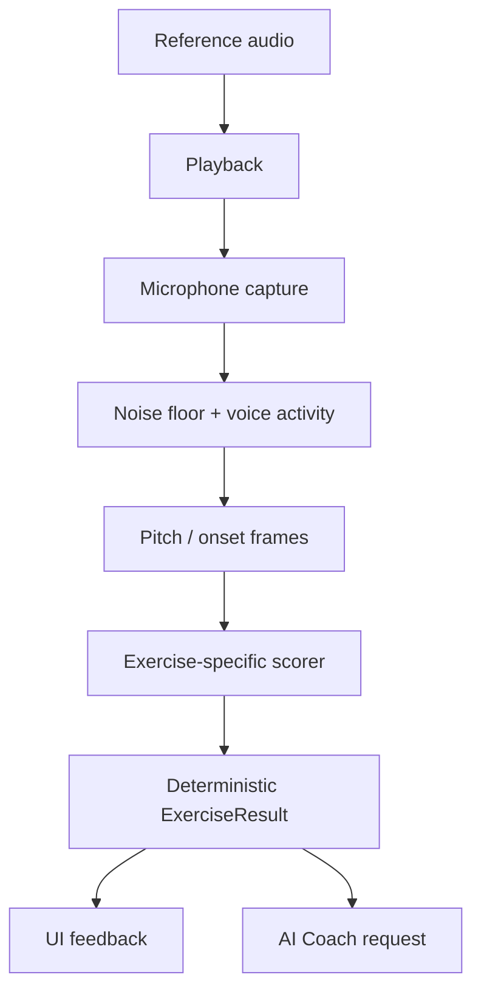

# Harmonia — Architecture

## Mimari prensipler

21:40 TRT heartbeat: CAL-03a `LatencyEstimator` pure Dart bounded trial
istatistiği (8–64), explicit source/method/route/rate ve observed shared clock.
`LatencyEstimate` ayrı diagnostic tipidir; LatencyCalibration veya scorer'a
bridge yok. Scheduled playback zamanı, mikrofondaki loopback toplamı ve
dokunma/motor bias birbirinin yerine geçmez. Count-in hâlâ kapalı; CAL-03b
pipeline'a özel fiziksel ölçüm adapter'ı/cihaz raporu ister. [ADR-023](./DECISIONS.md).

2026-10-11 devam paketi: doğrulanan `ExerciseProtocol` yeni `ConfiguredExercise` binding'i üzerinden katalog için hazırdır; legacy demo henüz migrate edilmedi. Sonuç evidence deep snapshot, pitch provenance ve kaynak/analyzer cohort uygulanmıştır. İlk codec mono PCM16 WAV; sentetik tone ve fixture metadata ayrı katmanlardır. Bunlar kayıt adaptörü/frame analyzer değildir. Detay ve devam sınırları: [AUDIO_TESTING.md](./AUDIO_TESTING.md).

Sonraki “şimdi başlat” paketi: `AudioCapture`/`ReferencePlayback`/`AudioLabBackend` domain arayüzleri, application `AudioLabController`, infrastructure `PluginAudioLabBackend` ve ayrı laboratuvar ekranı eklendi. Domain codec'e bağımlı değildir; yalnız `CapturedAudio` metadata taşır. iOS/Android record/player kendi temp dosyalarında çalışır; skor ekranının mock analyzer'ını henüz değiştirmez. Cancel epoch ve serialized resource komutları session yarışlarını kapatır; kesintide yeniden başlamak kullanıcı eylemi gerektirir. Native build/fake test doğrulandı; fiziksel cihaz ve gerçek DSP ayrı kapılardır.

İlk heartbeat: domain `AudioFixture` JSON + `AudioFixtureEntry`/`AudioFixtureManifest` v1; infrastructure read-only `AudioFixtureLoader` (seçilmiş yerel root, hash/header/rate/count/path/bütçe) eklendi. `LoadedAudioFixture` codec PCM'ini taşır; label/consent/hak referansını doğrulanmış saymaz. Sequential fail-fast stream sonuna ulaşılmadan tüm dataset valid sayılmaz. Bu loader canlı kayıt adapter'ı veya pitch analyzer değildir. Domain'e IO/hash/codec bağımlılığı eklenmedi.

08:41 UTC heartbeat: domain `YinPitchFrameAnalyzer` sınırlı senkron PCM penceresinde target-independent Hz/RMS/periodicity ve abstention nedeni verir; `PitchDeviation` ham Hz'yi değiştirmeden signed absolute cents, pitch-class residual ve octave offset hesaplar. Flutter/plugin/IO/AI bağımlılığı yok. Bu çekirdek mevcut `PitchAnalyzer` implementasyonu değil: kayıt frame aggregation, stability/coverage, provenance, isolate ve session/capture bağlantısı bekliyor. Periodicity → insan sesi veya voicedRatio dönüşümü otomatik yapılmaz. UI isolate'ında canlı çağrılmamalı; scorer ve mock ekran bu pakette değişmedi. [ADR-019](./DECISIONS.md).

Kullanıcı devam paketi: domain `RecordingPitchAnalyzer` sabit-config/10 sn bütçeli diagnostic evidence üretir; source caller tarafından explicit (varsayılan unverified), version algoritma+config içerir. Regular half-hop ve end-anchor full windows, per-frame startSample, immutable counts/frame trace; PCM tutulmaz. Lower median observed Hz ve log-frequency population dispersion raw oktavı korur. `RecordingPitchWorker` async domain sınırı, infrastructure `IsolateRecordingPitchWorker` native VM implementasyonu, bounded snapshot ve tek active istek koruması. UI/plugin/IO closure'a taşınmaz. Hard cancel/owner epoch, laboratuvar PCM yükleme ve UI bağlantısı yok. Bu diagnostic model mevcut `PitchAnalyzer` sonucu değildir; periodic ratio otomatik voicedRatio yapılmaz. [ADR-020](./DECISIONS.md).

1. Ses ölçümü AI’ye bırakılmaz; deterministik ve test edilebilir bir motor tarafından yapılır.
2. UI, ses motoru ve backend birbirine doğrudan bağlanmaz.
3. Her egzersizin girdi, ölçüm ve sonuç sözleşmesi bulunur.
4. Offline temel çalışma mümkün olmalıdır.
5. AI sonucu değil, sonucu açıklamayı ve sonraki çalışmayı seçmeyi üstlenir.
6. Ham ses kişisel veri gibi ele alınır; varsayılan olarak gereksiz yere gönderilmez.

2026-10-11 modül envanteri paketi: domain `capture_quality.dart` (`AudioRouteSnapshot`/`RoutePolicy`, `CalibrationStamp`, `NoiseFloorCalibrator`, `CaptureQualityAssessor`, `LatencyCalibration`) saf Dart ve O(n)'dir; IO/plugin bağımlılığı yoktur. Opsiyonel `AudioRouteProbe` yetkinliği infrastructure `audio_route_mapping.dart` ile audio_session cihaz listesinden route çıkarır (API deneysel; yükseltmede yeniden test). `AudioLabController` kalibrasyon kaydını alıp siler, cevap kaydında kalite raporunu worker'dan önce hesaplar. Uygulama kabuğu: `HarmoniaApp` → `AppShellController` (application) → `ProfileRepository` (application arayüzü) → `FileProfileRepository`/`JsonFileStore` (infrastructure). Tema token'ları `lib/app/theme/harmonia_theme.dart`; sonuç renkleri `HarmoniaResultColors` ThemeExtension. Ekranlar `features/onboarding|home|settings`. Karar: ADR-021/022.

## Katmanlar

13:44 UTC diagnostic integration: `AudioRecordingReader` optional domain
capability, immutable `CapturedAudioSamples` explicit origin taşır. Plugin
yalnız kendi tamamlanmış WAV'ını aynı file handle/bounded read/header kontrolüyle
okur (`readLabWav`); decode/snapshot henüz ana isolate'da, performans kapısı açık.
Controller file load'u resource queue'da tutar; native DSP işi queue dışında.
Cancel/background/route/close epoch eski sonucu reddeder; hard cancel yok,
aynı controller eski iş bitmeden yeni analiz başlatmaz. Analysis failure replay
dosyasını silmez. UI PCM-free evidence gösterir, scorer/AI/progress'e göndermez.
Yukarıdaki bağlantısız paket notları tarihsel durumdur; gerçek voice/device QA
kapısı hâlâ geçilmedi.

Son kullanıcı açıklamasıyla ana chord stimulus **prerecorded** oldu. Domain `ChordRecordingCatalog` üç reserved 2/3/4-note klasör/slot'u doğrular; infrastructure `AssetChordRecordingCatalog` yalnız bundled JSON okur; UI `ChordPlaceholderScreen` loading/error/retry ve disabled actions sunar. File/target/rights null; no player/capture/score veya fake assets. Home'dan ayrı route var. Sesler gelince reviewed asset manifest/adapter eklenecek; önceki renderer alternatif olarak korunur.

Piyano referans paketinde domain `PianoChordReference` MIDI/tuning'den tek bilinen hedef kaynağı ve simultaneous `ConfiguredExercise` üretir; infrastructure `PianoNoteSample`/`PianoChordRenderer` explicit mono decoded PCM'i aynı başlangıçta tek WAV'a hazırlar. Asset ID/rights/origin ve actual sample rate korunur; source beyanı lisans veya nota QA değildir. I/O/player/recording başlamaz. Prepared chord player/session ve gerçek bank adapter henüz yok; mevcut lab ve mock scorer değiştirilmedi. [Piyano teknik sınırları](./PIANO_REFERENCES.md).

```text
Flutter UI
  ├─ App shell / navigation
  ├─ Exercise screens
  ├─ Live visual feedback
  └─ Progress and subscription screens

Application layer
  ├─ Exercise session coordinator
  ├─ Adaptive plan service
  ├─ Result presenter
  └─ Entitlement checks

Domain layer
  ├─ Exercise definitions
  ├─ Pitch / rhythm / melody scoring
  ├─ Difficulty model
  ├─ Progress aggregation
  └─ Leaderboard rules

Audio layer
  ├─ Microphone capture
  ├─ Noise-floor calibration
  ├─ Voice activity detection
  ├─ Pitch detection
  ├─ Rhythm onset detection
  └─ Audio playback

Infrastructure
  ├─ Auth and profile API
  ├─ Results database
  ├─ Object storage for opted-in recordings
  ├─ AI gateway
  └─ Analytics / crash reporting
```

## Ses akışı



## `ExerciseResult` sözleşmesi

**Sonuç v2 temeli uygulandı (2026-10-11):** `ScoreMetric` measured/not_measured/not_applicable + nullable value; valid/invalid sonuç, mode/difficulty/content/scoring sürümü mevcut. Tek ses scorer ve ekran yeni modeli kullanır. JSON şekli v1'den farklıdır; henüz backend/persistence olmadığı için canlı veri migration yapılmadı. Gelecek okuyucular schemaVersion 2'yi açıkça desteklemeli; v1 sayısal alanlar sessizce measured kabul edilmemeli.

```json
{
  "schemaVersion": 2,
  "sessionId": "string",
  "exerciseId": "string",
  "skill": "pitch|interval|chord|rhythm|melody|range",
  "measurementStatus": "valid|invalid",
  "exerciseMode": "learning|recall_exam|sight_reading|choir_practice",
  "difficulty": 1,
  "contentVersion": "string",
  "scoringVersion": "2",
  "target": {},
  "measurements": {},
  "scores": {
    "overall": { "status": "measured", "value": 87.6 },
    "accuracy": { "status": "measured", "value": 90 },
    "timing": { "status": "not_applicable", "value": null },
    "stability": { "status": "measured", "value": 84 },
    "memory": { "status": "not_applicable", "value": null }
  },
  "errors": [
    {
      "type": "wrong_note|wrong_octave|late|early|unstable|missing_voice|noise|invalid_signal",
      "severity": "low|medium|high",
      "evidence": {}
    }
  ],
  "createdAt": "ISO-8601"
}
```

## Pitch motoru

İlk sürümde:

- Hedef frekansa göre pencere boyutu.
- Overlap’li frame analizi.
- Voice activity ve noise-floor filtresi.
- Median veya trimmed mean pitch.
- Cents farkı.
- Doğru oktav kontrolü.
- Stability ve voiced ratio.

Başarı kararı için oktav toleransı gizlice uygulanmamalıdır. Bir oktav hata, “yakınlık” olarak raporlanabilir ancak ses aralığı testinde doğru başarı sayılmamalıdır.

### Çok sesli sınav ve canlı görsel genişlemesi (2026-10-10)

2/3/4 sesli referans birlikte çalınır, kullanıcı ayrı ayrı söyler. Bilinen referans nota listesi + monofonik frame motoru + nota segmentleri + sıra/set eşleştirmesi kullanılır. Eşzamanlı mikrofon multipitch ayrı bir analyzer ve AR-GE kapısıdır; mevcut `PitchAnalyzer`'a tek frequency alanında saklanmaz.

`VisualFeedbackFrame` ölçümden UI'ya tek yönlü gider: phase, enerji, signed cents, confidence, aktif nota ve tamamlanan segmentler. Görsel smoothing skoru değiştirmez. Dinle-hatırla sınavında playback ve mic response fazları ayrılır. V2 skor geçişi model/scorer/ekranda yapıldı; gerçek frame/capture ve görsel pipeline henüz yok.

Sözleşmeler, benchmark ve iş sırası: [AUDIO_ENGINE_PLAN.md](./AUDIO_ENGINE_PLAN.md).

### Koro çalışması için ayrı audio policy

`choir_practice` modunda diğer parti track'leri kulaklıktan sürerken yalnız öğrencinin tek vokali mikrofondan alınabilir. Bu mod recall exam'den farklıdır; overlap yasağı bütün modlara yayılmaz. Rehber track gain/mute, playback timeline, kendi parti hedef event'leri ve latency kaydedilir. Hoparlör/bleed başarı sayılmamalı; cihaz fixture'ı ve kalite kontrolü gerekir. İlk sürüm ensemble multipitch ayrıştırma veya otomatik blend/tını/nefes tekniği skorlaması yapmaz.

## Müfredat ve öğrenme kanıtı — önerilen

`ExerciseDefinition` v2: referans nota/onset listesi, tuning bağlamı, tempo/ölçü, referans tekrar sayısı, gecikme, yanıt sıra/set kuralı, ipucu/mod, transpozisyon kuralı ve içerik sürümü. `SkillNode` önkoşul/öğrenme amacını; `MasteryEvidence` geçerli metrik örnekleri, algı/üretim, zorluk, destek, yeni soru ve gecikmeli kontrolü taşır.

Plan seçimi önce kurallı katalog/prerequisite hizmetinden gelir; AI yalnız uygun adayları açıklar veya sınırlandırılmış seçimi önerir. `SkillProgress` artık geçersiz/ölçülmemiş sonuçları dışlar; metrik başına denominator ve skill/difficulty/mode/content/scoring cohort'u kullanır. Tam mastery, hint/tuning/delay ayrıntıları, repository/dedup ve öğretmen gözlemi henüz yok. [Eğitim modeli](./LEARNING_MODEL.md).

## Ritim motoru

Uygulanan temel: `EventRhythmAnalyzer`, sınırlı kronolojik event listelerini monoton dinamik eşleştirmeyle karşılaştırır: maksimum birebir eşleşme, sonra minimum mutlak sapma. Skor F1 coverage × deadband dışındaki timing fidelity; eksik/fazla vuruşlar ve sapma ayrı. Bağımsız ölçülmüş latency çıkarılır; cevaptan otomatik hizalama yaparak gecikme gizlenmez. Boş referans hata; hiç kullanıcı onset'i yoksa invalid/unmeasured. Bu formül eğitimci kalibrasyonu bekler; mikrofon/clap veya tempo-independent mode henüz yok. Demo mock adapter aynı domain motoruna yönlenir.

- Referans ritim event listesine çevrilir.
- Kullanıcı tap/clap onset’leri çıkarılır.
- İlk vuruş için latency kalibrasyonu yapılır.
- Her onset’in beklenen vuruşa uzaklığı hesaplanır.
- Eksik, fazla, erken ve geç vuruşlar ayrılır.
- Tempo bağımsız ve tempo bağlı skorlar ayrı tutulur.

## AI gateway

Mobil uygulama doğrudan OpenAI API anahtarı taşımaz.

```text
Flutter -> Harmonia API -> AI Gateway -> gpt-4o-mini
                                  └-> schema validation
                                  └-> usage limits
                                  └-> prompt versioning
                                  └-> audit log
```

AI gateway’in sorumlulukları:

- Kullanıcı kimliği ve abonelik kontrolü.
- PII azaltma.
- `ExerciseResult` özetleme.
- Prompt versiyonu seçme.
- Structured Output doğrulama.
- Hata durumunda deterministik fallback.
- Kullanım ve maliyet takibi.

V2 sonuç doğrudan eski sayısal AI payload'ına geçirilemez: gelecek özet adapter'ı yalnız `measured` metrikleri gönderir, invalid/unmeasured veriyi açık durum olarak korur. Mevcut AI örnek dokümanı canlı entegrasyon değildir; AI-01/02 uygulamasında payload/eval güncellenmelidir. Bu pakette gateway çağrılmadı.

## Veri varlıkları

```text
User
  ├─ Profile
  ├─ Consent
  ├─ Subscription
  ├─ ExerciseSession
  │    ├─ ExerciseAttempt
  │    └─ ExerciseResult
  ├─ SkillProgress
  ├─ DailyPlan
  └─ CoachMessage
```

Ham kayıtlar `ExerciseAttempt` içine gömülmemeli; ayrı storage kaydı olmalı. Silme talebinde kullanıcıya ait tüm ölçüm ve kayıt ilişkileri birlikte temizlenebilmeli.

## Plus gerçek eğitimci servisi — önerilen, henüz uygulanmadı

```text
Flutter: seçilmiş kayıt + seçilmiş gelişim özeti + paylaşım onayı
  -> Harmonia Review API: auth / entitlement / kapasite / hak rezervasyonu
  -> Private RecordingAsset + HumanReviewRequest + queue
  -> Atanmış gerçek eğitimcinin paneli: dinleme + kendi yazdığı yorum
  -> WrittenFeedback + PracticeAssignment
  -> Öğrenci: imzalı yorum / takip / açıklama sorusu
```

Bu akış AI gateway üzerinden geçmez; kayıt AI'ye otomatik gönderilmez. İnsan yorumu otomatik AI metniyle doldurulmaz. Varlıklar: `RecordingAsset`, `HumanReviewRequest`, `ReviewAssignment`, `WrittenFeedback`, `HumanReviewCredit` ledger, `TeacherQualification`, `PracticeAssignment`, amaç bazlı `Consent`/audit. `ExerciseResult` geriye dönük değiştirilmez.

Kabul + hak rezervasyonu atomik/idempotent; teslimde consume, iptal/hizmet sorunu durumunda restore. Payment refund ayrı sağlayıcı olayıdır. Atama bazlı yetki, kısa süreli imzalı kayıt URL'si, erişim revocation, amaç/saklama süresi, kapasite/deadline ve minimal bildirim outbox'ı gerekir. Sınıf rolü bütün Plus kayıtlarına erişmez. Öğrencinin yalnız seçtiği progress snapshot paylaşılır; düşük güvenli veri etiketlenir.

Faz 3 küçük yönetilen pilot; Faz 4 hizmet kapılarından sonra ücretli Plus. Faz 5 tam Teacher paneli bu özelliğin önkoşulu değildir. [Hizmet/operasyon/gizlilik ayrıntıları](./HUMAN_REVIEW.md).

## Test sınırları

- Domain scoring: yüksek kapsamlı unit test.
- Pitch fixture kayıtları: regression test.
- Ritim event matching: property-based test.
- AI JSON schema: contract test.
- Flutter exercise flow: integration test.
- Gerçek mikrofon ve cihaz davranışı: seçilmiş cihaz matrisiyle manual QA.
- Ölçüm geçerliliği: null/status, yanlış oktav/sıra, ekstra ritim, latency ve invalid'in mastery dışında tutulması.
- Öğrenme: içerik/prerequisite contract; yeni soru ve gecikmeli kontrolün ipuçlu çalışmadan ayrımı.
- Koro: diğer partilerle kulaklıklı tek vokal ve bleed regression.
- İnsan hizmeti: rol/atama erişimi, hak rezervasyonu çift istek, upload/queue hatası, iptal/silme/reassignment, teslim/QA ve bildirim idempotency.

## Dağıtım sırası

1. Offline demo.
2. Internal test build.
3. 10 kişilik closed beta.
4. AI kapalı ölçüm beta’sı.
5. AI açık beta.
6. Abonelikli public release.

## CORE-03a — Exact-order symbolic pitch alignment (2026-10-12)

Domain `SequencePitchEvent` already-segmented immutable Hz/onset/duration;
`PitchSequenceAligner` bounded monotonic DP ve `PitchSequenceEvidence` source
ile adım kanıtı. Reference invalid throw; response invalid/no-response nullable
karar. Existing PitchDeviation raw cents/octave kullanılır, hedefe pitch fold
yok. No IO/plugin/AI, no MelodyAnalyzer/scorer bridge. Onset/duration sadece
chronology/budget için; timing/memory skoru üretmez. CORE-03b segmentation ve
gerçek VAD/benchmark sonrasında ürün adapter'ı ayrıca gerekir.

## CORE-03b — Diagnostic recording frame→segment (2026-10-12)

Domain `SegmentationPitchFrame` validasyon sınırı, `PitchSegmenter.fromRecording`
mevcut immutable DSP evidence adapter'ı. Target-independent run anchor, raw
observed lower median; window-center midpoint sınırları sadece diagnostic.
Örtüşen frame süreleri toplanmaz, unknown gap sustain varsayılmaz. Discarded
ve nonPitched indeksleri ayrı audit; source/analyzer version korunur. No IO,
VAD/MelodyAnalyzer/scorer bridge. PCM→DSP→segment→symbolic alignment yalnız
sentetik regresyonda explicit bağlandı; ürün UI başarı akışı değil.

## CORE-04a — Puansız ezgi application session (2026-10-12)

`MelodySessionController` bir private `SingleToneSessionController` sahiplenir:
noise-floor/route/quality gate, cevap penceresi, owned PCM silme ve epoch sonuç
reddi aynı kalır. Tek ses target deviation hesaplaması içeride kullanılmayan
diagnostic'tir; dış sonuç yalnız `PitchSegmenter` adayları, quality/retry ve
reference binding taşır. PitchSequenceAligner/ExerciseResult/history bağlantısı yok.

`MelodyReferenceBackend` explicit reference id/contentVersion/3–5 finite Hz
declaration sağlar; oynatıcı bu referansı çalmalıdır. Source/hak/etiket kabulü
değildir, gerçek adapter henüz yok. Private backend wrapper tüm native command/
read/route çağrılarını seri işler ve error sonrası queue'yu kurtarır. Playback
handle completion ve worker bitişi native kuyruğu tutmaz. Facade old operation
settle olana kadar restart'ı engeller; hard cancel/izin diyaloğu kapatma yok.
Close/deletion pending native işlem bitişini bekleyebilir. Callback sayımı
device-unverified; tek attempt tek reference, ipucu veya recalled memory iddiası yok.

## CORE-04b1 — Bağlı sentetik ezgi audio adapter (2026-10-12)

Infrastructure `SyntheticMelodyBackend` capture (AudioLabBackend + reader) ile
ReferenceClipPlayer'ı birlikte sahiplenir. DiagnosticMelodyReference frequencies
tek kaynak; `renderDiagnosticMelody` bounded 8–48 kHz/fixed 600 ms tones/gaps,
immutable encoded bytes. Reference source açık `synthetic`, capture origin
reader'dan aynen taşınır; iki kaynak birbirine dönüştürülmez. Mobile factory
PluginAudioLabBackend + JustAudioClipPlayer yaratır (lazy native init).

Reference çalma capture.playReference'e delege edilmez; varsayılan C4 fallback
yok. Route capability yoksa unknown/unverified; headphone uydurulmaz. Capture
interruptions forwarded, fiziksel player/focus/route matrisi henüz yapılmadı.
Session controller native serialization/epoch sahibi olmaya devam eder.
Stop finally iki player'ı dener; close ilk hatayı korur, diğer kaynağı yine
kapatır ve tekrar çağrıda aynı future döner. UI/home bağlantısı yok; score/
sequence/AI/history entegrasyonu yok. Reference WAV sonlanması cihazın duyulma
zamanı veya yanıt onset doğrulaması değildir.

## CORE-04b2 — Ezgi UI (2026-10-12)

MelodySessionScreen private controller sahiplenir; default synthetic-1 üç ton
(C4/E4/G4), SyntheticMelodyBackend.mobile + native worker. Girişte native init/
izin/kayıt yok. ListenableBuilder phase/outcome okur; source/Hz candidates
isteğe bağlı detail. Kesin nota/sıra/hafıza/başarı veya VAD/onset iddiası yok;
history/skill graph/AI binding yok. Home Deneysel route. Background cancel,
inactive permission istisnası; dispose resource close başlatır. Native cleanup
callback bekleyebilir; hard cancel veya bellek erase garantisi yok. Existing
spacing/typography token'ları kullanılır; fake başarı rengi/animasyonu yok.

## REL-08 — Runtime dışı QA runner (2026-10-13)

tool/quality_check.dart standalone Dart IO; mobil runtime'a import edilmez.
QualityStep/qualityPlan immutable executable+argv; shell string evaluation yok.
executeQualityPlan injected executor test seam, sequential fail-fast; process
stdio miras alınır, root script konumu ve Harmonia pubspec guard ile sabit.
Default no-pub/no fetch; explicit --fetch locked pub resolution. Hard timeout,
SDK kurma/upgrade, build/deploy/upload veya hosted CI activation yok. Plan ve
QA code acceptance cihaz/voice/eğitim acceptance'dan ayrıdır.

## LEARN-02a — Domain draft mikroders (2026-10-13)

micro_lesson.dart typed immutable LessonStep/MicroLesson/Catalog; skor veya
Flutter UI bağı yok. LessonPhase tam sıra ve bound text/reference sayıları;
catalog graph skillId→route/dimension tutarlılığını denetler. Identifier
partition training vs independent vs delayed disjoint; aynı waveform farklı
ID ile gizlenirse bu şema bunu bilemez, ileride içerik hash/review gerekir.
awaitsExamples boş slotları görünür tutar. Draft-only educatorApproved=false,
assessmentEnabled=false, gerçek onay pipeline yok; JSON/IO/upload da yok.
draft_micro_lessons.dart iki text draft, no audio/exercise/result bridge.
Lesson reading hiç SkillStatusEvaluator'a aktarılmaz; skor kuralları değişmez.

## LEARN-02b — Salt metin draft reader (2026-10-13)

MicroLessonScreen stateless, yalnız MicroLesson okur. Mic/player/repository/
completion servis dependency yok; beş faz ve pending content/onay etiketi,
disabled practice actions. Identifier bağlı olsa bile bu build practice açmaz.
SkillMapScreen injectable lesson catalog; custom graph için default empty,
standart graph için draftMicroLessons. Route/dimension eşleşen skill dersleri
button ile reader'a gider. History Future ve SkillStatusEvaluator unchanged;
navigation dönüşünde completion result yazılmaz. Mevcut spacing/typography,
scrollable cards/semantic headers; cihaz reader/visual QA ayrı bekliyor.

## LEARN-02c — Draft catalog interchange (2026-10-13)

MicroLessonCodec dart:convert, IO yok. Exact root/lesson/step keys, int schema1,
draft kind/review ve type/enum/budget validation; existing constructor+graph
guard tekrar uygulanır. Catalog tümü kurulmadan prefix verilmez. Text 1MiB
UTF8; decoded list budget pre-traversal. Fresh export maps, immutable restore;
parser error source temizlenir. Standard jsonDecode duplicate keys çözümler;
cryptographic/canonical/hak/etiket/waveform verifier değildir. UI hâlâ typed
draft catalog kullanır; codec kendiliğinden replace/onay/mastery açmaz.

## LEARN-03c — Süreli günlük plan (2026-10-13)

`domain/learning/daily_plan.dart` saf ve deterministik `DailyPlanner`:
5/12/15 dk `DailyBudget`, blok türleri kalıcılık kontrolü → zayıf tekrar →
yeni. Plan yerel gece yarısından önceki sonuçlardan kurulur; bugünkü geçerli
turlar yalnız ilerleme işaretler (kontrolde yalnız retentionCheck turu).
Tekrar kuyruğu 1/3/7/14 gün (geçilmiş later-day kontrol sayısıyla), en çok
gecikmiş önce; bir beceride zayıf seviye varken sonraki seviye yeni sayılmaz;
günde en fazla 1/2 yeni. `MeasuredExercise.draftMinutes` (ritim/tiz-pes 2,
derece 3) geliştirici tahmini. Boş süre doldurulmaz, açıkça gösterilir.
Mastery merdiveni/eşikleri değişmedi; `exercise_launcher.dart` home önerisi
ve plan ekranının ortak egzersiz açıcısı. Bütçe seçimi kalıcı değil (ekran state).

## DATA-03a / LEARN-04a / SHELL-04a — Yerel taşıma, rapor, tercih (2026-10-13)

`application/data_export.dart`: `harmonia-local-export` schema 1; profil +
sonuç özetleri, ses yok, exportedAt dakika hassasiyeti. Decode önce bütün
belgeyi doğrular (4 MiB, ≤5000 kayıt, exact root keys, strict profile/result,
yinelenen attempt reddi); hata kodu metni yankılamaz. Import yalnız
`ResultHistoryRepository.record` kurallarıyla (duplicate/conflict korunur),
profil değişmez. UI: Ayarlar → "Verilerini taşı", panoya kopyala/yapıştır;
uygulama hiçbir yere göndermez.
`domain/learning/skill_report.dart`: rota becerileri durum sayıları + ölçülemeyen
(bilinmiyor) sayısı + TodayPlanner ile tek hedef; yüzde yok. Beceri haritası
üstünde rapor kartı.
`application/practice_preferences.dart` + `infrastructure/storage/
file_practice_preferences.dart`: günlük bütçe schema 1; bozuk/eksik → varsayılan,
bozuk dosya kullanıcı yeni seçim yapana dek korunur. AppServices.preferences.

## SHELL-04b — Common status presentation (2026-10-13)

ContentStatusPanel stateless loading/empty/error + caller safe text/onRetry.
History/chord placeholder kullanır; repository/reset/delete/score/network bağı
yok, auto retry yok. History LocalOnlyNotice scoped policy, OS connectivity
probe veya sync değil. Consumer scroll wrapper/narrow layout sahibi; corrupt
dosya ve mevcut Future/store davranışı korunur. Session resume kabulü değil.

## SHELL-04c — Daily plan error ownership (2026-10-14)

DailyPlanScreen shared ContentStatusPanel loading/error/empty; own Future and
budget state preserved, onRetry _reload only. _loadForView immediately observes
future errors with ignore(), returning original future to FutureBuilder; this
closes setState→next frame unhandled-error gap, NOT hiding error from user or
substituting empty plan. Pending view hides stale plan, disposed reload blocked.
No repository clearing/network/score/mastery changes or audio resume.

## SHELL-04d — Skill-map data availability (2026-10-14)

_SkillCard nullable view state means history unavailable, separate from domain
MasteryState.notMeasured. Error shows unavailable chip, no SkillReport/focus;
text draft navigation remains independent of measurement. Shared status panel
manual reload; original Future with eager error observer prevents next-frame
failure gap; mounted guard and late load disposal tests. No state recorded to
history or mastery; no empty result injected to hide repository failure.

## REL-06a — 12TET target metadata guard (2026-10-14)

Pure TargetNoteTuning scientific label→MIDI/frequencyFor(a4) + validate;
ExerciseProtocol her note için çağırır. Decode constructor aynı invariant'i
uygular; legacy const TargetNote/Exercise ve response DSP/scorer aynı kalır.
Absolute0.005000001Hz metadata rounding, no pitch-class/octave fold/student
rubric change. Unicode/solfege/whitespace/unsupported labels explicit reject;
movable-do ayrı algı yanıtı, absolute target label yerine geçmez. Schema1 fields
aynı, validation stricter (ADR-025). Metadata hedefi waveform doğrulamaz.

## REL-06b — Decoded protocol JSON preflight (2026-10-14)

fromJson strict object keys/types at root/tuning/event/target; integer version,
finite number, bool-only aids, enum-safe lookup. Notes and rhythm lengths≤256
before mapping, no accepted-prefix result. Constructor semantic rules/tuning
remain separate (ArgumentError); shape/type error FormatException with no user
value/source echo. No raw-text parser/IO/auth/approval/acoustic verification.
Wire schema1 valid round-trip unchanged; not a signed/canonical decoder.

## REL-06c — Shared rhythm reference clock (2026-10-14)

RhythmReferenceClock is the shared playback/evaluation preflight: 2–256
onsets, finite beat conversion, 0–30000 ms before rounding, strictly increasing
rounded milliseconds. The existing click renderer uses the same 30 s constant.
This is a technical stimulus budget, not a new student timing rubric. No beat
merging, truncation, tempo scaling or latency correction. Invalid reference
returns neutral invalidInput in evaluation; controller catches it before WAV
rendering/player access. Timestamp microseconds must be nonnegative, ordered
and within the exact JavaScript integer range; equal taps remain scored extras.
Absolute epoch is irrelevant after the unchanged first-tap anchor. Replay quota
is checked. No additional response-duration cap, no device calibration claim.

## REL-06d — Catalog evidence cohorts (2026-10-15)

ResultCohort matches exerciseId, skill, mode, difficulty, contentVersion,
scoringVersion, source and analyzerVersion. MeasuredExercise declares its
expected cohort; comparableResults drives skill state, reports, today and
daily plans. RhythmNextStepPolicy uses the same matcher. Rhythm metadata comes
from its bound Exercise; perception catalogs explicitly match current learning/
difficulty1/scoring2 touch output (level remains in ID/content). Validity is a
separate gate: same-cohort invalid attempts remain for retry, not mastery.
No persisted-result rewrite or schema change; older incompatible evidence is
preserved in history but excluded from current learning comparisons. Thresholds
and supported/independent/retained rules unchanged. This does NOT fingerprint
target/tuning/protocol or independently verify hint/replay claims; full session
context binding and real content/device/educator acceptance remain open.

## SHELL-04e — Home recommendation recovery (2026-10-15)

Home TodayCard uses shared ContentStatusPanel loading/error, explicit retry,
and the original Future with an immediate error observer. Errors remain visible;
no empty-history fallback, store reset or automatic retry. Pending reload hides
old recommendation/action. Returning from an exercise uses the same mounted
reload path; replacing goal/repository replaces the observed Future and late
old completion cannot overwrite current UI. Read-only consumer: no record,
delete, clear, scoring or planner-policy change. Full resume/offline session
acceptance and real-device usability are still separate SHELL-04 gates.

## CORE-04c1 — Explicit excerpt rehearsal audio (2026-10-15)

DiagnosticMelodyPractice binds the original immutable DiagnosticMelodyReference
to a zero-based half-open contiguous range (1–5 notes) and 1–3 repetitions.
The choice is explicit learner practice, not an analyzer-selected error region.
renderDiagnosticMelodyPractice prepares local mono PCM/WAV, with original Hz/
octave/order unchanged: 600 ms notes, 200 ms internal gaps, 1000 ms between
repeats, 400 ms final tail. Maximum 5×3 is nominal 13.8 s; 8–48 kHz only,
no resampling, tempo scaling, autoplay, file I/O or capture. Existing full
renderDiagnosticMelody delegates to full-range single-repeat with identical
samples; mobile session behavior is unchanged. Timings are synthetic scheduling,
not observed device clocks or a validated teaching prescription.

This package has no player/controller/UI connection or assessment/hint counter.
CORE-04c2 must own playback and stop/close/background races exclusively, avoid
capture overlap, label manual synthetic practice and keep it out of recall,
scoring/history/mastery. Wrong-region inference still needs reliable voice/
sequence acceptance. 2/3/4 prerecorded piano path is unaffected.
