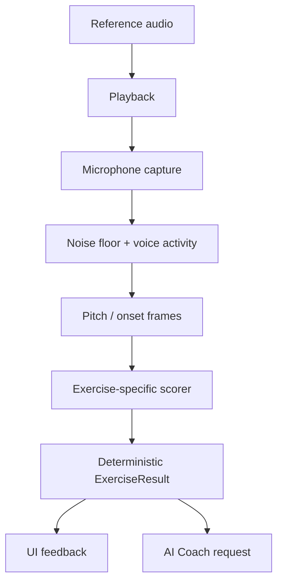

# Harmonia — Architecture

## Mimari prensipler

2026-10-11 devam paketi: doğrulanan `ExerciseProtocol` yeni `ConfiguredExercise` binding'i üzerinden katalog için hazırdır; legacy demo henüz migrate edilmedi. Sonuç evidence deep snapshot, pitch provenance ve kaynak/analyzer cohort uygulanmıştır. İlk codec mono PCM16 WAV; sentetik tone ve fixture metadata ayrı katmanlardır. Bunlar kayıt adaptörü/frame analyzer değildir. Detay ve devam sınırları: [AUDIO_TESTING.md](./AUDIO_TESTING.md).

Sonraki “şimdi başlat” paketi: `AudioCapture`/`ReferencePlayback`/`AudioLabBackend` domain arayüzleri, application `AudioLabController`, infrastructure `PluginAudioLabBackend` ve ayrı laboratuvar ekranı eklendi. Domain codec'e bağımlı değildir; yalnız `CapturedAudio` metadata taşır. iOS/Android record/player kendi temp dosyalarında çalışır; skor ekranının mock analyzer'ını henüz değiştirmez. Cancel epoch ve serialized resource komutları session yarışlarını kapatır; kesintide yeniden başlamak kullanıcı eylemi gerektirir. Native build/fake test doğrulandı; fiziksel cihaz ve gerçek DSP ayrı kapılardır.

İlk heartbeat: domain `AudioFixture` JSON + `AudioFixtureEntry`/`AudioFixtureManifest` v1; infrastructure read-only `AudioFixtureLoader` (seçilmiş yerel root, hash/header/rate/count/path/bütçe) eklendi. `LoadedAudioFixture` codec PCM'ini taşır; label/consent/hak referansını doğrulanmış saymaz. Sequential fail-fast stream sonuna ulaşılmadan tüm dataset valid sayılmaz. Bu loader canlı kayıt adapter'ı veya pitch analyzer değildir. Domain'e IO/hash/codec bağımlılığı eklenmedi.

08:41 UTC heartbeat: domain `YinPitchFrameAnalyzer` sınırlı senkron PCM penceresinde target-independent Hz/RMS/periodicity ve abstention nedeni verir; `PitchDeviation` ham Hz'yi değiştirmeden signed absolute cents, pitch-class residual ve octave offset hesaplar. Flutter/plugin/IO/AI bağımlılığı yok. Bu çekirdek mevcut `PitchAnalyzer` implementasyonu değil: kayıt frame aggregation, stability/coverage, provenance, isolate ve session/capture bağlantısı bekliyor. Periodicity → insan sesi veya voicedRatio dönüşümü otomatik yapılmaz. UI isolate'ında canlı çağrılmamalı; scorer ve mock ekran bu pakette değişmedi. [ADR-019](./DECISIONS.md).

Kullanıcı devam paketi: domain `RecordingPitchAnalyzer` sabit-config/10 sn bütçeli diagnostic evidence üretir; source caller tarafından explicit (varsayılan unverified), version algoritma+config içerir. Regular half-hop ve end-anchor full windows, per-frame startSample, immutable counts/frame trace; PCM tutulmaz. Lower median observed Hz ve log-frequency population dispersion raw oktavı korur. `RecordingPitchWorker` async domain sınırı, infrastructure `IsolateRecordingPitchWorker` native VM implementasyonu, bounded snapshot ve tek active istek koruması. UI/plugin/IO closure'a taşınmaz. Hard cancel/owner epoch, laboratuvar PCM yükleme ve UI bağlantısı yok. Bu diagnostic model mevcut `PitchAnalyzer` sonucu değildir; periodic ratio otomatik voicedRatio yapılmaz. [ADR-020](./DECISIONS.md).

1. Ses ölçümü AI’ye bırakılmaz; deterministik ve test edilebilir bir motor tarafından yapılır.
2. UI, ses motoru ve backend birbirine doğrudan bağlanmaz.
3. Her egzersizin girdi, ölçüm ve sonuç sözleşmesi bulunur.
4. Offline temel çalışma mümkün olmalıdır.
5. AI sonucu değil, sonucu açıklamayı ve sonraki çalışmayı seçmeyi üstlenir.
6. Ham ses kişisel veri gibi ele alınır; varsayılan olarak gereksiz yere gönderilmez.

## Katmanlar

Son kullanıcı açıklamasıyla ana chord stimulus **prerecorded** oldu. Domain `ChordRecordingCatalog` üç reserved 2/3/4-note klasör/slot'u doğrular; infrastructure `AssetChordRecordingCatalog` yalnız bundled JSON okur; UI `ChordPlaceholderScreen` loading/error/retry ve disabled actions sunar. File/target/rights null; no player/capture/score veya fake assets. Home'dan ayrı route var. Sesler gelince reviewed asset manifest/adapter eklenecek; önceki renderer alternatif olarak korunur.

Piyano referans paketinde domain `PianoChordReference` MIDI/tuning'den tek bilinen hedef kaynağı ve simultaneous `ConfiguredExercise` üretir; infrastructure `PianoNoteSample`/`PianoChordRenderer` explicit mono decoded PCM'i aynı başlangıçta tek WAV'a hazırlar. Asset ID/rights/origin ve actual sample rate korunur; source beyanı lisans veya nota QA değildir. I/O/player/recording başlamaz. Prepared chord player/session ve gerçek bank adapter henüz yok; mevcut lab ve mock scorer değiştirilmedi. [Piyano teknik sınırları](./PIANO_REFERENCES.md).

```text
Flutter UI
  ├─ App shell / navigation
  ├─ Exercise screens
  ├─ Live visual feedback
  └─ Progress and subscription screens

Application layer
  ├─ Exercise session coordinator
  ├─ Adaptive plan service
  ├─ Result presenter
  └─ Entitlement checks

Domain layer
  ├─ Exercise definitions
  ├─ Pitch / rhythm / melody scoring
  ├─ Difficulty model
  ├─ Progress aggregation
  └─ Leaderboard rules

Audio layer
  ├─ Microphone capture
  ├─ Noise-floor calibration
  ├─ Voice activity detection
  ├─ Pitch detection
  ├─ Rhythm onset detection
  └─ Audio playback

Infrastructure
  ├─ Auth and profile API
  ├─ Results database
  ├─ Object storage for opted-in recordings
  ├─ AI gateway
  └─ Analytics / crash reporting
```

## Ses akışı



## `ExerciseResult` sözleşmesi

**Sonuç v2 temeli uygulandı (2026-10-11):** `ScoreMetric` measured/not_measured/not_applicable + nullable value; valid/invalid sonuç, mode/difficulty/content/scoring sürümü mevcut. Tek ses scorer ve ekran yeni modeli kullanır. JSON şekli v1'den farklıdır; henüz backend/persistence olmadığı için canlı veri migration yapılmadı. Gelecek okuyucular schemaVersion 2'yi açıkça desteklemeli; v1 sayısal alanlar sessizce measured kabul edilmemeli.

```json
{
  "schemaVersion": 2,
  "sessionId": "string",
  "exerciseId": "string",
  "skill": "pitch|interval|chord|rhythm|melody|range",
  "measurementStatus": "valid|invalid",
  "exerciseMode": "learning|recall_exam|sight_reading|choir_practice",
  "difficulty": 1,
  "contentVersion": "string",
  "scoringVersion": "2",
  "target": {},
  "measurements": {},
  "scores": {
    "overall": { "status": "measured", "value": 87.6 },
    "accuracy": { "status": "measured", "value": 90 },
    "timing": { "status": "not_applicable", "value": null },
    "stability": { "status": "measured", "value": 84 },
    "memory": { "status": "not_applicable", "value": null }
  },
  "errors": [
    {
      "type": "wrong_note|wrong_octave|late|early|unstable|missing_voice|noise|invalid_signal",
      "severity": "low|medium|high",
      "evidence": {}
    }
  ],
  "createdAt": "ISO-8601"
}
```

## Pitch motoru

İlk sürümde:

- Hedef frekansa göre pencere boyutu.
- Overlap’li frame analizi.
- Voice activity ve noise-floor filtresi.
- Median veya trimmed mean pitch.
- Cents farkı.
- Doğru oktav kontrolü.
- Stability ve voiced ratio.

Başarı kararı için oktav toleransı gizlice uygulanmamalıdır. Bir oktav hata, “yakınlık” olarak raporlanabilir ancak ses aralığı testinde doğru başarı sayılmamalıdır.

### Çok sesli sınav ve canlı görsel genişlemesi (2026-10-10)

2/3/4 sesli referans birlikte çalınır, kullanıcı ayrı ayrı söyler. Bilinen referans nota listesi + monofonik frame motoru + nota segmentleri + sıra/set eşleştirmesi kullanılır. Eşzamanlı mikrofon multipitch ayrı bir analyzer ve AR-GE kapısıdır; mevcut `PitchAnalyzer`'a tek frequency alanında saklanmaz.

`VisualFeedbackFrame` ölçümden UI'ya tek yönlü gider: phase, enerji, signed cents, confidence, aktif nota ve tamamlanan segmentler. Görsel smoothing skoru değiştirmez. Dinle-hatırla sınavında playback ve mic response fazları ayrılır. V2 skor geçişi model/scorer/ekranda yapıldı; gerçek frame/capture ve görsel pipeline henüz yok.

Sözleşmeler, benchmark ve iş sırası: [AUDIO_ENGINE_PLAN.md](./AUDIO_ENGINE_PLAN.md).

### Koro çalışması için ayrı audio policy

`choir_practice` modunda diğer parti track'leri kulaklıktan sürerken yalnız öğrencinin tek vokali mikrofondan alınabilir. Bu mod recall exam'den farklıdır; overlap yasağı bütün modlara yayılmaz. Rehber track gain/mute, playback timeline, kendi parti hedef event'leri ve latency kaydedilir. Hoparlör/bleed başarı sayılmamalı; cihaz fixture'ı ve kalite kontrolü gerekir. İlk sürüm ensemble multipitch ayrıştırma veya otomatik blend/tını/nefes tekniği skorlaması yapmaz.

## Müfredat ve öğrenme kanıtı — önerilen

`ExerciseDefinition` v2: referans nota/onset listesi, tuning bağlamı, tempo/ölçü, referans tekrar sayısı, gecikme, yanıt sıra/set kuralı, ipucu/mod, transpozisyon kuralı ve içerik sürümü. `SkillNode` önkoşul/öğrenme amacını; `MasteryEvidence` geçerli metrik örnekleri, algı/üretim, zorluk, destek, yeni soru ve gecikmeli kontrolü taşır.

Plan seçimi önce kurallı katalog/prerequisite hizmetinden gelir; AI yalnız uygun adayları açıklar veya sınırlandırılmış seçimi önerir. `SkillProgress` artık geçersiz/ölçülmemiş sonuçları dışlar; metrik başına denominator ve skill/difficulty/mode/content/scoring cohort'u kullanır. Tam mastery, hint/tuning/delay ayrıntıları, repository/dedup ve öğretmen gözlemi henüz yok. [Eğitim modeli](./LEARNING_MODEL.md).

## Ritim motoru

Uygulanan temel: `EventRhythmAnalyzer`, sınırlı kronolojik event listelerini monoton dinamik eşleştirmeyle karşılaştırır: maksimum birebir eşleşme, sonra minimum mutlak sapma. Skor F1 coverage × deadband dışındaki timing fidelity; eksik/fazla vuruşlar ve sapma ayrı. Bağımsız ölçülmüş latency çıkarılır; cevaptan otomatik hizalama yaparak gecikme gizlenmez. Boş referans hata; hiç kullanıcı onset'i yoksa invalid/unmeasured. Bu formül eğitimci kalibrasyonu bekler; mikrofon/clap veya tempo-independent mode henüz yok. Demo mock adapter aynı domain motoruna yönlenir.

- Referans ritim event listesine çevrilir.
- Kullanıcı tap/clap onset’leri çıkarılır.
- İlk vuruş için latency kalibrasyonu yapılır.
- Her onset’in beklenen vuruşa uzaklığı hesaplanır.
- Eksik, fazla, erken ve geç vuruşlar ayrılır.
- Tempo bağımsız ve tempo bağlı skorlar ayrı tutulur.

## AI gateway

Mobil uygulama doğrudan OpenAI API anahtarı taşımaz.

```text
Flutter -> Harmonia API -> AI Gateway -> gpt-4o-mini
                                  └-> schema validation
                                  └-> usage limits
                                  └-> prompt versioning
                                  └-> audit log
```

AI gateway’in sorumlulukları:

- Kullanıcı kimliği ve abonelik kontrolü.
- PII azaltma.
- `ExerciseResult` özetleme.
- Prompt versiyonu seçme.
- Structured Output doğrulama.
- Hata durumunda deterministik fallback.
- Kullanım ve maliyet takibi.

V2 sonuç doğrudan eski sayısal AI payload'ına geçirilemez: gelecek özet adapter'ı yalnız `measured` metrikleri gönderir, invalid/unmeasured veriyi açık durum olarak korur. Mevcut AI örnek dokümanı canlı entegrasyon değildir; AI-01/02 uygulamasında payload/eval güncellenmelidir. Bu pakette gateway çağrılmadı.

## Veri varlıkları

```text
User
  ├─ Profile
  ├─ Consent
  ├─ Subscription
  ├─ ExerciseSession
  │    ├─ ExerciseAttempt
  │    └─ ExerciseResult
  ├─ SkillProgress
  ├─ DailyPlan
  └─ CoachMessage
```

Ham kayıtlar `ExerciseAttempt` içine gömülmemeli; ayrı storage kaydı olmalı. Silme talebinde kullanıcıya ait tüm ölçüm ve kayıt ilişkileri birlikte temizlenebilmeli.

## Plus gerçek eğitimci servisi — önerilen, henüz uygulanmadı

```text
Flutter: seçilmiş kayıt + seçilmiş gelişim özeti + paylaşım onayı
  -> Harmonia Review API: auth / entitlement / kapasite / hak rezervasyonu
  -> Private RecordingAsset + HumanReviewRequest + queue
  -> Atanmış gerçek eğitimcinin paneli: dinleme + kendi yazdığı yorum
  -> WrittenFeedback + PracticeAssignment
  -> Öğrenci: imzalı yorum / takip / açıklama sorusu
```

Bu akış AI gateway üzerinden geçmez; kayıt AI'ye otomatik gönderilmez. İnsan yorumu otomatik AI metniyle doldurulmaz. Varlıklar: `RecordingAsset`, `HumanReviewRequest`, `ReviewAssignment`, `WrittenFeedback`, `HumanReviewCredit` ledger, `TeacherQualification`, `PracticeAssignment`, amaç bazlı `Consent`/audit. `ExerciseResult` geriye dönük değiştirilmez.

Kabul + hak rezervasyonu atomik/idempotent; teslimde consume, iptal/hizmet sorunu durumunda restore. Payment refund ayrı sağlayıcı olayıdır. Atama bazlı yetki, kısa süreli imzalı kayıt URL'si, erişim revocation, amaç/saklama süresi, kapasite/deadline ve minimal bildirim outbox'ı gerekir. Sınıf rolü bütün Plus kayıtlarına erişmez. Öğrencinin yalnız seçtiği progress snapshot paylaşılır; düşük güvenli veri etiketlenir.

Faz 3 küçük yönetilen pilot; Faz 4 hizmet kapılarından sonra ücretli Plus. Faz 5 tam Teacher paneli bu özelliğin önkoşulu değildir. [Hizmet/operasyon/gizlilik ayrıntıları](./HUMAN_REVIEW.md).

## Test sınırları

- Domain scoring: yüksek kapsamlı unit test.
- Pitch fixture kayıtları: regression test.
- Ritim event matching: property-based test.
- AI JSON schema: contract test.
- Flutter exercise flow: integration test.
- Gerçek mikrofon ve cihaz davranışı: seçilmiş cihaz matrisiyle manual QA.
- Ölçüm geçerliliği: null/status, yanlış oktav/sıra, ekstra ritim, latency ve invalid'in mastery dışında tutulması.
- Öğrenme: içerik/prerequisite contract; yeni soru ve gecikmeli kontrolün ipuçlu çalışmadan ayrımı.
- Koro: diğer partilerle kulaklıklı tek vokal ve bleed regression.
- İnsan hizmeti: rol/atama erişimi, hak rezervasyonu çift istek, upload/queue hatası, iptal/silme/reassignment, teslim/QA ve bildirim idempotency.

## Dağıtım sırası

1. Offline demo.
2. Internal test build.
3. 10 kişilik closed beta.
4. AI kapalı ölçüm beta’sı.
5. AI açık beta.
6. Abonelikli public release.
