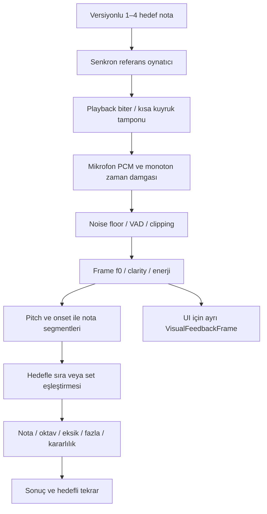

# Harmonia — Ses motoru ve 3/4 sesli genişleme

**Tarih:** 2026-10-11 · **Durum:** teknik tasarım; gerçek motor henüz Harmonia'ya bağlanmadı.

**Geliştirme başlangıcı güncellemesi:** REL-01–05 uygulandı: sonuç/metric status ve progress cohort, ritim event alignment, ezgi placeholder fail-closed. Gerçek capture/frame/segment/cihaz benchmark yok. [Uygulama kaydı](./IMPLEMENTATION_LOG.md), [ayrıntılı iş planı](./IMPLEMENTATION_ROADMAP.md).

**Güncel teknik durum — 08:41 UTC heartbeat:** Yukarıdaki başlangıç durumu tarihseldir. Yerel kayıt/çalma laboratuvarı ve fixture loader mevcut; deneysel YIN-style frame çekirdeği sentetik testli. Agora'daki McLeod algoritması port edilmedi. Canlı kayıt→frame, overlap aggregation, VAD, segment, isolate/performance ve gerçek benchmark hâlâ yok; ürün ekranı mock kalıyor. Periodicity insan sesi olasılığı/voiced ratio değildir. [Sınırlar ve devam](./AUDIO_TESTING.md).

## Koro modu ve değerlendirme kapısı — 2026-10-11

**Son devam:** bounded kayıt evidence ve native isolate worker kod/testli (205 test); frame median/dispersion/periodic counts tanımları [AUDIO_TESTING.md](./AUDIO_TESTING.md) içinde. Kayıt aggregation artık diagnostic düzeyde var, ancak human VAD/voice ratio/nota segmentleme/skor veya capture→UI bağlantısı değil. Yukarıdaki 08:41 durumu tarihseldir; worker hard cancel ve düşük cihaz performansı bekliyor.

Yeni koro rotası, başka partiler devam ederken öğrencinin kendi partisini korumasını çalıştırır. Kulaklıktan eşlik/diğer track'ler çalarken mikrofon yalnız tek vokali alır; kendi rehber track'i kademeli azaltılır/kapatılır. Bu `choir_practice` politikasının playback/record overlap'i kasıtlıdır; aşağıdaki dinle-hatırla sınavının playback→response ayrımı değiştirilmez. Hoparlör sızıntısı, cihaz latency'si ve yanlış rehber gain/mute başarısız öğrenci diye skorlanamaz. İlk sürüm dört şarkıcıyı aynı mikrofondan ayırmayı gerektirmez.

Pitch motorunun yanı sıra nota sıra/oktav/süre sözleşmesi, ekstra/eksik ritim vuruşları ve metrik geçerliliği doğrulanmalı. İlk incelemedeki melody count=100 ve rhythm extra=100 davranışları kaldırıldı; ezgi hâlâ ölçülmedi durumunda, ritim ise yalnız event listeleri üzerinde gerçek eşleştirme yapıyor. P0 bulguların kapanış/kalan işleri [PRODUCT_AUDIT.md](./PRODUCT_AUDIT.md); öğrenme/koroya aktarım [LEARNING_MODEL.md](./LEARNING_MODEL.md).

## Elimizdeki gerçek temel

Agora `src/PitchTest/lib/pitchDetector.ts`, Pitchy kullanır. Pitchy'nin algoritması YIN değil **McLeod Pitch Method**'dur ([kütüphanenin resmî açıklaması](https://github.com/ianprime0509/pitchy)). Kod yorumundaki “Pitchy/YIN” algoritmanın doğrulanmış adı değildir.

- Hedefe göre 2048–16384 örneklik pencere; yarım pencere hop; clarity eşiği 0,85; -50 dB gate.
- Geçerli frame frekanslarının medianı, cents sapması, RMS ve voiced ratio.
- `matchToTarget` ×2/÷2/×4/÷4 adayları kullanır. Oktav cezası olsa da 60 başarı eşiği nedeniyle yanlış oktav başarı sayılabilir. Ses aralığı testine aynen taşınmamalı.
- Dışa dönen `clarity`, Pitchy frame clarity ortalaması değil geçerli frame oranıdır; alan adları ayrılmalı.
- Tüm kaydın tek medianı birden fazla sıralı notayı yok eder. Kısa/boş buffer fallback'i özyinelemede sonlanmayabilir; port öncesi sınır testi gerekir.
- Harmonia'da `PitchAnalyzer`, mock motor ve oktav hatasını başarı saymayan scorer vardır; gerçek ses yakalama yoktur. Sonuç v2 ile tek ses timing/memory uygulanamaz ve invalid puanlanmaz. Pitch/frame performansı henüz gerçek kayıtlarla doğrulanmadı.

“İyi motor” iddiasını fixture ve gerçek cihaz testleriyle kanıtlamak ilk iş; yalnız güzel animasyon yeterli değil.

## Üç farklı problem

**Son kullanıcı açıklaması önceliklidir:** Referans hazır 2/3/4 sesli piyano kaydı, klasörden oynatılacak; kullanıcı dosyaları sağlayınca birlikte incelenecek. Null-file/null-target placeholder katalog/ekran eklendi. Tekil sample mix alternatif olarak kalır, canlı bilinmeyen akor transkripsiyonu yapılmaz. [PIANO_REFERENCES.md](./PIANO_REFERENCES.md).

**Kullanıcı piyano yönü:** 2/3/4 referans piyanodan sağlanacak. Bilinen key→target/protocol ve tekil piyano sample→single-clock WAV mix altyapısı testli; dosya biçimi soruldu, gerçek bank/player/response henüz yok. [PIANO_REFERENCES.md](./PIANO_REFERENCES.md). Eşzamanlı çalınan piyano akoru ile sırayla söylenen öğrenci cevabı iki ayrı faz/analiz problemidir.

| Mod | Referans | Kullanıcı cevabı | Gereken motor |
|---|---|---|---|
| Tek ses / kısa ezgi | Tek ses veya ardışık ezgi | Bir kişi ardışık söyler | Monofonik pitch + nota bölümlendirme |
| 2/3/4 sesli duyma sınavı | Piyano sesleri aynı anda çalınır | Duyduğu sesleri birer birer söyler; sıra tanımlı | Referans nota listesi zaten bilinir; monofonik pitch + bölümlendirme + dizi/set eşleştirme |
| Eşzamanlı çoklu algılama | Akor/çoklu ses | Mikrofona aynı anda birden fazla temel frekans gelir | Ayrı multipitch tahmini; harmonik ayrıştırma ve çoklu eşleştirme |

Bir şarkıcının normal cevabındaki harmonikleri üç ayrı nota saymayacağız. Piyanoyu birlikte çalmak için multipitch detector gerekmez; planlayıcı her kaydın notasını zaten bilir.

## MVP+ için önerilen yol

### 1. Capture ve playback

- Kayıtlı piyano seslerinin hakları, nota etiketleri, sample rate, peak/normalizasyon ve tuning'i envanterlenir.
- 3/4 referansın aynı audio clock üzerinde başlaması; toplam gain ile clipping önleme. İlk prototipte referans ve cevap aynı anda çalışmaz; kendi playback'ini kullanıcı başarısı sanma engellenir.
- Cihaz sample rate'ini tahmin etme; gerçek değeri geçir. Bluetooth/audio route değişiminde kalibrasyonu geçersiz kıl. Session id ve iptal token'ı ile eski frame yeni soruya sızmaz.

### 2. Frame ve segment

- Stream `PitchFrame`: `timestampMs`, `frequencyHz?`, `clarity`, `rmsDb`, `isVoiced`, `isClipped`.
- Hedef yakınlığına göre daha iyi frekans “seçerek” sonucu şişirme. Hedef, pencere/difficulty politikasına yardımcı olabilir; raw detector çıktısı korunur.
- Segmentler cents sürekliliği, sessizlik, minimum voiced süre ve onset ile kurulur. Glissando/vibrato tek notayı yapay parçalara bölmemeli; aynı notanın tekrarını onset/sessizlik ayırmalı.
- `NoteSegment`: başlangıç/bitiş, median f0, raw oktav, kararlılık, geçerli frame oranı ve kalite nedeni.
- Ezgide sıra/zamanlı alignment; çok sesli sınavda öğretmen tanımına göre alttan üste sıra veya sırasız set. Yalnız greedy yakın nota eşleştirmesi değil eksik/fazla/tekrar maliyeti olan eşleştirme.

### 3. Skor

- Absolute cents, pitch-class cents ve octave offset farklı alanlar. Eğitimde ipucu kullanılabilir; sınav ve range doğruluğunda yanlış oktav başarılı değildir.
- 3/4 nota skorları tek tek görünür. “3 sesin 2'si doğru” ile “üçü doğru ama sıra yanlış” ayrılır.
- Ölçülmeyen timing/memory `null` + `notApplicable/notMeasured`; sessizlik/gürültü için `invalidMeasurement`. Genel skor bunları yanlış nota gibi cezalandırmaz.
- Ses aralığı uçları tekrar doğrulamasıyla alınır; rahat aralık ile tek başarılı uç ayrı gösterilir. Daha yüksek/alçak ses için kullanıcı zorlanmaz.

## Görsel geri bildirim sözleşmesi

`VisualFeedbackFrame` UI'ya `sessionId`, `phase`, `level01`, `signedCents?`, `confidence`, `stability01?`, `activeNoteIndex?`, `completedNotes`, `errorType?` taşır. UI ölçüm yapmaz; skorun sahibi değildir.

| Veri / durum | Görsel davranış | Yanlış kullanım |
|---|---|---|
| RMS | Alanın genişliği/dalga yüksekliği | “Daha yüksek sesle söyle = daha iyi” mesajı |
| Signed cents | Dikey/merkez sapması + “pes/tiz” metni | Yalnız renk değişimi veya keyfî orb hareketi |
| Confidence | İz opaklığı; düşük güvende kesikli/ölçülmedi | Kararsız veriyi pürüzsüz ve kesin göstermesi |
| Kararlılık | Bandın daralması | Vibratoyu yanlış nefes teşhisi yapmak |
| Sıradaki ses | 3/4 düğüm veya nota segmenti | Sınavda gizli hedef nota adını göstermek |
| Oktav hatası | Ayrı etiket ve tekrar açıklaması | Yeşil başarı gibi sunmak |
| Sessizlik / gürültü | Nötr bekleme, tekrar/kalibrasyon | Başarısız öğrenci puanı üretmek |

Canlı rehber yalnız **çalışma** modunda; **sınav** modunda ses alınıyor bilgisi var, hedef bandı/doğru-yanlış/nota adı cevap bitene kadar gizli. Reduced motion'da alan yerine sabit gösterge + metin. Ekran okuyucu her frame'i değil faz ve sonuçları okur.

## Performans ve doğruluk kapıları (öneri, henüz ölçülmedi)

- 100+ etiketli tek ses, ardından en az 100 adet 3/4 sesli sıralı cevap; farklı register, tını, vibrato, çocuk/yetişkin ve cihaz koşulları.
- Sentetik ve gerçek fixture ayrılır; veri bölmeleri aynı kişinin sesini train/tune ve holdout arasında sızdırmaz.
- Yanlış oktavın başarı sayılması test setinde **0**; kısa/boş buffer, silence, clipping, noise için crash **0**.
- İlk kabul hedefi: kaliteli tek ses kayıtlarında doğru nota+oktav ≥%95; gürültülü koşulda yanlış olumlu ≤%5. Sınıf dağılımı, abstention ve güven aralığıyla birlikte raporlanır; öğretmen onayıyla revize edilir.
- 3/4 ses için nota precision/recall ve exact-sequence ayrı; öneri ≥%90 nota F1, ≥%80 exact-sequence; henüz sonuç değil.
- UI 60fps hedefi; en az bir düşük Android'de frame süreleri p95≤16,7ms. Görsel enerji tepkisi p95≤80ms; güvenilir pitch gecikmesi nota/pencere bazında ayrıca ölçülür (alt register daha uzun pencere gerektirebilir). 10 dakikalık session CPU/batarya ölçümü.
- Analiz isolate/native katmanda; UI son geçerli frame'i interpolasyonla çizer; çizim smoothing'i score'a dönmez. Düşük cihazlarda parçacık/blur azaltılır; büyük FFT ile UI thread bloklanmaz.

## Eşzamanlı multipitch AR-GE — ayrı kapı

- Ses sayısına göre detector'ü 4 kere çalıştırmak yeterli değil. Spektral/harmonik salience veya çoklu-f0 model adayları gerçek akor fixture'larıyla karşılaştırılır.
- Oktav çakışmaları, yakın frekanslar, eksik temel, pedal/reverb ve playback leakage zor örneklerdir.
- Note-set precision/recall, octave error, false positives, gecikme, model boyutu ve cihaz yükü raporlanır; lisans bağımsız kontrol edilir.
- Benchmark kapısı geçilmeden kullanıcıya “aynı anda 4 sesi doğru tespit ediyor” denmez. Bu AR-GE ilk çok sesli sınavı ve aboneliği bloke etmez.

## İlk uygulama işleri

- [ ] AUDIO-01: tek ses fixture sözleşmesi + motor sınır testleri.
- [ ] AUDIO-02: gerçek capture → frame → scorer; invalid/uygulanamaz alanları.
- [ ] AUDIO-03: VisualFeedbackFrame + seçilen tasarımın CustomPainter prototipi.
- [ ] AUDIO-04: referans chord scheduler + 3/4 segment/alignment spike.
- [ ] AUDIO-05: cihaz benchmark raporu; sonra ürün kapsamını kilitle.
