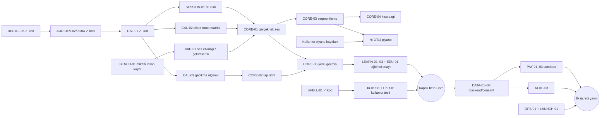

# Resonia — Current Roadmap

**2026-11-10 — CHOIR-B2 gerçek Google Drive denemesi (yerel sunucu):** Koro
hesabının (agoravoiceschoir@gmail.com) Google Cloud projesinde Web OAuth
istemcisi oluşturuldu; uygulama "Testing" durumunda, koro hesabı test
kullanıcısı (yayına alma için ana sayfa + gizlilik politikası adresi gerekiyor;
Testing'de Drive izni 7 günde düşer). Yerel Edge Functions gerçek Google ile:
izin sayfası → "Drive bağlandı", `Vocalart · Drive Deneme` klasörü
(Kayıtlar/Repertuvar/Sesli notlar) koro Drive'ında oluştu, `media/upload` →
Google'a doğrudan PUT → `finalize` → `GET` aynı baytları döndü. Uygulama
ekranlarıyla (simülatör/cihaz) gerçek Drive akışı henüz denenmedi; uzak
Supabase projesi ve SMTP ayarı yok.

**2026-11-10 — CHOIR-B2/B3 Drive, repertuvar, ödev, kayıt ve partisyon
süzgeci (ADR-041):** Çevrimiçi koronun ödev/kayıt ekranları mevcut koro
ekranlarıdır; `ChoirStore` sunucudaki koroyu aynalar (`ChoirRemote`,
`syncOnline`), değişiklik önce sunucuya gider, dosyalar ilk kullanımda iner
(`ensureMedia`). Şef: koro sayfasından Drive'ı tarayıcıda bağlar (koro hesabı,
`drive.file`); MIDI/nota/prova kaydı ve ödev sunucuya ve Drive'a gider. Korist:
kaydı paylaşım sayfası yerine yükler; aynı partideki gönderilmiş kayıtları
dinler. Partisyon şefi: "Partimin kayıtları" kuyruğu, dinle → **Şefe gönder**
(not isteğe bağlı) / **Tekrar iste** (not zorunlu), sesli not. Şef kuyruğu
yalnız ulaşan kayıtlar. Cihazdan çıkma: ayrılma/çıkarılma/silme/çıkışta koro
cihazdan silinir. Sunucu: `20261110180000_choir_drive_media.sql` (media,
choir_items, choir_drive + Vault, `can_upload_media`, `can_read_media`,
`put_item`, kayıt sahiplik kontrolü), Edge Functions `drive-oauth` + `media`.
**pgTAP 70/70, Deno 4/4, entegrasyon 3/3** (gerçek yerel Supabase + Edge
Functions + disk-Drive: bağlama, MIDI, ödev, kayıt, başka parti reddi, şef
bekler, lider sesli notla gönderir, şef dinler ve geri döner), uçtan uca
sahte sunucu testleri 8/8, ekran testleri 2/2, kalite kapısı **1594 test +
5 skip**. Açık: gerçek Google Drive ile hiç denenmedi (Google Cloud OAuth
istemcisi ve uzak proje kullanıcıda), Drive'daki dosyalar koro silinince
silinmiyor, PDF nota kayıt ekranında görünmüyor (Faz 4), AAC sıkıştırma yok
(2 dk WAV ≈ 10 MB), push bildirim yok, cihaz/pilot denemesi yok.

**2026-11-10 — CHOIR-B1b Faz 1 ekranları (çevrimiçi koro, ADR-041):**
Yalnız `--dart-define=SUPABASE_URL/SUPABASE_KEY` verilen derlemede açılır;
verilmezse koro modülü eskisi gibi cihazda. Koro sekmesinde: e-posta + 6 haneli
kodla giriş, koro kur, davet kodu + QR (paylaş, yeni kod eskisini iptal eder,
iptal), kodu yaz/QR okut → koro adı → ad + parti → katılma isteği (bekleyen
istek görünür, geri alınabilir), şef: istekleri onayla/reddet + partiyi
belirle, üyeleri partiye göre listele, parti değiştir, partisyon şefi yap,
çıkar, koroyu sil; korist: partisi, üyeler, ayrıl. Ödev/kayıt hâlâ cihazda;
çevrimiçi koroda "Drive bağlanınca" notu. Yeni SQL: `my_join_requests`,
`cancel_join_request`, `delete_choir`; giriş kodu e-posta şablonu. İzinler:
iOS kamera açıklaması (TR/EN), Android INTERNET + CAMERA (APK doğrulayıcı
listesi güncellendi). **pgTAP 42/42**, gerçek yerel Supabase'e karşı
entegrasyon testi 2/2 (katılım→onay→parti→partisyon şefi→başka koro reddi→
ayrılma→silme; Mailpit'ten kodla giriş), ekran testleri 9/9, kalite kapısı
**1584 test + 4 skip** (2'si isteğe bağlı entegrasyon). iOS simülatör derlemesi
geçti; simülatörde koro kartı ve giriş ekranı açıldı, uçtan uca simülatör akışı
tamamlanmadı. Açık: uzak Supabase projesi, Apple/Google girişi, gizlilik
manifesti/mağaza etiketleri (sunuculu derleme e-posta/kimlik toplar),
gerçek cihaz QR okuma, Faz 2 Drive.

**2026-11-10 — Ses aralığı dairesel kadran:** `RangeDial` (270° kadran,
ölçülen aralık yay + yelpaze, uç notalar dışta) aralık testi sonucunda ve
Gelişim kartında düz çubuğun yerini aldı. 1575 test geçti; gerçek cihazda
görsel kontrol yapılmadı.

**2026-11-10 — CHOIR-B1a koro sunucusu: yetki kuralı + şema (ADR-041):**
Kullanıcı kararları: Drive ana dosya deposu (koro adına hesap), PDF nota,
kaydı aynı parti + partisyon şefi dinler, şef yalnız partisyon şefinin
"şefe gönder" dediğini görür, tek şef, Apple/Google/e-posta girişi, pilot
35 kişilik kendi koro. Kod: `ChoirMember.leadsPart`, `SubmissionStatus.forwarded`
+ `forward`/`requestRetake`, saf Dart `ChoirAccess`; `supabase/` (config +
`20261110120000_choir_core.sql`: tablolar, RLS, katılım/parti/partisyon
şefi/kayıt/değerlendirme fonksiyonları). **pgTAP 33/33** (yerel Supabase:
korolar arası izolasyon, onaysız kişi, parti bazlı dinleme, şefe gönderilmeden
görmeme, doğrudan yazım reddi, çıkarılan üye, iptal edilen davet, anonim).
Kalite kapısı temiz: **1563 test + 2 skip**. Açık: Supabase/Google Cloud
hesapları (kullanıcı yetkisi), Drive Edge Functions, uygulamada giriş/katılım/
QR ekranları, uzak depo, PDF nota görüntüleme; gerçek cihaz ve pilot yok.
Plan: Faz 1 hesap+katılım → Faz 2 Drive+repertuvar → Faz 3 kayıt+süzgeç →
Faz 4 PDF nota, push, AAC, universal link.

**2026-11-10 — Sonuç ekranı sadeleşti + HeroCard sağ boşluk hatası giderildi:**
`HeroCard` içeriği artık kartın tüm genişliğini alır (skor halkası ortada).
`SessionEnd`: ortalı başlık, tek özet satırı, ince seri satırı, kanıtlar tek
kartta, sonraki adım tek dokunulabilir satır. Ölçüm/skor mantığı değişmedi.
Ses aralığı testi sonucu da aynı düzene taşındı (HeroCard'da aralık, puan
kartı, klavye, açılır ses grubu grafiği, sabit alt butonlar). Kalite kapısı
temiz: **1548 test + 2 skip**. Ritim tekrarı sonucu da taşındı (sabit tek
birincil buton, bilgi kartı, seçenek listesi). Cihazda görsel kontrol
yapılmadı; kullanılmayan akor tanı ekranı taşınmadı.

**2026-11-10 — Ritim tekrarı: kabul gevşetildi + canlı noktalı yeni ekran
(kullanıcı kararı; kod + test):** Zamanında ±10→±50 ms, eşleşme ±120→±160 ms,
0.8–1.25× sabit tempo sapması uyarlanır (uyarı kalır), ustalık |sapma| 60→80 ms;
analizör v2, v1 kohortu ayrı. Ekran trainer diliyle yeniden tasarlandı: dinlerken
vuruşlar yanar, dokunurken her nokta anında renkli belirir, sonuçta bağlı çiftler
ve sayaçlar. Ortak `RhythmTrack` Alkışla ritim'de de kullanılıyor. Kayıtlı alkış
sesinde art arda çalışta kırpma/çıtırtı giderildi (choke + headroom). Kalite
kapısı temiz: **1548 test + 2 skip**. Eğitimci kalibrasyonu ve cihazda dokunma
gecikmesi ölçümü yok.

**2026-11-10 — Alkışla ritim: 10 el alkışı animasyonu (kod + test):** Yeni
`ClapStage`: eller dinleme sırasında vuruşa önceden kapanır, temasta basılma/
esneme/sarsıntı, sönümlü geri açılma; 3/4 görünüm el çizimi. 10 stil seçilebilir
(Klasik, Ses halkası, Kıvılcım, Hız izi, Tebeşir tozu, Palmas, Kapalı avuç, Işık,
Dalga formu, Notalar), seçim kalıcı. Dinleme turunda artık kullanıcının verdiği
kayıtlı alkış çalar (`post-punk-clap.wav` → mono 48 kHz `assets/audio/clap/
clap.wav`; okunamazsa sentez). Lisansı teyit bekliyor. Kalite kapısı temiz:
**1544 test + 2 skip**. Cihazda akıcılık ve ses–
görüntü hizası denenmedi.

**2026-11-10 — P5 doğrulama pilotu hazırlığı (belge + araç; veri YOK):**
`docs/research/PILOT_PROTOCOL_2026-11.md` (perde ≥100 etiketli holdout, alkış,
aralık test–tekrar, 4 haftalık kart; önceden kayıtlı ölçüt yordamı; rıza/hak/
silme taslağı; ikili etiketleme; karar kapıları tablosu) ve `docs/research/pilot/`
(kayıt rehberi, manifest ve meta şablonları, taslak ölçüt dosyası, rıza TASLAĞI).
`tool/benchmark/pilot_analysis.dart`: manifest + WAV'ları `AudioFixtureLoader`
ile okur, `app-yin`/`yin+fallback`/`mpm` için sınıf×sonuç, ±50/±40 c, oktav,
çekimserlik, yanlış-başarı, cihaz/route/oda kırılımı, Wilson aralıkları ve
Cohen kappa üretir; veri yoksa açık hata (çıkış 2); yalnız humanRecording +
holdout karar tablosuna girer; hüküm yalnız dondurulmuş ölçüt dosyasıyla.
Kalite kapısı temiz: **1538 test + 2 skip**. **Hiçbir pilot sonucu yok;
BENCH-01/VAD-01/CAL-02 açık.** Yazılmadı: alkış/aralık/kart analiz betikleri,
izinli yerel günlük dışa aktarma (kart verisi bunsuz toplanamaz), CPU/frame
ölçümü. Katılımcı, rıza, hukuk incelemesi, eğitimci etiketi ve ölçüt
dondurma sizde.

**2026-11-09 — P4 `exam` rotasına tekrar alıştırması (kod + test):** Yalnız
`exam` hedefi ve günlük süre >5 dk iken rotada bir "Tekrar alıştırması" adımı:
melodi yankısı ve alkışla ritim dönüşümlü (son türün tersi; ilk kez melodi;
bugün yapıldıysa bugünün türü). Adım mevcut ekranları açar; bir tur bitince
"yapıldı" olarak işaretlenir (`echoLast`/`echoDay`, geriye uyumlu) — XP, seri,
ustalık, geçmiş ve lab seviyeleri DEĞİŞMEZ. Rota `stepCount` yeni adımı sayar
(10 dk: nefes + ders + tekrar); diğer hedeflerin ve hedefsiz eski kayıtların
rotası aynı. `pendingContent` (exam) 2/3/4 sesli tekrarın kayıt beklediğini
söylüyor; 2/3/4 sesli placeholder kapalı. Kalite kapısı temiz: **1525 test +
2 skip**. Cihazda denenmedi; melodi yankısı yalnız canlı ses olan cihazda
açılır (testte açılmıyor, uyarı gösteriyor); adım metinleri eğitimci onaysız;
ekrandaki "~N dk" ayarı rotadan hesaplanmıyor (kullanıcı seçimi), bu yüzden
süre hesabı değişmedi.

**2026-11-09 — P3 yıldız eşiği, kapı kanıtı ve başarısız kapı önerisi (kod +
test):** 3★ eşiği ≥%90 (2★ ≥%80, %80 geçme, 12/20 soru, ders=her zaman tamam ve
kilit mantığı aynı); yıldız "pratik göstergesi, ustalık değil". Kapı başına son 3
deneme günlüğü (`gateAttempts`: doğru, sorulan, gün; yerleştirme durakları dahil,
eski kayıt boş yüklenir) ve **yalnız gösterge** "pekişti" (≥2 gün, ≥36 soru,
birleşik ≥%80): ders yolunda kapı düğümünde küçük rozet ("iki ayrı günde
doğrulandı"), kilit/rota/yıldızı etkilemez. Başarısız kapıda tek öneri "Önceki
dersi tekrar et" + "Yeniden dene". Simülasyon: gerçek %90'da 3★ ders %35→%74.
Kalite kapısı temiz: **1507 test + 2 skip**. Eşikler taslak; pilot, cihaz ve eğitimci
onayı yok. Açık: 1,8× yazıda ders yolu düğümlerinde (eski) 6 px taşma.

**2026-11-09 — P2 aralık skorundan genişlik çıkarıldı (kod + test):** Puan =
%62,5 doğruluk + %37,5 ilk deneme (`rangeScoreModelVersion` `match-1`);
doğruluk 40 cent kenarından tam isabete 0–100 yayıldı. Genişlik/bant
betimleyici: sonuç ekranı önce "E3–B4 · N yarım ses", sonra "Eşleme", sade not
("ses tipi veya yetenek değil"), sıra metni "kendi önceki denemelerine göre".
**Eski aralık skorları silinir** (`rangeScoreModel` anahtarı; koroRange ve
diğer veriler korunur). `range_ladder.dart` ve 40 c/2 deneme kuralı değişmedi.
Kalite kapısı temiz: **1488 test + 2 skip**. Gerçek şarkıcı/cihazda denenmedi; ölçülen
aralığın düşük gürültülü şarkıcıda eksik çıkması sürüyor.

**2026-11-09 — P1 Alkışla ritim tempo normalize kuralı (kod + test):** İlk alkış
hâlâ çapa; alkış sayısı ritimle eşitse ilk→son alkış süresi referans süreye
ölçekleniyor (`normalizeClapTempo`), sonra aynı ±120 ms ve 0 eksik/0 fazla.
%15'ten fazla tempo sapmasında sonuçta sessiz not ("Tempo ≈ %N hızlıydı/yavaştı");
geçme/skor/XP etkilenmez. Seviye sırasına ritim süresi eklendi (senkop, vuruş
dışı, süre, en kısa aralık, vuruş sayısı); **mevcut `clapLevel` değerleri yeni
sıraya göre farklı ritme denk gelebilir**. Simülasyonda corr(geçme, seviye)
−0,06 → −0,37. Kalite kapısı temiz: **1484 test + 2 skip**. Gerçek insan alkışı ve cihaz
denenmedi; dokunmatik "Ritim tekrarı" ayrıca doğrulanmadı.

**2026-11-09 — P0 tekrar kartı büyüme eşiği (kod + test):** Doğru cevap yarı
ömrü artık kart vadesi gelince (Δ ≥ `dueFraction`·h, `dueFraction` =
log2(1/reviewTarget) ≈ 0,234) iki katına çıkarır; eskiden h/2 gerekiyordu ve
yarı ömür tavanı ≈ 4× ziyaret aralığında kalıyordu. `memoryModelVersion`
`hlr-lite-2`: **kullanıcıların mevcut tekrar kartları sıfırlanır** (xp, düğüm,
gün korunur). ×2/÷2, 0,5–60 sınırı, `reviewTarget`, tur boyu, `dueCards`
değişmedi. Simülasyon (sentetik, pilot verisi değil): günlük gelen 90 günde
≤12 tekrar ve h=60; haftalık ≤8; %85 doğrulukta <40. Kalite kapısı
temiz: **1477 test + 2 skip**. Cihazda/öğrenciyle denenmedi.

**2026-11-09 — PLACE-01 hedef parkuru, seviye ve yerleştirme (kod + test):**
Hedef sıralı bir parkur seçiyor (Akor/Dizi/Yürüyüş ilk kez rotada); girişte
ayrı seviye adımı (yeni / biraz / tecrübeli). Yerleştirme yolun kendi
kapılarıyla, %80 kuralı aynı, sonuç belli olunca erken biter (12'de 10
doğru / 3 yanlış); tecrübeli sondan bir önceki ara duraktan başlar, kalırsa
iner. Doğruluk tam uzunluğa bölünür (yıldız şişmez). Ayarlar'dan seviye ve
"Seviyemi bul". **1470 test + 2 opt-in skip**. Açık: parkur sırası ve
metinler eğitimci onayı, kapı ayırt ediciliği (±1 durak), `exam` için
tekrar slotu kararı, cihaz/öğrenci denemesi.

**2026-11-09 — BENCH-MODEL-01 model/ağırlık/yük incelemesi (ölçüm + belge,
uygulama kodu değişmedi):** `tool/benchmark/` (4 betik) ve
[rapor](docs/research/VOCAL_MODEL_BENCHMARK_2026-11-09.md). Sentetik ses
benzeri sinyallerde YIN çekirdeği C2–C6'da ±2 c, SNR ≥10 dB'de sağlam, 5 dB'de
çöküyor (kalite kapısı 15 dB); MPM dayanıklı. Skor: tek ses skorunda 50→50,5 c
için 45 puan uçurum ve vibrato "kararsız" (aktif uygulamada bağlı değil);
aralık skorunda genişlik %60 ve ölçüm eşleme doğruluğuna duyarlı; 12 soruluk
kapı düşük ayırt edici (%85'lik öğrenci %74 geçer). Müfredat: 1310 puanlı
sorunun tamamı algı, ses üretimi ölçülmüyor; zor öğeler 4–9× az çalışılıyor.
Tekrar kartında büyüme eşiği hatası: günlük kullanıcıda 90 günde 90 tekrar
(tek sabitle ~10). Tüm veri sentetik/simülasyon; kalite kapısı format+analyze
temiz, **1452 test + 2 opt-in skip** (ritim betiği dahil son koşu).
Ek: alkışla ritim ölçüldü (`rhythm_benchmark.dart`): mükemmel bilen
performansçının geçme oranı ritim süresiyle −0,99, seviye sırasıyla −0,06
(mutlak ±120 ms kuralı); detektör jitter'ı ~1,5 ms. Rakip/eğitim mimarisi
karşılaştırması (rapor §6b): açılan Türk konservatuvar kılavuzlarında cevap
biçimi tekrar (şarkı/alkış/kalem), çoktan seçmeli işitme maddesi bulunamadı;
uygulamada ezgi/ritim tekrarı var ama rota ve ilerleme dışında; `exam` hedefi
adlandırma yoluna bağlı. Hedefe göre hüküm: kulak eğitimi evet, sınav bugünkü
hâliyle hayır, şan/ses hazırlık katmanı. Açık: gerçek insan/yankı/cihaz
benchmark'ı (BENCH-01), eğitimci kararı (aralık skoru, kapı, tolerans, `exam`
rotası, ritim kuralı), HLR kalibrasyonu. Hiçbir rubrik/tolerans/sabit
değiştirilmedi.

**2026-11-09 — QA-INT-02 akor ve dizi adları anlatımı (kod + test):** Akor
ve dizi açıklamaları jargonsuz; iki yeni "nasıl okunur?" slaytı; tanış
sayfasında notaları adıyla gösteren klavye (akor) ve adım kalıbı (dizi);
soru ekranı yardımı akor ve dizilere genişledi. **1452 test + 2 opt-in
skip**. Açık: eğitimci onayı, akor dizisi adları, cihaz denemesi.

**2026-11-09 — QA-INT-01 aralık adları anlatımı (kod + test):** Aralık
açıklamaları jargonsuz; "Başlarken"de "Aralık adları nasıl okunur?"
(sayı, yarım ses, küçük/büyük = m/M, tam/artık); her yeni aralıkta tuş sayan
klavye; soru ekranında sessiz "Bu adlar ne demek?" / "?" yardımı.
**1447 test + 2 opt-in skip**. Açık: cihaz/yeni başlayan denemesi, eğitimci
onayı, akor ve dizi adları için benzer yardım.

**2026-11-09 — AUDIO-PIANO-02 patlama düzeltmesi (kod + test):** Vuruş
ortasından başlayan kayıtlar sessizlikten tek örnekte 0,28'e sıçrıyordu.
Notalara 5 ms kosinüs giriş/kosinüs sönüm, kayıt sonunda kesilme yerine
sönüm; ses aralığı testi de örnekleyiciden; eğitim sesleri yarıda
kesilirken ~30 ms kısılır (ölçüm akışları hariç). **1440 test + 2 opt-in
skip**. Açık: hoparlörde dinleme ve yeni IPA.

**2026-11-09 — AUDIO-PIANO-01 kayıtlı piyano (kod + test):** Piyano
tınısında tek nota sesleri (nota, ardışık aralık, dizi, ezgi) kullanıcının
izinli kaydından çalar; siyah tuşlar ±1 yarım ses kaydırma, kayıt başı
sessizliği kırpılır. Akor/eşzamanlı aralık ve A5+ notalar bütünüyle synth'te
(tek seste tını karışmaz); mikrofonlu tanı referansı bilerek synth.
**1438 test + 2 opt-in skip**. Açık: cihazda dinleme/gecikme, siyah tuş ve
A5+ kayıtları, hazır akor kayıtları.

**2026-11-09 — QA-NOTE-01 tek nota adlandırması + açılışta dil (kod + test):**
TestFlight bildirimi: ders adı "Do ve Mi" derken şıklar "C/E" idi. Ders
başlıkları, ipuçları ve örnekler artık öğrencinin notasyonunu izliyor
(`NoteNames`). Evet/hayır düğmeleri cevaptan önce nötr (önceden "Evet" hep
yeşildi). Karşılamada Türkçe/English seçimi. **1434 test + 2 opt-in skip**.
Açık: "başka şık yeşil" bildiriminin ekranı kesinleşmedi; kayıtlı piyano
(E1–G5 beyaz tuşlar, izinli) ile soru seslerinin refactor'u onay bekliyor.

**2026-11-09 — UX-MOTION-02 hareket dili uygulamaya yayıldı (kod + test):**
Ortak sayfa geçişi (Android'de yükselip belirme, iOS'ta yerel Cupertino),
soru ekranında doğruya zıplama / yanlışa sallanma, ders sonunda kademeli
giriş + dolan skor halkası + kazanılmış kutlamaya ses (ders → başarı,
ara durak/final → fanfar), ders yolunda düğümlerin sırayla belirmesi. Kural:
kulak eğitimi soru/karşılaştırma ekranlarında ve referans ses çalarken arayüz
notası yok. Kalite kapısı temiz, **1427 test + 2 opt-in skip**. Açık: cihazda
ses/akıcılık, VoiceOver/TalkBack, Bugün/Gelişim sekmeleri ve mikrofonlu
ekranlarda hareket dili.

**2026-11-09 — UX-MOTION-01 rehberli, müzikal ilk açılış (kod + test):**
Onboarding `karşılama → isim → hedef → süre → hazır` oldu. Mor ses küresi
rehber olarak "yazıyor…" balonuyla konuşur; isim isteğe bağlı ve her harf
pentatonik bir notayla karo olarak belirir; seçimler ve adımlar kısa
sentezlenmiş notalarla yanıt verir, sonda akor + küçük patlama. Ortak hareket
dili `lib/trainer/ui/motion.dart`, sesler `lib/trainer/audio/ui_sounds.dart`
(lisanslı ses yok, Ayarlar'da kapatılabilir, hareket azaltmaya uyar). Kalite
kapısı temiz, **1424 test + 2 opt-in skip**. Açık: cihazda ses/gecikme/sessiz
anahtar, VoiceOver, kullanıcı algısı; hareket dilinin diğer ekranlara
yayılması (sayfa geçişleri, ders/sonuç ekranları) sonraki dilim.

**2026-11-09 — PATH-01 ders yolu ve kutlama (kod + test):** Beceri ekranı
zikzak ders yoluna döndü; geçilen düğümden sonra "Devam et" sıradaki dersi
açar. Kutlama kademeli ve yalnız kurulan olaya bağlı: ders → küçük patlama,
ara durak → havai fişek, final/beceri sonu → kupa. Serbest çalışma, yanıtsız
oturum ve geçilemeyen kapı kutlanmaz; skor/eşik/XP değişmedi. Kalite kapısı
temiz, 1416 test + 2 opt-in skip. Açık: simülatör/cihaz uçtan uca turu,
VoiceOver, hareket/haptik kullanıcı algısı. Sıradaki önerilen dilim:
dürüst karşılaştırma mesajları (kendi geçmişi + yayımlanmış aralık normları);
"%x kullanıcıdan iyi" sunucu ve onaylı toplu veri olmadan gösterilmez.

**2026-11-09 — WIDE-03 sade sonuç (kod + test):** Ders sonu artık
“tamamlandı” ile doğruluğu ayırır; yanıt yoksa “ölçülmedi” der, puan
göstermez. XP başlıktan çıktı ve “pratik puanı, beceri ölçümü değil” diye
etiketlendi; Gelişim'de “Pratik seviyesi” aynı açıklamayı taşır. Tek
“Sonraki adım” kartı: karışanların kaydedilmeyen kısa tekrarı ya da sıradaki
ders. Skor/eşik/XP formülü değişmedi. Kalite kapısı format 424/0, analyze
temiz, **1402 test + 2 opt-in skip**; ses kapsamı hash ile aynı. Mikrofonlu
egzersiz sonuçları bu dilimde ele alınmadı. Sonraki dilim: WIDE-04 insan ve
erişilebilirlik pilotu (gerçek katılımcı/cihaz gerekir) veya WIDE-05.

**2026-11-09 — WIDE-01/02 ilk dilim (kod + test):** Onboarding
`karşılama → hedef → süre → hazır` oldu; mikrofon, aralık ve hatırlatma ilk
ihtiyaç anına taşındı. Altı hedef (`PracticeGoal`) günlük rotayı yalnız hazır
içerikten kurar; konuşma/sahne sessizce aralık dersine düşmez, hazır olmayan
içerik “Hazırlanıyor” notuyla görünür. Hedefi olmayan eski kayıtların rotası
birebir korunur; yarım kurulum yeni adıma eşlenir. Ayarlar'da hedef ve günlük
süre değiştirilebilir. Tam kalite kapısı format 423/0, analyze temiz,
**1395 test geçti, 2 opt-in skip**; ses kapsamı hash ile değişmedi. Açık:
Maestro/simülatör ve cihaz turu, VoiceOver/TalkBack, 18–29/30–44/45–59/60+
insan turu (`not_run`), eğitimci onaylı ses hazırlığı/konuşma içeriği.
Sonraki dilim: WIDE-03 sade sonuç ve sonraki adım.

**2026-11-09 — WIDE-AUDIT-01 ürün incelemesi (yalnız belge):** Kullanıcının
geniş kitle hedefi için güncel aktif TrainerApp akışı incelendi. Hedef bazlı
kısa onboarding/günlük rota, eğitimci onaylı ses hazırlığı, porte ve
konuşma/sahne içerikleri önceliklendirildi. Ayrıntılar:
[ürün incelemesi](docs/product/VOCALART_GROWTH_AUDIT_2026-11-09.md),
[yaş grupları ve otomasyon protokolü](docs/product/VOCALART_USABILITY_PROTOCOL_2026-11-09.md),
[uygulama promptu](docs/product/VOCALART_IMPLEMENTATION_PROMPT_2026-11-09.md).
WIDE-01–11 öneridir; uygulama veya yeni otomasyon geliştirilmiş sayılmaz.
Bu oturumda `dart tool/quality_check.dart`: format 420/0, analyze temiz,
1381 test geçti, 2 opt-in skip. İnceleme sırasında alınan lib/test/tool
hash envanteriyle son karşılaştırmada fark yok; ses algoritması değiştirilmedi.
Gerçek yaş grubu/cihaz/eğitimci pilotu yapılmadı; mevcut kullanıcı değişiklikleri
korundu. Sonraki önerilen dilim WIDE-01/02; mevcut dış kabul kapıları açık.

**Tarih:** 2026-11-09 (son güncelleme: QA-INT-02 akor ve dizi adları)
**Durum:** Faz 1 — güvenilirlik sözleşmeleri, yerel kayıt laboratuvarı, deneysel DSP/worker, kalibrasyon/kalite kapısı ve misafir uygulama kabuğu kod-test seviyesinde. Tek ses skor ekranı hâlâ simülasyon; fiziksel cihaz, insan sesi benchmark'ı, eğitimci içerik onayı ve öğretim pilotu kapıları açık. **Hiçbir modül cihazda/pilotta doğrulanmış veya yayında değil.**
**Sahip:** Mennan Sevim  
**Platform:** Flutter mobil uygulama; ileride web ve öğretmen paneli

**2026-11-09 — HUM-06a güvenli hizmet operasyonları sözleşmesi:** İlk 20
kabul edilmiş pilot kaydı için bağımsız QA gereksinimini yalnız politika bayrağı
olarak taşıyan; atama, yeniden kayıt, eğitimci değişimi, bekleme, ileri tarihli
gecikme, erişim geri çekme, iptal ve teslim geçişlerini UTC kronolojiyle
sınırlayan saf domain çekirdeği eklendi. Yeniden kayıt eski eğitimci erişimini
ve deadline'ı temizler; yeni kayıt revision artırarak triage'a döner. QA kaydı
teslimden sonra, izin referansıyla ve teslim eğitimcisinden farklı reviewer ile
kurulur. İtiraz yalnız teslim sonrası süre içinde açılır ve bir kez çözülür;
ikinci değerlendirme veya hizmet hakkı yalnız önerilir, ledger/ödeme/iade
değiştirilmez. 11 adversarial test ve HUM-02a–05a regresyonları geçti. Gateway
backend yokken fail-closed. Tam kalite kapısı format 420/0, analyze temiz,
**1381 test geçti ve 2 opt-in test skip edildi**. Bu kod gerçek erişim iptali,
silme, QA, bildirim, hak iadesi veya finansal iade değildir.

**2026-11-09 — HUM-05a güvenli öğrenci teslim sözleşmesi:** Eğitimci yorumu
ile AI koçunu aynı içerik türü gibi göstermeyen öğrenci domain sınırı eklendi.
Eğitimci teslimi authored/delivered kronolojisini korur; AI kartında eğitimci
kimliği, atama ve kanıt alanları yoktur. Dahil tek açıklama sorusu yalnız
`available → submitted → answered → closed` ilerler; tekrar soru, adım atlama,
yanlış eğitimci, süresi geçmiş pencere ve geriye giden zaman reddedilir. Push
payload exact schema/event/opaque-token dışında soru, cevap, ses, skor veya
eğitimci içeriği taşıyamaz. Öğrenci yalnız teslimdeki benzersiz ödevleri
seçebilir; bu seçim mastery değildir. Gateway canlı backend yokken fail-closed.
9 adversarial test geçti; tam kalite kapısı format 418/0, analyze temiz,
**1370 test geçti ve 2 opt-in test skip edildi**. Bu kod gerçek yorum, push,
bildirim izni, günlük plan yazımı veya açıklama teslimi değildir.

**2026-11-08 — HUM-04a eğitimci atama/yorum domain sözleşmesi:** Gerçek
eğitimci paneli veya teslim varmış gibi davranmadan önce güvenli saf domain
sınırı eklendi. Atama; request, eğitimci ve qualification token'larını UTC
erişim aralığı ve iptal zamanı ile sınırlar. Yazılı geri bildirim yalnız aktif
atamadaki eğitimci token'ıyla kurulabilir; kayıt süresini aşmayan zaman kanıtı,
gözlemden ayrı olası açıklama, 1–3 güçlü yön, en fazla 2 öncelik, tam 3 benzersiz
katalog ödevi ve takip hedefi zorunludur. Koleksiyonlar immutable; teslim
gateway'i backend kimlik/audit yokken fail-closed. 8 adversarial test geçti;
tam kalite kapısı format 416/0, analyze temiz, **1361 test geçti ve 2 opt-in
test skip edildi**. Token eşleşmesi insan kimliğini, uzmanlığı veya yorumun
gerçekten insan tarafından yazıldığını kanıtlamaz; bunlar backend ve pilot dış
kapılarıdır.

**2026-11-08 — HUM-03a idempotent yerel hak ledger çekirdeği:** Plus insan
hizmeti için ödeme/entitlement iddiası taşımayan saf domain aggregate eklendi.
Süreli ve sınırlı grant'ler en erken sona eren aktif haktan rezervasyon yapar;
reserve/consume/restore geçişleri explicit UTC zaman, request token ve
idempotency key ister. Aynı isteğin ya da ağ tekrarının ikinci hak tüketmesi,
idempotency key'in başka komutta kullanılması, restore sonrası tüketim, çift
restore, süresi geçmiş ve tükenmiş grant fail-closed reddedilir. Audit event
ve snapshot'lar dışarıya değiştirilemez görünümle verilir. 8 adversarial domain
testi geçti. Tam kalite kapısı: format 414/0, analyze temiz, **1353 test geçti
ve 2 opt-in test skip edildi**. Bu in-memory sözleşme gerçek abonelik, ödeme,
sunucu transaction'ı, kalıcı ledger veya kullanıcı hakkı değildir.

**2026-11-07 — HUM-02a güvenli yerel eğitimci yorumu önizlemesi:** Plus
üyelik kartındaki akış önizlemesi artık hedef, tek soru ve paylaşılacak gelişim
özeti seçimlerini gösteriyor. `HumanReviewDraft`, kayıt seçimi ve sürümlü amaç
onayını bounded/fail-closed doğruluyor; `HumanReviewGateway` kapalı adapter'ı
backend, yetki, kapasite, hukuk, hak ve kayıt kapılarını açıkça bildiriyor.
Kayıt seçme, onay ve gönderim kasıtlı olarak kapalı: seçimler saklanmıyor,
dosya alınmıyor, hak tüketilmiyor ve dışarı veri gönderilmiyor. Gerçek
eğitimcinin kendi yazdığı yorum ile AI koçu ayrıştıran metin korundu. 5 domain
+ 3 widget testi ve ilgili rota regresyonları geçti; 320×720 ve 1,6× metin
ölçeği kapsandı. Tam kalite kapısı: format 412/0, analyze temiz, **1345 test
geçti ve 2 opt-in test skip edildi**. Bu servis/pilot/yükleme/ödeme kanıtı
değildir.

**2026-11-07 — REL-23 AAB→universal APK teslimat parity kapısı:**
`scripts/release/verify_android_delivery.py`, doğrulanmış AAB'den bundletool
ile geçici universal APK üretip bu APK'yı bağımsız REL-21 kapısından geçiriyor;
kimlik, sürüm/build, SDK, exact izinler, sertifika ve launch kaynaklarının AAB
ile birebir eşleşmesini zorunlu tutuyor. APKS arşivi bounded/path-safe okunuyor,
yalnız `universal.apk` çıkarılıyor; geçici dizin işlem sonunda siliniyor. Beş
adversarial test geçti. Güncel 1.0.0+12 AAB'den 76.817.611 byte universal APK
üretildi ve parity geçti. Sonuç açıkça `installed:false`, `uploaded:false`;
bu Play'in cihaz split üretimi, kurulum veya fiziksel çalışma kanıtı değildir.

**2026-11-07 — REL-22 Android AAB fail-closed doğrulama kapısı:** Play
teslim formatı için `scripts/release/verify_android_aab.py` eklendi. Bounded
ZIP/JAR yapısı, Google bundletool doğrulaması, pubspec sürüm/build exact-match,
kimlik, min24/target36, exact izin kümesi, Flutter `libapp.so`, markalı launch
renk/stil/ikon kaynakları ve tek imza sertifikası birlikte denetleniyor.
Bundletool 1.18.3 SHA-256 ile pinli; debug sertifikası yalnız explicit yerel
flag ile, üretim sertifikası yalnız beklenen SHA-256 ile kabul ediliyor. Beş
adversarial test geçti. Eski 1.0.0+1 AAB güncel +12 kaynakta reddedildi;
yeniden üretilen 1.0.0+12 yerel beta AAB (73.853.941 byte, SHA-256
`41a4ca46461021e32a36e39adaa6edb77c866ff8748dfc89eb4a0ae9b77b51ee`)
kapıdan geçti. İmza `Android Debug`; Play yüklemesi, gerçek keystore ve
fiziksel Android kabulü yapılmadı.

**2026-11-07 — REL-21 Android APK fail-closed doğrulama kapısı:**
`scripts/release/verify_android_apk.py`, APK'yı bounded ZIP olarak denetliyor;
pubspec sürüm/build exact-match, `com.mennansevim.vocalart`, min 24/target 36,
exact izin kümesi, Flutter `libapp.so`, Android 11-/12+ markalı launch
kaynakları ve imza sertifikası birlikte doğrulanıyor. Debug sertifikası yalnız
`--allow-debug-signing` ile yerel kanıt olarak kabul ediliyor; üretim imzası
beklenen SHA-256 verilmeden kabul edilmiyor. Beş adversarial Python testi
geçti. Eski 1.0.0+9 APK güncel pubspec 1.0.0+12 karşısında doğru biçimde
reddedildi; yeniden üretilen 1.0.0+12 yerel beta APK (76.780.216 byte,
SHA-256 `43b2a698733ca606d7dd7f2285b2db8c5f4a6366fec76e2a32cb8592fbc8363d`)
kapıdan geçti. Sertifika hâlâ `Android Debug`; mağaza AAB'si, Play kabulü ve
fiziksel Android QA yapılmadı. Proje kalite kapısı temiz: format 408/0,
analyze 0 sorun, **1337 test geçti ve 2 opt-in test skip edildi**.

**2026-11-06 — FX-10 noktalı nefes halkaları:** Kullanıcı isteğiyle
`BreathFlow` parçacıklı küreden, ses analizindeki halka efektine benzer
noktalı halkalara geçti (Apple Watch kadranı tarzı). Dışta 60 noktalı kadran
adım süresini doldurur (öndeki nokta en parlak, her 5'te bir büyük nokta);
içte 4 nokta halkası ortadaki boş alan ile nefes erişimi arasında akar. Al:
halkalar açılır ve içe akar; tut: neredeyse durur, küçük titreşimle
parıldar; ver: kapanır ve dışa akıp söner. Hız/dönüş EMA ile değişir,
duraklatınca halkalar süzülerek durur, ticker durur; azaltılmış harekette
halkalar sabit, yalnız açılıp kapanır. `breathAt`, rehber saati, renk geçişi
ve ekran mantığı değişmedi; mikrofon yok, ölçüm yok. Tam test **1337 geçti,
2 skip**; `lib`/`test` format temiz; analyze'da yalnız bu işe ait olmayan
`tool/brand/render_icons_test.dart` bilgisi. Al/tut/ver kareleri test
ortamında render edilip incelendi; **cihazda gerçek kare hızında
görülmedi.**

**2026-11-06 — REL-20 IPA 1.0.0+10:** FX-09 nefes akışını içeren çalışma
ağacından imzalı App Store IPA üretildi (`build/ios/ipa/Vocalart.ipa`,
SHA-256 `0df00194785cc05043c89b64da6cac5ff7f6c9f3875001473185fe8b023db607`);
yerel doğrulayıcı passed. Upload, TestFlight ve cihaz kabulü yok.

**2026-11-06 — FX-09 nefes akışı (Hazırla · nefes egzersizi):** Nefes
ekranındaki düz ilerleme halkası, parçacık akışıyla aynı görsel dile sahip
çekirdek efekt `BreathFlow` (`lib/trainer/ui/breath_flow.dart`) ile
değiştirildi. Al: ince parçacıklar kenardan içe süzülür, küre sinüs eğrisiyle
dolar (mor). Tut: küre dolu kalır, parçacıklar yüzeyde küçük doğal titreşimle
durur (mavi-yeşil). Ver: küre yavaşça boşalır, parçacıklar dışa süzülüp söner
(yumuşak yeşil). Renk EMA ile geçer, keskin değişmez; ince halka adımın
süresini doldurur. Efekt yalnız rehber saatini izler, mikrofon kapalı ve hiçbir
şey ölçülmez. Duraklatınca küre durur, havadaki parçacıklar söner, ticker
durur; azaltılmış harekette yalnız küre + halka. Sabit 512'lik parçacık havuzu
ve tek `drawVertices`. Küre boyu ekran yüksekliğine göre 168–220. 6 yeni test;
tam test **1337 geçti, 2 skip**, `lib`/`test` format temiz. `quality_check`
format/analyze adımı bu değişiklik dışındaki commit edilmemiş
`tool/brand/render_icons_test.dart` yüzünden kırmızı. Al/tut/ver kareleri test
ortamında render edilip incelendi; **cihazda ve eğitimci onaylı nefes
içeriğiyle görülmedi** (4·2·6 desen hâlâ taslak, EDU-01).

**2026-11-06 — REL-19 yerel Android beta release APK + izin daraltma:**
`RESONIA_CHANNEL=beta` release varyantı, yalnız yerel kanıt için explicit
debug-signing override ile üretildi (`app-release.apk`, 76.452.708 byte,
SHA-256 `cd937d250d113b26a52df1747016e8ed0a3daa0bc7ceb377b8629204108ead12`).
Artifact `com.mennansevim.vocalart`, `1.0.0+9`, min 24 / target 36 ve APK
Signature Scheme v2 doğrulamasından geçti; sertifika açıkça `Android Debug`.
Bağımlılıkların eklediği gereksiz READ_EXTERNAL/READ_MEDIA_* ve
ACCESS_NETWORK_STATE izinleri merge'de kaldırıldı; artifact yalnız mikrofon,
reboot, titreşim, bildirim ve Android'in signature receiver iznini taşıyor.
Tam kapı **1331 geçti, 2 opt-in skip**. Bu APK mağazaya yüklenemez; gerçek
keystore, imzalı AAB, Play kabulü ve fiziksel Android QA açık.

**2026-11-06 — UI-01d Android markalı açılış ekranı + iOS koyu tema:**
Android 11 ve öncesindeki launch drawable artık merkezlenmiş Vocalart marka
simgesini, Android 12+ sistem splash'i explicit simge + marka arka planını
kullanıyor; açık zemin iOS ile aynı krem `#F8F5EF`. iOS metin/vurgu renkleri
named dynamic asset'e taşındı; koyu temada patlıcan metnin koyu zeminde
kaybolması engellendi. Kaynak sözleşmesi 5/5, `ibtool`, analyze, debug APK ve
paketlenmiş `aapt2` kaynak tablosu temiz; tam kapı **1331 geçti, 2 opt-in
skip**. Fiziksel Android/iOS görsel kabulü ve imzalı release artifact açık.

**2026-11-06 — UI-01c markalı iOS açılış ekranı:** Varsayılan Flutter
`LaunchImage` referansı kaldırıldı; native storyboard artık krem zemin üzerinde
patlıcan `Vocalart` yazısı ve lime vurgu çizgisi gösteriyor. Storyboard `ibtool`
ile derlendi, iOS simülatör debug derlemesi başarılı ve tam kalite kapısı
**1330 geçti, 2 opt-in skip**. Fiziksel cihazda görsel kabul yapılmadı; mevcut
imzalı 1.0.0+9 IPA bu değişiklikten önce üretildi ve UI-01c'yi içermez.

**2026-11-06 — REL-11j iOS izin/ürün beyanı kapısı:** İmzalı IPA Info.plist
artık exact device platform/SDK, arm64 capability, iPhoneOS gereksinimi,
en+tr localization, beklenmeyen background-mode ve arbitrary-network-load
yokluğu açısından doğrulanıyor. Türkçe varsayılan ile paketlenmiş Türkçe ve
İngilizce `NSMicrophoneUsageDescription` metinleri ürünün yalnız kullanıcı
başlatınca yerel kayıt sözleşmesine exact bağlı. Python paketi **16 test**;
güncel 1.0.0 build 8 IPA geçti. Fiziksel izin diyaloğu/ayar dönüşü ayrı kapı.

**2026-11-05 — REL-11i tüm privacy manifest zinciri:** App-owned manifest
kapısına ek olarak IPA içindeki framework ve plugin bundle'larındaki bütün
`PrivacyInfo.xcprivacy` dosyaları bounded okunuyor. Her beyan tracking kapalı,
tracking domain ve collected-data listeleri boş olmalı; required-reason API
girdileri eksiksiz tip + en az bir neden taşımalı. Python paketi **14 test**;
güncel 1.0.0 build 8 IPA'daki **8 manifest** geçti. Bu kontrol bağımlılık
güncellemesinin gizlilik sözleşmesini sessizce değiştirmesini engeller; mağaza
formu/hukuk incelemesi değildir.

**2026-11-05 — REL-11h device platform/minimum OS kapısı:** Arm64 tek başına
device kanıtı olmadığı için IPA doğrulayıcı artık ana app ve her embedded
framework'ün Mach-O `LC_BUILD_VERSION` bilgisini `vtool` ile okuyor. Platform
exact `IOS` olmalı; arm64 `IOSSIMULATOR` reddedilir. Ana executable minimum OS
Info.plist'teki 15.0 ile eşleşmeli, hiçbir framework uygulamadan daha yeni OS
istememeli. Python paketi **13 test**; güncel 1.0.0 build 6 IPA'da 4 bundle
device IOS olarak geçti (ana 15.0, framework'ler 13.0). Upload/cihaz yok.

**2026-11-05 — REL-11g device mimarisi kapısı:** IPA doğrulayıcı ana
uygulama ve gömülü `.framework` bundle'larının executable dosyalarını
`lipo` ile kontrol ediyor; her biri yalnız `arm64` olmalı. Simulator
`x86_64`, karışık universal veya okunamayan Mach-O artifact fail-closed
reddediliyor. Python paketi **12 test**; güncel 1.0.0 build 6 IPA'da ana
uygulama + App/Flutter/objective_c olmak üzere **4 Mach-O bundle** arm64
olarak geçti. Bu App Store sunucu kabulü veya fiziksel cihaz çalışması değil.

**2026-11-05 — REL-11f paketlenmiş privacy manifest kapısı:** IPA
doğrulayıcı artık kaynak dosyanın varlığına güvenmek yerine imzalı ana app
içindeki `PrivacyInfo.xcprivacy` dosyasını bounded plist olarak okuyor.
Ürün sözleşmesi exact doğrulanıyor: tracking kapalı, tracking domain ve
toplanan veri listeleri boş, kullanılan FileTimestamp API nedeni yalnız
`C617.1`. Eksik/bozuk veya veri topladığını belirten artifact fail-closed
reddediliyor. Python paketi **11 test**; güncel 1.0.0 build 5 IPA geçti.
Mağaza gizlilik formu/hukuk incelemesi ve upload hâlâ dış kapı.

**2026-11-06 — REL-15 IPA 1.0.0+6:** FX-02…06 (alkış kutlaması, dinleme
küresi, ses dalgaları, nabız dizisi, "sıra sende" sahnesi) commit 915049b
üstünden imzalı App Store IPA: `build/ios/ipa/Vocalart.ipa` 33,2 MB,
1.0.0 build 6 (`pubspec.yaml` +5 → +6, commit edilmedi). Önceki build 5
`build/ios/ipa-1.0.0+5/`. Güncel doğrulayıcı 14/14 test; gerçek IPA `passed`
(Apple Distribution L3Z9U2B39K, imza, entitlement, privacy manifest ve
cihaz mimarisi/platformu ve 8 privacy manifest kapısı, profile 2027-09-25).
Açılış görseli hâlâ Flutter
varsayılanı. Yükleme yok; cihazda çalıştırılmadı.

**2026-11-06 — REL-18 IPA 1.0.0+9:** FX-08 parçacık akışını içeren imzalı
IPA (`build/ios/ipa/Vocalart.ipa`, 33,2 MB) üretildi ve yerel doğrulayıcıdan
geçti (imza, entitlement, izin beyanı, 8 privacy manifest, cihaz mimarisi).
Önceki artifact `build/ios/ipa-1.0.0+8/`. Upload/TestFlight yok.

**2026-11-06 — FX-08 parçacık akışı (aralık testi):** Ses aralığı ekranındaki
katmanlı ses dalgası yerini `ParticleFlow`'a bıraktı; nota çizgileri, hedef
bandı, sahne büyümesi ve test akışı aynı. Sabit yatay konumdaki küçük işaretçi
yalnız algılanan perdeyle yukarı/aşağı gider; arkasında bıraktığı ince
parçacıklar sola akıp sönerek perde geçmişini çizer. Ses şiddeti yalnız
yoğunluk ve akış kalınlığını değiştirir. Hedef dışında mor, ±40 sent geçme
penceresinde (merdiven kuralı) yumuşak yeşil; renk ton üzerinden yumuşak
geçer. Tek tahminlik ≥150 sent sıçramalar 3 ardışık tahminle doğrulanmadan
alınmaz (~40–60 ms), 1€ filtresi korunur. İşaretçi halkası hedefte geçen süreyi
3 sn'lik kayda göre doldurur ama başarı değildir; ✓ yalnız tüm kayıt gerçek
yargıda eşleşince (`flash`) görünür. Ses yokken parçacık üretilmez, akış
söner, ticker durur; azaltılmış harekette yalnız sade işaretçi. Demo
(`particle_flow_demo.dart`, `@Preview`, "DEMO · ÖRNEK VERİ" etiketi) hedefin
2,6 yarım ton altından A3'e yaklaşıp 3 sn kalır; uygulama bu dosyayı içe
aktarmaz. Eski `VoiceWaves` dosyası filtre/kural kaynağı olarak duruyor, ekranda
kullanılmıyor. 8 yeni test; tam kapı **1329 geçti, 2 skip**, analyze/format
temiz. Demo kareleri test ortamında render edilip incelendi; **gerçek ses,
mikrofon ve cihazla görülmedi.**

**2026-11-06 — FX-06 "sıra sende" sahnesi (aralık testi):** Kullanıcı
"Şimdi sen söyle" anının anlaşılmadığını söyledi; 5 canlı akış taslağı
(`docs/design/range_scene_lab.html`, yayınlı) arasından "Sahne büyür"
seçildi. Dinleme başlayınca 0,55 sn'lik geçişle nota adı geri çekilir,
başlık mercan "Şimdi sen söyle" çipine ve "A3 notasını "aa" ile 3 saniye
tut" açıklamasına dönüşür, ses dalgası alanı 230'dan 340'a büyür, nabız
dizisinin yerini 3 sn'lik geri sayım çubuğu alır; sonuçta dizi geri gelir.
Ayrı bir bekleme adımı eklenmedi: kayıt süresi ve akışı değişmedi, geri
sayım yalnız gösterge. Dalgalarda ~0,1 sn'den kısa ses parçaları (gürültü)
artık çizilmiyor. 1 yeni widget testi; tam test **1309 geçti, 2 skip**;
analyze ve format temiz. Simülatörde piyano → sıra sende → sayım görüldü;
**gerçek ses ve cihazla görülmedi.**

**2026-11-05 — FX-05 nabız dizisi (aralık testi nota haritası):** Kullanıcı
20 taslak arasından (`docs/design/range_map_lab.html`, yayınlı taslak
sayfası) "Nabız dizisi"ni seçti. Merdivendeki klavye (`KeyboardMap`)
yerine `PulseChain` (`lib/trainer/koro/pulse_chain.dart`): ip üzerinde
yarım ses halkaları; tutturulanlar lime, sırayla nefes alan dalga; bulunan
aralık esneyen lime bant; başlangıçtan hedefe akan ışık nabızları (yön);
hedef halkasında aşama sayacı (piyanoda döner, dinlerken 3 sn'de dolar,
geri bildirimde tam); sonuçta dalga halkası + kıvılcım (tuttu) ya da
mercan/kehribar halka (kaçtı/yanlış oktav); görünen aralık yaylı geçişle
genişler. Geri bildirimde artık değerlendirilen nota gösterilir (ladder
zaten sonrakine geçmişti); aynı düzeltme `VoiceWaves` hedefine de uygulandı,
dalga geçmişi geri bildirimde silinmiyor. Puan, eşik, rubrik değişmedi.
Sonuç sayfasındaki `KeyboardMap` duruyor. 2 yeni test; tam test **1308
geçti, 2 skip**; analyze ve format temiz. Simülatörde piyano, dönüş ve
kaçırma işareti görüldü; tutturma efekti test içi PNG ile. **Gerçek ses ve
cihazla görülmedi.**

**2026-11-05 — FX-04 ses dalgaları (aralık testi dinleme anı):** Kullanıcı
15 taslak arasından "ses dalgaları"nı seçti (`docs/design/range_listening_lab.html`,
yayınlı taslak sayfası). Merdivendeki `PitchTrail` ve küre yerine
`VoiceWaves` (`lib/trainer/koro/voice_waves.dart`): altı katmanlı, farklı hız
ve derinlikte akan dalgalar; sağ kenar "şimdi", sol az önce söylenen; her
an perdeye göre renkli (lavanta pes, mercan tiz, lime notada). Piyano
çalarken nota bandında gri dalga, sonra öğrencinin ayrı cümlesi.
Akıcılık: 1€ filtresi (minCutoff 0,8 Hz, beta 0,004; ±6 sent titreme
±2,4'e iner, iki yarım seslik sıçrama 250 ms'de oturur), 120 Hz sabit
örnekli geçmiş, orta nokta eğrileri, Siri tipi sönümleme, yumuşak kenar
(tanh), sessizlikte cümle bölme, ses girişinde kabarma, notaya oturunca
parıltı. "Notada" rengi ladder geçme kuralından türetilir
(`rangeToleranceCents`·(1−`rangePassMark`/100) = 40 sent); rubrik, eşik,
puan değişmedi, yalnız gösterge. `PitchTrail` kaldırıldı; küre yalnız rahat
ses sayfasında. 7 yeni test. Tam test **1306 geçti, 2 skip**; analyze ve
format temiz. Simülatörde piyano dalgası görüldü; simülatör mikrofonu
sessiz olduğundan ses dalgası test içinde PNG'ye çizilerek kontrol edildi.
**Gerçek cihaz/mikrofonla görülmedi**; 120 Hz ekranda his kanıtsız.

**2026-11-05 — FX-03 dinleme küresi (Shazam tarzı):** Yeniden kullanılabilir
`AudioReactiveOrb` (`lib/trainer/ui/audio_reactive_orb.dart`): büyük
mikrofon çekirdeği (radyal gradyan + parıltı), 5 eşmerkezli halka, sürekli
nefes + genliğe bağlı büyüme; durumlar idle / listening / soundDetected
(yumuşatılmış seviye eşiği, histerezisli) / completed. Seviye mevcut
`record` genlik akışından (100 ms) gelir; kare başına kare-hızından bağımsız
EMA (hızlı yükseliş 60 ms, yavaş bırakış 280 ms) titremeyi siler. Tek
`AnimationController` saati, `CustomPainter(repaint:)` + `RepaintBoundary`,
widget ağacı yeniden kurulmaz; azaltılmış harekette saat durur. Küre
mikrofonu kendisi açmaz (yakalamayla çakışmasın diye). Aralık testinde:
rahat ses sayfası (dokunulabilir idle küre → dinleme) ve merdivende
çal/dinle/geri bildirim/dönüş (tutunca completed). Puan, eşik, rubrik
değişmedi; seviye yalnız gösterge. Sınır: fiziksel iPhone'da 60/120 Hz his
görülmedi. Testler: 6 yeni; `range_ladder_test` iki `pumpAndSettle` sabit
pump'a çevrildi (idle küre sürekli nefes alır). Analyze temiz; tam test
**1298 geçti, 2 skip, 1 hata** — hata FX-02'nin eşzamanlı
`applause_burst_test`'i; format kapısı da yalnız `applause_burst.dart`'ta
duruyor.

**2026-11-05 — FX-02 alkış kutlaması (etkileşim 1/3):** Hareket
araştırması `docs/design/motion_lab.html` (5 referans uygulama, 6 canlı
prototip, simüle ses). İlk etkileşim olarak yeniden kullanılabilir
`ApplauseBurst` (`lib/trainer/ui/applause_burst.dart`): lime rozet
`SpringSimulation` (420/14) ile girer, üç "alkış" dalgası halka + konfeti
(42 parça, kapalı form yol, kare başına ayırma yok) ve dokunsal
(medium + 2× light, `ResoniaHapticsScope` ve widget bayrağına bağlı) verir.
Azaltılmış harekette yalnız rozet ve tek dokunsal. Yalnız Alkışla ritim
ekranında gerçek analiz `_passed` olduğunda `_cheers++` ile çalar; puan,
eşik, rubrik değişmedi. Lottie/Rive eklenmedi (yerel çizim yeterli).
Sınır: fiziksel iPhone'da his/dokunsal/kare süresi henüz görülmedi; mevcut
alkış algılama hâlâ enerji onseti (`ClapOnsetDetector`), alkış
sınıflandırması değil. Sıradaki: seviye görselleştirici, sonra iOS
SoundAnalysis değerlendirmesi. Tam kapı **1299 test + 2 skip temiz (format, analyze, test)**.

**2026-11-05 — ECHO-TRAIN-01 alkış eğitimi, canlı ezgi grafiği, dokunma
sesi (simülatör geri bildirimi):** Alkışla ritim artık bir eğitim modülü:
dinle (eller alkışlar) → tempoda 4'lük sayım → titreşim + "başla" sesi →
limon "SIRA SENDE · Alkışla!" bandı, mikrofon açık → alkışlar canlı olarak
"Sen" çizgisine düşer → referansla vuruş vuruş karşılaştırma (ortak ritim
eşleştiricisi, değişmeyen ±120 ms; ilk alkış çapa, gecikme sayılmaz) →
tam eşleşmede sonraki ritim. 12 ritim kolaydan zora (senkop → vuruş dışı →
en kısa aralık → alkış sayısı); seviye `TrainerStore.clapLevel`. Alkış sesi
yeniden sentezlendi (3–4 mikro patlama + 1,2 kHz gövde + oda yansıması).
`ClapOnsetDetector` (5 ms enerji sıçraması, 90 ms bekleme, 150 ms ısınma)
yalnız sentetik alkışla test edildi; gerçek alkış/cihaz/oda ölçülmedi.
Ezgi tekrarı: söylerken referans bantları ve canlı perde izi aynı grafikte
(süre referansa esnetilir, çünkü yalnız sıra/perde karşılaştırılır); oktav
farkıyla söylenince ezgi kişinin oktavına taşınabilir (oktav hatası yine
tuttu sayılmaz); 250 sent üstü "çok pes/tiz"; aynı "Sıra sende · Söyle!"
bandı. Ritim tekrarında her dokunuş referansın tıkını çalar (önceden
yüklenmiş 3 oynatıcı). 1287 test geçti; simülatörde alkış akışı görüldü,
gerçek cihazda denenmedi. **2026-11-10 güncellemesi:** "Sıra sende"de bekleme
süresi yok; otomatik bitirme sayacı ilk alkışla başlar ("Bitirdim" her zaman
bitirir). 1563 test + 2 skip temiz; cihazda denenmedi.
**2026-11-10 — Ezgi tekrarı otomatik bitiş:** Dinleme artık sabit 8 sn
sürmüyor. `EchoEndDetector` canlı perde izinden (gösterim izi, puan değil)
nota parçalarını sayar; beklenen nota sayısı duyulduktan sonra 700 ms,
aksi halde 1,5 sn sessizlikte `finishResponse` çağrılır. Hiç ses yokken veya
sürekli gürültüde 8 sn penceresi yedek kalır; "Bitirdim" her zaman bitirir.
Değerlendirme yine tüm kayıt üzerinde. Eşikler sentetik dizilerle test edildi;
gerçek cihaz/sesle ayarlanmadı. Canlı iz artık söylenen notalara göre
yerleşir (`echoTraceX`): k'inci tutulan nota k'inci bandın içinde çizilir,
hız fark etmez; tutulmakta olan nota kendi bandında büyür. Fazladan nota
varsa düz zaman ölçeğine döner. Yalnız gösterim; puan değişmedi.

**2026-11-05 — RANGE-VIS-01 aralık testi görselleri (B + C):** Dinleme
sırasında hedef nota ±50 sentlik bir şerit; sesin, kalınlığı giriş
seviyesine bağlı parlak bir iz bırakır (şeritteyken yeşil, dışında mor,
uçta sent etiketi). Gerçek değerlendirme "tuttu" derse şerit ve klavye tuşu
kısa süre parlar. Basamak çubukları ve sonuçtaki basamak yerine piyano
klavyesi: ulaşılan tuşlar limon, hedef tuş çerçeveli, canlı perde tuşların
üstünde nokta; sonuçta en pes–en tiz ayracı. Canlı perde için
`PluginAudioLabBackend(livePcm: true)` kaydı PCM akışıyla alır ve aynı WAV
dosyasını yazar (sonraki analiz değişmez); `LivePitchTracker` 16 kHz'e
indirip 20 ms'de bir deneysel YIN karesi verir. Canlı değer yalnız
gösterimdir; tuttu/tutmadı kararı ve eşikler değişmedi. Cihazda denenmedi:
akış kaydının iOS/Android'de dosya kaydıyla aynı örnekleri verdiği ve canlı
YIN'in ana iş parçacığında takılma yapmadığı doğrulanmadı.

**2026-11-05 — MEL-ECHO-01 ezgi tekrarı yeniden (TestFlight geri
bildirimi):** Koro kütüphanesindeki `Ezgi tekrarı` artık
`lib/trainer/koro/melody_echo.dart`: önce referans çalar (notalar perde
yüksekliğine göre dizili hap olarak sırayla yanar), sonra mikrofon 8 sn
dinler (`Bitirdim`), ardından iki desen karşılaştırılır: nota nota
`Tuttu / n sent tiz·pes / Oktav farkı / Duyulmadı` ve mevcut perde izi
(`GhostRibbonView`). Tek birincil eylem: geçtiyse `Sonraki ezgi`, değilse
`Tekrar dinle ve söyle` (ikincil `Başka ezgi`). Kolaydan zora 6 seviye, 30
ezgi (`melody_echo_levels.dart`: 3 ses adım → 3 ses atlama → 4 ses adım →
4 ses atlama → 5 ses akan → 5 ses geniş/renkli), her biri ölçülen aralığa
(yoksa seçilen koro partisine) ±2 yarım ses rastgele tonla yerleşir.
İlerleme kapısı yeni bir rubrik değil: mevcut
`PitchSequenceEvidence.wholeSequenceCorrect` (±50 sent, oktav hatası ve
fazladan ses geçmez). Seviye `TrainerStore.melodyEchoLevel` olarak saklanır;
XP/seri/ustalık/geçmişe yazılmaz. Referans hâlâ sentetik ton (piyano kaydı
değil) ve her yeni ezgi oturumu 2 sn ortam ölçümüyle açılır. Eski
`MelodySessionScreen` kodda duruyor, kütüphaneden bağlantısı kalktı.
Alkışla ritim: Lucide el ikonları yerine parmaklı iki avuç `CustomPainter`
çizimi (bilekten açılıp kapanır, temasta kıvılcım). 1281 test geçti;
gerçek ses/cihazda denenmedi, ilerleme kapısı insan sesiyle kalibre
edilmedi.

**2026-11-05 — RHY-UX-01 ritim tekrarı sadeleştirme (TestFlight geri
bildirimi):** Desenler `orderedEasyToHard` ile içerikten türetilen
deterministik anahtara göre sıralanır (yazılı zorluk etiketi → senkop →
alt bölüm → en kısa aralık ms → vuruş sayısı). Mevcut ritim ve aksak
katalogları bu sırayla zaten uyumluydu; asıl eksik ilerleme eylemiydi —
`Sonraki desene geç` eklendi (yalnız gezinme, kayıt/ustalık sayılmaz).
Cevap sırasında vuruş alanı 200 → 136 px; sonuç gelince dinle kartı ve vuruş
alanı kalkar, sonuç + tek birincil eylem görünür (sonraki adım kartı ya da
`Tekrar dene`). Hedefli tekrar sonunda tekrarlanan başlık, vuruş çipleri,
`Tam zamanında hâlini göster` ve ölçüm ayrıntısı kalktı; birincil eylem
`Devam: tam deseni çal`. Puanlı denemede vuruş çipleri `Ölçüm ayrıntısı`
altına indi. Her beklenen vuruş alındıysa otomatik bitiş 2,5 sn yerine
desenin en uzun aralığı + değişmeyen ±120 ms penceresi (en az 0,6 sn;
dörtlüklerde 0,87 sn); eksik vuruşta 2,5 sn kalır. Rubrik/tolerans
değişmedi; sınır: tam cevaptan sonraki geç fazladan vuruş artık
yakalanmaz. 1276 test geçti; cihazda/TestFlight'ta denenmedi.

**2026-11-04 — REL-11e imzalı entitlement zinciri:** IPA kapısı artık ana
uygulamanın gömülü imzalı entitlement plist'ini doğrudan `codesign` ile okur;
`application-identifier`, Apple Team ID ve `get-task-allow=false` değerlerini
App Store profile ve beklenen uygulama kimliğiyle exact-match doğrular. Eksik,
debug'a açık veya başka profile ait imzalı entitlement fail-closed reddedilir.
Python paketi **9 test**; güncel gerçek 1.0.0 build 4 IPA profile + imza +
entitlement zincirinden geçti. Upload, Apple sunucu kabulü ve cihaz kurulumu
yapılmadı.

**2026-11-04 — REL-14 IPA 1.0.0+5:** FX-01 (Hayalet Şerit, Transient
Hizalama) dahil çalışma ağacından imzalı App Store IPA:
`build/ios/ipa/Vocalart.ipa` 33,5 MB, 1.0.0 build 5 (`pubspec.yaml` +4 → +5).
Doğrulayıcı 9/9 test; gerçek IPA `passed` (Apple Distribution L3Z9U2B39K,
profile 2027-09-25). Önceki build 4 `build/ios/ipa-1.0.0+4/`. Commit yok,
yükleme yok, cihazda çalıştırılmadı; açılış görseli hâlâ Flutter varsayılanı.

**2026-11-04 — FX-01 yankı efektleri (tasarım 1 ve 4):** Kullanıcı onayıyla
`design-exports/yanki-efektleri` keşfindeki iki öneri koda taşındı.
Ezgi tekrarı sonucuna **Hayalet Şerit** (`GhostRibbonView`): hizalanan her
aday bölümün arkasında referans sesi aligner'ın kendi ±50 sent bandıyla çizilir,
kayıttaki perde kareleri ham sent farkına göre (bant içi / dışı / oktav farkı /
eşleşmedi) renkli bir şerit olarak soldan sağa çizilir; oktav katlanmaz,
sessizlik boşluk kalır. Ritim tekrarı sonucuna **Transient Hizalama**
(`TransientAlignmentView`): üstte referans tıklar, altta dokunuşlar, eşleşen
çiftler bağla birleşir, ±120/±10 ms pencereleri gölgeli, en büyük kayma
yazılı, "tam zamanında hâli" düğmesi dokunuşları vuruşa kaydırır. Puan,
rubrik, tolerans, geçmiş kaydı değişmedi; outcome'lara yalnız çizim verisi
(`recording`, `referenceOnsetsMs`, `userOnsetsMs`) eklendi, tolerans
sabitleri tek kaynağa (`RhythmAnalysisDefaults`) alındı. Sınır: canlı perde
akışı olmadığı için şerit kayıttan sonra oynar (canlı değil); ritim dokunuş
olduğu için alt şeritte dalga formu yok. Gerçek cihaz/mikrofonla
görülmedi. Tam kapı **1269 test + 2 skip** temiz.

**2026-11-04 — REL-13 IPA 1.0.0+4:** DESIGN-14 (yeni Figma şablonu,
Manrope) ve RANGE-03 (3 sn aralık çekimi, sessizlik kırpma) içeren çalışma
ağacından imzalı App Store IPA: `build/ios/ipa/Vocalart.ipa` 33,5 MB,
1.0.0 build 4 (`pubspec.yaml` +3 → +4). Doğrulayıcı 9/9 test; gerçek IPA
`passed` (Apple Distribution L3Z9U2B39K, imzalı entitlement zinciri,
profile 2027-09-25). Önceki build 3
`build/ios/ipa-1.0.0+3/`. Değişiklikler commit edilmedi. Açılış görseli hâlâ
Flutter varsayılanı. Yükleme yok; cihazda çalıştırılmadı.

**2026-11-04 — RANGE-03 aralık çekimi:** Kullanıcı onayıyla aralık testi
çekimi 2 → 3 sn oldu; `evaluateRangeEvidence` süreklilik oranını tüm çekim
yerine ilk–son periyodik çerçeve arasında ölçüyor (baştaki/sondaki sessizlik
cezalandırılmıyor). Gereken ses miktarı eskisiyle aynı: en az **0,7 sn**
(eski 2 sn × 0,35) ve bu bölümde ≥0,35 süreklilik; ±80 sent dağılım ve
yanlış oktav kuralları değişmedi. Önce sentetik deneyle 1,4 sn gecikmeli doğru
sesin reddedildiği görüldü; YIN çekirdeği diğer 12 senaryoda (bas, soprano,
zayıf temel, vibrato, gürültü, 48 kHz) doğru, kullanıcının
`voice-recognizer/main.py` FFT-tepe yöntemi oktav/ayna hataları yaptı ve
kullanılmadı. Yeni 4 regresyon testi; tam kapı **1263 test + 2 skip** temiz.
Eşikler hâlâ taslak; **gerçek cihaz/insan sesiyle doğrulanmadı**.

**2026-11-04 — DESIGN-14 yeni Figma Make şablonu:** `outer-cane-45483491.figma.site`
tasarımının son CSS katmanı (krem `#F8F5EF` zemin, `#FFFEFA` kartlar ve sert
alt gölge, `#432A72` aubergine hero, `#D9F574` lime ana düğme, `#FF6259`
mercan ve `#7455DB` lavanta vurgular) `TC` tokenlarına ve ortak bileşenlere
taşındı. Metin renkleri 4.5:1 için koyulaştırıldı (`primary #6849CC`,
`coralDeep #B63E38`, `muted #6F6877`, `green #4F741B`). Bugün: "MERHABA AD"
eyebrow, "Bugün sesin nasıl?", seri çipi, baş harfli avatar, haftanın 7 günü
noktalı "Bu hafta N gün" çipi (gerçek aktif günler; uydurma 5 gün hedefi yok),
orb'lu plan kartı, etiketli adım çubuğu, lime "play" düğmesi, "Hızlı
egzersizler · Tümünü gör" (Egzersizler sekmesine geçer), "Kaldığın yerden" ve
koro satırı. Egzersizler: "Egzersiz ara" araması, mor aktif çipler, mercan
"Ses aralığını ölç" kartı, "Tüm egzersizler · N egzersiz", renk döngülü ızgara
ve boş durum. Gelişim: mercan halkalı seviye kartı, lime madalya, cümle
düzeni başlıklar. Ders/sonuç/koro ana düğmeleri lime; geri düğmesi yuvarlak
kart. **Bilinçli sapmalar:** tasarımdaki dakika/seviye/%XP gibi ölçülmeyen
değerler yerine gerçek ders sayıları; rota adım listesi (tekrar kartları ve
ses adımı erişimi için) plan kartının altında korundu; yazı tipi kullanıcı onayıyla
Manrope (`googlefonts/manrope` statik 400–800, OFL lisansı
`assets/fonts/OFL-Manrope.txt`); ince çizim nedeniyle `TT.small` w500 ve
alt menü pasif etiketi `TC.body` w600. Tam kalite kapısı
**1259 test + 2 opt-in skip**, analyze/format temiz. Görseller
`design-exports/figma-yeni-sablon-2026-11-04/`. **Simülatör/cihazda
denetlenmedi.**

**2026-11-04 — REL-11d Apple sahiplik zinciri:** IPA kapısı profile
`TeamIdentifier`, entitlement team kimliği ve exact application-identifier'ı
beklenen `L3Z9U2B39K` / `com.mennansevim.vocalart` ile bağlıyor. Codesign
ayrıntılarında da exact bundle/team ve ilk authority `Apple Distribution:`
olmalı; suffix veya başka team imzası reddediliyor. Python paketi **9 test**;
güncel gerçek 1.0.0 build 3 IPA bu kapıların tümünden geçti. Upload veya Apple
sunucu kabulü değildir. Tam kalite kapısı **1259 test + 2 opt-in skip**,
analyze/format temiz geçti.

**2026-11-05 — ONB-ROLE-02 çoklu rol seçimi:** Tanışmadaki "Vocalart'ı nasıl
kullanacaksın?" adımı çoklu seçim oldu (kare işaret, "Birden fazla
seçebilirsin"). `answers['role']` artık liste; eski tek-string kayıtlar
`TrainerStore.roles` ile okunur. Rol yalnız Koro sekmesinin görünürlüğünü
(`inChoir`: koroda söylüyorum / şef-eğitmen) ve "Planın kuruldu" özetindeki Koro
satırını etkiler; ders paketi, rota, aralık ve odak trainer'ı değişmez.
Tam kalite kapısı **1309 test + 2 opt-in skip**, analyze/format temiz.

**2026-11-05 — RANGE-04 aralık puanı:** Aralık sonucunda 0–100 puan
(%60 genişlik, %25 isabet, %15 ilk denemede), bu telefondaki kendi testlerine
göre sıra ve araştırma referans bandı; ⓘ butonu hesaplamayı popup'ta açıklar.
Başka kullanıcılarla sıralama yok. Ağırlıklar ürün kararı, benchmark değil;
cihazda görülmedi. Tam kapı **1321 test + 2 skip**.

**2026-11-05 — FX-07 dalga kararlılığı:** Ses dalgasının geçmiş kısmı artık
örnek id'lerine sabit (yeniden örnekleme yok), tüm katmanlar sağdan sola akar.
Cihazda akıcılık doğrulanmadı. Aralık puanı/sıralaması araştırıldı; rubrik ve
karşılaştırma tabanı kullanıcı kararı bekliyor. Tam kapı **1312 test + 2 skip**.

**2026-11-05 — MIC-02 tanı değerleri:** Gerçek cihazda sessiz odada −18 dBFS
"ortam gürültülü" görüldü. Sonuç kartı artık DC ofset, tepe, DC'siz taban ve
route gösterir (yalnız tanı; status/eşik değişmedi). Kök neden cihazda yeniden
ölçümle belirlenecek. Tam kapı **1311 test + 2 skip**, analyze/format temiz.

**2026-11-04 — MIC-01 mikrofon testi:** Tanışma akışına isteğe bağlı
"Mikrofonunu deneyelim" adımı (rol ile aralık arasında, `Ob.mic`, 6 adım) ve
Ayarlar > Ses > "Mikrofon testi" girişi eklendi. Akış: kullanıcı başlatınca
izin → 3 sn sessizlik (`NoiseFloorCalibrator`) → 3 sn rahat "aaa"
(`CaptureQualityAssessor`, ölçülen tabanla). Sonuç: Hazır · Ortam gürültülü ·
Ses çok kısık · Ses çok yüksek/kırpılıyor · İzin yok · Ölçülemedi; her biri
kısa öneri, hazır olmayanlarda "Sayılmadı · puan değil". **Yeni eşik yok**;
mevcut kalite kapısı hipotezleri kullanılıyor. Ham klipler okunup hemen
siliniyor, sonuç kalıcı yazılmıyor. Fake backend + sentetik sinyalle
widget/birim testleri (hazır, gürültülü, kısık, kırpılan, sessizlikte
konuşma, izin reddi, kayıt hatası, iptal, ses yolu değişimi, kesinti,
erişilebilirlik). Tam kalite kapısı **1259 test + 2 opt-in skip** temiz.
**Gerçek cihaz/mikrofonda doğrulanmadı**; eşikler cihaz benchmark'ı bekliyor.
Ortak `TopBar` geri butonu 44 pt (Android 48 dp kuralına uymuyor, ayrı iş).

**2026-11-04 — REL-11c iOS codesign kapısı:** IPA doğrulayıcı duplicate
archive path'i reddediyor; bounded ve symlinksiz artifact'ı geçici dizine
açıp ana bundle ile nested içerikleri `codesign --verify --deep --strict`
kapısından geçiriyor. İmza doğrulayıcı hatası başarıya çevrilmiyor. Python
paketi **7 test**; gerçek `Vocalart.ipa` codesign exit 0 geçti. Bu Apple
sunucu kabulü, upload veya fiziksel cihazda açılma kanıtı değildir. Tam kalite
kapısı **1236 test + 2 opt-in skip**, analyze/format temiz geçti.

**2026-11-04 — REL-11b iOS sürüm tek kaynağı:** İmzalı IPA export sırasında
build 2 olmuşken pubspec 1'de kalmıştı. `pubspec.yaml` artık `1.0.0+2` ve
doğrulayıcı strict `semver+build` değerini artifact içindeki marketing/build
sürümüyle exact-match karşılaştırıyor. Eski veya Xcode tarafından sessizce
değiştirilmiş artifact fail-closed reddedilir. Python paketi **5 test**;
mevcut gerçek IPA kaynakla 1.0.0+2 eşleşerek geçti. Tam kalite kapısı
**1235 test + 2 opt-in skip**, analyze/format temiz. Upload yapılmadı.

**2026-11-04 — REL-11a iOS artifact doğrulama kapısı:** İmzalı IPA için
salt-okunur, fail-closed yerel doğrulayıcı eklendi. Bounded ZIP/path/symlink,
tek ana app, Vocalart kimliği/adı, sürüm/build, minimum iOS, şifreleme beyanı,
executable, CodeResources ve App Store provisioning entitlement/süre kapıları
var. **3 Python testi geçti.** Mevcut `Vocalart.ipa` gerçek doğrulamada geçti:
`com.mennansevim.vocalart`, 1.0.0 build 2, iOS 15.0, App Store profili
2027-09-25'e kadar geçerli. Tam kalite kapısı **1235 test + 2 opt-in skip**,
analyze/format temiz geçti. Bu upload/App Store kabulü veya fiziksel cihaz
kanıtı değildir; yükleme yapılmadı.

**2026-11-04 — REL-12 tasarım IPA'sı:** Commit 4e7591e (DESIGN-09…13,
NAV-02) üzerinde imzalı App Store IPA üretildi: `build/ios/ipa/Vocalart.ipa`
33,2 MB, 1.0.0 build 3 (`pubspec.yaml` 1.0.0+3; Xcode otomatik build
artırma kapalı export ile). Doğrulayıcı 7/7 test, gerçek IPA `passed`
(codesign, App Store profile 2027-09-25). Önceki build 2 IPA
`build/ios/ipa-1.0.0+2/` altında. Açılış görseli hâlâ Flutter varsayılanı.
Yükleme yok; cihazda çalıştırılmadı.

**2026-11-04 — DESIGN-13 Gelişim ve Koro:** Gelişim'de seviye kartı
teal ilerleme ve sayılan değerlerle (toplam soru, aktif gün, seri; dakika
yok — ölçülmüyor), son 7 gün çubukları (bugün teal), beceri doğrulukları,
yeni "Ses aralığı" kartı (`stats_range`: ölçülmediyse "Ölçülmedi" boş
durum, ölçüldüyse Do2–Do6 şeridinde aralık + "TASLAK ÖLÇÜM") ve "Öneri"
(`stats_suggest`: en az 10 cevaplı beceriler içinde en düşük ilk deneme
doğruluğu; kanıt yoksa gizli). Koro kartı ikon kutusu ve 26 pt başlıkla
aynı sisteme geçti; üye sayısı/besteci gibi olmayan veri eklenmedi.
**1240 test geçti.** Figma Make planının 6 adımı kodda; simülatör/cihaz ve
gerçek kullanıcı kontrolü yapılmadı. Commit yok.

**2026-11-04 — DESIGN-12 detay → canlı → sonuç:** Beceri sayfası
kartına ikon ve ustalık çubuğu eklendi. Uygulamada gerçek zamanlı perde
çizgisi yok (söyleme kaydedilip sonra analiz ediliyor); bu yüzden canlı
çizgi uydurulmadı. Pitch dersindeki isteğe bağlı ses kontrolü canlı panele
çevrildi: hedef nota, Dinle · Bekle · Söyle · Kontrol adımları, tiz üstte
tanısal ölçek (aynı oktavda ±100 sent nötr işaret). Yanlış oktav metinle
söylenir ve işaret konmaz; ses yok/geçersiz denemede renksiz "sayılmadı"
kutusu (prototip hataları 1–3). Puan/başarı rengi yok; PUANSIZ korunur.
Sonuç ekranı halka (ilk deneme oranı), %/XP çipleri. **1238 test geçti.**
Gerçek mikrofon/cihazda bakılmadı. Commit yok.

**2026-11-04 — DESIGN-11 Egzersizler kütüphanesi:** Egzersizler sekmesi
kategori çipli kütüphane oldu (Tümü · Isınma · Kulak · Ses · Ritim · Çok
sesli; `cat_*`, başlık altında sabit). Üstte geniş "Ses aralığı testi" kartı
(`koro_range`, DENEYSEL, son ölçüm "taslak"), altında 2 sütun kartlar:
Nefes (`lib_breath`), 5 kulak yolu (`skill_*`, tamamlanan/toplam ders +
çubuk), Dinle ve söyle / Ezgi tekrarı (DENEYSEL), üç ritim (TASLAK),
Kaç ses (DİNLEME), 2/3/4 sesli (YAKINDA, soluk). Süre/seviye uydurulmadı;
yalnız ölçülen ders ilerlemesi gösterilir. Eski "Tek sesliden dört sesliye"
kartı kaldırıldı. **1236 test geçti.** Simülatör/cihazda bakılmadı. Commit yok.

**2026-11-04 — DESIGN-10 Bugün yerleşimi:** Bugün ekranı Figma Make
prototipine göre yeniden dizildi: tarih + seri + profil, "Merhaba[, ad]",
bu hafta çalışılan gün sayısı (`activeOn`, ölçülen soru günleri), koyu
"Bugünün planı" kartı (rotadaki adım kadar parçalı çubuk, "x / y adım
tamam", `today_begin` kartın içinde), adım listesi (`daily_plan`, `route_*`
korunur), yatay "Hızlı egzersizler" (`quick_*`), "Kaldığın yerden"
(`today_resume`, yalnız `lastTrainer` varsa; tamamlanan/toplam ders) ve koro
satırı. Beceri ızgarası (`skill_*`) Egzersizler'e "Kulak eğitimi" bölümü
olarak taşındı. Kontrast testi yatay kesilen metni de kesik sayıyor.
**1235 test geçti.** Simülatör/cihazda bakılmadı. Commit yok.

**2026-11-04 — NAV-02 dört sekme:** Alt menü Bugün · Egzersizler · (Koro,
role göre) · Gelişim oldu; Ayarlar her sekmenin sağ üstündeki profil
düğmesinden ayrı sayfa olarak açılıyor (`open_settings`), veri silinince
sayfa kapanıp girişe dönülüyor. Egzersizler şimdilik Ses Atölyesi içeriği,
beceri ızgarası hâlâ Bugün'de (kütüphane sonraki adım). "Ses/İlerleme
sekmesi" geçen metinler yeni adlara çekildi. **1235 test geçti.** Simülatör
ve cihazda bakılmadı. Commit yok.

**2026-11-04 — DESIGN-09 tema (Figma Make):** Rakip incelemesi sonrası
Simply Sing referans alındı; Figma Make prototipinin paleti `kit.dart`'a
işlendi: zemin #F7F8FA, koyu kart/metin #222539, mor #6A56E0 (#705CE6'nın
4,5:1 geçen tonu), ilerleme teal #45B4AC, başarı metni #2F7F7A, seri sarısı
#F2B96D; başlıklar Inter (Lora kalktı), kart köşesi 18 + ince çizgi.
Erişilebilirlik turunda kontrast kontrolü kaydırma alanının kestiği metni
artık ölçmüyor (`VisibleTextContrastGuideline`; tam görünen metin aynı
kurala tabi, kesik metin kaydırılınca ölçülür). **1235 test geçti.** Açık:
gezinme/Bugün/Egzersizler/egzersiz akışı yerleşimleri (plan:
[docs/design/figma-make-review-2026-11-04.md](./docs/design/figma-make-review-2026-11-04.md)),
simülatör ve cihazda bakılmadı. Commit yok.

**2026-11-03 — REM-02 akıllı hatırlatma:** Sabit 19:00 metni yerine
uygulama arka plana geçince 7 günlük + 2 haftalık yerel plan; metin duruma
göre (koro teslimi, tekrar kartı, seri, ara, aralık), aynı tür art arda
gelmez, saat alışkanlıktan öğrenilir, açılmazsa haftada bire iner. **1233
test geçti.** Açık: gerçek cihaz bildirim teslimi ve etki ölçümü. Commit yok.

**2026-11-03 — REVIEW-02 tekrar kartları:** Öğe başına yarı ömür modeli
(`hlr-lite-1`) ve Bugün rotasında "Tekrar kartları" adımı. Yalnız ölçülmüş
kulak cevaplarından; karışık sıra; sonraki tekrar günü gösterilir. **1221
test geçti.** Açık: parametre ayarı, gecikmeli doğruluk ölçümü, kartlara
bağlı hatırlatma (sıradaki iş), cihaz. Commit yok.

**2026-11-03 — RESEARCH-ENG-01:** Yöntem/hatırlatma/tasarım araştırması
[ENGAGEMENT_RESEARCH_2026-11.md](./ENGAGEMENT_RESEARCH_2026-11.md). Ana bulgu:
öğe başına zaman verisi yok, aralıklı tekrar yok. Önerilen sıra: tekrar
kartları (HLR-lite) + dinlenme günü → akıllı yerel hatırlatma + iç duyuş
adımı → kutlamalar + koro "provaya hazırım". Kod değişmedi.

**2026-11-03 — IA-03:** Girişten nota gösterimi adımı kalktı (5 adım, dile
göre varsayılan). 1209 test geçti.

**2026-11-03 — DESIGN-08:** Zemin sıcak kuma koyulaştı (#EDE6DA), mor ve
gri tonlar derinleşti; karşılama ekranı Kulak/Ses/Koro faydalarını gösteriyor;
Bugün'deki yinelenen aralık bağlantısı kalktı. 1208 test geçti. Bekleyen
kullanıcı kararları: nota gösterimi adımının girişten çıkması, Ses sekmesi
kahraman kartının küçülmesi. Commit yok.

**2026-11-03 — I18N-02 / RHYTHM-CLAP-01 / PIANO-NOTES-01:** Dil artık
Ayarlar'dan seçilebilir (Cihaz dili / Türkçe / English). Ses sekmesine
"Alkışla ritim": Batı ve Türk taslak ritimlerinden rastgele, sentez alkış ve
seste senkron el animasyonu. Kullanıcının piyano kayıtlarından 31'i (E1–G5)
etiket testinden geçerek eklendi; A5–C7 10 dosya bir beyaz tuş tiz çaldığı
için dışarıda (sentez çalar). **1208 test geçti**, 2 opt-in atlandı. Açık:
gerçek cihaz, çıkış gecikmesi, eğitimci onayı. Commit yok.

**2026-11-03 — CHOIR-SEP-01 / RANGE-02 / IA-02 (ADR-040):** Koro modülü
ayrı ürün (üyelikte "Koro · ayrı", satış yok); koro çalışma ekranında
eşlikle öğrenme basamakları (dinle → partin önde → birlikte → partin kısık →
partin yok). "Hangi ses grubusun" sorusu kaldırıldı: onboarding'de atlanabilir
ölçüm adımı. Aralık testi kullanıcının Agora algoritmasıyla dinle-tekrar et
merdiveni oldu; yanlış oktav başarı sayılmaz, ölçülemeyen kayıt ayrı tutulur,
başlangıç rahat "aa"dan. Kayıtlı piyano notaları hak teyidi gelene kadar
kapalı (sentez çalar). **1201 test geçti**, 2 opt-in atlandı; analyze/format
temiz. Açık: gerçek cihaz/mikrofon, piyano WAV hak teyidi, Maestro/integration
koşusu, koro entitlement altyapısı ve örnek eser çoğaltma. Commit yok.

**2026-11-03 — REL-10 TestFlight hazırlık kontrolü:** Beta kanalında
`flutter build ipa --release --no-codesign` arşivi geçti (188,6 MB; 1.0.0+1,
`com.mennansevim.vocalart`, iOS 15.0). Ana 1024 ikon asset catalog'da opak;
koyu/renklendirilmiş varyantlar saydam (Apple izinli). Team `L3Z9U2B39K`
ücretli bireysel hesap; aynı team'de Rotori App Store profilleri var, Vocalart
için profil yok. Uygulama ağ/özel şifreleme kullanmadığı için Info.plist'e
`ITSAppUsesNonExemptEncryption=false` eklendi; `release_identity_test` bunu
doğruluyor. Tam kalite kapısı: **1185 test geçti**, 2 opt-in atlandı,
analyze/format temiz. Kalan dış kapılar: App Store Connect kaydı, imzalı IPA,
yükleme (kullanıcı yetkisi), dış test için gizlilik politikası ve Beta App
Review. Flutter açılış görselinin varsayılan olduğunu uyarıyor; engelleyici
değil. Gerçek iPhone'da hiç çalışmadı. Commit/yükleme yok.

**2026-11-03 — LAUNCH-AUDIT-02 canlıya hazırlık ve pazar notu:** Yalnız
inceleme; uygulama kodu değişmedi. `dart tool/quality_check.dart` yeniden
koşuldu: **1185 test geçti**, 2 opt-in atlandı, format/analyze temiz. Karar:
açık mağaza yayınına hazır değil; en yakın hedef kapalı iç beta. İç beta
engelleri değişmedi: Android release keystore, Apple Distribution/provisioning,
gizlilik politikası URL'si, mağaza gizlilik/yaş formları, gerçek cihaz turu.
Tek ses/ezgi/söyleme puanı kapalı kaldığı sürece ürün "ses koçu" diye
pazarlanmamalı. Pazar: Türkçe ve konservatuvar sınavı odaklı rakip
doğrulanamadı; talep Ağustos–Eylül sınavlarına bağlı mevsimsel; ulusal aday
sayısı bilinmiyor. Ayrıntı ve kaynaklar: `COMPETITOR_RESEARCH.md` 3 Kasım eki.
Fiyat kararı alınmadı. Commit yok.

**2026-11-03 — REL-08b QA kapısı arıza kanıtı:** Simülatör QA turunda bir kez
görülen, adımı kaydedilemeyen `code_gate` çıkışından sonra yerel kapı artık her
adımın exit code ve süresini, ilk düşen adımı, bounded test hata özetini ve
repo yolunu maskeleyen süreç kuyruğunu JSON'a yazıyor. Testler canonical
runner gibi `--concurrency 4` kullanıyor; dashboard düşen adımı gösteriyor.
Parser/redaction için **3 Python testi** geçti. Gerçek kapı yeniden çalıştırıldı:
format **1,29 sn**, analyze **3,93 sn**, test **79,5 sn**; **1182 geçti, 0
başarısız, 2 opt-in atlandı**, tüm adımlar exit 0. Önceki tekil hatanın nedeni
geriye dönük kanıt yokluğundan belirlenmedi; yeni kayıt yalnız gelecekteki
tekrarı teşhis eder. Cihaz/ses/pilot/yayın kapısı değildir; commit/push yok.

**2026-11-03 — I18N-01 tam İngilizce (QA-DEF-009):** Kullanıcı kararıyla uygulama iki dilli: ilk cihaz dili Türkçe ise Türkçe, değilse İngilizce (koro `CT` kuralıyla aynı; dil seçici yok). `lib/domain/lang.dart` (`Lang.en`, `tr(tr, en)`, `percent`), `TrainerApp.localeResolutionCallback` dili ayarlar; müfredat, aksak/ritim kalıpları ve mikroders kataloğu dile göre önbellekli getter. Trainer ekranları, müzik sözlüğü, Ses Atölyesi'nden açılan eski ekranlar, hatırlatma bildirimi, hata ekranı ve iOS mikrofon izni (`InfoPlist.strings` en/tr) çevrildi. İngilizcede bulunan Ayarlar satır taşması düzeltildi. Testler varsayılan olarak Türkçe cihazda koşar (`test/flutter_test_config.dart`); eski bir test yalnız İngilizce locale yüzünden geçiyordu, düzeltildi. Yeni `english_ui_test` (3 test). **1185 test geçti**, 2 opt-in atlandı; analyze/format temiz; Maestro `11_english_tour` (iPhone Air EN) ve Türkçe 01/05/10 geçti. Sınırlar: çeviriler anadili İngilizce bir eğitimci/editör tarafından okunmadı; uygulamadan açılmayan eski ekranlar Türkçe; mağaza metni yok; gerçek cihaz denenmedi. Commit yok.

**2026-11-03 — QA-iOS-01 simülatör QA turu:** Maestro 2.12.1 kuruldu, `.maestro/` altında 10 yolculuk, `scripts/qa/` koşucu ve kod kapısı, `qa/dashboard` gerçek çıktılardan üretilen dashboard eklendi. 11 hata kaydedildi: 3 P1 (İlerleme ve sekmeler yeniden başlatmaya kadar bayat, yatayda onboarding tamamlanamıyor, ana CTA VoiceOver eylemsiz), 4 P2, 4 P3; 10'u doğrulandı, QA-DEF-009 (İngilizce cihazda karışık dil) ürün kararı bekliyor. `TrainerScope` artık `InheritedNotifier`; `BigButton`/`AppCard`/`HeroCard` kendi semantics sınırı; `FitOrScroll` eklendi; yazı ölçeği 2× ile sınırlı; yeni kurulum varsayılanı 10 dakika; aralık testinde "Ayarları aç". Tam **1182 test geçti**, 2 opt-in atlandı; analyze/format temiz; integration 7/7; Maestro son durum 27/27 simülatör kombinasyonu (4'ü son düzeltmeden önceki derleme). Sınırlar: gerçek cihaz, VoiceOver elle turu, gerçek ses, gerçek bildirim, performans ölçümü, iOS 15–26.4 yok. Rapor: `QA_FINAL_REPORT.md`. Commit yok.

**2026-11-02 — REL-09b yayın kimliği tutarlılık kapısı:** Güncel ürün adı ve
mağaza kimliği yayın yüzeylerinde tek sözleşmeye bağlandı: Vocalart /
`com.mennansevim.vocalart`. Yeni test Android namespace, applicationId,
launcher etiketi, Kotlin package/yolu ile iOS ana ve test target kimlikleri,
display name ve eski kimliğin platform dosyalarından kalkmasını birlikte
doğruluyor. Release uyarısı, pubspec/README, yayın kontrol listesi ve simülatör
mikrofon komutu güncellendi; ADR-039 önceki ad kararını açıkça yerine geçirdi.
Hedefli **13 test**, tam kalite kapısında **1174 test + 2 opt-in skip** geçti;
analyze/format temiz. Bu repo tutarlılığıdır: Apple Team/provisioning, Android
keystore, mağaza kaydı, imzalı arşiv ve fiziksel cihaz kurulumu hâlâ dış
kapılardır. Commit/push/yayın yapılmadı.

**2026-11-02 — PRIV-01 Verilerimi sil kapsamı:** LAUNCH-AUDIT'te bulunan hata düzeltildi. Ayarlar > Verilerimi sil ve Baştan başla artık zamanlanmış hatırlatmayı iptal ediyor, çalışma tercihlerini ve sonuç geçmişini de siliyor; koro verisi ve medya silinmeye devam ediyor. `TrainerStore` en son sıfırlanıyor: bir adım düşerse kullanıcı Ayarlar'da kalıyor, "Veriler silinemedi" mesajını görüyor ve tekrar deneyebiliyor. `PracticeReminderCoordinator.wipe()` eklendi; `disable()` kullanılmadı çünkü hata durumunda eski hatırlatmayı geri kuruyor. Onay metni yeni kapsamı söylüyor. Yeni 6 testle tam **1154 test geçti**, 2 opt-in tur atlandı; analyze/format temiz. Yeni widget testi `history.clear` çıkarılınca düştü. `integration_test/app_journeys_test.dart` iPhone 17 simülatöründe (iOS 27) 6/6 geçti: silme akışı gerçek `result_history.json`, `practice_preferences.json` ve `choir_media` üzerinde doğrulandı. Aynı dosyadaki `bySemanticsLabel('Geri')` bayat kalmıştı, `byTooltip` oldu. Sınırlar: kilitlenmeden kalan `choir-take-*`, `choir-review-*` geçici dizinleri silme kapsamında değil, `OrphanAudioCleaner` da bu önekleri temizlemiyor; hatırlatma iptali gerçek bildirimle ve gerçek telefonda denenmedi. Commit yok.

**2026-11-02 — LAUNCH-AUDIT canlıya çıkış ve rakip incelemesi:** Yalnız inceleme; uygulama kodu değişmedi. Doğrulanan: `quality_check` 1148 test geçti, 2 opt-in tur atlandı; `flutter build appbundle --release` 63,9 MB AAB üretti ancak Android debug anahtarıyla imzalı (`android/key.properties` yok), bu haliyle Play'e yüklenemez. `--no-pub` ile aynı derleme eski `GeneratedPluginRegistrant` yüzünden düştü; normal derlemede sorun yok. Hedef SDK 36, Play'in 31 Ağustos 2026 kuralını karşılıyor. Makinede yalnız Apple Development sertifikası var, Apple Distribution ve provisioning profile yok; Apple hesap üyeliği doğrulanmadı. Kodda bulunan hata (PRIV-01 ile düzeltildi): Ayarlar > Verilerimi sil yalnız `TrainerStore.resetAll` ve `ChoirStore.clearAll` çağırıyor; `FileResultHistory`, `FilePracticePreferences` ve zamanlanmış hatırlatma temizlenmiyor (kod okuması, çalıştırılarak denenmedi). Yayın riski: Kullanım koşulları metni uygulamayı beta ve içeriği taslak diye tanımlıyor, üyelik ekranı kapalı düğme gösteriyor; açık mağaza yayını öncesi ele alınmalı. Tek ses, ezgi ve trainer söyleme oturumlarında `scoringEnabled=false` sürüyor; canlı perde yok. Rakip tarafı: VocalCentric teslim toplama, take onayı, iyileştirme isteği ve AI perde geri bildirimini birlikte sunuyor; `2026-10-31-legato-and-naming.md` içindeki koro akışı farklılaşma önerisi artık bu ürüne karşı değerlendirilmeli. Chorilo arayüz dilleri arasında Türkçe var. `RELEASE_READINESS.md` kimlik satırı eski (`com.resonia.resonia`). Fiziksel cihaz, ses, eğitimci ve pilot kapıları açık kalır. Commit yok.

**2026-11-02 — DATA-03g bounded export üretimi:** Dışa aktarma yalnız importun
kabul ettiği sınırlar içinde belge üretiyor: en çok 5000 sonuç ve UTF-8 olarak
en çok 4 MB. Fazla kayıt encode edilmeden, büyük payload ise panoya gitmeden
reddediliyor; ekran bounded hata gösterip retry'ı açık bırakıyor. Böylece
uygulamanın ürettiği belge kendi decoder'ı tarafından boyut nedeniyle
reddedilecek veya panoyu gereksiz büyütecek biçimde yayımlanmıyor. Hedefli
**51 test** ve tam **1148 test geçti**, 2 opt-in tur atlandı; analyze/format
temiz. Gerçek cihaz clipboard kapasitesi ve iki cihaz kabulü hâlâ açıktır.

**2026-11-02 — DATA-03f eksiksiz export okuma kapısı:** Yerel sonuçlar
okunabilse bile taşınabilir çalışma tercihleri okunamıyorsa export artık
yakalanmamış hata veya kısmi belge üretmiyor. Kullanıcıya tercihlerin
okunamadığını ve panoya hiçbir şey yazılmadığını söylüyor; özel hata ayrıntısı
gösterilmiyor ve eylem yeniden kullanılabiliyor. Hedefli **49 test** ve tam
**1146 test geçti**, 2 opt-in tur atlandı; analyze/format temiz. Bu dosya/pano
kod kapısıdır; gerçek cihaz panosu, hesap veya bulut kabulü değildir.

**2026-11-02 — DATA-03e veri taşıma kaynak izolasyonu:** Veri taşıma ekranı
export/import başında history, profil ve taşınabilir tercih kaynaklarını tek bir
operation snapshot'ına bağlıyor. Bu bağımlılıklardan biri ekran açıkken
değişirse eski bekleyen export panoya yazamıyor; açık import onayı yeni kaynağa
uygulanamıyor ve eski başarı/hata yeni ekranda görünmüyor. Yeni kaynakta eylemler
yeniden kullanılabiliyor. Onay metni attempt ile session tekilliğini birlikte
açıklıyor. Hedefli **48 test** ve tam **1145 test geçti**, 2 opt-in tur atlandı;
analyze/format temiz. Bu yerel async izolasyondur; hesap, bulut senkronu, gerçek
iki cihaz panosu veya cross-store transaction değildir.

**2026-11-02 — SHELL-04p başlangıç kontrolü yenileme sınırı:** Başlangıç
kontrolü de ortak güvenli foreground yenileme davranışına alındı. Yalnız gerçek
arka plan→ön plan dönüşünde yerel geçmiş bir kez yeniden okunuyor; `inactive`
kesintisi ve yinelenen `resumed` okuma başlatmıyor. Repository, hedef veya
katalog değişince eski özet hemen loading arkasına alınıyor ve yeni bağımlılığın
sonucu bekleniyor. Bu yol egzersiz açmıyor, medya/mikrofon restore etmiyor ve
history yazmıyor. İlgili **41 test** ve tam **1143 test geçti**, 2 opt-in tur
atlandı; analyze/format temiz. Fiziksel lifecycle/offline cihaz kabulü ve
öğrenci/eğitimci doğrulaması açık kalır.

**2026-11-01 — REL-07e oturum kimliği tekilleştirme:** Yerel geçmiş artık
yalnız `attemptId` değil, sonuçtaki `sessionId` sınırını da tekil tutuyor. Aynı
oturumun aynı kanıtı farklı deneme kimliğiyle tekrar gelirse duplicate sayılıyor;
aynı oturum için farklı kanıt conflict olup mevcut kaydı değiştirmiyor. Toplu
içe aktarma bu kararı kapasiteden önce atomik planlıyor; diskte önceden yinelenen
attempt/session kimliği bozuk geçmiş sayılıyor ve dosya korunuyor. Eski geçmiş
sessizce göç ettirilmedi veya yeniden yazılmadı. Test fixture'larında gerçekten
ayrı turlara ayrı session kimliği verildi. Tam **1141 test geçti**, 2 opt-in tur
atlandı; analyze/format temiz. Bu yalnız yerel history bütünlüğüdür; hesap/bulut
senkronu, gerçek cihaz/ses, eğitimci/pilot veya yayın kabulü değildir.

**2026-11-01 — REL-06f protokol parmak izi:** Doğrulanmış egzersiz protokolünün
nota/ritim dizisi, sunum ve cevap sırası, akort, tempo, ölçü, recall, tekrar
kotası ve yardım politikalarının tamamı sürümlü SHA-256 kimliğine bağlandı.
Ritim sonucu bu kimliği kanıt olarak saklıyor; öğrenme kohortu, sonraki adım,
beceri durumu, haftalık rapor ve kaldığın yer yalnız tam eşleşen kimliği kabul
ediyor. Kimliği olmayan eski ritim sonuçları silinmiyor veya yeniden yazılmıyor,
ancak doğrulanabilir öğrenme kanıtı sayılmıyor. Algı modülleri protokolsüz
oldukları için değişmedi. Tam **1136 test geçti**, 2 opt-in tur atlandı;
analyze/format temiz. Bu kimlik içerik hakkı veya ses dosyası imzası değildir;
diğer oturum bağları ve dış cihaz/ses/eğitimci kapıları açık kalır.

**2026-11-01 — REL-06e oturum yardım kanıtı:** Sonuca yazılan `assistance`
kanıtı; referans çalma sayısı, perde ipucu, transpozisyon, eşlik ve yapılandırılmış
hatırlama gecikmesini katı şema ile taşır. `ExerciseProtocol` yardım izinlerini,
tekrar kotasını ve üst sınırları doğrular. Ritim sonucu bu kanıtı gerçek oturum
sayacıyla yazar. Beceri grafiği yalnız tek referans dinleme ve sıfır yardım
kullanımını bağımsız kanıt sayar; bozuk, çelişkili veya izin dışı kanıt güvenli
biçimde destekli kalır. Eski `referencePlays` sonuçları okunmaya devam eder.
Yapılandırılmış gecikme yalnız politikadır; ölçülmüş kullanıcı gecikmesi ya da
hafıza kanıtı değildir. Tam **1131 test geçti**, 2 opt-in tur atlandı;
analyze/format temiz. Puan eşikleri değişmedi; diğer oturumların bağlanması,
protokol parmak izi, gerçek cihaz/ses ve eğitimci kabulü hâlâ açıktır.

**2026-11-02 — NAME-02 görünen ad Vocalart:** Kullanıcı ad aramasından sonra Vocalart'ı seçti (NAME-01'deki Sinyorina'nın yerine). NAME-01'in değiştirdiği bütün kullanıcıya görünen yerler Vocalart oldu; Türkçe ekler ünsüzle biten ada göre düzeltildi (’a, ’ın, ’ı). Ön tarama (hukuki görüş değil): ABD/İngiltere App Store'da aynı adda uygulama yok, WIPO Global Brand Database'de "vocalart" kaydı yok; vocalart.com kayıtlı, vocalart.app ile kullanıcının düşündüğü vocalartmusic.com/.app boş. Türkiye/Almanya/İtalya mağazaları sonuç döndürmedi, TÜRKPATENT ayrıca aranmadı. Ardından kullanıcı isteğiyle uygulama kimliği `com.mennansevim.vocalart` oldu: iOS `PRODUCT_BUNDLE_IDENTIFIER` (RunnerTests `.RunnerTests`), Android `namespace`/`applicationId` ve `MainActivity` paketi (`kotlin/com/mennansevim/vocalart/`); `xcodebuild -showBuildSettings` yeni kimliği okuyor. Simülatör derlemesi denenemedi: Flutter 3.44.4'ün `debug_unpack_ios` adımı Xcode 27.0 (27A266a) `lipo -verify_arch arm64 x86_64` çağrısında "requires exactly one input file" hatasıyla düşüyor; bu araç zinciri uyumsuzluğu kimlik değişikliğinden bağımsız. Çözüm: `ios/Flutter/Debug.xcconfig` ve `Release.xcconfig` içinde `ARCHS[sdk=iphonesimulator*]=arm64` (Apple Silicon simülatörü yalnız arm64 ister; cihaz derlemesi etkilenmez). Sonra simülatör derlemesi geçti, paket `com.mennansevim.vocalart` / görünen ad `Vocalart`, uygulama iPhone 17 Pro simülatöründe karşılama ekranına açıldı; imzasız cihaz release derlemesi (`flutter build ios --release --no-codesign`) de geçti. Intel Mac simülatörü artık desteklenmiyor; Flutter Xcode 27'yi desteklediğinde bu satır kaldırılabilir. Android derlenmedi. İç kimlikler (paket, sınıf, `RESONIA_CHANNEL`, `.resonia`) değişmedi. Commit'e giren hâlin tam paketi **1100 test geçti** (çalışma alanındaki commit'lenmemiş diğer işlerle 1146), 2 opt-in tur atlandı; analyze/format temiz. Cihazda bakılmadı. Commit yok.

**2026-10-31 — NAME-01 görünen ad Sinyorina:** resonia.app başka yerlerde kullanıldığı için kullanıcı yeni adı Sinyorina olarak belirledi. Kullanıcının gördüğü her yer değişti: iOS ana ekran adı ve mikrofon izni metni, Android etiketi, uygulama başlıkları, karşılama ekranı, ayarlar, izin kurtarma ve hata metinleri (32 satır); testlerdeki beklentiler güncellendi. Değişmeyenler: Dart paketi `resonia`, sınıf/dosya adları, `RESONIA_CHANNEL`, `.resonia` koro dosyaları, kod yorumları, dokümanlar ve bundle ID `com.resonia.resonia` (TestFlight öncesi ayrı karar; ilk yüklemeden sonra değişmez). Uygulama ikonu addan bağımsız. Tam paket **1124 test geçti**, 2 opt-in tur atlandı; analyze/format temiz. Cihazda ve simülatörde bakılmadı; ad için marka/App Store uygunluğu kontrol edilmedi.

**2026-10-31 — DESIGN-07 kişisel ekranlar koro diliyle:** Kullanıcı isteğiyle koro ekranlarının görünümü kişisel ekranlara taşındı. Ortak parçalar `kit.dart`'a alındı: `CrumbBar` (geri oku + mor büyük harf yol etiketi, `ChoirPage` de bunu kullanıyor), `PageTitle`, `TT.heroCaps`, `trCaps`. Geri düğmesi her yerde yalın ok oldu, `TopBar` başlığı yol etiketine döndü. Beceri başına renkler (yeşil, kırmızı, pembe, sarı, mavi) kalktı; tek vurgu mor, beceriler ikonla ayrılıyor. Beceri ekranı, İlerleme seviye kartı ve Ses Atölyesi kartı patlıcan hero + limon etiket + Lora başlık oldu. Sekmelerde (Ses, İlerleme, Ayarlar) yol etiketi + büyük başlık var. Serbest çalışma seçimleri hap biçiminde. Ses aralığı testindeki emojiler limon kutuda Lucide ikon oldu. Ders, quiz, üyelik, beceri istatistiği ve çok seslilik ekranlarının başlıkları yol etiketi düzenine geçti. Kişisel ekran turu artık gerçek yazı tiplerini yüklüyor (`test/support/tour_fonts.dart`). Tam paket **1122 test geçti**, 2 opt-in tur atlandı; analyze/format temiz; iki tur da çalıştı ve görüntüler gözle kontrol edildi. Değişmeyenler: onboarding, nefes, oturum sonu ve quiz gövdeleri (yalnız renk ve başlık değişti), `Segmented` kontrolü. Testte ♭/♯ işaretleri kutu görünüyor; Inter alt kümesinde bu karakterler yok, cihazda sistem yazı tipine düşüp düşmediği kontrol edilmedi. Simülatörde ve gerçek telefonda bakılmadı. Commit'e yalnız bu işin dosyaları girdi; diskte yer kalmadığı için o hâlin testleri ayrıca çalıştırılamadı, yalnız analyze temiz.

**2026-10-31 — AUDIO-04c atomik reviewed chord bankası:** Özel kökteki sabit `reviewed_chords.json`, byte/UTF-8/JSON/strict schema/symlink kapılarından geçiyor; 2/3/4 kapsamının tamamı ve manifestteki bütün WAV dosyaları hash/header/path kontrolünü geçmeden `LoadedChordBank` yayımlanmıyor. Tek bozuk/eksik kayıt tüm bankayı kapatıyor; hata özel kök yolunu sızdırmıyor ve hiçbir ses/izin/mikrofon eylemi başlamıyor. 8 yeni testle tam **1122 test geçti**, 2 opt-in tur atlandı; analyze/format temiz. Bu yalnız dosya bütünlüğü ve atomik availability kapısıdır; nota/akort/tını/hak/eğitim uygunluğu, gerçek cihaz ve insan sesi kanıtı değildir. Placeholder rota gerçek kayıtların ortak incelemesine kadar kapalı.

**2026-10-31 — AUDIO-04b reviewed attempt composition:** Reviewed loader'dan geçmiş tek WAV kaydı; fresh player, PCM okuyabilen capture backend, isolate worker, referans session, kalibrasyon/cevap session ve diagnostic coordinator zincirine tek sahiplik sınırında bağlandı. Mobil fabrika yalnız nesneleri kurar; izin istemez, ses çalmaz, mikrofon açmaz ve placeholder rotayı etkinleştirmez. Geçersiz policy/tolerans native kaynak ayırmadan reddedilir; backend/worker kurulum hatalarında ayrılmış player/backend kapatılır. 5 yeni testle tam **1114 test geçti**, 2 opt-in tur atlandı; analyze/format temiz. Gerçek piyano kayıtları manifest/hak/etiket incelemesinden geçmeden kullanıcı rotası kapalı; insan sesi/VAD, fiziksel cihaz ve eğitimci kabulü açık.

**2026-10-30 — AUDIO-04a reviewed chord deneme ekranı:** Var olan CONS-01/02 zinciri dependency-injection ile açılan puansız 2/3/4 ses ekranına bağlandı: açık ortam kalibrasyonu → birlikte piyano dinleme → tek sürekli kayıtta sırayla söyleme → kalite kapısı → segment/matcher → açıklayıcı aday sonucu. Exact ve any-order yönergesi, learning notaları ve recall hedef gizleme, canlı yalnız-enerji alanı, izin/route/cancel kaynak yaşam döngüsü korunuyor. Sonuçlar eksik/fazla/farklı perde/oktavı açıklayabilir; puan/history/mastery/AI yazmaz. Placeholder rota kullanıcı piyano kayıtları reviewed manifestten geçene kadar kapalıdır. **1109 test geçti**, 2 opt-in tur atlandı; analyze/format temiz. Gerçek piyano fixture'ı, insan sesi/VAD, telefon ve eğitimci kabulü açık.

**2026-10-30 — AUDIO-03b canlı enerji frame'i:** Recorder'ın 100 ms aralıklı, cihazlar arası kalibre edilmemiş dBFS akışı provenance taşıyan `VisualFeedbackFrame` dizisine bağlandı. Kalibrasyon ve cevap fazları ayrıdır; geçersiz plugin değerleri frame üretmez. Canlı alan yalnız enerji gösterir: signed cents, confidence ve stability null kalır, tuning ekseni çizilmez ve ekranda “perde ölçülmüyor / puan değildir” yazısı korunur. Test backend'i mikrofon diye sunulmaz. Hedefli 12 ve tam **1102 test geçti**, 2 opt-in ekran turu atlandı; analyze/format temiz. Canlı pitch/sent frame'i, VAD, gerçek cihaz FPS'i ve akustik kabul AUDIO-03c/CAL-02/BENCH-01 kapısıdır.

**2026-10-30 — AUDIO-03a tanısal ses alanı:** `VisualFeedbackFrame` tek yönlü UI sözleşmesi ve Aurora `CustomPainter` ses alanı eklendi. Tek ses oturumu yalnız kalite kapısından geçmiş analiz tamamlandıktan sonra gerçek diagnostic evidence'ın signed cents ve kayıt tepe seviyesini gösteriyor. Periyodik-frame oranı güvene, pitch dispersion kararlılığa yükseltilmiyor; ikisi ölçülmediyse null ve ekranda açıkça “ölçülmedi”. Test/mock kaynak mikrofon diye sunulmuyor, renk başarı kodlamıyor, ±100 sent ekran sınırı ham sent değerini değiştirmiyor, reduced-motion/büyük yazı eşdeğer metni koruyor. **1098 test geçti**, 1 opt-in ekran turu atlandı; analyze/format temiz. Canlı frame stream, VAD, skor, gerçek telefon ve insan sesi benchmark'ı açık.

**2026-10-30 — DESIGN-06 Figma karşılaştırması:** 18 Figma ekranının tamamı okundu; kalan 14 ekran kodla tek tek karşılaştırıldı. Material ikonlar Lucide (`lucide_icons_flutter`, MIT, ince çizgi) oldu; kaydırıcı tutamağı Figma'daki küçük mor nokta oldu; parti ve filtre seçimleri kaydırmadan satır kırıyor (`OptionChip`). Durum rozetleri, son tarih kutusu, buton ikonları, kart ölçüleri ve boşluklar Figma değerlerine çekildi. Şefin işaretlediği anlar dalga üzerinde gösteriliyor; kayda yeniden başlatma düğmesi eklendi. Bilerek farklı kalanlar: muted metin rengi `6C6776` (Figma `807686` kontrastı düşük), Bugün verileri, hesap avatarı (hesap yok), kayıt öncesi mikrofon göstergesi, Otomatik hizala, eser metni yapıştırma, işaret kartında üç nokta ve işaret başına ses, Kabul/Tekrar iste kararı, Ön sayım, eserde solfej/sözlü bilgisi. Kontrol: `quality_check` 1106 geçti, 2 atlandı. Simülatörde yalnız ilk açılış ve Lucide ikonu görüldü; yeni kayıt ekranları gerçek eklentiyle, gerçek telefon, kulaklık, Bluetooth ve Android denenmedi. Commit yok.

**2026-10-30 — Ad değişikliği: Resonia:** Kullanıcı kararıyla uygulama adı her yerde Resonia oldu: görünen ad, Dart paketi (`package:resonia`), sınıf ve dosya adları, `RESONIA_CHANNEL`, `.resonia` paket uzantısı, iOS ve Android kimliği `com.resonia.resonia`. Proje klasör yolu ve dışarıdan gelen tasarım dosyalarının adları değişmedi. Eski `.harmonia` paketleri artık açılmaz (yayımlanmış sürüm yok). Tam paket 1103 geçti + 2 atlandı; iOS simülatörde çalıştı; Android derlenmedi. Adın mağazadaki ve marka olarak uygunluğu kontrol edilmedi.

**2026-10-30 — DESIGN-05 ana tasarım (ADR-037 güncellendi):** Kullanıcı `Harmonia.zip` içindeki 18 ekranı ana tasarım olarak belirledi (`design-exports/uxpilot/resonia-zip/`); uygulamanın tamamının teması buna geçti: krem zemin, patlıcan kartlar, Inter + Lora (SIL OFL, Figma değerleri), 14 yarıçaplı düğme, üstte yol etiketi. Eser detayı ödev ekranına katıldı, `piece_screen.dart` kaldırıldı; kayıt hazırlığı, kayıt, önizleme, şef dinleme, kaynak arşivi (arama, filtre) ve yeni ödev/eser formları yenilendi. Bilinçli farklar: Otomatik hizala yok (kulaklıkla kayıtta karşılaştıracak eşlik mikrofona girmez), kayıt öncesi mikrofon göstergesi yok (mikrofon kullanıcı başlatmadan açılmaz), solfej/sözlü seçimi ve Kabul/Tekrar iste korundu, Beceriler ızgarası Bugün'de kaldı, "SON BAKTIKLARIN" yerine gerçek en yakın ödev gösterilir. Dalgalar gerçek ses verisindendir. Figma bağlandı, dosya linki bekleniyor. Gerçek cihaz kapıları açık.

**2026-10-30 — DESIGN-04 UX Pilot akışı (ADR-037 güncellendi):** Kullanıcının `design-exports/uxpilot/uxpilot-export-10-30-26.pdf` 8 ekranı uygulandı: Bugün (Merhaba, Günlük rota kartı, Koro güncellemeleri, Beceriler ızgarası, beyaz alt menü), yeni eser detayı (`piece_screen.dart`), pratik mikseri, Kayıttan önce, kayıt, önizleme + hizalama, şef Ödevi dinle (not ekle, sesli not), yeni ödev. Veri olmadığı için alınmadı: şarkı sözü satırları, profil fotoğrafları, "12 arkadaşın gönderdi", tempo BPM (yüzde gösterilir), üç nokta menüsü. Ses dalgası gerçek WAV örneklerinden çizilir, yalnız yükseklik gösterir; WAV değilse sürgü kalır. Haftalık çubuk Bugün'den kalktı.

**2026-10-30 — DESIGN-03 İfade tasarım dili (ADR-037):** Kullanıcı 10 yönden 4. yönü seçti. Personal + Koro ortak temeli `lib/trainer/ui/kit.dart`: mor #6A3DE8, limon #D8F36A (yalnız koyu yazıyla), şeftali #FF8A6B, Bricolage (başlık) + Figtree (metin), hap düğmeler, 24–34 yarıçaplı kartlar, tonal alt menü. Eski ResoniaApp kabuğu değişmedi. Koro: öne çıkan tek eser, şefin yorumu Kaydet'in üstünde, dinleme ekranında tekrar eden etiketler kaldırıldı, kayıt şekli gerçek mikrofon seviyesine göre büyür (hareket azaltma açıksa durur). Yazı tipleri SIL OFL, statik kesim, `assets/fonts`. Testler ve 19 ekran görüntüsü üretildi; simülatörde gerçek yazı tipleri doğrulandı. Koro kayıt zincirinde mantık değişmedi, gerçek cihaz kapıları açık. Personal'ın tüm ekranları tek tek gözden geçirilmedi; koyu tema yok.

**2026-10-30 — CHOIR-A0 Koro modülü (kod + simülatör, ADR-036):** Kullanıcının anlattığı iş akışı uygulandı. Şef: koro oluşturur, tek ödevde birden çok eser, her eser için solfej/sözlü, ölçü aralığı veya yazılı bölüm, eşlikli kayıt isteği, MIDI + kanal→parti eşlemesi + hak beyanı, son tarih; dinleme sırası, 1/1,25× hız, ana işaret (nefes kaçağı dahil), etiket, yazılı yorum, kendi sesiyle not, kabul/tekrar iste. Korist: pakete katılır, ödev/eser/son tarih görür, MIDI ile çalışır (kendi partisi öne, diğerleri kısık, %50–120 hız, metronom, ön sayım, döngü), tek telefonda eşlikli kayıt alır, hizalama kaydırıcısıyla düzeltir, başka cihaz kaydını dosyadan ekler, şefe gönderir, geri bildirimi ve şefin sesini dinler, Personal çalışmaya geçer. Kaynaklar: nota, ders kaydı, not. Bugün sekmesinde en yakın son tarih. Sunucu yok: `.resonia` paketleri kişinin kendi paylaşımıyla taşınır; paket boyut/şema/hash/kimlik denetimli, bozuksa hiçbir şey kaydedilmez. TR/EN metin, yerel saat dilimi, yaygın dillerde parti adı önerisi. Yeni bağımlılıklar: `file_picker`, `share_plus`, `archive`, `open_filex`, `flutter_localizations`. **1095 test geçti**, 1 opt-in atlandı; analyze/format temiz. iPhone 17 Pro simülatöründe `integration_test/choir_journey_test.dart` (gerçek `record` + `just_audio` ile aynı anda çalma/kayıt, miks, hizalama, paket gidiş-dönüşü) ve `app_journeys_test.dart` 6/6 geçti; ekranlar elle gezildi, simülatör hoparlör rotasında engel doğru çıktı. **Kapılar açık:** gerçek telefonda kulaklık, bleed, gecikme ve Bluetooth (CAL-03b, CHOIR-01), Android derlemesi, gerçek koro MIDI'si, gerçek şef/koro pilotu, hukuk metni, paket imzası/kimlik, sunucu kararı (K2), son tarih bildirimi, divisi, AAC sıkıştırma (kayıt WAV, ~5 MB/2 dk). Modül ürün olarak bitmiş değildir.

**2026-10-30 — AUDIO-01 kod kapısı:** Fixture manifesti → hash/header/sample
rate/count doğrulaması → PCM16 decode → hedef bağımsız pitch frame zinciri tek
entegrasyon sözleşmesinde sabitlendi. 256 örnekli kısa WAV dosya kapılarını
geçse bile `insufficientData` kalıyor ve Hz uydurmuyor; C4/C5 fixture'ları WAV
header saatini koruyup ayrı oktavlar olarak çıkıyor, C5→C4 karşılaştırması
`octaveOffset: 1` ve yaklaşık +1200 sent. İki yeni sentetik fixture testi var;
lisanslı/etiketli insan kaydı, VAD, mikrofon, cihaz veya öğrenci başarısı kanıtı
değil. **1043 test geçti**, 1 opt-in ekran turu atlandı; analyze/format temiz.

**2026-10-30 — DESIGN-02 (tasarım devri uygulandı):** `design-exports/harmonia-design-handoff.zip` taslağı mevcut trainer bileşenleriyle uygulandı. Bugün: gradyan rota kartı + süreye göre adımlar (HOME-02: ≤3 dk yalnız ders, ≤5 dk 1 dk nefes + ders, daha uzun 2 dk nefes + ders + Koro). Yeni `BreathScreen` (PREP-01): görsel/haptik, mikrofonsuz, duraklatılabilir, arka planda durur; yalnız günün adımını işaretler, seri/XP/mastery'ye yazmaz; 4/2/6 ritmi taslak, eğitimci onayı yok. Ders sonu (RESULT-02): skor kartı + ÖLÇÜLDÜ/ÖLÇÜLMEDİ/DENEYSEL kanıt kartları + açılır ayrıntı; “Yanlışları tekrar et” (RETRY-02a) karışan seslerle 3 yeni örnek sorar, `record:false`. Ertesi gün kalıcılık kontrolü yok. Ayarlar › Üyelik önizlemesi fiyatsız ve satın alma düğmesi kapalı (taslaktaki 249/799 TL kullanılmadı). Sekmeler korunuyor. 1012 test, analyze/format temiz; iOS 26.5 simülatöründe Bugün ve Nefes elle, sonuç/üyelik ekran turuyla görüldü. Gerçek telefon, kullanıcı ve eğitimci kabulü açık.

**2026-10-30 — IA-01b Personal dil ve iddia tutarlılığı:** Ekran turunda bulunan koro dili temizlendi: İlerleme seviyeleri rol-nötr (Dinleyici → Çırak → Kalfa → Usta → Üstat → Maestro; eşikler aynı), son 7 gün iki harfli gün adlarıyla (Bugün çubuğuyla aynı), Ayarlar “SES” bölümü / “Çalışma aralığım” / “Çalışma aralığı: Alto”, nota gösterimi “Solfej (Do Re Mi)” (♭ işareti hem anlamsızdı hem test fontunda kare çıkıyordu), Premium özelliğinden “Koro” çıkarıldı. SATB seçimi uygulamanın ölçmediği bir “ses tipi” değil yalnız çalışma aralığı olarak sunuluyor; aralık testinin eğitmen/şef kararının yerini almadığı korunuyor. Personal pitch/aralık/akor/yürüyüş müfredatı koro üyeliği veya parti seçimini varsaymıyor; çok ses sonucu gelecekteki piyano kayıtlarını doğru adlandırıyor. Domain testi bu sınırı, widget testi İlerleme/Ayarlar dilini koruyor. **1041 test geçti**, 1 opt-in ekran turu atlandı; analyze/format temiz. Ses motoru, SATB sınıflandırması, gerçek cihaz ve eğitimci kabulü değişmedi.

**2026-10-30 — CHOIR-M1 + MIDI-01 (kod, UI/sunucu yok):** `lib/choir/domain/`: `Choir`, `ChoirMember` (şefin partisi olamaz), süreli `Invite` (kişisel/ortak kod, iptal > süre > kota önceliği), `ReferenceAsset` + `RightsDeclaration` (hakkı `unknown` dosya ödeve konamaz), `Assignment` (SATB sırası, kayıt sınırı 10–600 sn, varsayılan 120), `Submission` durum makinesi (taslak → gönderildi → dinlendi → kabul / tekrar iste → yeniden kayıt; puan alanı yok; yalnız aynı koronun şefi değerlendirir), `Feedback` (metin veya etiket zorunlu; etiketin Personal alanı şefin yargısıdır), parti bazlı nötr takip (taslak = gönderilmedi; parti değiştiren koristin eski kaydı sayılmaz). Katı UTC JSON. `lib/choir/midi/smf_reader.dart`: SMF tip 0/1, PPQ bölümü; running status, vel-0 note-off, FIFO çakışan nota, asılı nota sayımı, tempo haritası → saniye, ölçü işareti → ölçü başları; SysEx/kontrol/bilinmeyen chunk atlanır; tip 2, SMPTE, bozuk/kesik/sınır aşan dosya `MidiFormatException`. Fixture'lar testte üretiliyor, dış dosya kopyalanmadı. 26 yeni test; tam paket 1039 geçti, analyze/format temiz. Bağlı ekran, sunucu, gerçek koro MIDI'si ve seslendirme yok.

**2026-10-30 — IA-01 + ONB-03 (ADR-035 uygulandı):** “Koro” sekmesi herkes için **Ses** sekmesi oldu (Ses Atölyesi: aynı ses aralığı, tek sesli, aksak, kaç ses, piyano yer tutucusu; etiketler değişmedi). Günlük rotanın son adımı “Ses” (`DailyRoute.voiceStep`, `route_voice`). Onboarding: karşılama kişisel çalışma diliyle; rol sırası bireysel → enstrüman → korist → şef, alt metin “koro modülü ayrı ve henüz hazır değil”; aralık (eski parti) adımı **Atla** ile geçilebilir, “Bilmiyorum” seçeneği kaldırıldı, seçili aralığa tekrar dokunmak temizler; odak seçeneği `koro` → `voice`. Hazır ekranındaki ses satırı artık odak seçimine değil gerçekten rotada ses adımı olup olmadığına bağlı (eski satır 3–5 dk'da yanlış söz veriyordu); korist/şef rolüne “Koro modülü henüz yok” satırı. Eski kayıtlar migration gerektirmiyor (`focus: koro` yok sayılır, `partAsked` artık okunmuyor). Rol hâlâ yalnız kaydediliyor, akışı değiştirmiyor. 1013 test geçti, 1 opt-in atlandı; analyze/format temiz; ekran turu görüntüleri elle kontrol edildi. Entegrasyon yolculukları iPhone 17 Pro (iOS 26.5) simülatöründe **6/6 geçti** (~1 dk 23 sn); gerçek cihaz/kullanıcı kabulü açık. Koro modülünün kendisi (davet, ödev, şef paneli) yok.

**2026-10-30 — Personal + Choir planı (plan, kod değil):** Kullanıcı kararı: koro ayrı modül; ses, nefes, kulak eğitimi tüm kullanıcılar için. Plan [PRODUCT_PLAN_PERSONAL_CHOIR.md](./PRODUCT_PLAN_PERSONAL_CHOIR.md)'de: tek uygulama/tek hesap, Personal ana kimlik, davetli Koro modülü + Flutter web şef paneli (ADR-035). Choir C1 (koro, davet, parti, referans ses, ödev, kayıt gönder, şef dinleme kuyruğu) AI/ölçüm gerektirmez ama sunucu/hesap/upload/hukuk ister — repoda hiçbiri yok. C2 MIDI parti çalışması, C3 otomatik değerlendirme BENCH/VAD/CHOIR-01 kapılarına bağlı. 999 TL/koro örneği KDV ve kanal kesintisiyle ≈700–800 TL katkıya düzeltildi. Kullanıcı kararı bekleyenler: şef görüşmeleri, backend, reşit olmayan koristler, ödeme kanalı, pilot koro. Kararsız başlanabilecek kod: IA-01/ONB-03, CHOIR-M1 domain, MIDI-01 okuyucu.

**2026-10-29 — Ürün yönü (plan, kod değil):** Dış LLM rakip/gelir önerisi değerlendirildi; 90 günlük faz planı, kabul/uyarla/ret listesi ve KDV dahil düzeltilmiş gelir hesabı [PRODUCT_ROADMAP_90D.md](./PRODUCT_ROADMAP_90D.md)'de. Önerilen sıradaki kod işleri HOME-02 (süreye göre tek rota) → PREP-01 (ölçümsüz nefes) → RETRY-02 → RESULT-02; kullanıcı kararları §7'de bekliyor.

**2026-10-29 — E2E-01:** `integration_test/app_journeys_test.dart` ile uygulama gerçek kullanıcı gibi, production kablolamasıyla (dosya depolama, gerçek ses çalma, eklentiler) simülatörde uçtan uca test ediliyor: onboarding + sekmeler + soğuk yeniden başlatma, yarım onboarding'e dönüş, bugünkü ders + kalıcılık, 8 soruluk perde pratiği sonuna kadar, Koro aralık girişi + kaç ses, verileri sil. iPhone 17 Pro (iOS 27) simülatöründe **6/6 geçti** (~1 dk 22 sn). Komut: `flutter test integration_test -d <id>`; `quality_check` yalnız formatını kontrol ediyor (1004 kod testi + analyze/format temiz). Mikrofon, bildirim izni sistem penceresi, duyulan ses, gerçek telefon ve insan kullanıcı kapsam dışı; cihaz/pilot kapıları açık.

**2026-10-29 — TRAINER-03 (ADR-034):** Ders yolu, quiz, ders akışı, müfredat sırası/metinleri, oturum sonu ve istatistik ekranları da Resonia'ya özgü yeniden yazıldı (Basamak/Ara durak/Konser provası; Dinle → Söyle → Ayırt et; dinleme diski). Referans uygulamadan kalan metin/düzen yok; tür ortak.

**2026-10-29 — TRAINER-04a:** Pitch eğitmeninin isteğe bağlı “Söyle” adımı için UI'dan bağımsız, puansız session composition eklendi. Dersin item/bölge/parti/tını hedefi immutable MIDI+Hz referansına bağlanıyor; sentetik referans ayrı player'dan, cevap mevcut kalibrasyon/kalite/worker kapılı tek-ses oturumundan geçiyor. Çıktı yalnız tanısal candidate evidence; ders tamamlama, store, history, mastery veya unlock yazımı yok. 7 yeni testle tam paket 1000 geçti, 1 opt-in ekran turu atlandı; analyze/format/diff temiz. UI wiring, fiziksel cihaz ve insan sesi BENCH/VAD kapıları açık.

**2026-10-29 — TRAINER-04b:** Pitch dersi “Söyle” sayfasına isteğe bağlı ses kontrolü bağlandı. Ekrana giriş izin/mikrofon açmıyor; öğrenci ortam ölçümünü açıkça başlatıyor, referansı dinleyip söylüyor, yalnız kaynak etiketli tanısal sent farkı görüyor ve her an puanlı “Ayırt et” bölümüne geçebiliyor. Arka plan/çıkış denemeyi iptal ediyor, otomatik devam yok; kurulum hatası nötr ve atlanabilir. Diğer eğitmenlerde ve `liveAudio=false` test/preview'da kapalı. 4 widget testiyle tam 1004 test geçti, 1 opt-in ekran turu atlandı; analyze/format/diff temiz. Gerçek telefon, insan sesi, audibility, VAD/BENCH ve eğitimci kabulü açık.

**2026-10-29 — TRAINER-02 (farklılaşma, ADR-033):** Eğitmen modülü artık Resonia görsel kimliğinde ve koro öncelikli: Bugün / Koro / İlerleme / Ayarlar sekmeleri, 8 adımlı koro onboarding'i (rol, parti, odak), lig/kilit/kullanıcı adı kaldırıldı, seçilen parti dersleri öğrencinin aralığında çalar. Ders/quiz mekaniği hâlâ türün ortak kalıbında; cihaz/insan sesi/yayın kapıları açık.

**2026-10-29 — TRAINER-01 (ana deneyim değişti):** Uygulama artık `lib/trainer/` altındaki kulak eğitimi ikiziyle açılıyor (5 eğitmen, Öğren/Pratik, İstatistik, Sıralama, Ayarlar, kalıcı onboarding) ve **Koro Atölyesi** (ses aralığı testi, dinle-söyle, ezgi, ritim, aksak ritim, kaç ses?) ayrı kategori. Ödeme/hesap/lig sunucusu yok; ekranlar bunu açıkça söylüyor. Tam paket 978 test geçti, analyze/format temiz; iOS arm64 simülatör derlemesi başarılı. **Güncelleme (aynı gün sabah):** simülatör onarıldı, Flutter 3.47.8; `flutter run` iPhone 18 Pro (iOS 27) simülatöründe çalıştı. Ana sayfa, pratik quiz'i, ipucu sayfası, Koro Atölyesi ve mikrofonlu ses aralığı testi (izin → kayıt → çekirdek analiz → “ölçülemedi” kapısı) elle doğrulandı; 992 test geçti. Gerçek iPhone'da, insan sesiyle ve sesi kulakla dinleyerek test yapılmadı. Ayrıntı: IMPLEMENTATION_LOG “TRAINER-01”, ADR-032.

**Son kod doğrulaması (2026-10-29):** TRAINER-04b, TRAINER-04a'nın puansız pitch production session'ını yalnız açık kullanıcı eylemiyle dersin “Söyle” sayfasına bağlıyor. Kalibrasyon/dinleme/cevap/analiz durumları açıklanıyor; fake kaynak microphone'a yükseltilmiyor; sonuç store/history/mastery/completion/unlock'a yazılmıyor. Background/çıkış session'ı kapatıyor, production factory hatası öğrenciyi kilitlemiyor. Tam 1004 test geçti, 1 koşullu ekran-turu testi atlandı; analyze, format ve diff temiz. Gerçek cihaz/insan sesi BENCH-VAD ve öğretim kabulü hâlâ açık kapı.

**CAL-03a:** Ortak gözlenen saat, route/rate bağlamı ve 8–64 trial doğrulanır; medyan/MAD/ham P90–P10, aykırı trial indeksleri ve çekimser durumlar raporlanır. Planlanan playback timestamp'i duyulmuş klik değildir; mixed clock ve inferred route reddedilir. Tap hizalama motor yanlılığını içerir; loopback toplam gecikmesi dokunma pipeline'ına taşınamaz. Bu diagnostic **LatencyCalibration üretmez, ritim düzeltmez ve count-in açmaz**. Gerçek ölçüm adapter'ı/protokolü CAL-03b ve cihaz kapısı açık.

**LEARN-01a (22:05 TRT, ayrı oturum):** taslak beceri grafiği (15 düğüm; önkoşul, döngüsüzlük ve rota kuralları doğrulanır), kanıta dayalı durum merdiveni (ölçülmedi → çalışılıyor → destekle → bağımsız → sonraki gün korundu) ve hedefe göre filtrelenen “Beceri haritası” ekranı. Yalnız ritim düğümleri uygulamada ölçülüyor; diğerleri dürüstçe “henüz ölçülmedi”. 436 test (CAL-03a'nın 21 testi dahil), analyze/format temiz. Eğitimci onayı yok; kilit yok.

**PERC-01 (23:00 TRT):** “Tiz mi, pes mi?” dinleme çalışması — 8 sentetik ton çifti/tur, dengeli (her zaman aynı düğme = %50), tohumlu; cevap dokunmayla, mikrofon/DSP yok; şans düzeyi ekranda. Sonuç `touch` kaynaklı, `dimension: perception`, accuracy ölçülü, timing/stability uygulanamaz. Beceri grafiğinde “Tiz / pes ayırt etme” artık ölçülüyor (200 ve 100 cent seviyeleri, taslak ölçüt: art arda iki tur ≥7/8). Değerlendirici ortak `MeasuredExercise` arayüzüne taşındı. 448 test, analyze/format temiz. **iOS simulator build bu turda araç hatasıyla düştü** (Flutter `debug_unpack_ios` mimari kontrolü; framework doğru mimarileri içeriyor; motor önbelleği derleme sırasında yeniden yazıldı, aynı anda başka ajanın test süreci açık) — kod değişikliğinden kaynaklandığına dair kanıt yok, `flutter clean` diğer ajan bitince denenmeli.

**LEARN-03b (23:10 TRT):** Home “Bugünkü öneri” artık beceri grafiği üzerinden, hedefin rotasındaki **tüm ölçülen egzersizleri** (tiz/pes + ritim) kapsıyor: vadesi gelen kalıcılık kontrolü → rotadaki ilk tamamlanmamış ölçülebilir çalışma (tekrar/yeniden dene/sıradaki) → tamam. Ölçülemeyen önkoşullar engellemez. Algı turunda kalıcılık kontrolü = her çift tek dinleme, sonuç işaretli. 454 test, analyze/format temiz.

**iOS simulator build (2026-10-13 22:10 güncel):** Flutter 3.47.7 + Xcode 27.0 ile `flutter build ios --simulator --debug` başarılı; eski Xcode 26.6/Flutter 3.44.4 lipo engeli kapandı. iOS minimum hedef 15.0. Elle gezinti ve gerçek cihaz testi yapılmadı.

**INT-01a (23:30 TRT, ADR-024 hareketli do):** “Dereceyi bul” dinleme çalışması — her soruda tonik bağlamı (do–mi–sol), sonra do → hedef derece; ton soru başına değişir; cevap hece + aralık adı; seçenekler dengeli; şans düzeyi ve en çok karışan derece çifti gösterilir; 3 taslak seviye. Sonuç `Skill.interval`, `solfege: movable_do`, algı boyutu. Beceri grafiğinde “Tonik ve dereceler” ölçülüyor (ilk iki seviye, ≥7/8 × 2); günlük öneri rotada buraya ulaşır. 466 test, analyze/format temiz. Eğitimci terminoloji/içerik onayı yok; iOS simulator build engeli (Xcode lipo) sürüyor.

**2026-10-14 11:55 TRT — REL-09 / OPS-01a:** Beta kanalı, uygulama adı, release
imzalama yapılandırması, iOS gizlilik manifesti, yerel hata günlüğü. iOS simulator
ve Android debug APK build başarılı; gerçek cihazda çalıştırılmadı. Yayın açıkları:
[RELEASE_READINESS.md](./RELEASE_READINESS.md).

**2026-10-14 — UI-01 A+C:** Seçilen tasarım uygulandı (ayrı dal): alt sekmeli
kabuk, beceri yolu, yeni egzersiz ve rapor ekranları, gerçek veriye bağlı ses
görselleri, ikon ve açılış ekranı. Simulator'da açık/koyu kontrol edildi;
gerçek cihaz ve kullanıcı testi yapılmadı.

## Kalan işler — 2026-10-15 (A+C arayüz birleştirmesi sonrası)

Tür: **K** kodla yapılabilir · **Ka** kullanıcı kararı · **D** dış kaynak/insan/cihaz.
Ayrıntılı yayın açıkları: [RELEASE_READINESS.md](./RELEASE_READINESS.md).

**Arayüz (UI/UX)**
- [x] K — GROW-01a/b/c / F27: son7 gün çalışma dökümü, gönüllü 2/3/4/5 gün
  hedefi (günlük seri ve beceri puanından ayrı), desteklenen geçerli turlardan
  yerel takvim. Hedef yok seçeneği, değiştir/kapat, single-flight hata koruması
  ve v1→v2 yerel tercih migration'ı testli. REM-01c izinli yerel hatırlatmayı
  hedefi ve Gelişim ekranında önceki 7 günle çalışma hacmi/egzersiz kırılımı.
  Karşılaştırma öğrenme veya beceri artışı değildir. REM-01c hatırlatmayı
  kod/build seviyesinde bağladı; fiziksel teslimat cihaz kapısıdır.
  Üç ticari referansın diğer farkları ve sırası [benchmark](./COMMERCIAL_BENCHMARK_2026-10.md)
  tablosunda; aile/lig/ticari katalog çekirdek yayını engellemez.
- [x] K — Tek ses sonuç örnekleri A+C düzene taşındı (UX-02k): açık
  simülasyon shell, örnek puan etiketi, nötr invalid ve tema renkleri;
  yardım/noauto/tek işlem/hata/retry/dispose testli. Gerçek mikrofon/puan
  pipeline'ı değildir; geçmişe veya mastery'ye yazmaz.
- [x] K — Ses laboratuvarı A+C düzene taşındı (UX-02j): puansız shell,
  phase kontrolleri, açılır kayıt/gizlilik rehberi, kalite/diagnostic kartları.
  Gerçek seviye göstergesi yalnız capture fazlarında; human voice/cihaz QA
  sayılmaz. Kayıt/silme/worker/lifecycle sözleşmeleri aynı.
- [x] K — Ayarlar A+C kart düzenine taşındı (UX-02i): kısa görünür
  durumlar/açılır rehberler, erişilebilir bölüm başlıkları ve neutral eylemler.
  Profil silme geçmişi silmez; açık onay/çift işlem kilidi, pano hata/retry
  testli. Gerçek cihaz panosu/ekran okuyucu kabulü açık.
- [x] K — Çalışma geçmişi A+C kart düzenine taşındı (UX-02h): açık ölçüm
  kaynağı, karşılaştırma yardımı, büyük yazıya uygun kartlar. Beceri/sürüm/kaynak
  grupları ayrı; kronolojik son3 ve eksik alanlarda çekimser sunum. Yerel
  liste/silme onayı korunur; gerçek cihaz/ekran okuyucu kabulü açık.
- [x] K — Günlük plan A+C düzenine taşındı (UX-02g): taslak shell, açılır
  kurallar ve contextual blok eylemleri; bütçe/geçerli tur/free minutes
  korunur. Öğretim etkisi ve süre/tekrar ölçütleri gerçek pilot bekliyor.
- [x] K — Tek ses oturumu A+C düzenine taşındı (UX-02f): puansız shell,
  phase tabanlı kontrol ve canlı seviye korunur. Gerçek nota kararı/puan
  hâlâ VAD/BENCH/cihaz kapısına bağlı; yalnız UI kod/widget doğrulaması.
- [x] K — Veri taşıma A+C düzenine taşındı (UX-02e): yerel/puansız shell,
  açık onay ve pano hata/retry; çift işlem kilidi. Gerçek cihazlar arası
  pano doğrulaması açık; DATA-03b toplu sonuçları tek atomik dosya commit'inde
  uygular ve yazma hatasında kısmi önek bırakmaz. DATA-03c günlük süre/haftalık
  hedefi v2 ile taşır; hatırlatma/titreşim cihazda kalır. DATA-03d başarılı
  importu açık Bugün görünümüne yeniden başlatmadan yansıtır ve seçili sekmeyi
  korur. DATA-03e ekran bağımlılığı değişirken bekleyen export/import işlemini
  eski kaynak snapshot'ında tutar ve stale pano/yazım sunumunu engeller.
  DATA-03f tercih okuma hatasında sonuç-only kısmi export üretmez.
  DATA-03g entry/UTF-8 bütçesini clipboard çağrısından önce uygular.
  Ses/bulut aktarımı yok.
- [x] K — Piyano yer tutucusu A+C düzenine taşındı (UX-02d): kapalı shell,
  açılır akış ve altı disabled eylem; katalog retry recovery testli. Kayıt,
  hak/nota/kalite QA ve gerçek 2/3/4 modülü hâlâ bekliyor.
- [x] K — Mikroders okuyucu A+C düzenine taşındı (UX-02c): taslak/puansız
  lesson shell, özgün beş faz, açılır ders bilgisi ve geri dön. Okuma
  completion/mastery değildir; içerik/eğitimci ve gerçek cihaz kabulü açık.
- [x] K — Kısa ezgi oturumu A+C düzenine taşındı (UX-02b): kısa yönerge,
  açılır yardım, ChunkyButton, puansız lesson shell. Kod/widget doğrulaması;
  gerçek cihaz ve kullanıcı kabulü değildir.
- [x] K — Bu listede adı belirtilen kalan ekranların A+C migration'ı
  tamamlandı (UX-02b–k). Bu, aşağıdaki ek UX işleri veya cihaz/kullanıcı
  kabulünün tamamlandığı anlamına gelmez. REVIEW-01a/b görsel döküm ve
  karşılaştırmalı sentetik playback kod-test hazır; gerçek playback/cihaz/
  ekran okuyucu/eğitimci kabulü ayrı açık. GROW-01a/b/c tamamlandı; güncel açık
  işler aşağıdaki kabul kapılarında tutulur.
- [x] K — CORE-04c2b seçili ezgi dinleme ekranı: elle aralık/tekrar, parent
  session close→fresh player→route replacement; child close doğrulanmadan
  geri dönüş yok. Skor/history/mastery'ye bağlanmaz. Cihaz/focus/EDU QA açık.
- [x] K — ONB-01 günlük süre adımı (5/12/15): seçim ve kaydet ayrı;
  süreyi değiştirmeden devam mevcut tercihi korur. Kısmi hata/retry/back/
  pending/dispose testli. Kullanıcı kabulü UXR-01 hâlâ açık.
- [x] K — Tur sonu ekranı: "ne duydun / ne seçtin / doğrusu" yan yana ve
  karşılaştırmalı tekrar dinleme (rakip araştırmasındaki en güçlü fark).
  REVIEW-01a görsel döküm iki algı modülünde hazır: sekiz soru, açık doğru/farklı/
  cevap yok etiketi, çalınan sentetik örnek ve dokunma cevabı. Dar/büyük yazıda
  alt alta, genişte yan yana; ses kaydı/söyleme kanıtı değil. REVIEW-01b:
  açık dinle/durdur kontrolleri, son istek kazanır, pending-load/stop/close
  sıralaması, sonuç/history/retention koruması, lifecycle ve fail-closed route
  çıkışı fake/widget testli. Gerçek cihaz/playback/audio-focus/eğitimci kabulü D.
- [x] K — RETRY-01a: tiz/pes ve derece sonuçlarından yalnız yanlış sorularla
  kısa hedefli tekrar. Açık kullanıcı eylemi, aynı öğe/tonik, normal geri
  bildirim; history/mastery/retention/sınav kanıtından ayrı ve `toResult`
  fail-closed. Ritim/ezgi segment hedefleme F09 genişlemesi olarak açık.
- [x] K — RETRY-01b: ritim zaman çizgisindeki ilk görünür hatayı komşu
  referans vuruşlarıyla kısa kesite çevirir; kullanıcı başlatır, özgün tempo ve
  olaylar korunur. Kesit sonucu açıkça puansızdır; history/mastery/next-step'e
  yazılmaz ve domain kaydı reddeder. Ezgi tarafının güvenli diagnostic alt
  paketi RETRY-01c ile eklendi; gerçek hata/öğrenme kanıtı dış kapıda.
- [x] K — RETRY-01c: kısa ezgi diagnostic frekans adaylarıyla referans sırayı
  sembolik karşılaştırır; ilk farklı referans için iki seslik bağlamı puansız
  dinlemeye ön seçer. Kullanıcı açıkça başlatır; otomatik oynatma, skor,
  history, mastery veya hafıza sonucu yoktur. VAD/benchmark/eğitimci kapısı
  geçilmediği için “hata” değil deneysel aday bölümü olarak gösterilir.
- [x] K — RETRY-01d: ezgi sonucu aday hizalamanın her adımını toleransa yakın,
  oktav farkı, farklı perde, eşleşmeyen referans ve eşleşmeyen cevap olarak
  açıklar; hedefli bölüm önerisinin dayanağı görünür. Bunlar doğrulanmış
  nota/hata/hafıza sonucu değildir ve history/mastery/sıralamaya yazılmaz.
  Tam **1124 test** geçti, 2 opt-in tur atlandı; gerçek voice/VAD/cihaz/EDU
  kabulü açık.
- [x] K — F06a/b hata sonrası kavram tekrarı: hatalı tiz/pes, ritim ve
  tonik/derece sonuçlarından ilgili mevcut metin taslağına isteğe bağlı geçiş.
  Otomatik ses yok; okuma history/skor/mastery/sonraki adımı değiştirmez.
  Eğitimci onaylı örnekler ve öğretim pilotu olmadan F06 tamamlanmış değildir.
- [x] K — HOME-01: ana sayfada durağan yükleme iskeleti; tek semantik
  bildirim, dekoratif şekiller erişilebilirlik ağacından hariç. Yükleme/hata
  sırasında eski seri/beceri yolu/öneri gizli; açık retry ile toparlanır.
  İki tema, büyük yazı ve hareket azaltma widget testli; cihaz kabulü değil.
- [x] K — REM-01a: günlük hatırlatma saatini diğer tercihlerden bağımsız
  saklayan v3 migration, izin/schedule/cancel portu ve fail-closed coordinator.
  Native işlem doğrulanmadan yerel başarı yazılmaz; production fallback açıkça
  unavailable. Plugin, izin metni, ayarlar UI'sı ve cihaz testi hâlâ açık.
- [x] K — REM-01b: ayarlarda saat seç/aç/değiştir/kapat kabuğu ve dürüst
  unavailable durumu. İzin yalnız kullanıcı eyleminden sonra; pending/failure
  durumları açık, sahte başarı yok. Production native adapter/cihaz QA açık.
- [x] K — HAPTIC-01: varsayılan açık dokunuş geri bildirimi tercihi, v3→v4
  migration ve mevcut buton/cevap/yol/ritim titreşim çağrılarında ortak kapı.
  Kaydetme öncesi UI yayınlamaz; hata önceki değeri korur. Fiziksel cihazda
  titreşim davranışı D kapısıdır.
- [x] K — REM-01c: native günlük hatırlatma adapter'ı, cihaz saat dilimi,
  açık kullanıcı eyleminde izin, inexact Android alarmı, reboot receiver,
  iOS delegate ve izin reddinde bildirim ayarlarına geçiş. Unit/widget testleri
  ile Android debug ve iOS simulator build geçti.
- [ ] D — Hatırlatma fiziksel cihaz QA: gerçek iOS/Android izin diyaloğu,
  seçilen saatte teslimat, yeniden başlatma/DST/OEM pil kısıtı ve ayarlardan
  geri dönüş. İncelenmiş ürün metni de bu kapıda son kez onaylanır.
- [x] K / [ ] D — UI-01b iOS koyu ve renklendirilmiş (tinted) 1024 px ikon
  varyantları: modern tek-boyut catalog, saydam koyu ve gri tonlu tinted kaynak,
  asset/test/`actool` doğrulaması hazır. Fiziksel iOS görünümü, profesyonel ikon
  tasarım kabulü ve mağaza ekran görüntüleri hâlâ açık.
- [ ] D — Kullanıcı testi (UXR-01: ≥5 öğrenci + 1 eğitimci); "rakiplerden
  daha kullanışlı" iddiası ancak bununla kanıtlanır.
- [ ] D — VoiceOver/TalkBack ile elle erişilebilirlik testi; gerçek iPhone
  ve Android cihazda gezinti (şimdiye kadar yalnız simulator ve otomatik
  kılavuz testleri).

**Ürün ve ölçüm (değişmedi, dış kapı bekliyor)**
- [ ] D — Gerçek tek ses/ezgi sonucu: etiketli izinli kayıtlar (BENCH-01),
  ses etkinliği doğrulaması (VAD-01), cihaz route matrisi (CAL-02).
- [ ] D — Sayaçlı ritim için fiziksel gecikme ölçümü (CAL-03b).
- [ ] D — Eğitimci içerik/ölçüt onayı (EDU-01); 2/3/4 sesli piyano kayıtları.
- [x] K — SHELL-02 mikrofon ret kurtarma: açık retten sonra üç kayıt ekranında
  OS uygulama ayarları eylemi; otomatik prompt yok, hata ve single-flight testli.
  Gerçek iOS/Android kalıcı ret ve ayarlardan dönüş D cihaz kapısıdır.
- [x] K — SHELL-03a başlangıç kontrolü: yeni öğrenci için isteğe bağlı üç
  güvenilir dokunma turu, yerel geçmişten devam, hata/retry ve açıklamalı pratik
  odağı. Ölçülemeyen beceriler bilinmiyor; toplu seviye/ready skoru yok.
- [x] K — SHELL-04f güvenli devam: desteklenen güncel kohorttaki son yerel
  denemeden aynı çalışmanın yeni turuna döner. Yarım soru/player/mikrofon
  restore edilmez; otomatik ses/kayıt yok; stale/future kanıt fail-closed.
- [x] K — SHELL-04g ana ekran ön plan yenilemesi: yalnız gerçek arka
  plan→ön plan dönüşünde yerel kanıt tekrar okunur. `inactive` kesintisi ve
  yinelenen `resumed` görmezden gelinir; beklemede eski öneri/eylem gizlenir.
  Ses/egzersiz otomatik açılmaz; gerçek cihaz lifecycle kabulü açık.
- [x] K — SHELL-04h ortak consumer sınırı: aynı güvenli yenileme Today,
  günlük plan, beceri haritası ve çalışma geçmişinde tek yardımcıyla uygulanır.
  Yalnız yerel read projection yenilenir; yazma, rota açma ve media resume yok.
- [x] K — SHELL-04i dependency replacement: plan, harita ve geçmişe yeni
  repository/hedef/tercih verilince eski projection hemen gizlenir ve yeni
  kaynak yüklenir. Hesap/sync veya otomatik media davranışı eklenmez.
- [x] K — SHELL-04j Today tercih dependency replacement: repository kimliği
  revision'dan bağımsız izlenir; yeni store günlük süre/haftalık hedefi yeniden
  yükler ve eski store'un geç sonucu generation kapısında elenir.
- [x] K — SHELL-04k bekleyen tercih yazımı izolasyonu: store değişimi eski
  haftalık hedef save durumunu görünümden ayırır; geç başarı/hata yeni store
  hedefini, loading veya hata mesajını değiştiremez.
- [x] K — SHELL-04l tercih projection'ı fail-closed: store kimliği değiştiği
  anda önceki store'un günlük süre/hedefi gizlenir; yeni okumalar beklerken
  12 dakika/hedefsiz güvenli varsayılan gösterilir, geç eski okuma elenir.
- [x] K — SHELL-04m tercih okuma hatası matrisi: yeni store'un günlük süre
  okuması başarılı, haftalık hedef okuması hatalı olduğunda alanlar bağımsız
  sonuçlanır; eski hedef geri gelmez, UI nötr yükleme uyarısı verir ve hedefsiz
  kalır. Eski generation hataları yeni görünümde uyarı da yayınlayamaz.
- [x] K — SHELL-04n tercih retry recovery: güncel read failure için açık
  yeniden yükleme eylemi vardır; otomatik retry yoktur. Eylem yalnız bağlı
  store'u yeniden okur, başarıda yeni hedefi gösterir ve uyarıyı kaldırır.
- [x] K — SHELL-04o tercih yükleme/yazma kapısı: yeni store'un günlük süre ve
  hedef okumaları sonuçlanana kadar hedef seçimleri pasiftir ve “yükleniyor”
  görünür; tamamlanınca seçimler tekrar açılır. Bekleyen okuma ile save yarışmaz.
- [x] K — SHELL-04p başlangıç kontrolü consumer sınırı: gerçek foreground
  dönüşünde tek yerel read; inactive/repeated-resume yok. History/goal/catalog
  replacement eski özeti gizler; route/media/mikrofon restore veya write yok.
- [ ] D — SHELL-03b eğitimci onaylı seviye tanımları ve öğrenci kabul testi;
  bunlar olmadan başlangıç kontrolü yerleştirme veya sınav hazır oluşu değildir.
- [ ] Ka — Uygulama kimliği, sunucu/hesap (DATA-01), hata izleme servisi
  (OPS-01), ücretli API (AI-01), mağaza ve ödeme (PAY).

**Süreç**
- [ ] Ka — Otomatik ajan ana dalda commit'siz çalışmaya devam ediyor; büyük
  arayüz değişikliklerinden önce durdurulmalı veya ayrı dalda çalışmalı
  (2026-10-15 birleştirmesinde home_screen ve belge çakışması çıktı).

## Modül envanteri (A–Q) — kanıt durumu

**2026-10-14 15:39 TRT — REL-06b:** Protokol JSON exact fields/types/enums;
integer schema1, both≤256 event preflight, safe format errors/no partial prefix.
10 new tests, 636 suite. Valid round-trip/scorer aynı; REL-06 tüm session/hint/
cohort veya actual audio/etiket/rights/device acceptance değil.

**2026-10-14 10:36 TRT — REL-06a:** Hedef scientific nota/MIDI/frekans/A4
tutarlılığı ExerciseProtocol constructor + JSON reconstruction'da doğrulanır.
İki ondalık metadata rounding payı, öğrenci pitch toleransı değil. 10 yeni
test, 626 full suite. Gerçek sample/audio/tuning/hak/device QA ve REL-06 tüm
session/hint/cohort kabulü hâlâ açık; legacy demo/scorer değiştirilmedi.

**2026-10-14 05:35 TRT — SHELL-04d:** Beceri haritası geçmiş hatasında
“Durum alınamadı” gösterir; notMeasured/boş geçmişe dönüştürmez. Rapor/focus
kapalı, manual retry; draft okuma erişilebilir ve mastery yazmaz. 4 yeni
widget test, 616 full suite. SHELL-04 tüm consumer/resume ve dış kabulü değil.

**2026-10-14 00:13 TRT — SHELL-04c:** Günlük plan ortak loading/error/empty,
manual retry ve korunmuş bütçe. Immediate future failure next-frame gap
giderildi; error UI görünür, fake success plan yok. 3 yeni widget test, 612 full.
Session resume/tüm consumer migration ve gerçek device/pilot kapıları ayrı.

**2026-10-13 21:30 TRT — DATA-03a / LEARN-04a / SHELL-04a:** Ayarlar →
"Verilerini taşı" (ses-siz JSON panoya; strict import, çakışma korunur);
beceri haritasında rapor kartı (sayılar, bilinmeyen ≠ zayıf, tek hedef, yüzde
yok); günlük bütçe cihazda hatırlanır. 22 yeni test, 596 suite.

**2026-10-13 20:45 TRT — LEARN-03c:** Home'da Deneysel "Günlük çalışma
rotası": 5/12/15 dk plan; kalıcılık kontrolü (1/3/7/14 gün kuyruğu) → zayıf
tekrar → yeni; gün içi sabit plan ve tur ilerlemesi; boş süre açıkça yazılır.
19 yeni test, 574 suite. Süreler/aralıklar taslak; eğitimci ve öğrenme pilotu
kapısı açık. Mastery eşikleri değişmedi.

**2026-10-13 19:17 TRT — LEARN-02c:** Sürümlü draft-only JSON codec;
strict fields/types/enums/budgets, graph/phase/held-out ID yeniden doğrulama,
no accepted prefix ve sanitized parser error. 11 yeni test, son full 555.
Automatic file/asset/import UI veya gerçek onay yok. Sonraki LEARN-03 süreli
5/12/15dk günlük plan, taslak süreler/öğretim kapısı ayrı.

**2026-10-13 14:17 TRT — LEARN-02b:** Beceri haritasından iki taslak mikroders
okunuyor; görünür onay/örnek bekleme, beş faz ve algı/üretim. Practice disabled,
audio/mic/history/mastery/completion yok. 6 widget testi, 544 full suite;
okuma pedagojik kazanım değil. Sonraki LEARN-02c versioned strict JSON draft
katalog/import kapısı; EDU-01 gerçek onay ve örnek bankası hâlâ açık.

**2026-10-13 09:15 TRT — LEARN-02a:** Mikroders beş faz ve skill/route/algı-
üretim bağlama sözleşmesi; immutable/bounded, training/control ID leak reddi.
İki yalnız metin taslağı (tiz/pes, puls); boş örnek bankası ve onay/assessment
kapalı. Okuma/mastery bridge yok. 9 yeni test; sonraki LEARN-02b taslak okuma
ekranı/skill-map erişimi. 12 onaylı mikroünite veya öğretim kabulü değil.

**2026-10-13 04:20 TRT — REL-08:** Script-root Resonia guard, read-only
format→analyze→full suite, fail-fast exit, explicit locked --fetch ve --plan.
10 runner/CLI testi, 529 full suite. Hosted CI/docs taslağı etkin değil;
code checks ses/cihaz/pilot kabulü değil. Sıradaki hazır LEARN-02 mikroders
şeması; gerçek içerik için eğitimci onayı açık tutulur.

**2026-10-12 23:20 TRT — CORE-04b2:** Ana menüde Deneysel kısa ezgi kartı;
üç sentetik ton→bekle→söyle→quality→puansız detail ekranı. Girişte izin/kayıt
yok, kaynak/Hz adayları açık; history/mastery/AI/scorer bağı yok. 8 fake widget
testi (320px/1.8×, lifecycle, izin, kalite, a11y) ve 519 suite. CORE-04 gerçek
voice/device/pedagoji, recall ve hata bölüm loop kapıları açık. Sıradaki güvenli
bağımsız paket REL-08 local QA runner/CI taslağı, sonra LEARN-02 mikroders.

**2026-10-12 18:20 TRT — CORE-04b1:** Typed ezgi reference'inden 3–5 sıralı
sentetik ton WAV'ı ve capture+clip player adapter'ı; varsayılan tek C4 fallback
yok. Stop/close hata halinde iki kaynağı da kapatmayı dener; mock source korunur.
8 yeni regresyon, 511 full test. Gerçek piyano/cihaz/eğitimci kanıtı değil;
CORE-04b2 puansız ekran ve home bağlantısı sırada. Skor/başarı kapalı.

**2026-10-12 13:13 TRT — CORE-04a:** Puansız ezgi application koordinatörü;
3–5 nota reference bağlama sözleşmesi, kalibrasyon/kalite kapısı, tamamlanan
player callback sayımı ve diagnostic segment raporu. Native komutlar sıralı;
iptal, geç worker ve pending-start temizliği testli. Ürün adapter/ekranı henüz
yok (CORE-04b); callback sayısı duyma/hafıza kanıtı değil. Başarı/skor kapalı.

**2026-10-12 07:51 TRT — CORE-03b diagnostic segmentleme:** Recording frame
kanıtından hedef bağımsız periodic pitch adayları çıkaran `PitchSegmenter`
eklendi. Sessizlik/clip/unreliable ve kapsanmayan zaman boşluğu üzerinden
birleştirme yok; kısa run/spike indeksleri açıkça discarded evidence'da.
Ham oktav korunur; sınırlar window-center tahmini, gerçek onset veya VAD değil.
Ürün başarı/memory/timing/skor bağlantısı kapalı; CORE-04 oturum/UI ve gerçek
VAD/ezgi benchmark/cihaz kapıları açık. Son doğrulama IMPLEMENTATION_LOG'da.

**2026-10-12 02:47 TRT heartbeat — CORE-03a:** Mevcut beceri grafiği/günlük
plan/aralık geliştirmeleri korundu; sıradaki bağımsız ezgi altyapısı uygulandı.
Önceden segmentlenmiş monofonik olayları exact-order karşılaştıran bounded
`PitchSequenceAligner`: doğru/yanlış pitch/yanlış oktav/eksik/fazla adımları ve
immutable kaynaklı kanıt. Aynı nota sayısı, ters sıra veya tekrarlanan cevap
başarı sayılmaz. Boş/bozuk cevapta sıra kararı null; timing/memory/skor yok.
**480 test (+14), analyze temiz, format 143/0.** Mobil build/gerçek cihaz testi
yapılmadı. PCM segmentleme, VAD/insan benchmark'ı ve ezgi ekranı açık.

Durum sözlüğü: **Planlandı → Geliştiriliyor → Kod-test tamamlandı → Cihazda doğrulandı → Eğitim pilotunda doğrulandı → Yayında.** Bir modül, alt paketlerinden biri kod-test olduğunda değil, kendi kabul kapılarının hepsi geçtiğinde ilerler. Tamamlanma yüzdesi verilmez. İş ID'leri: [IMPLEMENTATION_ROADMAP.md §11](./IMPLEMENTATION_ROADMAP.md#11-modül-envanteri-iş-idleri-2026-10-11).

| Modül | Durum | Kodda olan (kanıt) | Eksik / sonraki ID | Dış kapı |
|---|---|---|---|---|
| A. Kabuk ve başlangıç | Geliştiriliyor | Misafir hedef seçimi, home, ayarlar/yardım/gizlilik/abonelik/hesap bilgi ekranları, yükleniyor/hata/yeniden dene, yerel profil silme, light/dark, 320px/1.8× testleri (SHELL-01); mikrofon reddi sonrası OS ayarları kurtarma (SHELL-02 kod/build); **Flutter erişilebilirlik kılavuz testleri: dokunma hedefi (Android/iOS), etiketli hedef, metin kontrastı — açık/koyu home/onboarding + oturum/ritim/lab/geçmiş (QA-01a)** | Başlangıç değerlendirmesi (SHELL-03), kaldığı yerden devam/offline (SHELL-04) | Fiziksel izin/ayar dönüşü, ekran okuyucu ve kullanıcı testi (UXR-01) |
| B. Ses motoru ve oturum | Geliştiriliyor | Kayıt/çalma lab, bounded WAV, YIN frame, kayıt diagnostics, native isolate, epoch iptal; **noise-floor kalibrasyonu, kalite kapısı, route politikası, latency sözleşmesi (CAL-01)**; **tek ses ürün oturum koordinatörü (SESSION-01)**; **canlı giriş seviyesi göstergesi (UX-03a; eklenti genliği, yalnız görüntü)**; just_audio tekrar oynatma düzeltmesi; **açılışta yetim geçici ses temizliği + ayarlarda hata uyarısı (SESSION-02)** | Gerçek VAD (VAD-01), latency ölçüm prosedürü (CAL-03), worker hard cancel | Fiziksel iOS/Android route matrisi (CAL-02), etiketli insan benchmark'ı (BENCH-01) |
| C. Tek ses | Geliştiriliyor | Scorer v2, oktav kuralı, nötr geçersiz sonuç; mock senaryo ekranı (Simülasyon); **gerçek kayıtlı “dinle ve söyle” oturum ekranı — puansız, doğru/yanlış kapalı** | Gerçek karar (CORE-01) yalnız VAD/benchmark sonrası | BENCH-01, cihaz QA |
| D. Ses aralığı | Planlandı | — | AUD-DEV-06 | BENCH-01; SATB/sağlık iddiası yok |
| E. Aralık / fonksiyonel duyma | Geliştiriliyor | Tiz/pes algı (PERC-01); **hareketli do derece duyma (INT-01a)**; algı ve üretim ayrı | INT-01 içerik+algı/üretim ayrımı | Eğitimci (fixed/movable-do kararı) |
| F. Ritim | Geliştiriliyor | Event alignment + vuruş bazlı hizalama; **dinle→tekrar et taklit modu (CORE-02a): pointer engine timestamp, ilk dokunuş çapası (zamanlaması ölçülmez), sentetik klik referansı, dinleme kotası, zaman çizelgesi, tempo ipucu**; 3 taslak desen | Eşzamanlı/count-in mod CAL-03'e bağlı (CORE-02b); ritim okuma/dikte | Eğitimci desen onayı ve tolerans kalibrasyonu; fiziksel dokunma örnekleme ölçümü |
| G. Ezgi | Geliştiriliyor | Fail-closed placeholder analyzer; CORE-03a symbolic alignment; CORE-03b diagnostic segmentleme; CORE-04a puansız session; CORE-04b1 sentetik reference; CORE-04b2 puansız ekran/home (8 widget testi) | Güvenilir bölüm döngüsü, gerçek segmentleme kabulü ve timing/hafıza/recall protokolü | İzinli ezgi fixture'ları, VAD/benchmark, cihaz ve eğitimci QA |
| H. 2/3/4 piyano | Geliştiriliyor (içerik bekliyor) | Kapalı placeholder katalog/ekran, renderer alternatifi, **CONS-01a–e reviewed loader/playback/composer + CONS-02a/b matcher + CONS-02c capture + CONS-02d quality/worker diagnostic + CONS-02e kalibrasyon + CONS-02f attempt coordinator** | Gerçek kayıt birlikte QA, production player/UI/result copy ve cihaz benchmark'ı | **Kullanıcının piyano kayıtları** + birlikte QA; BENCH/VAD/cihaz |
| I. Dersler / rotalar | Geliştiriliyor | Taslak graph/merdiven/harita (LEARN-01a), rota önerisi (LEARN-03a/b), süreli günlük plan (LEARN-03c), beceri raporu (LEARN-04a); LEARN-02a/b mikroders sözleşmesi + iki metin/reader; LEARN-02c strict draft JSON codec | Reviewed örnek bankası/ders akışı ve IO adapter, EDU-01 içerik/ölçüt onayı | Eğitimci ölçüt/içerik onayı ve öğrenme etkisi pilotu; okuma mastery değildir |
| J. Sonuçlar / gelişim | Geliştiriliyor | Sonuç v2 + katı `fromJson`; **yerel geçmiş (CORE-05): attempt ID tekilleştirme, çakışmada üzerine yazmama, açık kapasite, seri atomik yazma, bozuk dosyayı koruma; geçmiş ekranı (aynı cohort'ta ≥3 geçerli deneme yoksa “bilinmiyor”), tek/toplu silme**; ritim sonuçları `touch` kaynağıyla kaydediliyor | Upload/consent kısmı (DATA-03, backend) | — |
| K. Offline / hesap / backend | Geliştiriliyor | Atomik yerel JSON store + misafir profil + yerel sonuç geçmişi; DATA-03b tek-commit toplu import, attempt-id dedup/conflict ve kapasite raporu (tamamen offline) | Backend ADR (DATA-01), sync/outbox (DATA-02), sunucu consent/upload | Backend hesabı/maliyet onayı |
| L. AI koç | Geliştiriliyor | **Girdi/çıktı sözleşmesi, katı doğrulayıcı, zaman aşımı + yedek, 12 yerel eval (AI-02a); canlı çağrı yok** | AI-01 sunucu gateway, AI-03 gerçek model eval, UI bağlantısı | Ücretli API onayı, gateway |
| M. Plus eğitimci | Geliştiriliyor | HUMAN_REVIEW tasarımı; HUM-02a yerel draft/önizleme; HUM-03a in-memory hak ledger; HUM-04a atama/yorum; HUM-05a öğrenci teslim/açıklama/push; HUM-06a hizmet operasyonları/QA/itiraz sözleşmesi | HUM-01, HUM-02b, HUM-03b, HUM-04b, HUM-05b, HUM-06b, HUM-07 | Backend kimlik/yetki/audit, gerçek eğitimci kapasitesi ve QA, kayıt/silme, hukuk, notification transport, kalıcı transaction/ödeme |
| N. İleri konservatuvar | Planlandı | — | CONS-03–05 | Güncel resmî kaynak, eğitimci rubriği |
| O. Koro | Planlandı | Route politikası: hoparlörde rehberli parti desteklenmez | CHOIR-01–05 | Kulaklıklı cihaz spike, eğitimci |
| P. Abonelik / haklar | Planlandı | Ayarlarda “satın alma yok” bilgisi | PAY-01–03 | Mağaza hesabı, sandbox, canlı ödeme onayı |
| Q. Öğretmen / sosyal | Planlandı | — | TEACH-01, SOC-01 | İzinli sınıf pilotu |

## Üç teslim kapsamı

1. **Kapalı beta Core** — A (izin/kalibrasyon dahil), B (oturum + kalite kapısı + en az 1 iOS ve 1 düşük/orta Android cihaz raporu), C (benchmark kapısı geçerse gerçek tek ses; geçmezse kapalı), F (ölçülmüş gecikmeyle tap ritim), G (3–5 nota, segmentleme benchmark'ı geçerse), J yerel geçmiş, I ilk mikroüniteler (eğitimci onaylı). Ödeme, hesap, AI ve bulut yok; ham ses cihazdan çıkmaz. Internal/TestFlight dağıtımı ayrı onay ister.
2. **İlk ücretli yayın** — Core + D, E, günlük rota ve gecikmeli kontrol (I), hesap/sync/silme/export (K), isteğe bağlı sınırlı AI koç (L), Premium abonelik sandbox senaryoları (P), crash/hata izleme ve destek (OPS-01), hukuk/çocuk güvenliği/mağaza metni (LAUNCH-01). Plus, pilot kapıları geçmeden satılmaz.
3. **Genişleme** — H (kayıtlar gelince; sequence motoru hazırsa daha erken), M Plus, N ileri konservatuvar, O koro, Q öğretmen/sosyal.

## Kritik yol ve bağımlılıklar

Kritik yoldaki insan/dış kapılar: etiketli izinli kayıtlar (BENCH-01), fiziksel cihazlar (CAL-02), eğitimci içerik onayı (EDU-01), kullanıcı testleri (UXR-01), piyano kayıtları (H), backend/AI/mağaza hesapları ve hukuk incelemesi. Kod işleri bu kapıları geçmiş saymaz.

## 30 / 60 / 90 günlük kapasiteye bağlı plan

Tek geliştirici + kullanıcı koordinasyonu varsayımıyla öneridir; tarih garantisi değildir, dış kapılar gecikirse kayar.

| Pencere | Kod (onay gerektirmeyen) | Kullanıcı/dış girdi gerektiren | Çıkış kanıtı |
|---|---|---|---|
| 0–30 gün | SESSION-01/02, CAL-03 prosedür kodu, CORE-02 tap ekranı, CORE-05 yerel geçmiş, SHELL-02/04 | 2 fiziksel cihazda CAL-02 protokolü; BENCH-01 için izinli 100+ kayıt planı ve ilk etiketler; UXR-01 5 kişilik ilk değer testi | Cihaz raporu, ilk etiketli set, kullanıcı testi notları |
| 31–60 gün | VAD-01 (development seti), CORE-01 kapılı bağlantı, CORE-03 segmentleme spike, EDU-01 içerik şeması | Holdout benchmark ölçümü; eğitimci ilk 12 mikroünite onayı; internal build dağıtım onayı | Holdout raporu (yanlış başarı/çekimserlik), onaylı içerik, kapalı beta adayı |
| 61–90 gün | LEARN-01–03, DATA-01 ADR + adapter'lar, AI-03 eval seti (canlı çağrısız), PAY-02 sandbox entegrasyon kodu | Kapalı beta kullanıcıları; backend/AI/mağaza hesabı ve maliyet onayları; hukuk incelemesi | Beta öğrenme/geri dönüş ölçümü, ücretli yayın kapı listesi |

## Kuzey yıldızı

Resonia, konservatuvar ve müzik sınavlarına hazırlanan öğrencinin her gün kısa bir çalışma yapmasını, hatasını anlamasını ve bir sonraki doğru egzersize yönlendirilmesini sağlamalıdır.

**Ana vaat:** “Her gün 10 dakika: duy, hatırla, tekrar et, sınava hazırlan.”

## Mevcut gerçeklik

- Ayrıntılı iş/sprint/yayın planı: [IMPLEMENTATION_ROADMAP.md](./IMPLEMENTATION_ROADMAP.md). Uygulanmış paket ve doğrulama: [IMPLEMENTATION_LOG.md](./IMPLEMENTATION_LOG.md).
- 2026-10-11 geliştirme başlangıcı: ScoreMetric/sonuç v2, valid-invalid, metrik örnek sayıları ve zorluk/mod/sürüm cohort; ritim event alignment; ezgi placeholder'ın sahte skoru kapatıldı. 58 test geçti; analyze temiz, format kontrolü değişiklik bulmadı. Gerçek ses/pedagoji kapısı geçilmedi.
- Agora Voice içinde çalışan tek sesli ses aralığı testi referans prototip olarak incelendi.
- Referans projede yukarı/aşağı nota taraması, mikrofon kontrolü, pitch analizi, ses kayıtları ve skor tablosu bulunuyor.
- Resonia'da domain/mock tek ses ekranı ve yerel kayıt→native DSP diagnostic laboratuvarı var; VAD/gerçek başarı ve fiziksel mikrofon doğrulaması bekliyor.
- Ses ölçümü deterministik ses işleme ile yapılacak; AI ölçümün yerine geçmeyecek.
- `gpt-4o-mini`, ölçüm sonuçlarını açıklayan ve egzersiz seçen metin tabanlı koç olarak kullanılacak.

## Fazlar

### 2026-10-11 eğitim ve Plus kapsam güncellemesi

[Derin inceleme](./PRODUCT_AUDIT.md) kodda olan/plandaki özellikleri ayırır. [Öğrenme modeli](./LEARNING_MODEL.md) ortak temel ve konservatuvar/koro rotalarını; [gerçek eğitimci hizmeti](./HUMAN_REVIEW.md) Plus kapsamını tanımlar. Tercih edilen tasarım Aurora marka deneyimi + Konservatuvar açıklayıcı sonuç yaklaşımıdır; kullanıcı testi bekleniyor.

- **Faz 1–2 P0:** AUD-01–07/F26: ölçülmeyen timing/memory 100, melody count=order, extra tap=100 ve koşulsuz progress ortalaması kapatılmadan gerçek eğitim değerlendirmesi yok. Nullable/status + sequence/rhythm/tuning sözleşmeleri.
- **Faz 2:** F22 mikroders/algı-üretim ayrımı/ipucusuz yeni soru; core sadece test bankası olarak çıkmaz.
- **Faz 3:** Mastery ve gecikmeli kontrol; 3 eğitimci/20 başvuruluk F21 pilotu; F23 kulaklıklı parti bağımsızlığı teknik spike. Tam sınıf paneli bu pilotun önkoşulu değil.
- **Faz 4:** Ayrı çıkış kapılarıyla ileri konservatuvar ve koro rotaları, kurum/yıl eşlemesi, Plus'ın gerçek insan teslimi. Kota/fiyat/teslim kapasite pilotundan sonra.
- **Faz 5:** Sınıf/ödev platformu ve isteğe bağlı lig. Makam/usul, enstrüman pedagojisi ve büyük repertuvar ayrı kapsam olarak kalır.

**Yeni doğrulama:** 2026-10-11'de 26 test tekrar geçti; static analysis sorun bulmadı. Bunlar mock/domain/widget testleridir; gerçek ses veya pedagojik etkililik doğrulaması değildir.

### 2026-10-10 kapsam güncellemesi

10 ilgili rakibin resmî ürün özellikleri incelendi: [araştırma](./COMPETITOR_RESEARCH.md). Eksik özellikler [F01–F20 backlog'una](./FEATURE_BACKLOG.md), beş etkileşimli tasarım [tasarım çalışmasına](./DESIGN_STUDIES.md) kaydedildi. Bunlar uygulamaya eklenmiş canlı özellikler değil; önceliklendirilmiş ürün planı ve tasarım prototipleridir.

- **Faz 1:** AUDIO-01/02/03, doğru oktav, invalid measurement, gerçek pitch/enerji görseli. 3/4 sesli sıralı cevap için erken teknik spike; canlı motor kapısı önce.
- **Faz 2:** teori mikrodersi, hata döngüsü/tempo, offline sonuç kuyruğu, beceriden ilgili egzersize geçiş (F06/F09/F14/F05).
- **Faz 3:** başlangıç/ileri düzey ve adaptif tekrar; AI yalnız ölçülen veriyi açıklar (F02/F12).
- **Faz 4:** 2/3/4 sesi birlikte duyup sırayla söyleme, akor çevrimi, fonksiyonel duyma/solfej, deşifre/dikte, kişisel preset, süreli deneme, abonelik (F07/F08/F10/F11/F13/F16).
- **Faz 5:** sınıf programı, normalize opt-in lig, öğretmen grup lisansı (F15/F17). Enstrüman bankası/MIDI/repertuvar/nefes ölçümü daha sonra ve lisans/benchmark şartıyla.

Eşzamanlı mikrofondan çoklu pitch ayırma ayrı AR-GE'dir; mevcut monofonik motoru üç kez çalıştırmak değildir. İlk 3/4 sesli ürünün önkoşulu değil. [Motor planı](./AUDIO_ENGINE_PLAN.md).

Faz süreleri tam zamanlı tek geliştirici ve dar kapsam için eski kaba tahminlerdir; yeni özelliklerin tamamı bu sürelere otomatik sığmaz. Benchmark ve pilot sonrası yeniden tahmin yapılmalı.

### Faz 0 — Keşif ve ölçüm temeli

**Süre:** 1–2 hafta

**Amaç:** Yanlış ürünü hızlıca inşa etmemek.

- 10–15 öğrenci ve 3–5 müzik öğretmeniyle görüş.
- Gerçek sınav egzersizlerini ve kullanılan terminolojiyi listele.
- En az 100 etiketli tek ses kaydı topla: doğru nota, yanlış nota, oktav hatası, gürültü, kararsız ses.
- Pitch motoru için yanlış pozitif/negatif benchmark seti oluştur.
- MVP’de hangi egzersizlerin olacağını kesinleştir.

**Çıkış kriteri:** Kullanıcı problemi, MVP kapsamı ve ölçüm başarı hedefleri yazılı hale gelmiş olmalı.

### Faz 1 — Teknik spike

**Süre:** 1–2 hafta

- Flutter ses yakalama prototipi.
- Canlı RMS ve pitch göstergesi.
- Pitch analizini UI thread’inden ayırma.
- Doğru oktavı yanlış oktavdan ayıran testler.
- Ritim için tap timestamp toplama prototipi.
- Offline modda temel analiz.

**Çıkış kriteri:** Aynı kayıt, desteklenen cihazlarda tutarlı sonuç vermeli; algoritma testleri çalışmalı.

### Faz 2 — MVP: Resonia Core

**Süre:** 6–8 hafta

Kullanıcıya görünen ilk ürün:

- Misafir başlangıç testi.
- Mikrofon kalibrasyonu.
- Tek ses dinle-söyle.
- Basit interval egzersizi.
- Ritim dinle-tıkla.
- 3–5 notalık ezgi tekrarı.
- Egzersiz sonunda açıklanabilir geri bildirim.
- Mikroders, algı/üretim ayrımı, destekten ipucusuz yeni soruya geçiş.
- Günlük mini çalışma.
- Temel ilerleme geçmişi.

**MVP dışı:** Sosyal ağ, genel chatbot, büyük şarkı kütüphanesi, öğretmen paneli, herkese açık leaderboard.

**Çıkış kriteri:** Yeni kullanıcı 3 dakika içinde ilk egzersizi tamamlayabilmeli ve neden hata yaptığını anlayabilmeli.

### Faz 3 — Adaptif öğrenme ve Resonia Coach

**Süre:** 4–6 hafta

- `gpt-4o-mini` ile egzersiz sonu koç mesajı.
- Hata türüne göre sonraki egzersiz seçimi.
- Günlük ve haftalık çalışma planı.
- Pitch, ritim, ezgi ve ses aralığı ayrı gelişim skorları.
- Tekrarlanan hatalara göre zorluk ayarı.
- AI cevaplarının JSON schema ile doğrulanması.
- Beceri önkoşulları, zorluk/mod/içerik sürümü, gecikmeli kontrol ve geçerli örnek bazlı mastery.
- Plus gerçek eğitimci pilotu: kayıt + seçili gelişim özeti → eğitimcinin yazılı yorumu → takip ödevi.
- Koro parti bağımsızlığı için kulaklıklı tek-vokal ölçüm spike'ı.

**Çıkış kriteri:** AI önerisi aynı girdide tutarlı, güvenli ve UI tarafından işlenebilir olmalı.

### Faz 4 — Konservatuvar modu ve abonelik

**Süre:** 4–6 hafta

- 2, 3 ve 4 sesli sınavlar.
- Ritim tekrarı ve tempo analizi.
- 7–10 notalık ezgi hafızası.
- Konservatuvar sınav simülasyonu.
- Premium içerik ve abonelik.
- Kişisel raporların dışa aktarımı.
- Ham ses kayıtları için açık rıza, silme ve dışa aktarma.
- Koro alt rotası: rehberi azalt/diğer partilerle söyle, giriş-bitiş ve kısa repertuvar aktarımı.
- Okul/bölüm/yıl gereksinimlerini kaynağa bağlama; çalgı/şan dış kapsamını gösterme.
- Plus: gerçek eğitimci kapasitesi, güvenli kayıt/hak ledger ve teslim/iade kapıları geçildiyse ücretli hizmet.

**Çıkış kriteri:** Kullanıcı doğrulanmış şablonla ipucusuz deneme tamamlayabilmeli; koro rotasında rehbersiz parti çalışması ayrı doğrulanmalı. Plus satılıyorsa gerçek eğitimci teslimi ve gizlilik/hak kapıları geçilmiş olmalı. Tam sınav/prova yerine geçme iddiası yok.

### Faz 5 — Öğretmen ürünü ve kontrollü sosyal sistem

**Süre:** 8–12 hafta

- Öğretmen paneli.
- Sınıf ve öğrenci grupları.
- Ödev gönderme.
- Özel sınav oluşturucu.
- Anonim ve zorluk-normalize ligler.
- Gelişim yüzdesi bazlı ödüller.

**Çıkış kriteri:** En az bir öğretmen gerçek sınıfıyla ürünü kullanmalı ve haftalık raporu faydalı bulmalı.

## Öncelik sırası

1. Oktav doğruluğu ve pitch güvenilirliği.
2. Tek ses deneyimi.
3. Ritim ve kısa ezgi tekrarı.
4. Açıklanabilir geri bildirim.
5. Adaptif çalışma planı.
6. Gerçek eğitimci hizmet pilotu ve koro parti bağımsızlığı spike'ı.
7. 2/3/4 sesli sınavlar, solfej/deşifre ve rota içerikleri.
8. Kapıları geçilmiş Premium/Plus aboneliği.
9. Tam öğretmen/sınıf paneli.
10. Leaderboard ve sosyal özellikler.

## Yapılan iş (2026-08-16)

Faz 0/1 kapsamında kod tabanı ilk kez oluşturuldu (`agoravoiceweb`'e dokunulmadı, AI hiçbir yere bağlanmadı):

- **Flutter iskeleti:** `flutter create` ile proje kuruldu (`pubspec.yaml`, `lib/main.dart`, `android/`, `ios/`).
- **Klasör yapısı** (`ARCHITECTURE.md` katmanlarını yansıtır):
  - `lib/app/` — app shell (`resonia_app.dart`).
  - `lib/domain/models/` — `User`, `Exercise`, `ExerciseAttempt`, `ExerciseResult`, `SkillProgress`.
  - `lib/domain/audio/` — `PitchAnalyzer`, `RhythmAnalyzer`, `MelodyAnalyzer` arayüzleri ve sonuç tipleri.
  - `lib/domain/scoring/` — `PitchExerciseScorer`: `PitchAnalysisResult`'ı `ExerciseResult` sözleşmesine çevirir (ADR-006 dahil: yanlış oktav asla başarı sayılmaz).
  - `lib/infrastructure/audio/mock/` — `MockPitchAnalyzer` (senaryo seçilebilir: doğru, yanlış nota, yanlış oktav aşağı/yukarı, kararsız, gürültü, sessizlik), `MockRhythmAnalyzer` (gerçek onset eşleştirme mantığı, DSP gerektirmiyor), `MockMelodyAnalyzer` (placeholder).
  - `lib/features/single_tone_exercise/` — ilk egzersiz ekranı.
- **İlk egzersiz ekranı:** Tek ses (C4) dinle-söyle ekranı. Gerçek mikrofon henüz yok; senaryo butonlarıyla mock pitch motoru tetiklenip başarı, yanlış nota, yanlış oktav (aşağı/yukarı), kararsız ses, gürültü ve sessizlik durumları gösteriliyor. Hata metinleri `AI_COACH.md` § Fallback'teki kural tabanlı, AI'siz metinlerle birebir aynı.
- **Testler:** `test/domain/...`, `test/infrastructure/audio/mock/...`, `test/widget_test.dart` — 26 test, hepsi geçiyor (`flutter test`). `flutter analyze` temiz.
- **Dokunulmadı / bağlanmadı:** `agoravoiceweb` projesi; AI Coach canlı sisteme bağlanmadı; pitch/ritim skorları hâlâ tamamen deterministik kodla hesaplanıyor (AI'ye hesaplatılmadı).

## Bir sonraki oturum

**Başka modele devir:** Önce [MODEL_HANDOFF.md](./MODEL_HANDOFF.md) ve [AGENTS.md](./AGENTS.md) oku; kod/akış haritası, gerçek doğrulama sınırları, önerilen ama kaydedilmemiş piyano listesi ve en yakın diagnostic integration dilimi burada özetlenir. Bu teslim kullanıcı isteğiyle ilk yerel commit olarak kaydediliyor; push/yayın yok.

**Yeni kullanıcı yönü (geçerli):** Hazır 2/3/4 sesli piyano kayıtları klasörlerden çalınacak; kayıtlar gelince birlikte incelenecek. O zamana kadar placeholder kapalı. Live multipitch yok. [PIANO_REFERENCES.md](./PIANO_REFERENCES.md).

**Bu oturumda tamamlanan kod paketleri:** CAL-01 (noise-floor kalibrasyonu, kayıt kalite kapısı, route politikası, latency sözleşmesi, laboratuvara bağlantı) ve SHELL-01 (Aurora token'ları, misafir hedef seçimi, home, ayarlar/yardım/gizlilik/abonelik/hesap, yerel profil). Ayrıntı: [IMPLEMENTATION_LOG.md](./IMPLEMENTATION_LOG.md).

**Güncel devir:** DATA-03c pano belgesinde günlük süre ve haftalık hedefi taşır;
hatırlatma/titreşim cihazda kalır, v1 okunur ve cross-store kısmi hata açık
raporlanır. Bunu hesap/bulut senkronu veya gerçek iki cihaz kabulü diye sunma.
DATA-03e bekleyen pano işlemini history/profile/preference kaynağına bağlar;
dependency replacement eski export/import sonucunu yeni ekrana sızdırmaz.
SHELL-04i/h stale yerel projection sınırlarını korur; medya otomatik başlamaz.
DATA-03b pano içe aktarmasını tek atomik yerel batch yazımına taşıdı; bunu
hesap, bulut senkronu veya iki cihaz teslimatı diye sunma. Backend
ADR/outbox hâlâ açık. SHELL-04p başlangıç kontrolünü ortak foreground ve
dependency-replacement sınırına aldı; bunu fiziksel lifecycle/offline kabulü
veya yarım oturum restore'u sayma. RETRY-01c ezgi frekans adaylarından yalnız puansız ve açıkça
deneysel bölüm dinleme önerisi üretir; bunu hata, nota doğruluğu veya hafıza
kanıtı sayma. SHELL-03a başlangıç kontrolünü yalnız mevcut güvenilir
dokunma turlarıyla bağladı; toplu seviye/ready skoru yok. SHELL-03b eğitimci
seviye tanımı ve öğrenci kabulüne bağlıdır. SHELL-04/F14'ün kalan kabulü artık
fiziksel offline/lifecycle/process-death matrisi ve gerçek cihaz kanıtıdır. Fiziksel
iOS/Android mikrofon izin/ayar dönüşü ve bildirim teslimatı D kapılarıdır.
CAL-03b fiziksel referans saat/pipeline
ölçüm adapter'ı ve protokolünü gerektirir. Count-in yalnız doğru pipeline'ın
bağımsız cihaz ölçümüyle açılır; tap yanlılığı veya loopback toplamını dokunma
düzeltmesi yapma. VAD/benchmark olmadan simülasyon başarı ekranını gerçek motora
bağlama; eşikleri sonuca bakarak değiştirme. Mağaza/ödeme/upload/ücretli API/
push ayrı yetki ister.

- [x] Öncelikli tasarım yönünü kaydet: Aurora + Konservatuvar. Nihai doğrulama değil.
- [ ] Öğrenci ve eğitimciyle hibrit tasarımın sonuç anlama/sonraki eylem testini yap.
- [x] REL-01/02: measurement status ve metrik durumları; tek seste timing/memory 100 kaldırıldı, invalid puanlanmıyor.
- [x] REL-03/04: metrik bazlı gelişim/cohort ve ritim extra/latency/monoton alignment.
- [x] REL-05: ezgi placeholder'da yanlış sıra/hafıza başarısı üretimini kapat; gerçek analiz yok.
- [ ] REL-06/07: tam exercise sequence/tuning/hint sözleşmesi ve provenance/fixture; gerçek melody alignment CORE-03'te.
- [x] REL-06/07 alt paketi: protokol JSON round-trip, mode/skill politikaları, immutable sonuç evidence, mock pitch provenance ve kaynak/analyzer cohort.
- [x] REL-06e alt paketi: oturumun gözlediği tekrar/ipucu/transpozisyon/eşlik
  kanıtı; ritim persistence bağlantısı ve bağımsız mastery için fail-closed
  doğrulama. Diğer session bağları, protocol fingerprint ve dış QA açık.
- [x] REL-06f alt paketi: tüm ExerciseProtocol JSON'unu sürümlü SHA-256 kimliğe
  bağla; ritim sonucu ve bütün öğrenme tüketicilerinde exact-match/fail-closed
  cohort. Eski kimliksiz ritim geçmişi saklanır ama mastery üretmez.
- [x] REL-07e alt paketi: attempt ve session kimliklerini yerel geçmişte tekil
  tut; exact tekrar duplicate, değişmiş aynı-session kanıtı conflict, bozuk
  persist edilmiş kimlikler fail-closed. Sessiz overwrite/migration yok.
- [x] AUD-DEV-01 alt paketi: PCM16 WAV ve sentetik tone testleri; fixture metadata/holdout sızıntı kontrolleri. Gerçek kayıt seti bekliyor.
- [x] AUD-DEV-01 loader alt paketi: metadata/manifest JSON, disk varlığı/hash/header/Hz/count/bütçe ve symlink/path testleri. Gerçek etiketli kayıt seti bekliyor.
- [x] AUD-DEV-02 kod alt paketi: açık kullanıcı eylemiyle yerel kayıt/çalma laboratuvarı ve fake-testli iptal/lifecycle coordinator. Fiziksel cihaz/Android QA bekliyor.
- [x] AUD-DEV-03 frame alt paketi: hedef bağımsız deneysel DSP, bounds/abstention, sentetik nota/oktav ve WAV→frame regresyonları. Tam kayıt analizi, VAD/benchmark/isolate ve cihaz kapısı açık.
- [x] AUD-DEV-03 kayıt/worker alt paketi: bounded overlapping/end-anchor frame diagnostics, tüm denominator'lar, explicit source/version, log dispersion ve native isolate testleri. Lab bağlantısı/hard cancel, VAD ve gerçek benchmark/cihaz kapısı açık.
- [x] AUD-DEV-04 diagnostic bağlantı alt paketi: owned file bütçesi/header, explicit PCM kaynak, isteğe bağlı worker, stale load/result/error ve lifecycle testleri. Tam exercise session/VAD/cihaz ve hard cancel kapıları açık.
- [x] CAL-01 (AUD-DEV-05 kod alt paketi): noise-floor kalibrasyonu, kalite kapısı, route politikası, latency sözleşmesi ve lab bağlantısı. Cihaz eşik doğrulaması (CAL-02) açık.
- [x] SESSION-01: tek ses ürün oturum koordinatörü + ekran; puansız, hoparlörde referans bitmeden kayıt yok, cevap analizden önce silinir. Cihaz QA açık.
- [x] INT-01a: hareketli do derece duyma (tonik bağlamı, ton değişimi, karışma analizi). Aralık söyleme (üretim), harmonik/inen aralıklar ve eğitimci onayı açık.
- [x] LEARN-03b: rota genelinde (algı + ritim) tek günlük öneri; algıda tek dinlemeli kalıcılık kontrolü.
- [x] PERC-01: tiz/pes algı çalışması (dokunma cevaplı, şans düzeyi gösterilir); beceri grafiğine bağlı. Eğitimci içerik onayı ve simülatör/cihaz denemesi açık.
- [x] LEARN-01a: taslak beceri grafiği, kanıta dayalı durum merdiveni, beceri haritası ekranı. Eğitimci onayı, mikroders içeriği (LEARN-02) açık.
- [x] QA-01a: erişilebilirlik kılavuz testleri (dokunma hedefi/etiket/kontrast). Ekran okuyucu ile manuel test açık.
- [x] UX-03a: kayıt/kalibrasyon sırasında canlı giriş seviyesi (yalnız görüntü). Cihazda dBFS doğrulaması açık.
- [x] LEARN-03a: kural tabanlı tek sonraki adım (tekrar → yeni desen → ertesi gün kalıcılık kontrolü). Eşikler taslak; eğitimci onayı ve öğrenme pilotu açık.
- [x] CORE-05: yerel sonuç geçmişi + geçmiş ekranı; aynı attempt iki kez sayılmaz.
- [x] SESSION-02: açılışta yetim geçici ses dizini temizliği; hata ayarlarda görünür.
- [x] CORE-02a: ritim taklit modu (ilk dokunuş çapası, vuruş zaman çizelgesi). Eğitimci desen onayı ve cihaz dokunma ölçümü açık; count-in modu CAL-03'e bağlı.
- [x] SHELL-01: Aurora token'ları, misafir hedef seçimi, home, ayarlar/yardım/gizlilik/abonelik/hesap, yerel profil. Kullanıcı testi (UXR-01) açık.
- [x] AUDIO-01: fixture manifest/hash/header kapısından pitch frame'e kısa buffer ve oktav sözleşmesi; kısa veri Hz uydurmaz, ham oktav korunur. Sentetik kod testi; gerçek insan/cihaz benchmark'ı BENCH-01/CAL-02'de açık.
- [ ] AUDIO-02: gerçek mikrofon + frame pipeline; ölçülmeyen timing/memory değerlerini sonuçta gösterme.
- [x] K / [ ] D — AUDIO-03a: analiz sonrası diagnostic evidence → `VisualFeedbackFrame` → Aurora CustomPainter; signed cents/kaynak/null güven açık, reduced-motion testli. Canlı pitch stream ve cihaz performansı AUDIO-03c/CAL-02 bekliyor.
- [x] K / [ ] D — AUDIO-03b: canlı recorder dBFS → provenance'lı kalibrasyon/cevap enerji frame'i; pitch ekseni/sent/güven/skor yok, invalid event abstain. Canlı pitch ve cihaz FPS/akustik kabul AUDIO-03c/CAL-02 bekliyor.
- [ ] AUDIO-04: 3/4 referans playback + sıralı nota segment/alignment spike; **CONS-02a reviewed-target diagnostic matcher kod-testli**, gerçek fixture/insan sesi/cihaz değerlendirmesi açık.
- [x] AUDIO-04 piyano hazırlama alt paketi: 2/3/4 bilinen MIDI hedefi/protokol + single-clock WAV mix, headroom/key/rate/tuning/runtime testleri. Bank/player/capture ve gerçek sequence benchmark açık.
- [x] K / [ ] D — AUDIO-04a: reviewed referans + attempt coordinator için puansız 2/3/4 deneme UI'sı; calibration/listen/sequential response/quality/matcher sonucu ve recall hedef gizleme testli. Placeholder route, gerçek kayıt/insan/cihaz/eğitimci kabulü bekliyor.
- [x] K / [ ] D — AUDIO-04b: reviewed WAV → player/backend/worker/session/coordinator mobil composition; autoplay/permission yok, fail-closed kaynak temizliği testli. Kullanıcı rotası gerçek kayıt QA ve cihaz/insan/eğitimci kapılarını bekliyor.
- [x] K / [ ] D — AUDIO-04c: fixed manifest + 2/3/4 coverage + tüm WAV'lar için atomik reviewed bank loader; symlink/UTF-8/schema/partial failure kapıları testli. Dosya bütünlüğü müzikal/hak/eğitim/cihaz kabulü değildir; route kapalı.
- [ ] F22: ilk 12 mikroünitenin öğrenme amaçları ve örnek/kontrol seti için eğitimci onayı.
- [ ] F21: eğitimci uzmanlık/QA rubriği, hak/kota/kapasite politikası, kayıt paylaşma-gizlilik akışı ve küçük pilot planı.
- [ ] F23: başka partiler çalarken kulaklıklı vokal kayıt ölçümü; referans sızıntısı fixture'ı.

Önceki eksik temel işler de devam eder:

- [ ] Gerçek mikrofon yakalama (Flutter ses yakalama prototipi) — `PitchAnalyzer` arayüzünü değiştirmeden `MockPitchAnalyzer`'ın yerini alacak gerçek bir implementasyon.
- [ ] Canlı RMS ve pitch göstergesi (UI thread'inden ayrı, isolate/compute ile).
- [ ] Pitch fixture kayıtlarıyla regression test seti (Faz 0'daki 100+ etiketli kayıt toplandıktan sonra).
- [ ] `DECISIONS.md` içindeki ilk kararları onayla.
- [ ] Faz 0 görüşme sorularını yaz, 10–15 öğrenci/3–5 öğretmenle görüş.
- [x] İlk tek ses benchmark formatı: mono PCM16 WAV ve metadata kapısı. Gerçek benchmark seti henüz yok.
- [ ] Ritim için gerçek tap timestamp toplama prototipi (ekran + mikrofon/dokunma girişi).
- [ ] Ham sesin hangi durumda saklanacağını kesinleştir (rıza akışı `ExerciseAttempt.rawAudioStorageRef` alanına bağlanacak).

## Açık sorular

- İlk yayın odağı konservatuvar işitsel hazırlığı; koro ayrı rota olarak planlandı. Hangi okul/bölüm ve ilk koro düzeyi pilotu daraltacak?
- İlk dil yalnızca Türkçe mi olacak?
- İlk MVP’de sesli kullanıcı kaydı zorunlu mu, misafir modunda mı başlanacak?
- Öğretmenlerin içerik oluşturması ne zaman gerekli?
- Abonelikte hangi içerik gerçekten ödeme isteği oluşturuyor?
- Plus hak/fiyat/teslim kapasitesi, eğitimci ücreti ve kayıt saklama süreleri nasıl doğrulanacak?

## Yarım kalırsa devam notu

Kod yazmaya başlamadan önce `PRODUCT_SPEC.md`, `ARCHITECTURE.md` ve `DECISIONS.md` birlikte okunmalı. Yeni kapsam için `FEATURE_BACKLOG.md`, `AUDIO_ENGINE_PLAN.md`, `DESIGN_STUDIES.md`, `PRODUCT_AUDIT.md`, `LEARNING_MODEL.md` ve `HUMAN_REVIEW.md` de okunmalı. Ölçüm benchmark’ı yoksa AI ve leaderboard geliştirmesine geçilmemeli. Beş önizleme simülasyondur; gerçek mikrofon/abonelik/eğitimci servisi eklenmiş sayılmaz. İlk uygulama paketi skor/ölçüm sözleşmesi + gerçek tek ses pipeline; bütün ileri kapsam bir sprint değildir.

## Değişiklik günlüğü

| Tarih | Değişiklik |
|---|---|
| 2026-08-15 | İlk roadmap, mimari, ürün, AI ve karar dokümanları oluşturuldu. |
| 2026-08-16 | Flutter proje iskeleti, domain modelleri (`User`, `Exercise`, `ExerciseAttempt`, `ExerciseResult`, `SkillProgress`), pitch/ritim/ezgi analiz arayüzleri, mock pitch/ritim/ezgi motorları, `PitchExerciseScorer`, ilk tek ses egzersizi ekranı ve 26 unit/widget testi eklendi. |
| 2026-10-10 | 10 rakibin resmî kaynakları; F01–F20 özellik backlog'u; beş uçtan uca etkileşimli tasarım; 3/4 sesli sıralı cevap/multipitch ayrımı ve ses-görsel sözleşmesi. Flutter kaynakları değiştirilmedi; bu oturumda eski 26 test yeniden çalıştırılmadı. |
| 2026-10-11 | Kod/eğitim yeterliliği incelemesi; 26 test ve temiz analiz yeniden doğrulandı. Aurora + Konservatuvar öncelikli yön; öğrenme modeli/iki rota, Plus gerçek eğitimci servisi, F21–F26 ve ADR-013–016 dokümante edildi. Flutter ve Agora kaynakları değiştirilmedi; canlı servis/ödeme/AI bağlanmadı. |
| 2026-10-11 — geliştirme başlangıcı | Kullanıcı uygulama başlangıcını istedi. Ayrıntılı roadmap; REL-01–05 kaynak/test değişiklikleri ve dar ekran/büyük yazı kontrolü. 58 test geçti; önceki yalnız doküman oturumundan farklı olarak Resonia kaynakları değiştirildi. Agora, gerçek mikrofon, AI, ödeme ve dış servisler değişmedi. |
| 2026-10-11 — modül envanteri | A–Q modül envanteri, üç teslim kapsamı, kritik yol ve 30/60/90 planı. CAL-01 kalibrasyon/kalite kapısı ve SHELL-01 misafir kabuğu kod-test; 299 test, analyze/format temiz, iOS simulator build. Cihaz/pilot/yayın doğrulaması yok. |
| 2026-10-11 — oturum + ritim | SESSION-01 tek ses oturumu (puansız) ve CORE-02a ritim taklit modu; just_audio tekrar oynatma düzeltmesi. 338 test, analyze/format temiz, iOS simulator build ve elle simülatör gezintisi. Cihaz/pilot doğrulaması yok. |
| 2026-10-11 — geçmiş | CORE-05 yerel sonuç geçmişi (katı JSON, tekilleştirme/çakışma/kapasite, bozuk dosya koruma, ekran) ve SESSION-02 yetim ses temizliği. 363 test, analyze/format temiz. |
| 2026-10-11 — sonraki adım | LEARN-03a kural tabanlı sonraki adım + home “Bugünkü öneri”. 377 test, analyze/format temiz. Öğrenme etkisi doğrulanmadı. |
| 2026-10-11 — erişilebilirlik + seviye | QA-01a erişilebilirlik kılavuz testleri ve UX-03a canlı giriş seviyesi. 384 test, analyze/format temiz, iOS simulator build. |
| 2026-10-11 — metrik/ekonomi/UXR | ANALYTICS-01 olay sözleşmesi (gönderim yok), ECON-01 birim ekonomi tablosu, UXR-01 protokolü ve üretim UX akış/durum matrisi. 389 test. |
| 2026-10-11 — AI sözleşmesi | AI-02a koç girdi/çıktı sözleşmesi ve yerel eval (canlı API yok). Oturum sonu: 401 test, analyze/format temiz, iOS simulator build. |
| 2026-10-11 — beceri grafiği | LEARN-01a taslak beceri grafiği, durum merdiveni ve beceri haritası. 436 test (CAL-03a dahil), analyze/format temiz. |
| 2026-10-11 — algı | PERC-01 tiz/pes algı çalışması, ortak ölçülen egzersiz arayüzü. 448 test; iOS simulator build araç hatası (ortam). |
| 2026-10-11 — günlük öneri | LEARN-03b beceri grafiği tabanlı günlük öneri. 454 test. iOS simulator build Xcode lipo uyumsuzluğuyla engelli (ortam). |
| 2026-10-11 — aralık | INT-01a hareketli do derece duyma, ADR-024. 466 test. |

## 2026-10-31 — Legato ve isim araştırması (uygulama değişikliği yok)

Kullanıcı isteğiyle güncel Trainer/Choir kaynakları Legato'nun resmi mağaza ve ürün sayfalarıyla karşılaştırıldı. Rapor: [Legato ve isim araştırması](docs/research/2026-10-31-legato-and-naming.md). Seçili isimler için TR/US Apple Search API sonuçları aynı klasörde JSON olarak saklandı. Canlı perde/insan sesi doğrulaması, eser bazlı süre günlüğü ve cihazlar arası devamlılık öncelik önerileridir; uygulanmış özellik veya kabul edilmiş yeni kapsam değildir. Uygulama kodu, skor kapıları ve mevcut kullanıcı değişiklikleri değiştirilmedi. Bu araştırmada uygulama kurulmadı, cihaz testi veya test paketi çalıştırılmadı.
