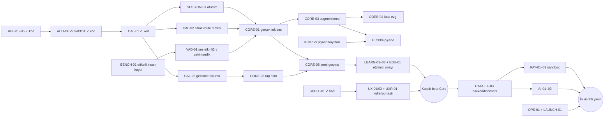

# Harmonia — Current Roadmap

**Tarih:** 2026-10-13 (son güncelleme: DATA-03a yerel taşıma, LEARN-04a rapor, SHELL-04a tercih)
**Durum:** Faz 1 — güvenilirlik sözleşmeleri, yerel kayıt laboratuvarı, deneysel DSP/worker, kalibrasyon/kalite kapısı ve misafir uygulama kabuğu kod-test seviyesinde. Tek ses skor ekranı hâlâ simülasyon; fiziksel cihaz, insan sesi benchmark'ı, eğitimci içerik onayı ve öğretim pilotu kapıları açık. **Hiçbir modül cihazda/pilotta doğrulanmış veya yayında değil.**
**Sahip:** Mennan Sevim  
**Platform:** Flutter mobil uygulama; ileride web ve öğretmen paneli

**Son kod doğrulaması (2026-10-13, 21:30 TRT):** `dart tool/quality_check.dart` exit 0: 596 test geçti, analyze temiz, format 174 dosya/0 değişiklik. CI etkin değil; cihaz testi yapılmadı. Xcode 27.0 kurulu; Android cmdline-tools/lisans eksik. Gerçek voice/cihaz ve eğitimci kapıları açık.

**CAL-03a:** Ortak gözlenen saat, route/rate bağlamı ve 8–64 trial doğrulanır; medyan/MAD/ham P90–P10, aykırı trial indeksleri ve çekimser durumlar raporlanır. Planlanan playback timestamp'i duyulmuş klik değildir; mixed clock ve inferred route reddedilir. Tap hizalama motor yanlılığını içerir; loopback toplam gecikmesi dokunma pipeline'ına taşınamaz. Bu diagnostic **LatencyCalibration üretmez, ritim düzeltmez ve count-in açmaz**. Gerçek ölçüm adapter'ı/protokolü CAL-03b ve cihaz kapısı açık.

**LEARN-01a (22:05 TRT, ayrı oturum):** taslak beceri grafiği (15 düğüm; önkoşul, döngüsüzlük ve rota kuralları doğrulanır), kanıta dayalı durum merdiveni (ölçülmedi → çalışılıyor → destekle → bağımsız → sonraki gün korundu) ve hedefe göre filtrelenen “Beceri haritası” ekranı. Yalnız ritim düğümleri uygulamada ölçülüyor; diğerleri dürüstçe “henüz ölçülmedi”. 436 test (CAL-03a'nın 21 testi dahil), analyze/format temiz. Eğitimci onayı yok; kilit yok.

**PERC-01 (23:00 TRT):** “Tiz mi, pes mi?” dinleme çalışması — 8 sentetik ton çifti/tur, dengeli (her zaman aynı düğme = %50), tohumlu; cevap dokunmayla, mikrofon/DSP yok; şans düzeyi ekranda. Sonuç `touch` kaynaklı, `dimension: perception`, accuracy ölçülü, timing/stability uygulanamaz. Beceri grafiğinde “Tiz / pes ayırt etme” artık ölçülüyor (200 ve 100 cent seviyeleri, taslak ölçüt: art arda iki tur ≥7/8). Değerlendirici ortak `MeasuredExercise` arayüzüne taşındı. 448 test, analyze/format temiz. **iOS simulator build bu turda araç hatasıyla düştü** (Flutter `debug_unpack_ios` mimari kontrolü; framework doğru mimarileri içeriyor; motor önbelleği derleme sırasında yeniden yazıldı, aynı anda başka ajanın test süreci açık) — kod değişikliğinden kaynaklandığına dair kanıt yok, `flutter clean` diğer ajan bitince denenmeli.

**LEARN-03b (23:10 TRT):** Home “Bugünkü öneri” artık beceri grafiği üzerinden, hedefin rotasındaki **tüm ölçülen egzersizleri** (tiz/pes + ritim) kapsıyor: vadesi gelen kalıcılık kontrolü → rotadaki ilk tamamlanmamış ölçülebilir çalışma (tekrar/yeniden dene/sıradaki) → tamam. Ölçülemeyen önkoşullar engellemez. Algı turunda kalıcılık kontrolü = her çift tek dinleme, sonuç işaretli. 454 test, analyze/format temiz.

**iOS simulator build engeli (ortam):** Xcode 26.6 `lipo`, Flutter 3.44.4'ün `lipo <bin> -verify_arch arm64 x86_64` çağrısını reddediyor (“requires exactly one input file”); mimariler tek tek doğrulanınca geçiyor. Önceki başarılı derlemeler bu adımı önbellekten atlamıştı; motor önbelleği yenilenince ortaya çıktı. Kod kaynaklı değil. Çözüm kullanıcı ortamında: Flutter'ı bu Xcode'u destekleyen sürüme güncellemek veya uyumlu Xcode/Command Line Tools seçmek.

**INT-01a (23:30 TRT, ADR-024 hareketli do):** “Dereceyi bul” dinleme çalışması — her soruda tonik bağlamı (do–mi–sol), sonra do → hedef derece; ton soru başına değişir; cevap hece + aralık adı; seçenekler dengeli; şans düzeyi ve en çok karışan derece çifti gösterilir; 3 taslak seviye. Sonuç `Skill.interval`, `solfege: movable_do`, algı boyutu. Beceri grafiğinde “Tonik ve dereceler” ölçülüyor (ilk iki seviye, ≥7/8 × 2); günlük öneri rotada buraya ulaşır. 466 test, analyze/format temiz. Eğitimci terminoloji/içerik onayı yok; iOS simulator build engeli (Xcode lipo) sürüyor.

## Modül envanteri (A–Q) — kanıt durumu

**2026-10-13 21:30 TRT — DATA-03a / LEARN-04a / SHELL-04a:** Ayarlar →
"Verilerini taşı" (ses-siz JSON panoya; strict import, çakışma korunur);
beceri haritasında rapor kartı (sayılar, bilinmeyen ≠ zayıf, tek hedef, yüzde
yok); günlük bütçe cihazda hatırlanır. 22 yeni test, 596 suite.

**2026-10-13 20:45 TRT — LEARN-03c:** Home'da Deneysel "Günlük çalışma
rotası": 5/12/15 dk plan; kalıcılık kontrolü (1/3/7/14 gün kuyruğu) → zayıf
tekrar → yeni; gün içi sabit plan ve tur ilerlemesi; boş süre açıkça yazılır.
19 yeni test, 574 suite. Süreler/aralıklar taslak; eğitimci ve öğrenme pilotu
kapısı açık. Mastery eşikleri değişmedi.

**2026-10-13 19:17 TRT — LEARN-02c:** Sürümlü draft-only JSON codec;
strict fields/types/enums/budgets, graph/phase/held-out ID yeniden doğrulama,
no accepted prefix ve sanitized parser error. 11 yeni test, son full 555.
Automatic file/asset/import UI veya gerçek onay yok. Sonraki LEARN-03 süreli
5/12/15dk günlük plan, taslak süreler/öğretim kapısı ayrı.

**2026-10-13 14:17 TRT — LEARN-02b:** Beceri haritasından iki taslak mikroders
okunuyor; görünür onay/örnek bekleme, beş faz ve algı/üretim. Practice disabled,
audio/mic/history/mastery/completion yok. 6 widget testi, 544 full suite;
okuma pedagojik kazanım değil. Sonraki LEARN-02c versioned strict JSON draft
katalog/import kapısı; EDU-01 gerçek onay ve örnek bankası hâlâ açık.

**2026-10-13 09:15 TRT — LEARN-02a:** Mikroders beş faz ve skill/route/algı-
üretim bağlama sözleşmesi; immutable/bounded, training/control ID leak reddi.
İki yalnız metin taslağı (tiz/pes, puls); boş örnek bankası ve onay/assessment
kapalı. Okuma/mastery bridge yok. 9 yeni test; sonraki LEARN-02b taslak okuma
ekranı/skill-map erişimi. 12 onaylı mikroünite veya öğretim kabulü değil.

**2026-10-13 04:20 TRT — REL-08:** Script-root Harmonia guard, read-only
format→analyze→full suite, fail-fast exit, explicit locked --fetch ve --plan.
10 runner/CLI testi, 529 full suite. Hosted CI/docs taslağı etkin değil;
code checks ses/cihaz/pilot kabulü değil. Sıradaki hazır LEARN-02 mikroders
şeması; gerçek içerik için eğitimci onayı açık tutulur.

**2026-10-12 23:20 TRT — CORE-04b2:** Ana menüde Deneysel kısa ezgi kartı;
üç sentetik ton→bekle→söyle→quality→puansız detail ekranı. Girişte izin/kayıt
yok, kaynak/Hz adayları açık; history/mastery/AI/scorer bağı yok. 8 fake widget
testi (320px/1.8×, lifecycle, izin, kalite, a11y) ve 519 suite. CORE-04 gerçek
voice/device/pedagoji, recall ve hata bölüm loop kapıları açık. Sıradaki güvenli
bağımsız paket REL-08 local QA runner/CI taslağı, sonra LEARN-02 mikroders.

**2026-10-12 18:20 TRT — CORE-04b1:** Typed ezgi reference'inden 3–5 sıralı
sentetik ton WAV'ı ve capture+clip player adapter'ı; varsayılan tek C4 fallback
yok. Stop/close hata halinde iki kaynağı da kapatmayı dener; mock source korunur.
8 yeni regresyon, 511 full test. Gerçek piyano/cihaz/eğitimci kanıtı değil;
CORE-04b2 puansız ekran ve home bağlantısı sırada. Skor/başarı kapalı.

**2026-10-12 13:13 TRT — CORE-04a:** Puansız ezgi application koordinatörü;
3–5 nota reference bağlama sözleşmesi, kalibrasyon/kalite kapısı, tamamlanan
player callback sayımı ve diagnostic segment raporu. Native komutlar sıralı;
iptal, geç worker ve pending-start temizliği testli. Ürün adapter/ekranı henüz
yok (CORE-04b); callback sayısı duyma/hafıza kanıtı değil. Başarı/skor kapalı.

**2026-10-12 07:51 TRT — CORE-03b diagnostic segmentleme:** Recording frame
kanıtından hedef bağımsız periodic pitch adayları çıkaran `PitchSegmenter`
eklendi. Sessizlik/clip/unreliable ve kapsanmayan zaman boşluğu üzerinden
birleştirme yok; kısa run/spike indeksleri açıkça discarded evidence'da.
Ham oktav korunur; sınırlar window-center tahmini, gerçek onset veya VAD değil.
Ürün başarı/memory/timing/skor bağlantısı kapalı; CORE-04 oturum/UI ve gerçek
VAD/ezgi benchmark/cihaz kapıları açık. Son doğrulama IMPLEMENTATION_LOG'da.

**2026-10-12 02:47 TRT heartbeat — CORE-03a:** Mevcut beceri grafiği/günlük
plan/aralık geliştirmeleri korundu; sıradaki bağımsız ezgi altyapısı uygulandı.
Önceden segmentlenmiş monofonik olayları exact-order karşılaştıran bounded
`PitchSequenceAligner`: doğru/yanlış pitch/yanlış oktav/eksik/fazla adımları ve
immutable kaynaklı kanıt. Aynı nota sayısı, ters sıra veya tekrarlanan cevap
başarı sayılmaz. Boş/bozuk cevapta sıra kararı null; timing/memory/skor yok.
**480 test (+14), analyze temiz, format 143/0.** Mobil build/gerçek cihaz testi
yapılmadı. PCM segmentleme, VAD/insan benchmark'ı ve ezgi ekranı açık.

Durum sözlüğü: **Planlandı → Geliştiriliyor → Kod-test tamamlandı → Cihazda doğrulandı → Eğitim pilotunda doğrulandı → Yayında.** Bir modül, alt paketlerinden biri kod-test olduğunda değil, kendi kabul kapılarının hepsi geçtiğinde ilerler. Tamamlanma yüzdesi verilmez. İş ID'leri: [IMPLEMENTATION_ROADMAP.md §11](./IMPLEMENTATION_ROADMAP.md#11-modül-envanteri-iş-idleri-2026-10-11).

| Modül | Durum | Kodda olan (kanıt) | Eksik / sonraki ID | Dış kapı |
|---|---|---|---|---|
| A. Kabuk ve başlangıç | Geliştiriliyor | Misafir hedef seçimi, home, ayarlar/yardım/gizlilik/abonelik/hesap bilgi ekranları, yükleniyor/hata/yeniden dene, yerel profil silme, light/dark, 320px/1.8× testleri (SHELL-01); **Flutter erişilebilirlik kılavuz testleri: dokunma hedefi (Android/iOS), etiketli hedef, metin kontrastı — açık/koyu home/onboarding + oturum/ritim/lab/geçmiş (QA-01a)** | Kalıcı izin reddi → OS ayarı (SHELL-02), başlangıç değerlendirmesi (SHELL-03), kaldığı yerden devam/offline (SHELL-04) | Ekran okuyucu ve kullanıcı testi (UXR-01) |
| B. Ses motoru ve oturum | Geliştiriliyor | Kayıt/çalma lab, bounded WAV, YIN frame, kayıt diagnostics, native isolate, epoch iptal; **noise-floor kalibrasyonu, kalite kapısı, route politikası, latency sözleşmesi (CAL-01)**; **tek ses ürün oturum koordinatörü (SESSION-01)**; **canlı giriş seviyesi göstergesi (UX-03a; eklenti genliği, yalnız görüntü)**; just_audio tekrar oynatma düzeltmesi; **açılışta yetim geçici ses temizliği + ayarlarda hata uyarısı (SESSION-02)** | Gerçek VAD (VAD-01), latency ölçüm prosedürü (CAL-03), worker hard cancel | Fiziksel iOS/Android route matrisi (CAL-02), etiketli insan benchmark'ı (BENCH-01) |
| C. Tek ses | Geliştiriliyor | Scorer v2, oktav kuralı, nötr geçersiz sonuç; mock senaryo ekranı (Simülasyon); **gerçek kayıtlı “dinle ve söyle” oturum ekranı — puansız, doğru/yanlış kapalı** | Gerçek karar (CORE-01) yalnız VAD/benchmark sonrası | BENCH-01, cihaz QA |
| D. Ses aralığı | Planlandı | — | AUD-DEV-06 | BENCH-01; SATB/sağlık iddiası yok |
| E. Aralık / fonksiyonel duyma | Geliştiriliyor | Tiz/pes algı (PERC-01); **hareketli do derece duyma (INT-01a)**; algı ve üretim ayrı | INT-01 içerik+algı/üretim ayrımı | Eğitimci (fixed/movable-do kararı) |
| F. Ritim | Geliştiriliyor | Event alignment + vuruş bazlı hizalama; **dinle→tekrar et taklit modu (CORE-02a): pointer engine timestamp, ilk dokunuş çapası (zamanlaması ölçülmez), sentetik klik referansı, dinleme kotası, zaman çizelgesi, tempo ipucu**; 3 taslak desen | Eşzamanlı/count-in mod CAL-03'e bağlı (CORE-02b); ritim okuma/dikte | Eğitimci desen onayı ve tolerans kalibrasyonu; fiziksel dokunma örnekleme ölçümü |
| G. Ezgi | Geliştiriliyor | Fail-closed placeholder analyzer; CORE-03a symbolic alignment; CORE-03b diagnostic segmentleme; CORE-04a puansız session; CORE-04b1 sentetik reference; CORE-04b2 puansız ekran/home (8 widget testi) | Güvenilir bölüm döngüsü, gerçek segmentleme kabulü ve timing/hafıza/recall protokolü | İzinli ezgi fixture'ları, VAD/benchmark, cihaz ve eğitimci QA |
| H. 2/3/4 piyano | Geliştiriliyor (içerik bekliyor) | Kapalı placeholder katalog/ekran, renderer alternatifi | Reviewed manifest/player/session (CONS-01/02) | **Kullanıcının piyano kayıtları** + birlikte QA |
| I. Dersler / rotalar | Geliştiriliyor | Taslak graph/merdiven/harita (LEARN-01a), rota önerisi (LEARN-03a/b), süreli günlük plan (LEARN-03c), beceri raporu (LEARN-04a); LEARN-02a/b mikroders sözleşmesi + iki metin/reader; LEARN-02c strict draft JSON codec | Reviewed örnek bankası/ders akışı ve IO adapter, EDU-01 içerik/ölçüt onayı | Eğitimci ölçüt/içerik onayı ve öğrenme etkisi pilotu; okuma mastery değildir |
| J. Sonuçlar / gelişim | Geliştiriliyor | Sonuç v2 + katı `fromJson`; **yerel geçmiş (CORE-05): attempt ID tekilleştirme, çakışmada üzerine yazmama, açık kapasite, seri atomik yazma, bozuk dosyayı koruma; geçmiş ekranı (aynı cohort'ta ≥3 geçerli deneme yoksa “bilinmiyor”), tek/toplu silme**; ritim sonuçları `touch` kaynağıyla kaydediliyor | Upload/consent kısmı (DATA-03, backend) | — |
| K. Offline / hesap / backend | Geliştiriliyor | Atomik yerel JSON store + misafir profil + yerel sonuç geçmişi (tamamen offline) | Backend ADR (DATA-01), sync/outbox (DATA-02), consent (DATA-03) | Backend hesabı/maliyet onayı |
| L. AI koç | Geliştiriliyor | **Girdi/çıktı sözleşmesi, katı doğrulayıcı, zaman aşımı + yedek, 12 yerel eval (AI-02a); canlı çağrı yok** | AI-01 sunucu gateway, AI-03 gerçek model eval, UI bağlantısı | Ücretli API onayı, gateway |
| M. Plus eğitimci | Planlandı | HUMAN_REVIEW tasarımı | HUM-01–07 | Gerçek eğitimci kapasitesi, hukuk |
| N. İleri konservatuvar | Planlandı | — | CONS-03–05 | Güncel resmî kaynak, eğitimci rubriği |
| O. Koro | Planlandı | Route politikası: hoparlörde rehberli parti desteklenmez | CHOIR-01–05 | Kulaklıklı cihaz spike, eğitimci |
| P. Abonelik / haklar | Planlandı | Ayarlarda “satın alma yok” bilgisi | PAY-01–03 | Mağaza hesabı, sandbox, canlı ödeme onayı |
| Q. Öğretmen / sosyal | Planlandı | — | TEACH-01, SOC-01 | İzinli sınıf pilotu |

## Üç teslim kapsamı

1. **Kapalı beta Core** — A (izin/kalibrasyon dahil), B (oturum + kalite kapısı + en az 1 iOS ve 1 düşük/orta Android cihaz raporu), C (benchmark kapısı geçerse gerçek tek ses; geçmezse kapalı), F (ölçülmüş gecikmeyle tap ritim), G (3–5 nota, segmentleme benchmark'ı geçerse), J yerel geçmiş, I ilk mikroüniteler (eğitimci onaylı). Ödeme, hesap, AI ve bulut yok; ham ses cihazdan çıkmaz. Internal/TestFlight dağıtımı ayrı onay ister.
2. **İlk ücretli yayın** — Core + D, E, günlük rota ve gecikmeli kontrol (I), hesap/sync/silme/export (K), isteğe bağlı sınırlı AI koç (L), Premium abonelik sandbox senaryoları (P), crash/hata izleme ve destek (OPS-01), hukuk/çocuk güvenliği/mağaza metni (LAUNCH-01). Plus, pilot kapıları geçmeden satılmaz.
3. **Genişleme** — H (kayıtlar gelince; sequence motoru hazırsa daha erken), M Plus, N ileri konservatuvar, O koro, Q öğretmen/sosyal.

## Kritik yol ve bağımlılıklar

Kritik yoldaki insan/dış kapılar: etiketli izinli kayıtlar (BENCH-01), fiziksel cihazlar (CAL-02), eğitimci içerik onayı (EDU-01), kullanıcı testleri (UXR-01), piyano kayıtları (H), backend/AI/mağaza hesapları ve hukuk incelemesi. Kod işleri bu kapıları geçmiş saymaz.

## 30 / 60 / 90 günlük kapasiteye bağlı plan

Tek geliştirici + kullanıcı koordinasyonu varsayımıyla öneridir; tarih garantisi değildir, dış kapılar gecikirse kayar.

| Pencere | Kod (onay gerektirmeyen) | Kullanıcı/dış girdi gerektiren | Çıkış kanıtı |
|---|---|---|---|
| 0–30 gün | SESSION-01/02, CAL-03 prosedür kodu, CORE-02 tap ekranı, CORE-05 yerel geçmiş, SHELL-02/04 | 2 fiziksel cihazda CAL-02 protokolü; BENCH-01 için izinli 100+ kayıt planı ve ilk etiketler; UXR-01 5 kişilik ilk değer testi | Cihaz raporu, ilk etiketli set, kullanıcı testi notları |
| 31–60 gün | VAD-01 (development seti), CORE-01 kapılı bağlantı, CORE-03 segmentleme spike, EDU-01 içerik şeması | Holdout benchmark ölçümü; eğitimci ilk 12 mikroünite onayı; internal build dağıtım onayı | Holdout raporu (yanlış başarı/çekimserlik), onaylı içerik, kapalı beta adayı |
| 61–90 gün | LEARN-01–03, DATA-01 ADR + adapter'lar, AI-03 eval seti (canlı çağrısız), PAY-02 sandbox entegrasyon kodu | Kapalı beta kullanıcıları; backend/AI/mağaza hesabı ve maliyet onayları; hukuk incelemesi | Beta öğrenme/geri dönüş ölçümü, ücretli yayın kapı listesi |

## Kuzey yıldızı

Harmonia, konservatuvar ve müzik sınavlarına hazırlanan öğrencinin her gün kısa bir çalışma yapmasını, hatasını anlamasını ve bir sonraki doğru egzersize yönlendirilmesini sağlamalıdır.

**Ana vaat:** “Her gün 10 dakika: duy, hatırla, tekrar et, sınava hazırlan.”

## Mevcut gerçeklik

- Ayrıntılı iş/sprint/yayın planı: [IMPLEMENTATION_ROADMAP.md](./IMPLEMENTATION_ROADMAP.md). Uygulanmış paket ve doğrulama: [IMPLEMENTATION_LOG.md](./IMPLEMENTATION_LOG.md).
- 2026-10-11 geliştirme başlangıcı: ScoreMetric/sonuç v2, valid-invalid, metrik örnek sayıları ve zorluk/mod/sürüm cohort; ritim event alignment; ezgi placeholder'ın sahte skoru kapatıldı. 58 test geçti; analyze temiz, format kontrolü değişiklik bulmadı. Gerçek ses/pedagoji kapısı geçilmedi.
- Agora Voice içinde çalışan tek sesli ses aralığı testi referans prototip olarak incelendi.
- Referans projede yukarı/aşağı nota taraması, mikrofon kontrolü, pitch analizi, ses kayıtları ve skor tablosu bulunuyor.
- Harmonia'da domain/mock tek ses ekranı ve yerel kayıt→native DSP diagnostic laboratuvarı var; VAD/gerçek başarı ve fiziksel mikrofon doğrulaması bekliyor.
- Ses ölçümü deterministik ses işleme ile yapılacak; AI ölçümün yerine geçmeyecek.
- `gpt-4o-mini`, ölçüm sonuçlarını açıklayan ve egzersiz seçen metin tabanlı koç olarak kullanılacak.

## Fazlar

### 2026-10-11 eğitim ve Plus kapsam güncellemesi

[Derin inceleme](./PRODUCT_AUDIT.md) kodda olan/plandaki özellikleri ayırır. [Öğrenme modeli](./LEARNING_MODEL.md) ortak temel ve konservatuvar/koro rotalarını; [gerçek eğitimci hizmeti](./HUMAN_REVIEW.md) Plus kapsamını tanımlar. Tercih edilen tasarım Aurora marka deneyimi + Konservatuvar açıklayıcı sonuç yaklaşımıdır; kullanıcı testi bekleniyor. Bu oturum yalnız dokümanlar değişti, canlı özellik eklenmedi.

- **Faz 1–2 P0:** AUD-01–07/F26: ölçülmeyen timing/memory 100, melody count=order, extra tap=100 ve koşulsuz progress ortalaması kapatılmadan gerçek eğitim değerlendirmesi yok. Nullable/status + sequence/rhythm/tuning sözleşmeleri.
- **Faz 2:** F22 mikroders/algı-üretim ayrımı/ipucusuz yeni soru; core sadece test bankası olarak çıkmaz.
- **Faz 3:** Mastery ve gecikmeli kontrol; 3 eğitimci/20 başvuruluk F21 pilotu; F23 kulaklıklı parti bağımsızlığı teknik spike. Tam sınıf paneli bu pilotun önkoşulu değil.
- **Faz 4:** Ayrı çıkış kapılarıyla ileri konservatuvar ve koro rotaları, kurum/yıl eşlemesi, Plus'ın gerçek insan teslimi. Kota/fiyat/teslim kapasite pilotundan sonra.
- **Faz 5:** Sınıf/ödev platformu ve isteğe bağlı lig. Makam/usul, enstrüman pedagojisi ve büyük repertuvar ayrı kapsam olarak kalır.

**Yeni doğrulama:** 2026-10-11'de 26 test tekrar geçti; static analysis sorun bulmadı. Bunlar mock/domain/widget testleridir; gerçek ses veya pedagojik etkililik doğrulaması değildir.

### 2026-10-10 kapsam güncellemesi

10 ilgili rakibin resmî ürün özellikleri incelendi: [araştırma](./COMPETITOR_RESEARCH.md). Eksik özellikler [F01–F20 backlog'una](./FEATURE_BACKLOG.md), beş etkileşimli tasarım [tasarım çalışmasına](./DESIGN_STUDIES.md) kaydedildi. Bunlar uygulamaya eklenmiş canlı özellikler değil; önceliklendirilmiş ürün planı ve tasarım prototipleridir.

- **Faz 1:** AUDIO-01/02/03, doğru oktav, invalid measurement, gerçek pitch/enerji görseli. 3/4 sesli sıralı cevap için erken teknik spike; canlı motor kapısı önce.
- **Faz 2:** teori mikrodersi, hata döngüsü/tempo, offline sonuç kuyruğu, beceriden ilgili egzersize geçiş (F06/F09/F14/F05).
- **Faz 3:** başlangıç/ileri düzey ve adaptif tekrar; AI yalnız ölçülen veriyi açıklar (F02/F12).
- **Faz 4:** 2/3/4 sesi birlikte duyup sırayla söyleme, akor çevrimi, fonksiyonel duyma/solfej, deşifre/dikte, kişisel preset, süreli deneme, abonelik (F07/F08/F10/F11/F13/F16).
- **Faz 5:** sınıf programı, normalize opt-in lig, öğretmen grup lisansı (F15/F17). Enstrüman bankası/MIDI/repertuvar/nefes ölçümü daha sonra ve lisans/benchmark şartıyla.

Eşzamanlı mikrofondan çoklu pitch ayırma ayrı AR-GE'dir; mevcut monofonik motoru üç kez çalıştırmak değildir. İlk 3/4 sesli ürünün önkoşulu değil. [Motor planı](./AUDIO_ENGINE_PLAN.md).

Faz süreleri tam zamanlı tek geliştirici ve dar kapsam için eski kaba tahminlerdir; yeni özelliklerin tamamı bu sürelere otomatik sığmaz. Benchmark ve pilot sonrası yeniden tahmin yapılmalı.

### Faz 0 — Keşif ve ölçüm temeli

**Süre:** 1–2 hafta

**Amaç:** Yanlış ürünü hızlıca inşa etmemek.

- 10–15 öğrenci ve 3–5 müzik öğretmeniyle görüş.
- Gerçek sınav egzersizlerini ve kullanılan terminolojiyi listele.
- En az 100 etiketli tek ses kaydı topla: doğru nota, yanlış nota, oktav hatası, gürültü, kararsız ses.
- Pitch motoru için yanlış pozitif/negatif benchmark seti oluştur.
- MVP’de hangi egzersizlerin olacağını kesinleştir.

**Çıkış kriteri:** Kullanıcı problemi, MVP kapsamı ve ölçüm başarı hedefleri yazılı hale gelmiş olmalı.

### Faz 1 — Teknik spike

**Süre:** 1–2 hafta

- Flutter ses yakalama prototipi.
- Canlı RMS ve pitch göstergesi.
- Pitch analizini UI thread’inden ayırma.
- Doğru oktavı yanlış oktavdan ayıran testler.
- Ritim için tap timestamp toplama prototipi.
- Offline modda temel analiz.

**Çıkış kriteri:** Aynı kayıt, desteklenen cihazlarda tutarlı sonuç vermeli; algoritma testleri çalışmalı.

### Faz 2 — MVP: Harmonia Core

**Süre:** 6–8 hafta

Kullanıcıya görünen ilk ürün:

- Misafir başlangıç testi.
- Mikrofon kalibrasyonu.
- Tek ses dinle-söyle.
- Basit interval egzersizi.
- Ritim dinle-tıkla.
- 3–5 notalık ezgi tekrarı.
- Egzersiz sonunda açıklanabilir geri bildirim.
- Mikroders, algı/üretim ayrımı, destekten ipucusuz yeni soruya geçiş.
- Günlük mini çalışma.
- Temel ilerleme geçmişi.

**MVP dışı:** Sosyal ağ, genel chatbot, büyük şarkı kütüphanesi, öğretmen paneli, herkese açık leaderboard.

**Çıkış kriteri:** Yeni kullanıcı 3 dakika içinde ilk egzersizi tamamlayabilmeli ve neden hata yaptığını anlayabilmeli.

### Faz 3 — Adaptif öğrenme ve Harmonia Coach

**Süre:** 4–6 hafta

- `gpt-4o-mini` ile egzersiz sonu koç mesajı.
- Hata türüne göre sonraki egzersiz seçimi.
- Günlük ve haftalık çalışma planı.
- Pitch, ritim, ezgi ve ses aralığı ayrı gelişim skorları.
- Tekrarlanan hatalara göre zorluk ayarı.
- AI cevaplarının JSON schema ile doğrulanması.
- Beceri önkoşulları, zorluk/mod/içerik sürümü, gecikmeli kontrol ve geçerli örnek bazlı mastery.
- Plus gerçek eğitimci pilotu: kayıt + seçili gelişim özeti → eğitimcinin yazılı yorumu → takip ödevi.
- Koro parti bağımsızlığı için kulaklıklı tek-vokal ölçüm spike'ı.

**Çıkış kriteri:** AI önerisi aynı girdide tutarlı, güvenli ve UI tarafından işlenebilir olmalı.

### Faz 4 — Konservatuvar modu ve abonelik

**Süre:** 4–6 hafta

- 2, 3 ve 4 sesli sınavlar.
- Ritim tekrarı ve tempo analizi.
- 7–10 notalık ezgi hafızası.
- Konservatuvar sınav simülasyonu.
- Premium içerik ve abonelik.
- Kişisel raporların dışa aktarımı.
- Ham ses kayıtları için açık rıza, silme ve dışa aktarma.
- Koro alt rotası: rehberi azalt/diğer partilerle söyle, giriş-bitiş ve kısa repertuvar aktarımı.
- Okul/bölüm/yıl gereksinimlerini kaynağa bağlama; çalgı/şan dış kapsamını gösterme.
- Plus: gerçek eğitimci kapasitesi, güvenli kayıt/hak ledger ve teslim/iade kapıları geçildiyse ücretli hizmet.

**Çıkış kriteri:** Kullanıcı doğrulanmış şablonla ipucusuz deneme tamamlayabilmeli; koro rotasında rehbersiz parti çalışması ayrı doğrulanmalı. Plus satılıyorsa gerçek eğitimci teslimi ve gizlilik/hak kapıları geçilmiş olmalı. Tam sınav/prova yerine geçme iddiası yok.

### Faz 5 — Öğretmen ürünü ve kontrollü sosyal sistem

**Süre:** 8–12 hafta

- Öğretmen paneli.
- Sınıf ve öğrenci grupları.
- Ödev gönderme.
- Özel sınav oluşturucu.
- Anonim ve zorluk-normalize ligler.
- Gelişim yüzdesi bazlı ödüller.

**Çıkış kriteri:** En az bir öğretmen gerçek sınıfıyla ürünü kullanmalı ve haftalık raporu faydalı bulmalı.

## Öncelik sırası

1. Oktav doğruluğu ve pitch güvenilirliği.
2. Tek ses deneyimi.
3. Ritim ve kısa ezgi tekrarı.
4. Açıklanabilir geri bildirim.
5. Adaptif çalışma planı.
6. Gerçek eğitimci hizmet pilotu ve koro parti bağımsızlığı spike'ı.
7. 2/3/4 sesli sınavlar, solfej/deşifre ve rota içerikleri.
8. Kapıları geçilmiş Premium/Plus aboneliği.
9. Tam öğretmen/sınıf paneli.
10. Leaderboard ve sosyal özellikler.

## Yapılan iş (2026-08-16)

Faz 0/1 kapsamında kod tabanı ilk kez oluşturuldu (`agoravoiceweb`'e dokunulmadı, AI hiçbir yere bağlanmadı):

- **Flutter iskeleti:** `flutter create` ile proje kuruldu (`pubspec.yaml`, `lib/main.dart`, `android/`, `ios/`).
- **Klasör yapısı** (`ARCHITECTURE.md` katmanlarını yansıtır):
  - `lib/app/` — app shell (`harmonia_app.dart`).
  - `lib/domain/models/` — `User`, `Exercise`, `ExerciseAttempt`, `ExerciseResult`, `SkillProgress`.
  - `lib/domain/audio/` — `PitchAnalyzer`, `RhythmAnalyzer`, `MelodyAnalyzer` arayüzleri ve sonuç tipleri.
  - `lib/domain/scoring/` — `PitchExerciseScorer`: `PitchAnalysisResult`'ı `ExerciseResult` sözleşmesine çevirir (ADR-006 dahil: yanlış oktav asla başarı sayılmaz).
  - `lib/infrastructure/audio/mock/` — `MockPitchAnalyzer` (senaryo seçilebilir: doğru, yanlış nota, yanlış oktav aşağı/yukarı, kararsız, gürültü, sessizlik), `MockRhythmAnalyzer` (gerçek onset eşleştirme mantığı, DSP gerektirmiyor), `MockMelodyAnalyzer` (placeholder).
  - `lib/features/single_tone_exercise/` — ilk egzersiz ekranı.
- **İlk egzersiz ekranı:** Tek ses (C4) dinle-söyle ekranı. Gerçek mikrofon henüz yok; senaryo butonlarıyla mock pitch motoru tetiklenip başarı, yanlış nota, yanlış oktav (aşağı/yukarı), kararsız ses, gürültü ve sessizlik durumları gösteriliyor. Hata metinleri `AI_COACH.md` § Fallback'teki kural tabanlı, AI'siz metinlerle birebir aynı.
- **Testler:** `test/domain/...`, `test/infrastructure/audio/mock/...`, `test/widget_test.dart` — 26 test, hepsi geçiyor (`flutter test`). `flutter analyze` temiz.
- **Dokunulmadı / bağlanmadı:** `agoravoiceweb` projesi; AI Coach canlı sisteme bağlanmadı; pitch/ritim skorları hâlâ tamamen deterministik kodla hesaplanıyor (AI'ye hesaplatılmadı).

## Bir sonraki oturum

**Başka modele devir:** Önce [MODEL_HANDOFF.md](./MODEL_HANDOFF.md) ve [AGENTS.md](./AGENTS.md) oku; kod/akış haritası, gerçek doğrulama sınırları, önerilen ama kaydedilmemiş piyano listesi ve en yakın diagnostic integration dilimi burada özetlenir. Bu teslim kullanıcı isteğiyle ilk yerel commit olarak kaydediliyor; push/yayın yok.

**Yeni kullanıcı yönü (geçerli):** Hazır 2/3/4 sesli piyano kayıtları klasörlerden çalınacak; kayıtlar gelince birlikte incelenecek. O zamana kadar placeholder kapalı. Live multipitch yok. [PIANO_REFERENCES.md](./PIANO_REFERENCES.md).

**Bu oturumda tamamlanan kod paketleri:** CAL-01 (noise-floor kalibrasyonu, kayıt kalite kapısı, route politikası, latency sözleşmesi, laboratuvara bağlantı) ve SHELL-01 (Aurora token'ları, misafir hedef seçimi, home, ayarlar/yardım/gizlilik/abonelik/hesap, yerel profil). Ayrıntı: [IMPLEMENTATION_LOG.md](./IMPLEMENTATION_LOG.md).

**Ek tamamlanan paketler:** SESSION-01, CORE-02a, CORE-05, SESSION-02, LEARN-03a, QA-01a, UX-03a, ANALYTICS-01 (gönderimsiz), AI-02a (canlı çağrısız) ve CAL-03a diagnostic kod-testli. ECON-01 modeli ve UXR-01 protokolü dokümanda. **Sonraki güvenli paket:** LEARN-01 beceri grafiği iskeleti; CAL-03b ise fiziksel referans saat/pipeline ölçüm adapter'ı ve protokolünü gerektirir. Count-in yalnız doğru pipeline'ın bağımsız cihaz ölçümüyle açılır; tap yanlılığı veya loopback toplamını dokunma düzeltmesi yapma. SHELL-02 yeni plugin kararı bekliyor. VAD/benchmark olmadan simülasyon başarı ekranını gerçek motora bağlama; eşikleri sonuca bakarak değiştirme. Mağaza/ödeme/upload/ücretli API/push ayrı yetki ister.

- [x] Öncelikli tasarım yönünü kaydet: Aurora + Konservatuvar. Nihai doğrulama değil.
- [ ] Öğrenci ve eğitimciyle hibrit tasarımın sonuç anlama/sonraki eylem testini yap.
- [x] REL-01/02: measurement status ve metrik durumları; tek seste timing/memory 100 kaldırıldı, invalid puanlanmıyor.
- [x] REL-03/04: metrik bazlı gelişim/cohort ve ritim extra/latency/monoton alignment.
- [x] REL-05: ezgi placeholder'da yanlış sıra/hafıza başarısı üretimini kapat; gerçek analiz yok.
- [ ] REL-06/07: tam exercise sequence/tuning/hint sözleşmesi ve provenance/fixture; gerçek melody alignment CORE-03'te.
- [x] REL-06/07 alt paketi: protokol JSON round-trip, mode/skill politikaları, immutable sonuç evidence, mock pitch provenance ve kaynak/analyzer cohort.
- [x] AUD-DEV-01 alt paketi: PCM16 WAV ve sentetik tone testleri; fixture metadata/holdout sızıntı kontrolleri. Gerçek kayıt seti bekliyor.
- [x] AUD-DEV-01 loader alt paketi: metadata/manifest JSON, disk varlığı/hash/header/Hz/count/bütçe ve symlink/path testleri. Gerçek etiketli kayıt seti bekliyor.
- [x] AUD-DEV-02 kod alt paketi: açık kullanıcı eylemiyle yerel kayıt/çalma laboratuvarı ve fake-testli iptal/lifecycle coordinator. Fiziksel cihaz/Android QA bekliyor.
- [x] AUD-DEV-03 frame alt paketi: hedef bağımsız deneysel DSP, bounds/abstention, sentetik nota/oktav ve WAV→frame regresyonları. Tam kayıt analizi, VAD/benchmark/isolate ve cihaz kapısı açık.
- [x] AUD-DEV-03 kayıt/worker alt paketi: bounded overlapping/end-anchor frame diagnostics, tüm denominator'lar, explicit source/version, log dispersion ve native isolate testleri. Lab bağlantısı/hard cancel, VAD ve gerçek benchmark/cihaz kapısı açık.
- [x] AUD-DEV-04 diagnostic bağlantı alt paketi: owned file bütçesi/header, explicit PCM kaynak, isteğe bağlı worker, stale load/result/error ve lifecycle testleri. Tam exercise session/VAD/cihaz ve hard cancel kapıları açık.
- [x] CAL-01 (AUD-DEV-05 kod alt paketi): noise-floor kalibrasyonu, kalite kapısı, route politikası, latency sözleşmesi ve lab bağlantısı. Cihaz eşik doğrulaması (CAL-02) açık.
- [x] SESSION-01: tek ses ürün oturum koordinatörü + ekran; puansız, hoparlörde referans bitmeden kayıt yok, cevap analizden önce silinir. Cihaz QA açık.
- [x] INT-01a: hareketli do derece duyma (tonik bağlamı, ton değişimi, karışma analizi). Aralık söyleme (üretim), harmonik/inen aralıklar ve eğitimci onayı açık.
- [x] LEARN-03b: rota genelinde (algı + ritim) tek günlük öneri; algıda tek dinlemeli kalıcılık kontrolü.
- [x] PERC-01: tiz/pes algı çalışması (dokunma cevaplı, şans düzeyi gösterilir); beceri grafiğine bağlı. Eğitimci içerik onayı ve simülatör/cihaz denemesi açık.
- [x] LEARN-01a: taslak beceri grafiği, kanıta dayalı durum merdiveni, beceri haritası ekranı. Eğitimci onayı, mikroders içeriği (LEARN-02) açık.
- [x] QA-01a: erişilebilirlik kılavuz testleri (dokunma hedefi/etiket/kontrast). Ekran okuyucu ile manuel test açık.
- [x] UX-03a: kayıt/kalibrasyon sırasında canlı giriş seviyesi (yalnız görüntü). Cihazda dBFS doğrulaması açık.
- [x] LEARN-03a: kural tabanlı tek sonraki adım (tekrar → yeni desen → ertesi gün kalıcılık kontrolü). Eşikler taslak; eğitimci onayı ve öğrenme pilotu açık.
- [x] CORE-05: yerel sonuç geçmişi + geçmiş ekranı; aynı attempt iki kez sayılmaz.
- [x] SESSION-02: açılışta yetim geçici ses dizini temizliği; hata ayarlarda görünür.
- [x] CORE-02a: ritim taklit modu (ilk dokunuş çapası, vuruş zaman çizelgesi). Eğitimci desen onayı ve cihaz dokunma ölçümü açık; count-in modu CAL-03'e bağlı.
- [x] SHELL-01: Aurora token'ları, misafir hedef seçimi, home, ayarlar/yardım/gizlilik/abonelik/hesap, yerel profil. Kullanıcı testi (UXR-01) açık.
- [ ] AUDIO-01: referans motorun kısa buffer/oktav testlerini ve fixture sözleşmesini çıkar.
- [ ] AUDIO-02: gerçek mikrofon + frame pipeline; ölçülmeyen timing/memory değerlerini sonuçta gösterme.
- [ ] AUDIO-03: gerçek VisualFeedbackFrame ile seçili ses efektini Flutter'da bağla.
- [ ] AUDIO-04: 3/4 referans playback + sıralı nota segment/alignment spike; gerçek fixture üzerinde değerlendir.
- [x] AUDIO-04 piyano hazırlama alt paketi: 2/3/4 bilinen MIDI hedefi/protokol + single-clock WAV mix, headroom/key/rate/tuning/runtime testleri. Bank/player/capture ve gerçek sequence benchmark açık.
- [ ] F22: ilk 12 mikroünitenin öğrenme amaçları ve örnek/kontrol seti için eğitimci onayı.
- [ ] F21: eğitimci uzmanlık/QA rubriği, hak/kota/kapasite politikası, kayıt paylaşma-gizlilik akışı ve küçük pilot planı.
- [ ] F23: başka partiler çalarken kulaklıklı vokal kayıt ölçümü; referans sızıntısı fixture'ı.

Önceki eksik temel işler de devam eder:

- [ ] Gerçek mikrofon yakalama (Flutter ses yakalama prototipi) — `PitchAnalyzer` arayüzünü değiştirmeden `MockPitchAnalyzer`'ın yerini alacak gerçek bir implementasyon.
- [ ] Canlı RMS ve pitch göstergesi (UI thread'inden ayrı, isolate/compute ile).
- [ ] Pitch fixture kayıtlarıyla regression test seti (Faz 0'daki 100+ etiketli kayıt toplandıktan sonra).
- [ ] `DECISIONS.md` içindeki ilk kararları onayla.
- [ ] Faz 0 görüşme sorularını yaz, 10–15 öğrenci/3–5 öğretmenle görüş.
- [x] İlk tek ses benchmark formatı: mono PCM16 WAV ve metadata kapısı. Gerçek benchmark seti henüz yok.
- [ ] Ritim için gerçek tap timestamp toplama prototipi (ekran + mikrofon/dokunma girişi).
- [ ] Ham sesin hangi durumda saklanacağını kesinleştir (rıza akışı `ExerciseAttempt.rawAudioStorageRef` alanına bağlanacak).

## Açık sorular

- İlk yayın odağı konservatuvar işitsel hazırlığı; koro ayrı rota olarak planlandı. Hangi okul/bölüm ve ilk koro düzeyi pilotu daraltacak?
- İlk dil yalnızca Türkçe mi olacak?
- İlk MVP’de sesli kullanıcı kaydı zorunlu mu, misafir modunda mı başlanacak?
- Öğretmenlerin içerik oluşturması ne zaman gerekli?
- Abonelikte hangi içerik gerçekten ödeme isteği oluşturuyor?
- Plus hak/fiyat/teslim kapasitesi, eğitimci ücreti ve kayıt saklama süreleri nasıl doğrulanacak?

## Yarım kalırsa devam notu

Kod yazmaya başlamadan önce `PRODUCT_SPEC.md`, `ARCHITECTURE.md` ve `DECISIONS.md` birlikte okunmalı. Yeni kapsam için `FEATURE_BACKLOG.md`, `AUDIO_ENGINE_PLAN.md`, `DESIGN_STUDIES.md`, `PRODUCT_AUDIT.md`, `LEARNING_MODEL.md` ve `HUMAN_REVIEW.md` de okunmalı. Ölçüm benchmark’ı yoksa AI ve leaderboard geliştirmesine geçilmemeli. Beş önizleme simülasyondur; gerçek mikrofon/abonelik/eğitimci servisi eklenmiş sayılmaz. İlk uygulama paketi skor/ölçüm sözleşmesi + gerçek tek ses pipeline; bütün ileri kapsam bir sprint değildir.

## Değişiklik günlüğü

| Tarih | Değişiklik |
|---|---|
| 2026-08-15 | İlk roadmap, mimari, ürün, AI ve karar dokümanları oluşturuldu. |
| 2026-08-16 | Flutter proje iskeleti, domain modelleri (`User`, `Exercise`, `ExerciseAttempt`, `ExerciseResult`, `SkillProgress`), pitch/ritim/ezgi analiz arayüzleri, mock pitch/ritim/ezgi motorları, `PitchExerciseScorer`, ilk tek ses egzersizi ekranı ve 26 unit/widget testi eklendi. |
| 2026-10-10 | 10 rakibin resmî kaynakları; F01–F20 özellik backlog'u; beş uçtan uca etkileşimli tasarım; 3/4 sesli sıralı cevap/multipitch ayrımı ve ses-görsel sözleşmesi. Flutter kaynakları değiştirilmedi; bu oturumda eski 26 test yeniden çalıştırılmadı. |
| 2026-10-11 | Kod/eğitim yeterliliği incelemesi; 26 test ve temiz analiz yeniden doğrulandı. Aurora + Konservatuvar öncelikli yön; öğrenme modeli/iki rota, Plus gerçek eğitimci servisi, F21–F26 ve ADR-013–016 dokümante edildi. Flutter ve Agora kaynakları değiştirilmedi; canlı servis/ödeme/AI bağlanmadı. |
| 2026-10-11 — geliştirme başlangıcı | Kullanıcı uygulama başlangıcını istedi. Ayrıntılı roadmap; REL-01–05 kaynak/test değişiklikleri ve dar ekran/büyük yazı kontrolü. 58 test geçti; önceki yalnız doküman oturumundan farklı olarak Harmonia kaynakları değiştirildi. Agora, gerçek mikrofon, AI, ödeme ve dış servisler değişmedi. |
| 2026-10-11 — modül envanteri | A–Q modül envanteri, üç teslim kapsamı, kritik yol ve 30/60/90 planı. CAL-01 kalibrasyon/kalite kapısı ve SHELL-01 misafir kabuğu kod-test; 299 test, analyze/format temiz, iOS simulator build. Cihaz/pilot/yayın doğrulaması yok. |
| 2026-10-11 — oturum + ritim | SESSION-01 tek ses oturumu (puansız) ve CORE-02a ritim taklit modu; just_audio tekrar oynatma düzeltmesi. 338 test, analyze/format temiz, iOS simulator build ve elle simülatör gezintisi. Cihaz/pilot doğrulaması yok. |
| 2026-10-11 — geçmiş | CORE-05 yerel sonuç geçmişi (katı JSON, tekilleştirme/çakışma/kapasite, bozuk dosya koruma, ekran) ve SESSION-02 yetim ses temizliği. 363 test, analyze/format temiz. |
| 2026-10-11 — sonraki adım | LEARN-03a kural tabanlı sonraki adım + home “Bugünkü öneri”. 377 test, analyze/format temiz. Öğrenme etkisi doğrulanmadı. |
| 2026-10-11 — erişilebilirlik + seviye | QA-01a erişilebilirlik kılavuz testleri ve UX-03a canlı giriş seviyesi. 384 test, analyze/format temiz, iOS simulator build. |
| 2026-10-11 — metrik/ekonomi/UXR | ANALYTICS-01 olay sözleşmesi (gönderim yok), ECON-01 birim ekonomi tablosu, UXR-01 protokolü ve üretim UX akış/durum matrisi. 389 test. |
| 2026-10-11 — AI sözleşmesi | AI-02a koç girdi/çıktı sözleşmesi ve yerel eval (canlı API yok). Oturum sonu: 401 test, analyze/format temiz, iOS simulator build. |
| 2026-10-11 — beceri grafiği | LEARN-01a taslak beceri grafiği, durum merdiveni ve beceri haritası. 436 test (CAL-03a dahil), analyze/format temiz. |
| 2026-10-11 — algı | PERC-01 tiz/pes algı çalışması, ortak ölçülen egzersiz arayüzü. 448 test; iOS simulator build araç hatası (ortam). |
| 2026-10-11 — günlük öneri | LEARN-03b beceri grafiği tabanlı günlük öneri. 454 test. iOS simulator build Xcode lipo uyumsuzluğuyla engelli (ortam). |
| 2026-10-11 — aralık | INT-01a hareketli do derece duyma, ADR-024. 466 test. |
