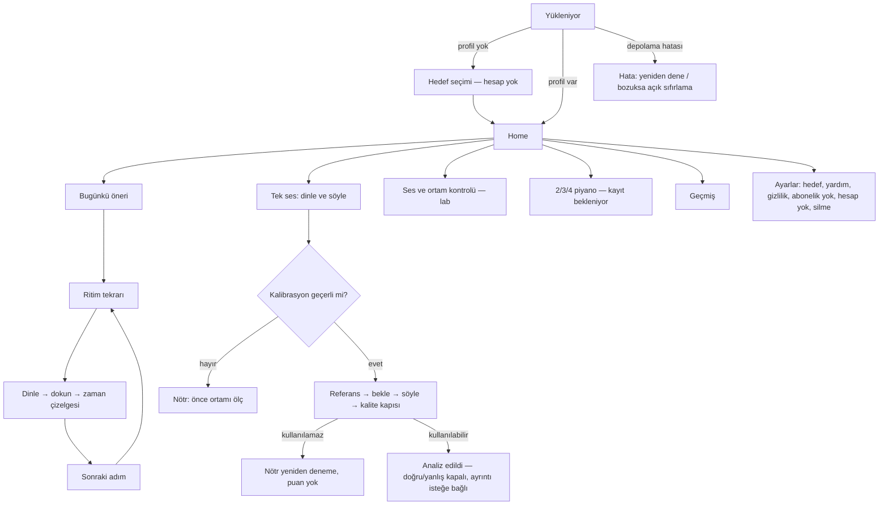

# Resonia — Tasarım önizlemesi kontrolü

**Tarih:** 2026-10-10. Üretim Flutter uygulaması için değil, beş etkileşimli tasarım önizlemesi için kontrol kaydıdır.

## Yapılan kontroller

- Beş varyant × 10 ekran × 320/360/736 px: 150 ekran/genişlik durumu.
- Sayfa script sözdizimi ve tarayıcı çalışma hataları: hata görülmedi.
- Telefon yüzeyi ve sayfa genişliği: yatay taşma görülmedi.
- Beş ses ekranının 360/736 px ekran görüntüleri incelendi.
- Aurora: misafir → kalibrasyon demosu → home → 4 ses seçimi → referans → hareketli yanıt → sonuç. 4/4 gösterimi doğrulandı.
- Demo ödeme butonu: gerçek satın alma yok; açık uyarı gösteriliyor.
- Reduced motion altında yanıtı başlat/durdur; koyu host görünümünde çalışma kontrolü.
- Paylaşılan stage yüksekliği küçük ekranda en uzun içeriğe göre ayrıldı; varyant değişimi içeriği kesmez.

## Sınırlar

- Mikrofon, gerçek pitch doğruluğu, DSP gecikmesi, cihaz performansı ve mağaza aboneliği test edilmedi; bu önizlemede bağlı değil.
- Hata senaryoları tasarım kontrollerinde bulunur; tüm hata senaryoları için ayrı otomatik uçtan uca test bu oturumda yapılmadı.
- Ritim tap sayısı yerel etkileşimdir; gerçek referans clock/timing scorer olmadığı için ritim başarı yüzdesi uydurulmaz.
- Rapor/lig profilleri ve fiyatları açıkça örnektir. Gerçek kullanıcı verisi yoktur.
- Ekran okuyucu ve cihaz üzerinde büyük yazı/VoiceOver/TalkBack QA'sı sonraki aşamadadır.
- Host carousel ve tasarım kontrollerini sağlar. Standalone kontrol sırasında yalnız test amacıyla varyant görünürlüğü değiştirildi; teslim edilen önizlemeye ikinci carousel sistemi eklenmedi.

Devam: [DESIGN_STUDIES.md](./DESIGN_STUDIES.md), [AUDIO_ENGINE_PLAN.md](./AUDIO_ENGINE_PLAN.md).

## Flutter uygulaması — akış ve ekran durumları (2026-10-11)

Bu bölüm tasarım önizlemesini değil **üretim Flutter kodunu** anlatır.

| Ekran | Yükleniyor | Boş | Hata | Geçersiz ölçüm | İzin reddi | Offline |
|---|---|---|---|---|---|---|
| Kabuk | Spinner | Hedef seçimi | Yeniden dene; bozuk profilde açık sıfırlama | — | — | Tamamen yerel |
| Tek ses oturumu | Faz metni + canlı seviye | “Önce ortamı ölç” | Kayıt/analiz alınamadı → yeniden dene | Nötr kart, nedenine göre yönlendirme | Ayarlar yönlendirme metni (derin bağlantı SHELL-02) | Yerel |
| Ritim | — | “Önce ritmi dinle” | Referans çalınamadı | “En az iki vuruş” | Gerekmez | Yerel |
| Geçmiş | Spinner | Açıklayıcı boş durum | Bozuk dosya korunur, açık sıfırlama | “Ölçülemedi — puanlanmadı” satırı | — | Yerel |
| Home öneri | İnce ilerleme | “Ritimle başla” | “Öneri gösterilemiyor” | — | — | Yerel |

Otomatik kontroller: 320 px/1,8× yazı, açık/koyu, Flutter erişilebilirlik kılavuzları (dokunma hedefi, etiket, kontrast). **Yapılmadı:** VoiceOver/TalkBack manuel turu, düşük cihaz performans profili, gerçek kullanıcı testi.

## UXR-01 — kullanıcı testi protokolü (hazır, yürütülmedi)

**Katılımcı:** en az 5 konservatuvar hazırlık öğrencisi (farklı seviyeler) + 1 eğitimci; reşit olmayanlar için veli onayı. **Cihaz:** katılımcının kendi telefonu + bir düşük/orta Android. **Kayıt:** ses kaydı Resonia dışına çıkmaz; gözlemci yalnız not ve süre tutar (ekran kaydı ayrıca rıza ister).

**Görevler:** (1) Uygulamayı ilk kez aç, hedef seç, ilk ölçülen çalışmayı tamamla. (2) Ritim sonucunda hangi vuruşun neden yanlış olduğunu sesli açıkla. (3) Sonuçtan sonra ne çalışacağını seç. (4) Tek ses oturumunda ölçüm alınamadı ekranını gör ve ne yapacağını söyle. (5) Geçmişini bul ve bir kaydı sil.

**Önceden kayıtlı başarı eşikleri (sonuca bakıp değiştirilmez):** ilk ölçülen çalışmaya medyan ≤ 3 dk; görev 2'de ≥ %80 doğru açıklama; görev 3'te ≥ %80 önerilen adımı veya eşdeğer doğru eylemi seçme; görev 4'te ≥ %80 “benim hatam değil, ortam/kayıt” yorumunu yapma; kritik engel (çıkmaz) = 0. Eğitimci ayrıca açıklama metinlerinin pedagojik doğruluğunu ve taslak ritim desenlerini/ölçütünü değerlendirir.

**Kullanıcıdan gereken:** katılımcı daveti ve onay (dış mesaj — kullanıcı yürütür), test tarihi, cihazlar. Sonuçlar bu dosyaya ve CURRENT_ROADMAP'e işlenir.
