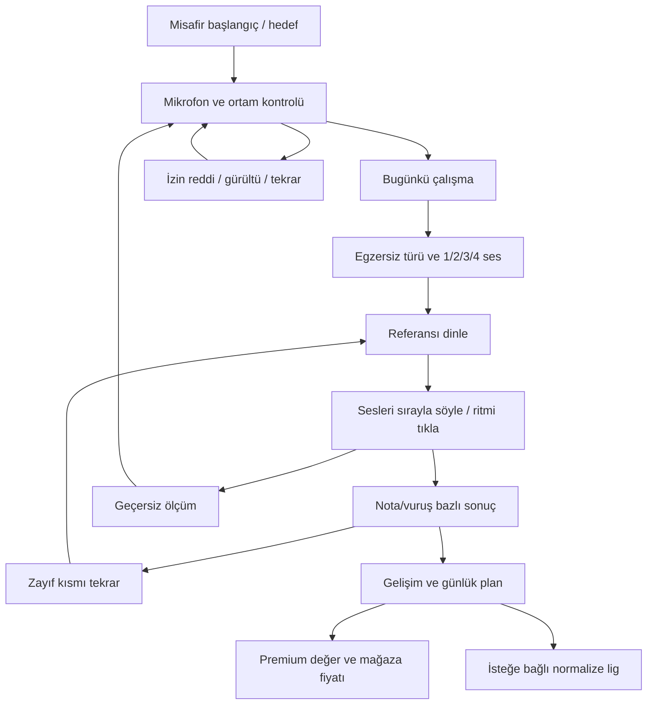

# Resonia — Beş uçtan uca mobil tasarım

**Tarih:** 2026-10-10 · **Durum:** etkileşimli konsept; üretim Flutter arayüzü henüz değiştirilmedi.

## Uygulanan yön — 2026-10-14

Kullanıcı rakip kalıplarına dayanan üç taslaktan **A (Yol) + C (Atölye)** yönünü
seçti ve uygulandı (ADR-026). Aşağıdaki 2026-10-11 Aurora+Konservatuvar notu
tarihsel kayıttır; güncel görsel dil A+C'dir.

## Tercih edilen birleşim — 2026-10-11

Kullanıcının yönü: **Aurora'nın marka deneyimi + Konservatuvar'ın açıklayıcı sonuç yaklaşımı**. Öncelikli yön olarak alınır; nihai kullanılabilirlik/marka onayı değildir. Beş alternatif ve mevcut önizleme korunuyor; bu oturum Flutter veya önizleme arayüzünü değiştirmedi.

- Home/egzersiz: Aurora'nın odaklı ses alanı; gerçek enerji, signed cents, confidence ve kararlılık dışında başarı hissi üretilmez.
- Sonuç: Konservatuvar'ın nota/vuruş bazlı kanıtı; ne oldu → nedeni hakkında sınırlandırılmış açıklama → çalışılacak bölüm → bir sonraki egzersiz.
- Detaylar kademeli açılır: yeni öğrencide sade yön/oktav açıklaması; ileri öğrencide porte ve ölçüm izi. Dinle-hatırla sınavında referans cevap öncesi gizli kalır.
- Gelişim: öğrenme basamağı, bağımsız kontrol ve yeterli örnek bilgisi; ölçülmeyen skor/yanıltıcı genel hazırlık yüzdesi yok.
- Plus: “Eğitimciye danış” → ne paylaşılacak/hak/teslim → eğitimci durumu → ad/uzmanlık/tarihli yazılı yorum → ödevi plana ekle. AI mesajı bu alanda eğitimci yorumu gibi görünmez.

Doğrulama hedefi: öğrencinin sonuçtan hatayı ve sonraki eylemi anlaması; nota bilgisi az kullanıcının takılmaması; hareket azaltma ve düşük cihaz performansı. Tam servis tasarımı [HUMAN_REVIEW.md](./HUMAN_REVIEW.md), eğitim rotası [LEARNING_MODEL.md](./LEARNING_MODEL.md).

## Önizleme

Konuşmadaki beş seçenek tek bir carousel'de gösterilir; her biri onboarding, kalibrasyon, home, egzersiz, cevap, sonuç, gelişim/lig ve Premium ekranlarına ilerler. Örnek değerler, kişiler ve fiyatlar tasarım verisidir; gerçek ölçüm veya canlı sıralama değildir. Mikrofon kullanılmaz. “Örnek yanıtı oynat” ses algılama hareketini simüle eder; gerçek reference/mikrofon pipeline'ı bağlanmaz.

**Düzenlenebilir önizleme kaynağı:** `/Users/sevimm/.codex/visualizations/2026/08/14/01a001fd-51fc-7613-bc84-3b92833f3a31/resonia-five-directions.html`.

## Ortak bilgi mimarisi

## Aurora — İmza ses alanı / Premium sakinlik

**Kullanıcı:** sınava hazırlanan, teknik geri bildirim isteyen ancak sıkıcı araç görünümünden kaçınan öğrenci.

**Görsel dil:** koyu gece yüzeyi, buz mavisi/lila ışık, geniş negatif alan; köşeleri yumuşak tek odaklı kontrol. Büyük ses alanı kimlik öğesidir, tam ekran arka plan animasyonu değildir.

**Akış:** “Sesini gör” başlangıcı → hedef → sade kalibrasyon → tek günlük çalışma kartı → tek ses/akor seçimi → referans → canlı alan → nota bazlı sonuç ve bir öneri → beceri grafikleri → Premium günlük koç.

**Ses efekti:** katmanlı ışık şeritleri; enerji genişliği, cents dikey kayması, kararlılık alanın toparlanması, confidence kesintisi. 3/4 seste yanıt düğümleri tek tek kilitlenir; aynı orb'u kopyalayarak ekran doldurulmaz.

**Flutter eşlemesi:** `CustomPainter` + sınırlı blur; mümkünse küçük shader alanı; `RepaintBoundary`; çoğu içerik sabit. Zayıf cihazda shader'sız fallback. Kazanç: güçlü marka. Risk: ölçümle bağı kopan “sihirli” görsel; öğretici etiketler sürekli görünür.

## Konservatuvar — Nota atölyesi / öğretmen güveni

**Kullanıcı:** ciddi sınav adayı ve öğretmen.

**Görsel dil:** kâğıt/yeşil, serif başlık, nota defteri ve numaralı çalışma programı; egzersizde notasyon temel dil.

**Akış:** sınav hedefi → kalibrasyon → müfredat listesi → egzersiz türü → porteli dinleme → nota hattında cevap → öğretmen okunabilir hata dökümü → haftalık beceri raporu → özel deneme/öğretmen planı.

**Ses efekti:** hedef bandının üzerinde gerçek pitch izi; pes/tiz aynı eksende. Akor sesleri sonuçta ayrı nota segmentleri. Dinle-hatırla sınavında hedef notasyon cevaptan önce gizli; deşifrede görünür çünkü görev başkadır.

**Flutter:** portenin `CustomPainter` veya lisanslı notation bileşeni; metric/trace aynı koordinat sisteminde. Kazanç: pedagojik güven. Risk: yeni kullanıcı için yoğunluk; temel görünümde yalnız sıralı yanıt noktaları.

## Orbit — Takımyıldız / alışkanlık ve ustalık

**Kullanıcı:** kısa günlük egzersizi oyun gibi tamamlayan genç öğrenci.

**Görsel dil:** gece laciverti, lime; kart listesi yerine aşama/istasyon haritası. Tek soruda tek büyük görsel görev.

**Akış:** keşif hedefi → cihaz kontrolü → günlük istasyonlar → 1/3/4 sesli görev → dinleme düğümleri → sırayla eşleşen yörüngeler → tamamlanan bağlantı → beceri seviyesi → opt-in haftalık lig → ileri görevler aboneliği.

**Ses efekti:** her yanıt bir düğüm; aktif düğümün halka uzaklığı cents hatasını, genişliği enerji/kararlılığı taşır. Merkez tam nota; yanlış oktav ayrı yörünge etiketi. Kilitlenme yalnız yeterli kararlı ölçümle olur. Referans düğümleri nota isimleri değil soru sırasıdır.

**Flutter:** küçük particle bütçesiyle `CustomPainter`, interruptible spring; lig/ödül animasyonu kayıt sırasında çalışmaz. Kazanç: geri dönüş. Risk: oyunun skoru öğretimden baskın olması; XP sınav başarısından ayrılır.

## Pulse — Ritim stüdyosu / fiziksel etkileşim

**Kullanıcı:** ritim ve ezgi hafızasına odaklanan öğrenci.

**Görsel dil:** açık sıcak yüzey, siyah/mandalina, büyük köşeli tipografi; thumb-first kontroller, dikey ses kolonları.

**Akış:** bugünkü ritim hedefi → latency kontrolü → ses/ritim/ezgi araçları → egzersiz → ritim dinle → büyük tap alanıyla cevap → erken/geç vuruş timeline'ı → zor bölümü yavaş tekrar → ritim raporu → ileri ölçü/deneme Premium.

**Ses efekti:** tek seste veri kolonları ve hedef ekseni; 3/4 seste sırayla cevaplanan kolonlar. Ritimde dekoratif eşitleyici yerine beklenen ve gelen vuruşların karşılaştırması. Tap aşağı basıldığı anda feedback; release beklenmez.

**Flutter:** pointer-down timestamp, ayrı ses clock, CustomPainter beat rail; meaningful haptic kullanıcı ayarıyla. Kazanç: hızlı giriş ve gerçek dokunsal his. Risk: ritim ve pitch hareketini aynı metrik sanmak; modlar açık ayrılır.

## Atelier — Kişisel ses defteri / uzun vadeli çalışma

**Kullanıcı:** sade tasarım isteyen, kendi gelişimini takip eden öğrenci/korist.

**Görsel dil:** sıcak kâğıt, bordo/mürekkep, editoryal başlık; dashboard kartlarından ziyade tarihli çalışma defteri.

**Akış:** kişisel hedef → sessiz kalibrasyon → “Bugün ne çalışıyoruz?” → egzersiz reçetesi → dinleme → dalga/precision dial → bir satırlık teşhis → geçmiş denemeleri karşılaştır → kişisel not/öğretmen paylaşımı → rapor/plan Premium.

**Ses efekti:** mürekkep gibi dalga; aynı alanda hassas merkez göstergesi. Enerji dalga genliği, cents iğne sapması, confidence çizginin sürekliliği. Gürültüde çizgi durur; yanlış kesinlik yaratılmaz.

**Flutter:** düşük maliyetli path painter, yerel session notebook; sayfa çevirme dekorasyonu yok. Kazanç: premium sakinlik ve rapor okunabilirliği. Risk: oyun alışkanlığı daha zayıf; haftalık “kendine karşı gelişim” döngüsü.

## Etkileşim ve erişilebilirlik kuralları

- Ana CTA ve tap alanı ≥44×44; tek elle erişilen alt eylem bölgesi; büyük yazıda reflow.
- Canlı durumda pause/iptal her zaman erişilebilir; yeni dokunuş eski animasyonun bitmesini beklemez.
- Damping 1 civarı sakin geçiş; başarı için kısa bir toparlanma, sürekli konfeti yok. Haptic yalnız faz değişimi/kararlı kilit, pitch frame başına değil.
- Ses şiddeti “başarı” değildir; renk ile birlikte metin, şekil ve sıra numarası.
- Reduced motion: statik alan+metin; yüksek contrast: blur yerine düz sınırlar. Hareket tasarımını `apple-design` ilkeleri şekillendirdi.
- Dinleme bitmeden mic skoru üretme; sınavda hedef/nota/doğru cevap gizli. Çalışma modunda rehber açık olabilir.
- Calibration hatası, izin reddi, gürültü, yanlış nota, oktav, kararsızlık, offline, satın alma hata/restore ayrı üretim durumlarıdır. Önizleme bütün platform izin/satın alma işlemlerinin çalışan uygulaması değildir.

## Önerilen seçim ve test

**Öneri:** Aurora marka ve ana deneyim + Konservatuvar'ın öğretici sonuç/nota katmanı. Pulse'ın tap ergonomisi ritim modülüne taşınır. Üç farklı görsel sistemi rastgele birleştirmek yerine aynı token/typography/navigation korunur.

Seçim henüz kesin değildir; Flutter ekranına geçirmek için kullanıcı onayı ve kullanılabilirlik testi gerekir. Öncelikli test: kullanıcı ilk egzersizi tamamlıyor mu, pes/tiz/oktav ayrımını açıklayabiliyor mu, 3/4 sesli talimatı anlıyor mu? İlk egzersiz ≤3 dk hedefi; hata açıklamasını ≥%80 doğru anlama hedefi, henüz test sonucu değildir.

## Devam checklist'i

- [x] 10 rakip ve kaynak tablosu.
- [x] Eksik özellikler için öncelikli backlog.
- [x] Beş özgün uçtan uca konsept ve görsel feedback yaklaşımı.
- [ ] Konsept seçimi ve cihaz üzerinde öğrenci/öğretmen testleri.
- [ ] Gerçek ses frame'leri ile seçili efekti bağlama.
- [ ] Flutter design token'ları ve tek ortak exercise state machine.
- [ ] İzin/gürültü/offline/ödeme hata durumlarının cihaz testleri.
