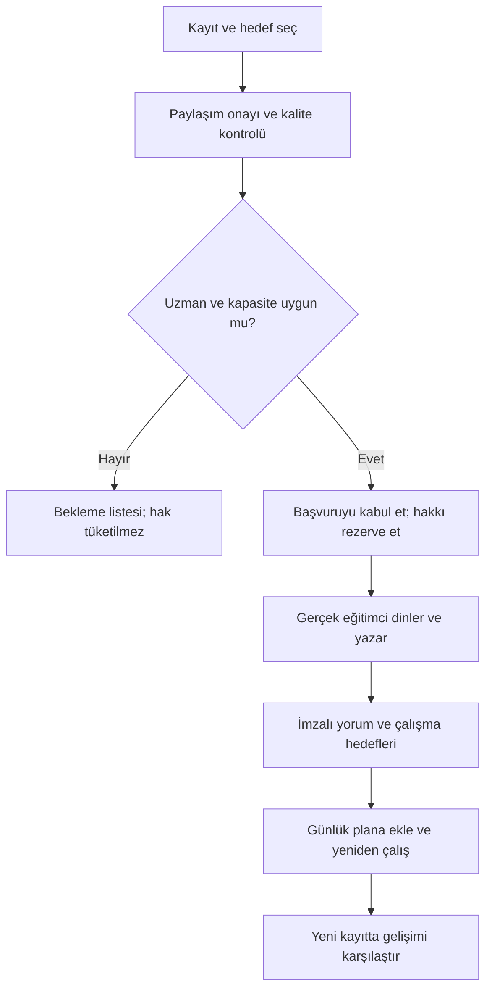

# Resonia Plus — Gerçek eğitimciden yazılı kayıt değerlendirmesi

**Tarih:** 2026-11-09
**Durum:** Güvenli yerel öğrenci draft/önizleme, in-memory hak ledger, atama/yapılandırılmış yorum, öğrenci teslim/açıklama/push ve hizmet operasyonları domain sözleşmeleri uygulandı. Servis, eğitimci havuzu, panel, push transport, ödeme, gerçek entitlement, kalıcı hak ve kayıt yükleme uygulanmadı. Kota/fiyat/teslim süresi pilot hipotezidir, canlı teklif değildir.

## Uygulanan güvenli önizleme

- Plus kartından hedef, tek soru ve seçilecek gelişim özeti adımları görülebilir.
- Kayıt, amaç bazlı onay ve gönderim disabled; seçimler saklanmaz, dosya alınmaz,
  hak tüketilmez ve dışarı veri gönderilmez.
- Domain sözleşmesi kayıt belirteci/süre/boyut, soru, UTC zaman ve sürümlü onayı
  bounded doğrular. Yerel tamlık servis kabulü değildir.
- Kapalı gateway; backend, kimlik/yetki, storage, kapasite, hukuk/onay ve hak
  kapılarının tümünü açıkça raporlar ve başvuru göndermez.
- Gerçek eğitimci teslimi ile AI koçu ayrı tutulur; AI eğitimci yorumunu yazmış
  gibi sunulmaz.

Bu dilim HUM-02'nin güvenli yerel başlangıcıdır. Gerçek kayıt seçimi/upload,
persist edilen taslak, consent metni, entitlement, kalıcı credit ledger ve eğitimci
ataması dış kapılar tamamlanmadan açılmaz.

## Uygulanan hak sözleşmesi çekirdeği

- Süreli/sınırlı grant'ler, aktif haklar arasından en erken sona erecek olanı
  rezervasyona ayırır.
- Reserve/consume/restore komutları idempotenttir; exact tekrar event veya
  ikinci tüketim üretmez. Aynı key farklı komutta ve aynı request ikinci kez
  kullanılamaz.
- Tükenmiş/süresi geçmiş hak, geçersiz zaman ve durum geçişleri fail-closed;
  servis sorunu restore ile unit'i tam bir kez geri bırakabilir.
- Aggregate yalnız bellektedir. Gerçek bakiye, abonelik, ödeme, mağaza iadesi
  veya sunucu transaction'ı olduğu iddia edilmez.

HUM-03b; auth/entitlement kaynağı, atomik kalıcı transaction, mağaza olayları,
kapasite, iptal/iade ve backend audit'i olmadan UI'ya bağlanmaz.

## Uygulanan atama ve yorum sözleşmesi

- Atama request/eğitimci/qualification token'ı ile UTC erişim aralığına bağlı;
  expiry ve revocation sonrasında yorum kurulamaz.
- Zaman damgalı gözlem, olası açıklamadan ayrı tutulur ve kayıt süresini aşamaz.
  En az bir güçlü yön, en fazla iki öncelik zorunludur.
- Tam üç benzersiz katalog egzersizi; hedef, yönerge, başarı koşulu, bounded
  tekrar/süre ve sonraki kayıt hedefi taşır.
- Koleksiyonlar immutable; backend kimlik, RBAC ve audit yokken gateway teslimi
  reddeder. AI author veya auto-fill yolu yoktur.

Bu model token eşleşmesini doğrular; eğitimcinin gerçek kimliğini/uzmanlığını
ve metni bizzat yazdığını doğrulamaz. HUM-04b authenticated panel, private
playback, storage authorization, teslim audit'i ve gerçek eğitimci pilotudur.

## Uygulanan öğrenci teslim sözleşmesi

- Eğitimci yorumu ve AI koçu farklı content kind'dır. AI kartı eğitimci kimliği,
  ataması, uzmanlığı veya zaman kanıtı taşıyamaz.
- Tek açıklama sorusu available→submitted→answered→closed ilerler; tekrar soru,
  yanlış eğitimci, expiry ve geriye giden zaman reddedilir.
- Push payload yalnız sabit schema/event ve opak token taşır. Yorum, soru, cevap,
  ses, skor veya eğitimci bilgisi bildirime konmaz.
- Öğrenci sadece teslimdeki benzersiz ödevleri seçebilir; seçim çalışma planına
  niyet bilgisidir, completion/mastery/başarı kanıtı değildir.
- Backend yokken delivery/clarification gateway'i kapalıdır.

HUM-05b authenticated öğrenci delivery endpoint'i, push izin ve transport'u,
deep-link yetkilendirmesi, plan persistence, outbox/idempotency ve gerçek pilot
olmadan canlı akış olarak açılmaz.

## Uygulanan hizmet operasyonları sözleşmesi

- İlk 20 kabul edilmiş pilot kaydı QA gerektirir işareti taşır; bu işaret QA'nın
  yapıldığını, kabul sırasının güvenilir olduğunu veya eğitimci onayını kanıtlamaz.
- Atama/review/delivery educator token kapsamlıdır. Yeniden atama eski educator
  eşleşmesini ve farklı yeni educator'ı zorunlu tutar.
- Gürültülü/anlaşılmayan kayıt için yeniden kayıt isteği aktif erişim ve deadline'ı
  temizler; yeni kayıt revision artırarak triage'a döner, yeni hak tüketmez.
- Gecikme yalnız aktif atamada deadline'ı ileri taşır. Paylaşım geri çekme ve
  iptal terminaldir; gerçek storage erişimi veya dosya silme yapmaz.
- QA kaydı teslim sonrası, izin referanslı ve teslim eğitimcisinden farklı reviewer
  ile kurulur. İtiraz süre içinde bir kez çözülür; ikinci değerlendirme ve hizmet
  hakkı yalnız yetkili sistem için öneridir, ledger veya ödeme iadesi değildir.
- Backend yokken operasyon/itiraz gateway'i kapalıdır.

HUM-06b authenticated workflow, gerçek storage revoke/delete, kalıcı audit ve
outbox, credit ledger transaction'ı, hukukça onaylı itiraz/iade politikası ve
ilk 20 izinli başvurunun gerçek ikinci eğitimci QA'sı olmadan canlı sayılamaz.

## Değer önerisi ve değişmez sınır

Öğrenci seçtiği ses kaydını, çalışma hedefini ve izin verdiği gelişim özetini gönderir. Uygun uzmanlığı doğrulanmış **gerçek bir müzik eğitimcisi kaydı dinler, kendisi yazılı değerlendirme yapar** ve takip çalışmaları verir. İlk sürümde bu değerlendirme AI tarafından yazılmaz; AI taslağı öğretmen imzasıyla insan değerlendirmesi gibi sunulmaz.

Resonia Coach'un otomatik mesajı ayrı, açıkça “AI koç” olarak görünür. Human review “Eğitimci değerlendirmesi”, ad/uzmanlık/tarih ile gösterilir. AI motor skorunu belirlemez; eğitimci de otomatik ölçüm sonucunu sessizce değiştirmez. Gözlemi ayrı bir değerlendirme kaydıdır.

Müzisyen olmak tek başına öğretim yetkinliği değildir. İlk havuz: 3–5 eğitimci; konservatuvar işitme/solfej, koro/şan ve gerekiyorsa ilgili çalgı uzmanlığı ayrı doğrulanır. Eğitmen olmayan yorumcuya pedagojik uzmanlık unvanı verilmez.

## İlk ürün paketi önerisi

| Paket | Değer | Durum |
|---|---|---|
| Free | Temel çalışma, ilk açıklanabilir sonuç | Limitler pilotta belirlenecek |
| Premium | İleri egzersiz, adaptif program, detaylı rapor, AI koç | Önceki dijital plan |
| Plus | Premium + sınırlı gerçek eğitimci değerlendirmesi | Yeni kapsam; başlangıçta ayda 1 hak önerisi |
| Ek değerlendirme | Gerekirse ayrı tek değerlendirme hakkı | Talep, kapasite ve mağaza kuralları doğrulanmadan satış yok |

Plus'ın ayda bir değerlendirmesi sınırsız eğitimci erişimi demek değildir. Üyelik açıklamasında kayıt limiti, yanıt biçimi, teslim takvimi, hak süresi/devri ve iptal/iade görünür olmalı. Önceki tasarımdaki 199 TL/ay veya 1.799 TL/yıl fiyatları bu hizmetin maliyetine dayanmıyor; yeni fiyat gibi kullanılamaz.

## Öğrenci deneyimi

1. Sonuç/gelişim ekranında “Eğitimciye danış”. Gönderilmeden kimse kayıt dinleyemez.
2. Hedef seç: konservatuvar işitme, koro, şan veya uygun uzman varsa çalgı. Okul/bölüm/yıl isteğe bağlı.
3. 30–120 saniyelik kayıt seç veya çek; sınırlar pilotta doğrulanacak. Bir konu ve bir açık soru yaz.
4. Paylaşılacak gelişim dönemi seç: son 7/30 gün veya seçilmiş oturumlar. Bütün geçmiş otomatik açılmaz; ölçülmeyen/düşük güvenli veri etiketlenir.
5. Kayıt kalitesi, kimle ne paylaşılacağı, saklama/silme ve hak koşullarını gör; ayrı paylaşım onayı ver.
6. Kapasite ve uzmanlık uygunsa başvuru kabul edilir, hak rezerve edilir; kesin teslim tarihi görünür. Önerilen hedef 3 iş günü; pilot kapasitesi doğrulanmadan vaat edilmez.
7. Eğitimci yazılı geri bildirim gönderir; öğrenci önerilen üç çalışma arasından günlük planına ekler.
8. Dahil olan bir açıklama sorusu platform içinden sorulabilir. Yeni performans değerlendirmesi veya sınırsız sohbet sayılmaz.
9. Öğrenci bir hafta hedefli çalışır ve sonraki kayıtla karşılaştırır. Yeni kaydın insan tarafından değerlendirilmesi yeni hak gerektiriyorsa açıkça belirtilir; otomatik kıyas insan yorumu gibi sunulmaz.

## Eğitimci geri bildirim standardı

Her teslim şu alanları içerir:

- Eğitimci adı, doğrulanmış uzmanlığı, teslim tarihi ve değerlendirilen kayıt.
- En az bir somut güçlü yön; varsa zaman damgası/nota/cümle kanıtı.
- En fazla iki öncelikli gelişim alanı: gözlenen şey ile olası açıklama ayrılır. Kaydın göstermediği bedensel teknik teşhis edilmez.
- Örnek: “00:18'de sus sonrası giriş gecikiyor; ikinci cümlede başlangıç sesi pesleşiyor.” Bu yalnız şablon örneğidir, gerçek öğrenci yorumu değildir.
- Katalogdan üç uygun çalışma; amaç, tekrar/süre ve başarı koşulu. Gereksiz zorlamaya yönlendirme yok.
- Gelecek hafta için bir kontrol hedefi; yeni kaydın nasıl alınacağı.
- Varsa ölçümle uyuşmayan gözlem veya kayıt sınırlılığı; otomatik puanı mutlak gerçek sayma yok.

Eğitimci portalında playback/seek, not/zaman damgası ve gönderim bulunmalı. Dinleme etkileşim günlüğü kalite denetimini destekler; tek başına “gerçekten dikkatle dinledi” kanıtı değildir. Yüzeysel/aynı yorumları tekrar eden teslimler ikinci eğitimci kontrolüne alınır. İlk 20 değerlendirme ikinci eğitimci tarafından izinli kalite kontrolünden geçer; bunu öğrenciye paylaşımda açıkla.

## Operasyon ve durum makinesi

`draft → uploading → submitted → triage → assigned → reviewing → delivered → closed`

Yan yollar: `upload_failed`, `needs_rerecord`, `waitlisted`, `cancelled`, `credit_restored`, `clarification_open`. Ödeme iadesi ve hizmet hakkı iadesi ayrı süreçlerdir; mağaza üzerinden gereken finansal iade yalnız hak ledger'ıyla taklit edilmez.

- Upload başarısızsa veya kullanıcı henüz göndermediyse hak tüketilmez. Yeniden deneme idempotent olmalı.
- Kabul ve hak rezervasyonu atomik olmalı; çift dokunma iki hak eksiltmez. Teslimde rezervasyon tüketilmiş hakka döner; hizmet iptalinde geri bırakılır.
- Anlaşılmayan/gürültülü kayıt için yeniden kayıt istenir; yeni hak istenmez. Öğrenciye süre ve iptal alternatifi verilir.
- Uzman/kapasite yoksa kuyruk kapatılır veya açık bekleme listesi; yerine AI teslim edilmez. Hedef süre aşılıyorsa görünür yeni tarih ve iptal/hak iadesi seçeneği.
- Eğitimci ayrılırsa uygun ikinci eğitimciye yetki verilerek yeniden atama yapılır; erişim eski eğitimciden kaldırılır.
- Öğrenci paylaşımı geri çekerse teslim öncesi işlem durdurulur; erişim iptal edilir ve hizmet hakkı geri bırakılır. Silme, yedek ve zorunlu kayıt sınırları hukukla belirlenir.
- Üyelik iptali, önceden kabul edilmiş değerlendirmeyi otomatik yok etmez; şartlarda hizmetin tamamlanması veya iadesi açık olur.
- Teslim sonrası itirazda kalite sorumlusu kaydı inceler; hak iadesi/ikinci yorum kuralı önceden yayımlanır. Finansal tüketici hakları ayrıca incelenir.
- İlk sürüm marketplace, canlı ders veya sınırsız DM değil; küçük yönetilen eğitimci havuzu ve basit güvenli değerlendirme panelidir.

## Teknik varlıklar ve erişim

| Varlık | Gerekli alanlar / amaç |
|---|---|
| `RecordingAsset` | Owner, storage key, süre/codec/boyut, upload doğrulaması, consent ref, expiry/deletion durumu |
| `HumanReviewRequest` | Student, hedef/soru, kayıt ref, seçilmiş progress snapshot, durum, content/rubric sürümü |
| `ReviewAssignment` | Eğitmen, uzmanlık, kabul/deadline, erişim başlangıç-bitişi |
| `WrittenFeedback` | Eğitimci yazarı, kanıt/zaman notları, güçlü yönler, öncelikler, hedefler, teslim sürümü |
| `HumanReviewCredit` ledger | Dönem/hak, reserve/consume/restore; idempotency key; ödeme olaylarıyla audit |
| `TeacherQualification` | Doğrulanmış branş, doğrulayan kişi/tarih; herkese gösterilen alanlar ayrı |
| `PracticeAssignment` | İzinli egzersiz ID'leri, parametreler, eğitimci hedefi, son kontrol tarihi |
| `Consent` / audit | Amaç, alıcı kategorisi, sürüm/tarih, geri çekme ve erişim olayları |

Flutter → yetkili Resonia API → private storage + request queue → eğitimci paneli → öğrenciye teslim. Bildirim yalnız yeni yorum var bilgisini taşır; ses veya hassas yorum push payload'ına konmaz. Bildirim/outbox yeniden denemesi çift teslim/çift tüketim yaratmaz.

Kayıt URL'leri kısa ömürlü ve yetkili; public link olmaz. Eğitimci yalnız aktif atandığı başvuruyu ve öğrencinin seçtiği özet veriyi görebilir. Öğretmen sınıf yetkisi bir Plus kaydına otomatik erişim vermez. Rol kontrolü API ve storage'da uygulanır; UI'da düğme saklamak güvenlik değildir. Dosya türü, süre/boyut, decode ve güvenli upload kontrolleri gerekir.

## Gizlilik ve güvenlik kararları

- Kayıt gönderme isteğe bağlıdır; core çalışma raw audio paylaşmadan kullanılabilir. Education-review onayı, AI ve tanıtım izninden ayrıdır.
- [KVKK'nın aydınlatma açıklamasına](https://www.kvkk.gov.tr/Icerik/2033/Aydinlatma-Yukumlulugu-) göre amaç, hukuki sebep, alıcılar ve haklar kullanıcıya anlatılmalıdır. İşleme dayanağı ve yurtiçi/yurtdışı aktarım şartları yayından önce hukuk uzmanıyla doğrulanır. Bu belge hukuki uyum onayı değildir.
- Pilot ürün politikası önerisi: teslimden 30 gün sonra ham kayıt silinsin; kullanıcı daha erken silmeyi seçebilsin. İmzalı yorum ve zorunlu ödeme/hizmet kayıtları için farklı, hukukça onaylı süre gerekir. Sonsuz saklama varsayılanı yok.
- İlk sürüm ses kimliği/voiceprint üretmez; sesi otomatik biyometrik profil veya model eğitim verisi yapmaz.
- Gerçek eğitimci kaydı otomatik OpenAI/AI servislerine gönderilmez. Model eğitimi, yayınlama, reklam veya herkese açık profil için yeniden ayrı amaç/izin gerekir.
- Reşit olmayan kullanıcı akışı, veli rolü ve eğitimci iletişim sınırları hukuk/çocuk güvenliği değerlendirmesiyle belirlenir; doğrulanmamış yaş kuralı varsayılmaz. Kişisel telefon/DM aktarımı yok; platform içi kontrollü iletişim.
- Eğitimci hizmeti ses sağlığı tanısı koymaz. Kayıttan duruş, nefes anatomisi veya ensemble blend kesin doğrulanamaz; gerektiğinde yüz yüze eğitim/uygun uzman desteğine yönlendirilir.

## Maliyet ve kapasite

`Aylık değerlendirme adedi = aktif Plus sayısı × aylık kullanım oranı × kişi başı kullanılan hak`

`Eğitimci saati = değerlendirme adedi × (dinleme + yazma + açıklama + QA dakikası) / 60`

Sadece duyarlılık örneği: 1.000 Plus kullanıcı, 1 hak ve değerlendirme başına toplam 15 dakika varsayımıyla kullanım %20 ise 50 saat, %100 ise 250 saat/ay. Bunlar talep veya verimlilik tahmini değildir. Kota satılırken yalnız düşük kullanım senaryosuna güvenilmez; yüksek kullanım kapasitesi de planlanır.

Net katkı hesabı: mağaza/vergi/iade sonrası gelir − eğitimci ödemesi − QA/destek − storage/AI/altyapı − içerik/edinim payı. Eğitimci ücreti, çalışma süresi ve kullanıcı ödeme isteği belirlenmeden Plus fiyatı sabitlenmez. Amaç en ucuz paket değil, teslim edilebilir uzman desteğidir.

## Pilot ve yayına çıkış

Faz 3'te 3 eğitimciyle 20 izinli başvuru pilotu; ayrı tam sınıf/marketplace platformu beklenmez. Faz 4 ücretli Plus yalnız şu kapılardan sonra:

1. Gerçek dinleme/yazılı teslim; doğru uzman ataması, kayıt bağlamı ve rubrik.
2. Kayıt/paylaşım/silme, çocuk güvenliği, görev bazlı erişim ve hukuk değerlendirmesi.
3. Hak ledger, kapasite/deadline ve iptal/iade senaryoları; entegrasyon testleri.
4. Eğitimci başına süre/maliyet, zamanında teslim, faydalı yorum ve uygulanabilir ödev QA'sı.
5. Öğrencinin ödevi tamamlama ve sonraki örnekteki değişimi; küçük pilot nedensel etkililik garantisi sayılmaz.

Ticari ayrıştırıcı hipotez: günlük ölçümlü çalışma + bağlamı bilen gerçek eğitimci. Talep ve kârlılık kanıtlanana kadar “çok para kazandırır” değil, doğrulanacak ürün avantajıdır.
