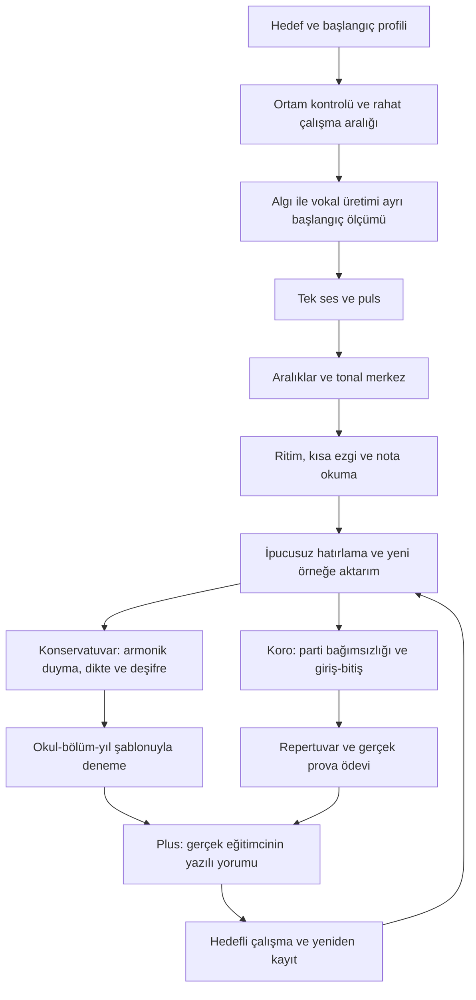

# Harmonia — Eğitim modeli ve öğrenci rotası

**Tarih:** 2026-10-11  
**Durum:** Önerilen müfredat ve ölçüm sözleşmesi; uygulamada henüz yok. Müzik eğitimcileriyle pilot/onay bekleniyor. İlk çekirdek Batı müziği işitsel becerileri; makam/usul ve enstrüman pedagojisi ayrı uzmanlık rotalarıdır.

**Geliştirme notu:** Sonuç/metrik geçerliliği ve SkillProgress cohort/denominator temeli uygulandı; tam müfredat, adaptive plan/mastery ve öğretim pilotu hâlâ yok. [İş planı](./IMPLEMENTATION_ROADMAP.md).

## Ürün test yaptırmaktan nasıl öğretmeye geçer?

Her çalışma bir beceri hedefi taşır: **anla → örneği duy → ayırt et → destekle üret → desteksiz hatırla → başka örneğe aktar → yeniden kontrol et**. Doğru cevap sonrası sadece daha zor soruya geçilmez; yanlış cevap sonrası sadece aynı kayıt tekrar çalınmaz.

Algılama ile üretme ayrı tutulur. İki sesten hangisinin daha tiz olduğunu doğru seçip notayı yanlış söyleyen öğrenciye “kulağın kötü” denmez; vokal eşleme çalışması atanır. Ezgiyi doğru sırayla ama ritimsiz söyleme, nota hafızası ve zamanlama açısından ayrı raporlanır. Mikrofon/ortam sorunu öğrenme hatası sayılmaz.

[Agarwal, Nunes ve Blunt'un 2021 sistematik incelemesi](https://pdf.poojaagarwal.com/Agarwal_etal_2021_EDPR.pdf), sınıf ortamlarında bilgiyi geri çağırma çalışmalarını destekler. Buradan ipucusuz hatırlamayı eğitim döngüsüne ekliyoruz. Bu genel bulgu Harmonia'nın müzik becerileri üzerindeki etkisini veya aşağıdaki tekrar takvimini doğrulamaz; ayrıca pilot gerekir.

## Ortak temel ve iki hazırlık rotası

Bu rota sabit haftalık süre değildir. Öğrenci başlangıç profiline göre seviyeden girebilir; geçersiz ölçümde seviye düşürülmez. Eğitimci, gözlenen ihtiyaçla önerilen sırayı değiştirebilir.

| Basamak | Öğrenme hedefi | Örnek çalışma | İlerleme kanıtı |
|---|---|---|---|
| 0 — Tanışma | Hedef, ortam, rahat bölge, destek ihtiyacı | Tiz/pes seçimi, tek ses eşleme, kısa puls, 3 nota | Başlangıç profili; eksik beceri “bilinmiyor” |
| 1 — Ses ve puls | Aynı notayı doğru oktavda, rahatça eşleme | Tek ses; yukarı/aşağı kaydırma; düzenli tap | Farklı hedeflerde rehbersiz eşleme; geçerli kayıt |
| 2 — Yön ve tonal merkez | İki sesin ilişkisi, tonik ve basit dereceler | Aralık seç/söyle; tonik duy → dereceyi bul | Yeni tonlarda algı/üretim ayrı; sadece nota adı ezberi değil |
| 3 — Ritim ve okuma | Süre, sus, ölçü ve alt bölme | 2/4, 3/4, 4/4; sonra 6/8; tap ve ritim okuma | Yeni kalıpta eksik/fazla/bias/dağınıklık; ipucusuz |
| 4 — Ezgi ve hafıza | Kontur, sıra, süre ve cümle | 3–5 nota → daha uzun ezgi; gecikmeli cevap | Nota/süre eşleşmesi; tekrar sayısı; yeni ezgide başarı |
| 5K — Armonik duyma | Birlikte duyulan sesleri ayırma | 2 → 3 → 4 ses; çevrim, sıra/set talimatı | Her nota/oktav; eksik/fazla; referans gizli |
| 6K — Sınav okuryazarlığı | Solfej, dikte, deşifre ve sınav koşulu | Görülmemiş kısa parça; süreli karma deneme | Kaynak/yıl şablonu; çalışma puanı ile deneme ayrı |
| 5H — Parti bağımsızlığı | Başka partiye kapılmadan kendi hattını sürdürme | Kanon/iki parti; sonra 3/4; kendi rehberini azalt | Rehber kapalıyken kendi hattının doğruluğu; yeni parça |
| 6H — Koro müzisyenliği | Giriş/bitiş, söz, cümle ve işaret | Sus sonrası giriş; cutoff; dinamik/cümle örneği | Zamanlama otomatik; ifade/diksiyon eğitimci; prova gözlemi |
| 7 — Aktarım | Beceriyi gerçek performansta kullanma | Deneme veya lisanslı kısa repertuvar kaydı | Gerçek eğitimci + hedefli tekrar + yeni kayıtta karşılaştırma |

Nota okuryazarlığı bir sonraki bütün aşama bitene kadar ertelenmez; basit porte/ritim bilgisi 1–4 boyunca paralel mikroderslerle verilir. Çok ses ve ritim zorluğu tek doğrusal “level”e bağlanmaz: öğrenci ritimde ileride, aralıkta başlangıç olabilir.

## Bir egzersizin öğretim döngüsü

Örnek: öğrenci aşağı yönlü küçük üçlüyü tekrar ederken ikinci sesi fazla tiz söylüyor.

1. Sonuç: “İkinci ses hedefin üzerinde; sıra doğru.” Geçerli ölçümün nota bazlı kanıtı gösterilir.
2. 30–60 saniye mikroders: yön ve mesafe, eğitimcinin özgün ses örneği.
3. Ayırt etme: iki alternatiften doğru inişi seç; vocal üretimden bağımsız.
4. Üretme: kolay tonda hedef rehberiyle söyle; yavaş bölüm tekrarı.
5. İpucunu kaldır: aynı beceriyi farklı başlangıç sesinde dene.
6. Daha sonra: duyulmamış örneği tek dinleyişten sonra söyle.
7. Devam ediyorsa: eğitimciye bir örnek kayıt ve öğrencinin sorusunu gönder.

Bu hata, ezgi hafızası veya ses tekniği teşhisine otomatik çevrilmez. AI, mevcut ölçümleri açıklayıp izinli kataloğun önerisini sunabilir; yeni egzersiz kuralları/puan veya öğretmen gözlemi uyduramaz.

## 12 dakikalık günlük çalışma örneği

| Süre | İçerik |
|---|---|
| 1 dk | Ortam ve rahat ses hazırlığı; zorlamadan |
| 2 dk | Önceki beceriden ipucusuz geri çağırma |
| 2 dk | Bir yeni kavramın mikrodersi ve dinleme örneği |
| 4 dk | Algı → üretim; ritim/ezgi/işitme ihtiyacına göre |
| 2 dk | Yeni örnek veya koro parti aktarımı |
| 1 dk | Kanıta dayalı özet ve yarınki tek hedef |

Kullanıcı 5 veya 15 dakikayı da seçebilir. Her gün bütün modülleri rastgele açmak yerine yeni öğrenme, tekrar ve aktarım dengelenir. Haftalık kısa ipucusuz kontrol ayrı sonuç üretir. Ses aralığının uçlarını her gün yarışma gibi zorlamak rota değildir; rahatsızlıkta çalışma durdurulur.

## İlk içerik bankası: sayı değil kapsama kapısı

Öneri: 12 mikroünite ve yaklaşık 120 eğitimci onaylı çekirdek örnek. Bu sayılar bütçe/kapsam hipotezidir; içerik henüz üretilmedi. Parametreli varyasyonlar ayrı özgün ders sayılmaz.

- Ünite 1–3: tiz/pes, nota/oktav eşleme, yön/aralık ve tonik.
- Ünite 4–6: puls/alt bölme, süre/sus/ölçü, kısa ritim okuma/tekrar.
- Ünite 7–9: kısa ezgi konturu, gecikmeli hatırlama, temel solfej/deşifre.
- Ünite 10–12: başlangıç armonik duyma, dikte/hata bulma, iki parti başlangıcı.

Her ünitede açıklama, doğru/yanlış karşılaştırmalı örnek, destekli çalışma ve **çalışmada görülmemiş** kontrol seti olmalı. Konservatuvar ileri akor/deşifre ve koro ileri repertuvar için ek içerik fazı gerekir; 120 örneğin tam sınav hazırlığına yettiği iddia edilmez.

Eğitimci kontrolü: öğrenme amacı, sıra, zorluk, ses örneği doğruluğu, rahat vokal bölge, telif, notation/audio senkronu, kabul edilebilir cevaplar ve hata açıklaması. Lisans uygunluğu eser bestesi kadar kullanılan kayıt/edisyon için de kontrol edilir.

## Adaptif model — önerilen, henüz uygulanmamış

`SkillNode` için: önkoşullar, lesson/content sürümü, rota, öğrenme amacı, tuning bağlamı, egzersiz parametreleri ve destek düzeyi.

`MasteryEvidence` için: geçerli deneme sayısı, algı/üretim ayrımı, zorluk, ipucu/tekrar, görülmemiş soru sonucu, gecikmeli kontrol, cihaz kalite bayrakları ve eğitimci gözlemi. Güncellenmiş `SkillProgress` metrik örneklerini ve temel cohort'u korur; bu tam öğrenme kanıtı sözleşmesini henüz karşılamaz.

Durumlar: **ölçülmedi → çalışılıyor → destekle yapabiliyor → bağımsız yapabiliyor → kalıcı/aktarılmış kanıt var**. Son durum bile ömür boyu garanti değildir; zamanla tekrar kontrol edilir.

Başlangıç pilot hipotezi: aynı beceride iki ayrı oturumda en az 10'ar geçerli yeni soru ve %80 başarı; bunlardan biri ipucusuz/gecikmeli olsun. 1/3/7/14 gün tekrar kuyruğu denenebilir. Bu sayılar evrensel müzik pedagojisi standardı değildir, eğitimci/pilot sonucu değişebilir. Ölçüm toleransı, ünite geçişi ve resmî sınav puanı ayrı kavramlardır.

Ezgi hafızası yalnız pitch ortalaması değildir: doğru nota/sıra/ritim, gecikme, tekrar ve ipucu koşuluyla değerlendirilir. Önce serbest tempo nota hafızası, sonra süreli ezgi ayrı tanımlanır. Esnek eşleştirme yanlış sıra ve ek notaları yok sayarak yüksek puan üretemez.

## Konservatuvar ve koro ayrıntıları

### Konservatuvar

- Okul + bölüm + hedef yıl + kaynak URL + son kontrol tarihi; bilinmeyen format “genel işitme denemesi”.
- Çalışma rahat aralığa uyarlanabilir; resmî biçimli denemede hedef oktav/transpozisyon kuralı sessizce değiştirilemez.
- Fixed-do/movable-do yaklaşımı ders hedefinde açıklanır; karışık terminoloji kullanılmaz.
- Sınavda gösterilmeyen nota rehberi, cevap bitmeden açılmaz. Deşifrede notanın görünmesi görevin gereğidir.
- Çalgı/şan performansı ayrı eğitimci uzmanlığı ve dış çalışma planıyla izlenir; core motor bunu öğrettiğini iddia etmez.

### Koro

- Parti seçimi eğitimciyle doğrulanır; aralık testinden otomatik kesin SATB sınıflandırması çıkmaz.
- Solo → kendi parti rehberi + eşlik → rehber azalt → yalnız diğer partiler; seviye bağımsızlıkla ilerler.
- Öğrenci kulaklık kullanır; kayıt başka partilerin sızıntısı nedeniyle güvenilmezse sonuç geçersizdir.
- Partiler çoğalınca zorluk yalnız nota sayısı değildir: benzer ritim, karşı yön, sus/giriş, register yakınlığı ve tonal değişim de etkiler.
- Notasyonla başlangıç/bitiş işaretleri çalışılır; video işareti öğretmen onayıyla eklenebilir. Dinamik/diksiyon/blend ilk sürümde otomatik doğrulanmış metrik değildir.
- [ACDA'nın aural theory yaklaşımı](https://acda.org/archives/sessions/integrating-aural-theory-in-the-choral-rehearsal) okuryazarlığı repertuvarla ilişkilendirir. Bizim aktarım ödevimiz ürün önerisidir; gerçek topluluk provası ayrıca gerekir.

## Öğrenciye gösterilecek gelişim raporu

“Konservatuvara %87 hazırsın” yerine: tek ses/oktav, aralık, armonik duyma, ritim, ezgi hatırlama, deşifre ve varsa parti bağımsızlığı. Her kart geçerli örnek sayısı, son ölçüm tarihi, seviye/koşul, önceki karşılaştırılabilir dönem ve bir sonraki eylemi içerir. Veri yoksa çizgi ve “henüz ölçülmedi”.

Eğitimci notu ayrı imzalı gözlem olarak görünür; sayısal motor skorunu değiştirip yeniden yazmaz. Repertuvar/ifade değerlendirmesi “öğretmen gözlemi” diye etiketlenir. Ses aralığı genişliği ilerleme veya yetenek derecesi değildir; rahat tessitura çalışma seçimini destekler.

## Öğrenmenin işe yaradığını nasıl sınarız?

İlk pilotta başlangıç, çalışma sonrası ve gecikmeli görülmemiş test; ipuçlu/ipuçsuz ayrım; eğitimcinin aynı rubrikle bağımsız değerlendirmesi. Benzer soruları tekrar ezberleme, farklı cihaz ve daha kolay görev etkisi kontrol edilir. Bu gözlemsel pilot ürün iyileştirme içindir; nedensel öğrenme/başarı garantisi için daha güçlü kontrollü değerlendirme gerekir.

Takip: geçerli ölçüm oranı, yeni soruya aktarım, gecikmeli hatırlama, aynı hatanın tekrarı, öğretmen–motor uyumu, haftalık çalışma, koro rehberini azaltabilme ve eğitimci ödevini tamamlama. Streak/XP yalnız alışkanlık göstergesidir.
