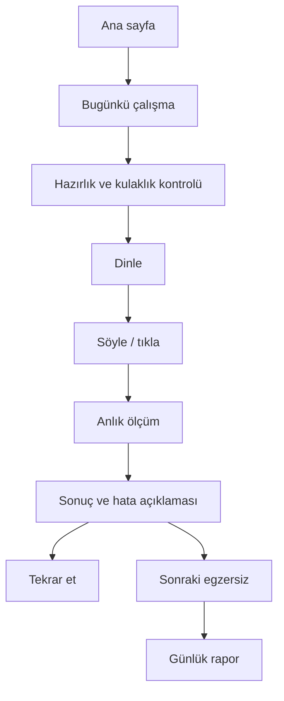

# Resonia — Product Spec

## Ürün tanımı

Resonia, konservatuvar hazırlığı ve koro/müzik sınavları için kişisel işitsel beceri koçudur.

Kullanıcı; notayı duyar, tekrarlar, nerede hata yaptığını görür ve bir sonraki egzersizi otomatik alır.

**2026-10-11 kapsam notu:** Bu tanım hedef üründür; mevcut Flutter sürümü mock tek ses demosudur. Gerçek eğitim, mikrofon, abonelik ve eğitimci servisi henüz bağlı değildir. [Kod/yeterlilik incelemesi](./PRODUCT_AUDIT.md).

**Aynı gün geliştirme başlangıcı:** Sonuç v2/ölçüm durumları, metrik bazlı gelişim ve deterministik ritim event eşleştirmesi uygulandı; ezgi placeholder ölçmediği becerileri puanlamıyor. [İş planı](./IMPLEMENTATION_ROADMAP.md), [uygulama kaydı](./IMPLEMENTATION_LOG.md). Bunlar gerçek ses motoru/öğretim ürününün tamamlandığı anlamına gelmez.

## Eğitim modeli ve konumlandırma

Test bankası değil, öğretim döngüsü: mikroders/örnek → algı seçimi → destekli üretim → ipucusuz hatırlama → yeni örneğe aktarım → gecikmeli kontrol. İşitme ile sesle üretme ayrı izlenir. Ortak temel sonrası konservatuvar (armonik duyma/solfej/dikte/deşifre/okul denemesi) ve koro (parti bağımsızlığı/giriş-bitiş/repertuvar) rotaları ayrılır. [Müfredat](./LEARNING_MODEL.md).

Öğretmen ve gerçek prova yerine geçtiği veya sınav kazanmayı garantilediği söylenmez. Çalgı/şan performansı, makam/usul ve topluluk blend'i ilk işitsel çekirdeğin dışında veya eğitimci desteğiyle ele alınır. Okul/bölüm/yıl gereksinimleri ayrı doğrulanır; ses aralığı tek başına SATB ataması veya yetenek sıralaması değildir.

## Hedef kullanıcılar

### Birincil kullanıcı

Konservatuvar sınavına hazırlanan, düzenli öğretmen desteği olmayan veya evde ek çalışma yapmak isteyen öğrenci.

### İkincil kullanıcı

Koro seçmesine hazırlanan korist, sesini ve müzik kulağını geliştirmek isteyen amatör şarkıcı.

### Ödeyen kullanıcı

Öğrenci, veli, özel müzik öğretmeni veya müzik kursu.

## Kullanıcı problemleri

- “Doğru mu söyledim?” sorusuna anında cevap alamamak.
- Hatanın nota mı, oktav mı, ritim mi olduğunu anlayamamak.
- Tek başına çalışırken ne yapacağını bilememek.
- Gelişiminin ölçülebilir olmadığını düşünmek.
- Sınav formatına yakın pratik bulamamak.

## MVP kapsamı

### Dahil

- Misafir giriş.
- Mikrofon kalibrasyonu.
- Tek ses dinle-söyle.
- Basit interval.
- Ritim dinle-tıkla.
- 3–5 notalık ezgi tekrarı.
- Günlük 10 dakikalık çalışma.
- Pitch, ritim ve ezgi skorları.
- Hata açıklaması.
- Hata sonrası mikroders, rehberi azaltma ve yeni soruda ipucusuz kontrol.
- Son 30 günlük gelişim.

### MVP dışında

- Büyük ticari şarkı kataloğu.
- Sosyal akış.
- Genel amaçlı AI sohbeti.
- Açık leaderboard.
- Öğretmen marketplace’i.
- Kullanıcı seslerinin model eğitimi için otomatik kullanımı.

## Ana kullanıcı akışı

## Egzersiz türleri

| Egzersiz | Kullanıcı eylemi | İlk başarı ölçümü |
|---|---|---|
| Tek ses | Dinle ve söyle | Cents, oktav, stability |
| Interval | İki sesi duy ve söyle | Nota sırası, interval yönü |
| İki ses | İki sesi ayrı ayrı tekrar et | Her sesin doğruluğu |
| Üç/dört ses | Birlikte çalınan sesleri sırayla söyle | Nota/oktav, eksik/fazla ses, tanımlı sıra |
| Ritim | Dinle ve tıkla | Onset timing, eksik/fazla vuruş |
| Ezgi | Dinle ve tekrar söyle | Nota sırası, pitch, ritim |
| Ses aralığı | Yukarı/aşağı ilerle | Doğru ve kararlı uç notalar |

## Mobil ekranlar

2026-10-10 ek kapsam: teori mikrodersi, zor bölüm/tempo tekrarı, tonal solfej, akor çevrimi, deşifre/dikte, kişisel preset ve öğretmen programları [FEATURE_BACKLOG.md](./FEATURE_BACKLOG.md) içinde faz/kabul kriteriyle tanımlandı. 2026-10-11 tercih edilen yön: Aurora marka deneyimi + Konservatuvar açıklayıcı sonuç yaklaşımı; kullanılabilirlik doğrulaması bekleniyor. [Tasarım çalışmaları](./DESIGN_STUDIES.md).

1. Home: Bugünkü hedef ve son gelişim.
2. Exercise setup: Egzersiz, süre, kulaklık ve mikrofon durumu.
3. Reference: Nota/ritim dinleme.
4. Response: Canlı pitch çizgisi veya ritim timeline’ı.
5. Feedback: Hata türü, ölçüm ve tekrar düğmesi.
6. Session summary: Beceri bazlı sonuçlar.
7. Progress: Haftalık gelişim ve zayıf alanlar.
8. Coach: Resonia AI mesajları.
9. Öğrenme rotası: beceri basamakları, ders, bağımsız kontrol ve tekrar zamanı.
10. Plus: kayıt/özet paylaşımı, eğitimci durumu, imzalı yazılı değerlendirme ve takip ödevleri.

## Puanlama

Tek bir toplam skor yerine ayrı skorlar gösterilir:

- Pitch accuracy.
- Octave accuracy.
- Pitch stability.
- Timing accuracy.
- Melody memory.
- Voiced ratio.
- Progress delta.

AI bu skorları değiştiremez; yalnızca yorumlar ve öneri üretir.

Ölçülmeyen skor 100 gibi sunulmaz; uygulanamaz/ölçülmedi olarak ayrılır. Gürültü ve sessizlik öğrenci başarısızlığı değil geçersiz ölçümdür. Öğrenme modunda rehber hedef görünebilir; sınavda hedef nota/başarı bilgisi cevap bitene kadar gizlenir.

## Animasyon ilkeleri

- Dinleme: referans sesle senkron hafif pulse.
- Söyleme: canlı pitch hattı ve hedef nota bandı.
- Başarı: kısa yükselme ve yumuşak haptic.
- Hata: kırmızı ceza animasyonu yerine açıklayıcı amber durum.
- Geçiş: 250–400 ms arası, dikkati bölmeyen hareket.
- Reduced motion tercihi desteklenir.

## Abonelik

### Free

- Günlük sınırlı çalışma.
- İlk ses aralığı testi.
- Temel sonuç.

### Premium

- Sınırsız egzersiz.
- Adaptif plan.
- Resonia Coach.
- 2/3/4 sesli sınavlar.
- Ezgi hafızası.
- Ayrıntılı rapor.
- Konservatuvar sınav simülasyonu.

### Teacher

- Sınıf paneli.
- Ödev ve özel sınav.
- Öğrenci raporu.
- Beceri bazlı grup analizi.

### Plus — Gerçek eğitimci desteği

- Premium kapsamı + öğrencinin örnek kaydını ve seçtiği gelişim özetini gerçek eğitimciye gönderme.
- Eğitimci gerçekten dinler ve yazılı yorumu kendisi yazar; uzmanlığı/adı/tarih ve somut gözlemler görünür.
- Üç önerilen çalışma ve bir takip hedefi; AI koç mesajı ile ayrı etiket/alan.
- Başlangıç önerisi ayda 1 değerlendirme; 30–120 sn kayıt ve 3 iş günü hedefi pilot hipotezidir. Fiyat ve kota henüz kesin değil; sınırsız insan hizmeti vaat edilmez.
- Kapasite, hak rezervasyonu/iadesi, paylaşım/silme ve güvenli iletişim ücretli yayının önkoşuludur. [HUMAN_REVIEW.md](./HUMAN_REVIEW.md).

## Başarı metrikleri

- İlk egzersizi tamamlama oranı.
- İlk oturumu bitirme oranı.
- 7 günlük geri dönüş.
- Haftalık tamamlanan egzersiz.
- Aynı hata türünde gelişim.
- AI önerisinden sonra tekrar egzersizi tamamlama.
- Premium denemeden aboneliğe dönüşüm.
- Görülmemiş ve gecikmeli ipucusuz soruda aynı becerinin korunması.
- Eğitimci önerisini uygulama; zamanında/kaliteli teslim ve hizmet başına net maliyet.

## KVKK ve güven

- Ham ses kaydı varsayılan olarak saklanmamalı.
- Saklama için ayrı ve açık rıza alınmalı.
- Kullanıcı hesabı takma adla leaderboard’a katılabilmeli.
- Profil, ölçüm ve ses kayıtları ayrı silinebilir olmalı.
- AI’ye mümkün olduğunca yalnızca ölçüm özeti gönderilmeli.

## Ürün metrikleri ve olay sözleşmesi (ANALYTICS-01, 2026-10-11)

Kodda `lib/domain/analytics/product_event.dart`: izinli olay adları ve her olay için izinli özellik anahtarları; değerler yalnız enum/bool/küçük tamsayı/içerik kimliği. Serbest metin, ses/PCM, ad/e-posta, konum ve kalıcı cihaz/kullanıcı kimliği şema tarafından reddedilir; oturum kimliği her açılışta rastgele hex, zaman damgası dakika hassasiyetinde. Tek uygulama sınırlı bellek içi kayıttır; **ağ gönderimi yok**. Sağlayıcı seçimi, rıza metni ve gönderim ayrı karar/onay ister (mağaza gizlilik beyanı dahil).

| Ürün sorusu | Olay(lar) | Not |
|---|---|---|
| İlk egzersiz tamamlama, ilk değer süresi | `appOpened` → `goalSelected` → `exerciseStarted` → `exerciseFinished(measured)` | Süre aynı oturum içinde dakika farkıyla; saniye hassasiyeti kullanıcı testinde (UXR-01) ölçülür |
| Sonuç anlama | `resultDetailsOpened`, `nextStepShown` → `nextStepApplied` | Anlama kanıtı değil; UXR-01 görev başarısıyla birlikte okunur |
| D7/D30 geri dönüş, haftalık çalışma | `appOpened`, `exerciseFinished` gün sayıları | Kalıcı kimlik olmadan cihaz bazlı ölçüm ancak hesap/rıza sonrası; o zamana kadar yalnız pilot |
| Yeni/gecikmeli soru başarısı | `exerciseFinished(retentionCheck, measured)` | Doğru/yanlış değil, geçerli ölçüm + sonuç geçmişiyle eşlenir |
| Kalibrasyon/izin sürtünmesi | `calibrationFinished(status, route)`, `microphonePermission(granted)` | Route yalnız token (`wired`, `builtIn`…) |
| Silme hakkı kullanımı | `historyDeleted(scope)`, `profileDeleted` | İçerik gönderilmez |
| Ödeme dönüşümü, iptal nedeni, destek yükü | — | PAY/OPS paketlerinde mağaza/sunucu doğrulamalı olaylar olarak eklenecek; şu an satın alma yok |

## Birim ekonomi modeli (ECON-01, 2026-10-11)

**Formül (ödeyen kullanıcı başına aylık net katkı):** brüt fiyat ÷ (1+KDV) × (1 − mağaza komisyonu) − iade − AI − altyapı − destek − edinim (ömre yayılmış) − içerik (sabit maliyet ÷ ödeyen kullanıcı) − eğitimci (yalnız Plus).

**Tamamı varsayımdır; fiyat teklifi değildir.** Örnek fiyatlar 149 TL/ay Premium ve 449 TL/ay Plus yalnız hesap içindir. KDV %20 ve mağaza komisyonu %15/%30 (küçük işletme/abonelik programı vs standart) **güncel mağaza ve vergi danışmanı doğrulaması gerektirir**; dijital hizmet vergisi gibi ek kalemler henüz eklenmedi. AI: `gpt-4o-mini` ayda düşük/orta/yüksek 0,2/0,6/1,5 TL (güncel resmî fiyat ve kurla yeniden hesaplanacak). Altyapı 1/2/4 TL, destek 2/4/8 TL, edinim 0 / 150 / 400 TL ÷ 6 ay ömür, içerik 60.000 TL/yıl ÷ 1.000 ödeyen, iade %3 (Plus %5). Plus eğitimci maliyeti değerlendirme başına 400 TL + %15 QA × kullanım oranı (%40/%70/%100).

| Senaryo (kullanım + edinim) | Premium, %15 komisyon | Premium, %30 komisyon | Plus, %15 komisyon | Plus, %30 komisyon |
|---|---|---|---|---|
| Düşük (organik, az kullanım; Plus %40 kullanım) | ≈ 94 TL | ≈ 76 TL | ≈ 109 TL | ≈ 56 TL |
| Orta (150 TL edinim; Plus %70) | ≈ 66 TL | ≈ 48 TL | ≈ −59 TL | ≈ −112 TL |
| Yüksek (400 TL edinim, yoğun kullanım; Plus %100) | ≈ 17 TL | ≈ −1 TL | ≈ −247 TL | ≈ −300 TL |

**Çıkarımlar (hipotez):** (1) Premium'un katkısını en çok edinim maliyeti ve komisyon belirliyor; AI maliyeti bu varsayımlarda küçük. (2) Plus, eğitimci ücreti ve kullanım oranı pilotla ölçülmeden fiyatlanamaz; örnek fiyat %70 kullanımda zarar eder — kota, teslim süresi ve fiyat HUM-07 pilotundan sonra belirlenmeli, sınırsız hizmet vaat edilmemeli. (3) Abonelik değeri tek seferlik ses aralığı testine değil tekrarlanan eğitim faydasına bağlanmalı; D30 ve haftalık çalışma ölçülmeden gelir projeksiyonu yapılmaz. Gelir garantisi yoktur.
